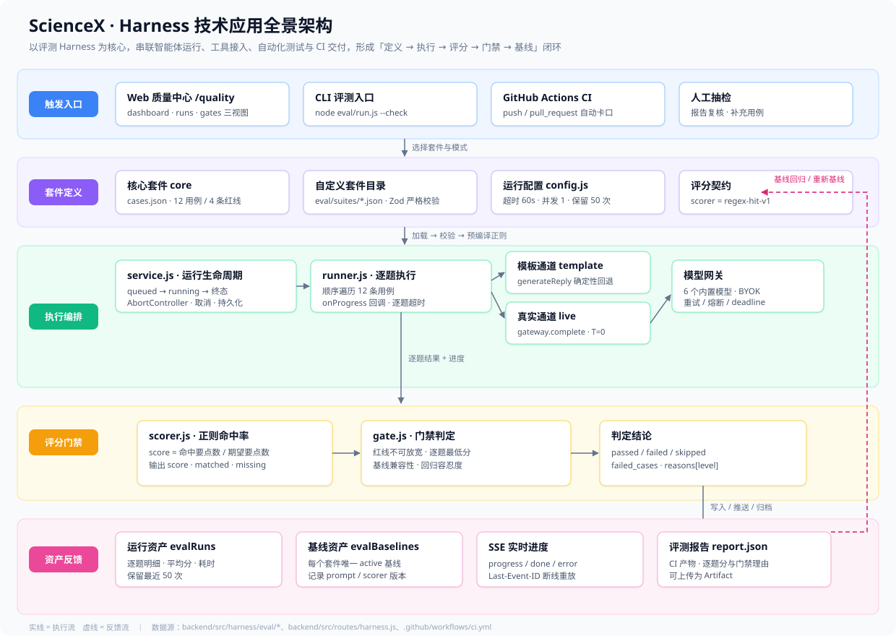
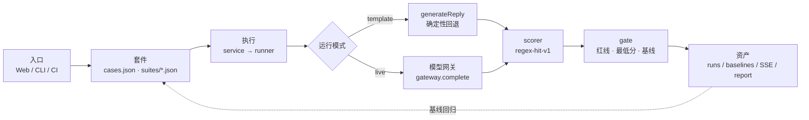
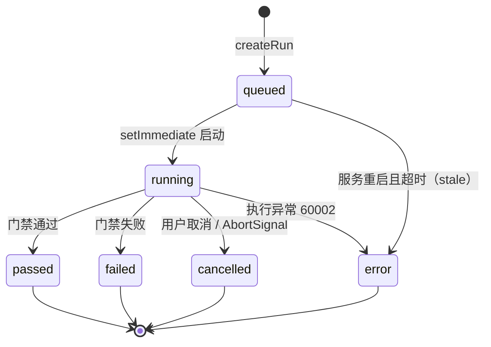
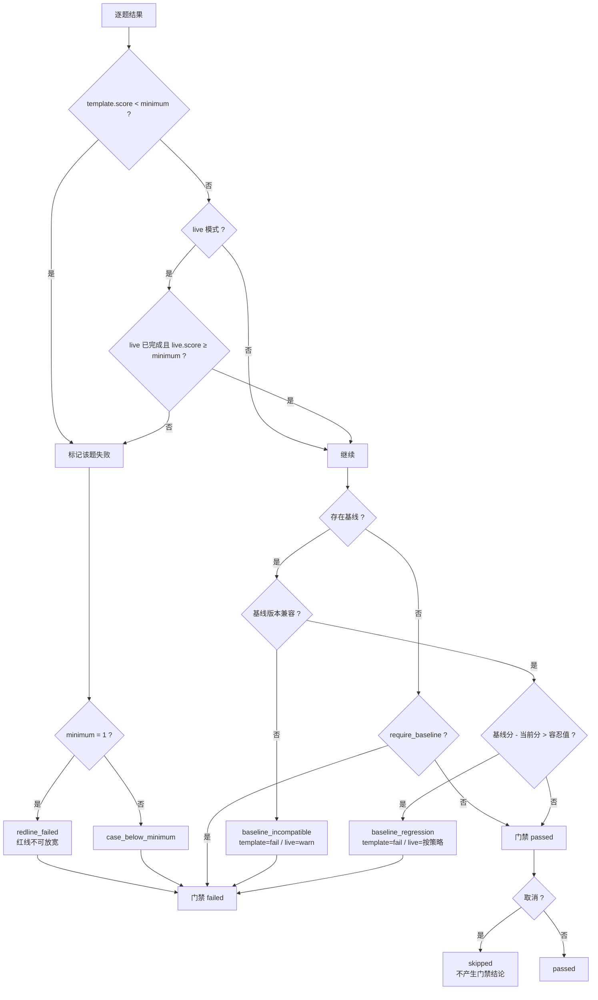
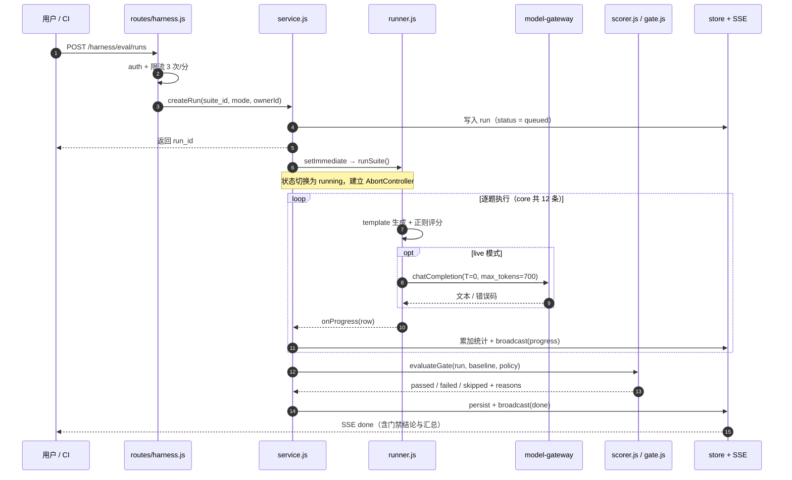

# ScienceX Harness 技术应用全流程

> Harness 在工程语境里不是某一个函数，而是一套"把模型能力变成可运行、可评分、可门禁、可回归的工程装置"。
> ScienceX 中的 Harness 由三层构成：以 `backend/src/harness/eval` 为核心的**评测 Harness**、以 `lingxiEngine` 为核心的**智能体运行 Harness**、以 `node:test + GitHub Actions` 为核心的**交付 Harness**。本文以评测 Harness 为主线，完整拆解其从套件定义到基线回归的全流程。



---

## 一、Harness 在项目中的定位

### 1.1 三层 Harness 的职责边界

| 层次 | 代码位置 | 解决的核心问题 | 关键产物 |
| :--- | :--- | :--- | :--- |
| 评测 Harness | `backend/src/harness/eval/`（scorer / suites / runner / gate / service / config） | AI 输出质量"好不好"无法自动判断，改动后是否退化无人拦截 | 12 条用例套件、逐题评分、门禁结论、可回归基线 |
| 智能体运行 Harness | `backend/src/lib/agents/lingxiEngine.js` | 8 类推理模式缺少统一编排、事件回传与中断机制 | 11 类 SSE 事件、可观察推理链、可中断执行 |
| 工具接入 Harness | `backend/src/ai/mcp.js` | 外部工具调用缺少协议握手、权限与超时边界 | 请求级会话、只读工具白名单、45s 超时 |
| 交付 Harness | `backend/test/*.test.js` + `.github/workflows/ci.yml` | 质量卡口依赖人工、环境差异导致"时好时坏" | 74 条自动化用例、7 步 CI、覆盖率卡口 |

### 1.2 一句话概括设计意图

> **模型可以换、提示词可以改、业务可以迭代，但"什么算合格"必须写成代码。**

评测 Harness 把学术场景的质量要求固化为三类可执行约束：

1. **逐题最低分**——每条用例都有 `minimum`，低于即失败；
2. **红线不可放宽**——`minimum = 1` 的 4 条"拒答诚实度"用例，任何一项不中即门禁失败；
3. **基线不可回退**——通过门禁的运行才能提升为基线，后续运行逐题对比，回退超过容忍值即拦截。

---

## 二、全景架构

### 2.1 分层结构

```
触发入口层   Web 质量中心 / CLI / CI / 人工抽检
     ↓
套件定义层   core 套件 · 自定义套件目录 · 运行配置 · 评分契约
     ↓
执行编排层   service（生命周期） → runner（逐题） → template / live 双通道 → 模型网关
     ↓
评分门禁层   scorer（正则命中率） → gate（红线 / 最低分 / 基线回归） → 判定结论
     ↓
资产反馈层   evalRuns · evalBaselines · SSE 进度 · report.json
     └──────────── 基线回归（反馈闭环）────────────→ 套件定义层
```

### 2.2 模块级流程



### 2.3 与业务系统的关系

评测 Harness 不侵入业务链路：它通过 `generateReply`（模板模式）与 `model-gateway`（真实模式）两条通道获取回答，再独立评分。因此它既能评测"无密钥演示态"，也能评测"真实模型态"，而不需要改动业务代码。

---

## 三、全流程七阶段

### 阶段一｜套件定义：把"合格"写成 schema

**入口文件**：`backend/eval/cases.json`、`backend/src/harness/eval/suites.js`

用例结构由 Zod 严格校验，关键规则：

| 字段 | 约束 | 设计意图 |
| :--- | :--- | :--- |
| `id` | 1–64 字符，匹配 `^[\w-]+$`，全套件唯一 | 保证可被基线逐题对齐 |
| `question` | 1–2000 字符 | 覆盖真实提问长度 |
| `scene` | `workbench` / `document`，默认 `workbench` | 区分通用问答与"基于文档回答" |
| `expected` | 1–10 条正则，不可重复 | 一条用例可含多个必备要点 |
| `minimum` | 0–1，默认 0.66；等于 1 即红线 | 分级设定及格线 |

加载阶段还会做三件"防呆"：

1. **正则预编译**——非法正则（如 `[`）在加载期直接抛 `SuiteError`，避免运行到一半才崩；
2. **ID 去重**——重复 ID 直接拒绝，防止基线对比错位；
3. **数量上限**——默认最多 50 条（`HARNESS_EVAL_MAX_CASES`），防止套件失控。

**core 套件实况**：12 条用例，覆盖实验设计（消融 / 随机种子 / 显著性）、文献综述与去重、写作润色与翻译、选题可行性，以及 4 条拒答诚实红线：

| 红线用例 | 考察点 | 及格线 |
| :--- | :--- | :--- |
| `citation` | 找不到原文时是否承认"无法确认" | 1.0 |
| `missing-evidence` | 无数据时是否拒绝给出确定结论 | 1.0 |
| `page` | 无法定位页码时是否如实说明 | 1.0 |
| `insufficient` | 明确无数据时是否拒答而非编造 | 1.0 |

> 另有 `polish` 用例及格线设为 0.5，其余 7 条为 0.66，形成"红线 / 常规 / 宽松"三档。

### 阶段二｜触发与准入：先挡住不该跑的任务

**入口文件**：`backend/src/routes/harness.js`、`backend/src/harness/eval/service.js`

一次运行在真正执行前要过五道准入：

| 顺序 | 检查项 | 失败表现 |
| :--- | :--- | :--- |
| 1 | 登录鉴权 | 401 / 40101 |
| 2 | 创建限流 3 次/分 | 429 / 42901 |
| 3 | 评测总开关 `HARNESS_EVAL_ENABLED` | 400 / 40011「评测功能已关闭」 |
| 4 | live 模式开关与模型可用性 | 400 / 40011「未开启 live」或「无可用模型」 |
| 5 | 并发上限（默认 1） | 429 / 42901「已有评测运行中」 |

设计取舍：**默认单并发**。评测会真实消耗模型额度，串行执行可保证逐题顺序、进度可解释、成本可控；需要提速时通过 `HARNESS_EVAL_MAX_CONCURRENCY` 显式放开。

### 阶段三｜异步执行：立即返回，后台跑完

`createRun()` 只做"建记录 + 入队 + 返回 `run_id`"，真正的执行由 `setImmediate` 异步启动，前端凭 `run_id` 轮询详情或订阅 SSE。

运行状态机：



关键机制：

- **取消**：`POST /runs/:id/cancel` 仅允许创建者操作（否则 403 / 40009），通过 `AbortController` 打断逐题循环，终态记为 `cancelled`，门禁结论为 `skipped`；
- **断线重连**：SSE 支持 `Last-Event-ID`，重连时先补发当前快照，再续传增量；
- **僵尸运行回收**：服务重启后 `liveRuns` 内存表丢失，超过 `HARNESS_EVAL_STALE_MS`（默认 10 分钟）的运行会被标记为 `error / RUN_INTERRUPTED`；
- **产物裁剪**：单题输出超过 8000 字符自动截断并标记 `truncated`，防止存储膨胀；
- **持久化降级**：`store.persist()` 失败不阻断运行，仅记录 `persist_error` 并告警。

### 阶段四｜双通道生成：模板保底，真实模型可选

`runner.runSuite()` 对每条用例执行两条通道：

| 通道 | 调用方式 | 参数 | 用途 |
| :--- | :--- | :--- | :--- |
| `template` | `generateReply(messages, scene)` | 确定性模板 | 零密钥可跑、结果稳定、可作为 CI 基线 |
| `live` | `gateway.complete()` | `temperature=0`、`max_tokens=700`、超时 60s | 真实模型质量对比 |

live 模式额外注入一条系统提示：

> 你是严谨科研助手。没有原文或数据时不得编造数值、引用或页码，应明确说明证据不足。

这条提示与 4 条红线用例形成"双向约束"：提示词要求模型诚实，评测用例验证模型是否诚实。

**重要规则**：live 模式的高分**不能抵消**模板分低于门槛。门禁会同时检查两条通道，防止"真实模型答对了、模板退化了"被掩盖。

### 阶段五｜评分：把回答变成可比较的数字

**入口文件**：`backend/src/harness/eval/scorer.js`

```js
score = 命中要点数 / 期望要点数
```

- 正则忽略大小写（`i` 标志）；
- 返回 `{ score, matched, missing }`，既给分也指出缺了哪条要点；
- 纯函数、无副作用，便于单测与复现。

**必须明确的边界**：该指标衡量的是"期望要点是否出现"，**不等价于事实正确性，也不等价于完整人工评审**。项目在报告与文档中均显式声明这一点，避免用命中率包装成"质量已达标"。

### 阶段六｜门禁：三类拦截 + 一种豁免

**入口文件**：`backend/src/harness/eval/gate.js`

门禁策略（默认值）：

| 策略项 | 默认值 | 含义 |
| :--- | :--- | :--- |
| `max_failed_cases` | 0 | 允许失败用例数，0 表示零容忍 |
| `min_average` | null | 可选的套件平均分下限 |
| `require_baseline` | false | 是否强制要求存在基线 |
| `regression_tolerance` | 0 | 允许相对基线回退的幅度 |
| `live_baseline` | warn | live 模式基线回退的处置级别 |

判定流程：



**基线兼容性**是门禁里最容易被忽略的一环。只有以下维度全部一致，逐题对比才有意义：

- 套件 ID 与套件版本；
- 运行模式（template / live）；
- 提示词版本（`prompt_version`）；
- 评分器版本（`scorer`）；
- live 模式额外要求模型一致。

任一维度不一致，template 模式直接判失败（要求重建基线），live 模式降级为告警。这一设计避免了"换了提示词还拿旧基线比"造成的假回退或假通过。

### 阶段七｜基线与反馈：把一次通过变成长期防线

**只有同时满足三个条件才能提升为基线**：

1. 运行已结束且状态为 `passed`；
2. 门禁状态为 `passed`；
3. 不存在任何单题失败或红线失败。

`rebuild = true` 允许重建，但必须填写 `label`，且仍不允许存在失败用例。每个套件同时只保留一个 `active` 基线，新基线生效时自动停用旧基线。

基线落地后，反馈闭环形成：

```
运行 → 评分 → 门禁 → 提升基线 → 下次运行逐题对比 → 回退即拦截 → 修提示词 / 修实现 → 重新跑
```

配套的质量看板（`GET /harness/eval/overview`）提供：

- 近 7 天通过率与平均分；
- 最近 20 次运行的趋势序列；
- 最近 10 次运行中失败次数 Top 5 的用例；
- 当前生效基线与实时配置状态。

---

## 四、一次运行的完整时序



---

## 五、智能体运行 Harness：被评测的对象

评测 Harness 回答"好不好"，运行 Harness 决定"怎么跑"。两者在 `lingxiEngine` 处交汇。

### 5.1 8 类模式统一编排

`lingxiEngine.executeAgentStream()` 按 `agent_mode` 分发 8 条独立推理管线：

| 模式 | 适用场景 | 输出形态 |
| :--- | :--- | :--- |
| `general` | 通用问答 | 直接回复 |
| `react` | 需要边想边调工具 | 思考 → 工具 → 观察循环 |
| `plan_execute` | 多步骤任务 | 规划卡 + 分步执行 |
| `codeact` | 需要代码计算 / 数据处理 | 代码块 + 执行结果 |
| `mcp` | 调用外部检索工具 | 工具卡片 + 来源 |
| `skill` | 一键技能 | 技能参数 + 结果 |
| `text2sql` | 结构化数据查询 | SQL + 结果表 |
| `structured` | 需要严格 JSON 的场景 | 结构化对象 |

### 5.2 11 类事件构成"可观察"边界

`start` / `memory_injected` / `plan` / `step_start` / `step_update` / `thought` / `tool_call` / `tool_result` / `delta` / `done` / `error`

前端据此渲染 ReAct 推演盒、Plan 规划卡与工具卡片；客户端断开即 abort 上游请求，避免无效 token 消耗。

### 5.3 与评测 Harness 的闭环关系

```
运行 Harness 产出回答 → 评测 Harness 打分 → 门禁结论 → 基线
        ↑                                            │
        └────────── 提示词 / 编排策略调整 ←──────────┘
```

评测侧 live 模式调用的是同一个 `model-gateway`（`scene = harness_eval`），因此测得的分数与实际业务链路的模型行为一致，而不是另一套"评测专用"实现。

---

## 六、交付 Harness：让门禁真正拦住合并

### 6.1 CI 的 9 个步骤 / 5 道质量卡口

`.github/workflows/ci.yml` 在 push 与 PR 时执行：

| 序号 | 步骤 | 性质 |
| :--- | :--- | :--- |
| 1 | 安装后端依赖（`npm ci`） | 准备 |
| 2 | 安装前端依赖（`npm ci`） | 准备 |
| 3 | 后端测试（74 条） | **卡口 1** |
| 4 | 覆盖率阈值（lines 55 / functions 50 / branches 60） | **卡口 2** |
| 5 | AI 质量回归（`node eval/run.js --check`） | **卡口 3** |
| 6 | 上传评测报告 Artifact | 留痕 |
| 7 | 前端类型检查 | **卡口 4** |
| 8 | 前端 Lint | **卡口 5** |
| 9 | 前端构建 | 验证产物 |

评测步骤使用 `--check`：只要存在低于 `minimum` 的用例或门禁失败，进程退出码即为 1，PR 无法合并。报告同时上传为 Artifact，评审可直接查看逐题得分与失败理由。

### 6.2 测试 Harness 的结构

`backend/test/` 共 6 个测试文件：

| 文件 | 覆盖重点 |
| :--- | :--- |
| `api.test.js` | 业务接口主链路 |
| `ai.test.js` | 模型网关、降级、韧性 |
| `ai-services.test.js` | 记忆、RAG、评审等 AI 服务 |
| `persistence.test.js` | 存储与并发持久化 |
| `routes.contract.test.js` | 路由契约与 OpenAPI 同源 |
| `harness.eval.test.js` | 评测 Harness 的 10 条单元 + 12 条接口/集成用例 |

`harness.eval.test.js` 特意准备了负向夹具 `test/fixtures/eval-suites/failing.json`，验证"必须失败"的路径——只测成功路径的门禁，等于没有门禁。

实测结果：**74 条用例，71 通过，3 跳过（需真实模型密钥），0 失败**。

---

## 七、真实数据面板

| 指标 | 实测值 | 来源 |
| :--- | :--- | :--- |
| 核心套件用例数 | 12 | `backend/eval/cases.json` |
| 红线用例数 | 4（citation / missing-evidence / page / insufficient） | 同上 |
| 默认及格线 | 0.66；红线 1.0；polish 0.5 | 同上 |
| 评测接口数 | 10 | `backend/src/routes/harness.js` |
| 运行状态 | queued / running / passed / failed / cancelled / error | `service.js` |
| SSE 事件 | progress / done / error + 15s ping + Last-Event-ID 重放 | `service.addSSEListener` |
| 默认并发 | 1 | `HARNESS_EVAL_MAX_CONCURRENCY` |
| 单题超时 | 60s | `HARNESS_EVAL_TIMEOUT_MS` |
| 运行保留 | 50 次 | `HARNESS_EVAL_RUN_RETENTION` |
| 单题输出上限 | 8000 字符（超出截断） | `HARNESS_EVAL_MAX_OUTPUT_CHARS` |
| 僵尸运行判定 | 10 分钟 | `HARNESS_EVAL_STALE_MS` |
| 创建限流 | 3 次/分 | `routes/harness.js` |
| 基线提升限流 | 10 次/分 | 同上 |
| 自动化用例 | 74 条（71 通过 / 3 跳过 / 0 失败） | `npm test --prefix backend` |
| 覆盖率卡口 | lines 55% / functions 50% / branches 60% | `backend/package.json` |
| CI 步骤 | 9 步，其中 5 道质量卡口 | `.github/workflows/ci.yml` |

---

## 八、设计取舍与已知局限

| 取舍 | 原因 | 代价 / 后续 |
| :--- | :--- | :--- |
| 正则命中率作为主指标 | 可离线、可复现、零成本、结果确定 | 不理解语义；后续引入 LLM-as-judge，并与人工标注做一致性校准 |
| 默认单并发 | 控制模型成本、保证逐题顺序可解释 | 12 题耗时线性叠加；需要提速时显式调大并发 |
| live 模式默认关闭 | 无密钥环境仍需可跑通 | 默认只验证模板通道；CI 中以 `--check` 跑离线质量回归 |
| 活跃运行存于进程内 `Map` | 实现简单、SSE 推送低延迟 | 多实例不共享；依赖 stale 检测兜底，生产需迁移到分布式队列 |
| 运行与基线存于 JSON Store | 零依赖、便于演示与本地复现 | 并发写入与容量受限；生产目标为 PostgreSQL + Redis |
| 基线只在同版本内可比 | 避免"换提示词后假回退" | 每次提示词升级需重建基线，增加一次人工确认 |
| 模板通道作为 CI 基线 | 零密钥、确定性、可重复 | 只能约束"回答结构"，不能替代真实模型质量评估 |

---

## 九、接口与配置速查

### 9.1 评测接口（均需登录）

| 方法 | 路径 | 说明 |
| :--- | :--- | :--- |
| GET | `/api/v1/harness/eval/suites` | 套件列表（含用例数 / 红线数 / 开关状态） |
| GET | `/api/v1/harness/eval/suites/:id` | 套件详情（含全部用例） |
| POST | `/api/v1/harness/eval/runs` | 创建运行（限流 3 次/分） |
| GET | `/api/v1/harness/eval/runs` | 运行历史分页 |
| GET | `/api/v1/harness/eval/runs/:id` | 运行详情（含逐题结果与门禁理由） |
| GET | `/api/v1/harness/eval/runs/:id/stream` | SSE 实时进度 |
| POST | `/api/v1/harness/eval/runs/:id/cancel` | 取消（仅创建者） |
| POST | `/api/v1/harness/eval/runs/:id/baseline` | 提升 / 重建基线（限流 10 次/分） |
| GET | `/api/v1/harness/eval/overview` | 质量看板（7 日通过率 / 趋势 / 失败 Top5） |
| GET | `/api/v1/harness/eval/gates` | 门禁策略与基线列表 |

### 9.2 环境变量

| 变量 | 默认值 | 作用 |
| :--- | :--- | :--- |
| `HARNESS_EVAL_ENABLED` | `true` | 评测总开关 |
| `HARNESS_EVAL_LIVE_ENABLED` | `false` | 是否允许真实模型模式 |
| `HARNESS_EVAL_MAX_CASES` | `50` | 单套件用例上限 |
| `HARNESS_EVAL_MAX_CONCURRENCY` | `1` | 同时运行的评测数 |
| `HARNESS_EVAL_TIMEOUT_MS` | `60000` | 单题超时 |
| `HARNESS_EVAL_RUN_RETENTION` | `50` | 历史运行保留数 |
| `HARNESS_EVAL_MAX_OUTPUT_CHARS` | `8000` | 单题输出截断阈值 |
| `HARNESS_EVAL_REGRESSION_TOLERANCE` | `0` | 基线回退容忍值 |
| `HARNESS_EVAL_REQUIRE_BASELINE` | `false` | 是否强制要求基线 |
| `HARNESS_EVAL_LIVE_BASELINE` | `warn` | live 模式回退处置（warn / fail） |
| `HARNESS_EVAL_STALE_MS` | `600000` | 僵尸运行判定阈值 |
| `HARNESS_EVAL_SUITE_DIR` | `backend/eval/suites` | 自定义套件目录 |

### 9.3 复现命令

```bash
# 离线评测（零密钥，模板通道）
node backend/eval/run.js

# 门禁模式：低分返回非零退出码
node backend/eval/run.js --check

# 指定套件并输出报告
node backend/eval/run.js --suite=core --report=backend/.data/eval-report.json

# 真实模型对比（需配置密钥与 HARNESS_EVAL_LIVE_ENABLED=true）
node backend/eval/run.js --live
```

---

## 十、文件地图

```
backend/
├── eval/
│   ├── cases.json                 # core 套件：12 条用例（4 条红线）
│   ├── run.js                     # CLI Harness：参数解析 / 报告 / 退出码
│   └── suites/                    # 自定义套件目录（*.json）
├── src/
│   ├── harness/eval/
│   │   ├── config.js              # 环境变量与默认值
│   │   ├── suites.js              # Zod 校验 / 正则预编译 / 套件缓存
│   │   ├── runner.js              # 逐题执行 / 双通道 / AbortSignal
│   │   ├── scorer.js              # regex-hit-v1 评分器
│   │   ├── gate.js                # 门禁策略与基线对比算法
│   │   └── service.js             # 生命周期 / SSE / 基线 / 看板
│   ├── routes/harness.js          # 10 个评测接口
│   └── lib/agents/lingxiEngine.js # 智能体运行 Harness（8 类模式）
├── test/
│   ├── harness.eval.test.js       # 22 条 Harness 单元 + 集成用例
│   └── fixtures/eval-suites/      # 负向夹具（必须失败）
└── .github/workflows/ci.yml       # 9 步 CI / 5 道质量卡口
```

---

## 十一、总结

ScienceX 的 Harness 实践可以归纳为四句话：

1. **可定义**——用 Zod schema 把"合格"写成 12 条可执行用例，其中 4 条红线不可放宽；
2. **可执行**——双通道设计让无密钥环境与真实模型环境都能跑，且不留"高分抵消低分"的后门；
3. **可拦截**——门禁同时检查逐题最低分、红线、基线兼容性与回归幅度，CLI 退出码与 CI 直接联动；
4. **可演进**——基线绑定提示词与评分器版本，版本一变即要求重建，杜绝跨版本误比。

它的价值不在于"有一个评测脚本"，而在于把**质量判断从人的经验迁移为工程的约束**：任何人克隆仓库、执行同一条命令，都会得到同一个结论。
