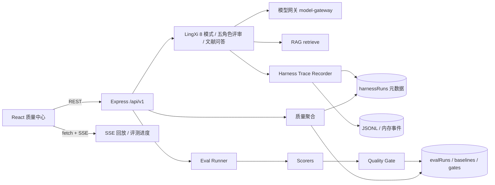
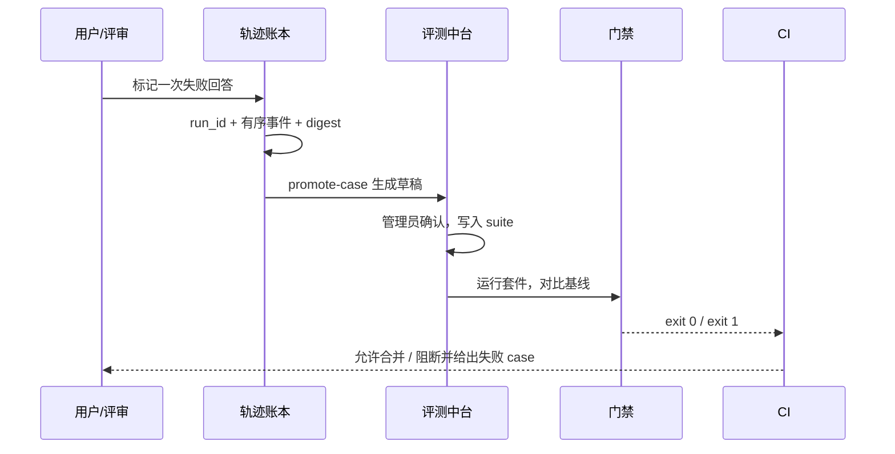

# ScienceX Harness 方案设计

> 文档定位：面向技术评审与面试讲解的 Harness 落地方案，不写概念科普，只讨论本项目可执行的增量。
>
> 范围限定：AI Agent 运行编排、评测集与质量门禁、轨迹记录与回放、可观测性。
>
> 事实基线：以当前仓库代码为准。文中所有“现状”均可在 `backend/src`、`backend/eval`、`frontend/src` 中找到对应实现；所有“新增”均标注了落点文件，不把规划写成既成事实。
>
> 一句话结论：**先做可证据化的运行轨迹，再把评测从脚本升级为带基线与门禁的评测中台；多智能体评审校准作为垂直扩展，而不是第一步就重写 Agent 运行时。**

---

## 0. 结论先行

### 0.1 三个方案与推荐顺序

| 方案 | 一句话定位 | 主战场 | 首期投入（1 名熟悉代码库的全栈） | 推荐角色 |
| :--- | :--- | :--- | :--- | :--- |
| 方案一 `TraceLedger` | 把每次 Agent 运行变成可检索、可回放、可转评测用例的证据链 | 轨迹记录与回放、单次运行可观测 | 9–11 人日 | 推荐方案的 Phase 0 基座 |
| 方案二 `EvalOps` | 把现有 12 条离线评测升级为可编排、可对比、可门禁的评测流水线 | 评测集、评分器、基线、CI 质量门禁 | 15–18 人日（含最小轨迹底座） | **首选主方案** |
| 方案三 `CouncilHarness` | 用黄金稿件和人工基线校准五角色评审团是否真的更可靠 | 多智能体评审编排、角色校准、冲突检测 | 17–21 人日 | 评审域的垂直加分项 |

**推荐路线：方案二为主，方案一只做最小轨迹底座（约 2–3 人日）前置，方案三在方案二稳定后增量接入。**

这不是“三套都做”。推荐路线分两段交付：

1. 轨迹底座：让对话、评审、文献问答三类运行都有 `run_id`、事件序列和可回放记录；
2. 评测中台：复用现有 `eval/run.js` 与 12 条用例，增加套件、评分器、基线、门禁、报告；
3. 质量中心前端：一个入口下分“运行轨迹 / 评测与门禁 / 评审校准 / 质量看板”四个 Tab。

以上 1–3 构成首期 Phase 0–2，合计 15–18 人日。**Phase 3 增量**再接入评审校准：复用评测中台的数据模型，只增加 `council-rubric` 套件和校准视图，增量约 8–10 人日。

### 0.2 为什么不是“直接上 LangSmith / 自建全链路平台”

| 选择 | 对本项目的现实问题 |
| :--- | :--- |
| 接第三方 LLM 可观测 SaaS | 论文正文、提示词、课题组记忆属于敏感数据；演示环境需要无外网也能跑；引入账号、额度和网络依赖，和“无密钥可演示”的现有约束冲突 |
| 直接上 OpenTelemetry + Collector | 需要额外基础设施与运维；当前是 Node/Express + JSON Store 的演示形态，收益与成本不匹配 |
| 重写 Agent 运行时 | `lingxiEngine.js` 的 8 种模式、SSE 事件、回退逻辑已经稳定；一次性重写会把“演示不崩”的现有优势变成风险 |
| 只做前端看板 | 没有真实轨迹与门禁数据，看板会退化成演示图；面试官追问“数据从哪来”时无法自证 |

### 0.3 本文的三条硬约束

1. **不虚构指标**：没有实测数据就显示“样本不足”；没有人工基线就不计算“准确率”，只报一致性。
2. **不破坏现有链路**：现有 SSE 事件协议、`eval/run.js --check`、CI 现有五个语义阶段、无密钥回退必须继续工作。
3. **不引入重依赖**：首期只使用现有 `express`、`zod`、`pino`、`c8` 和 Node 内置能力；第三方可观测平台只保留适配器接口，不作为交付前提。

---

## 1. 现状基线：项目已经有什么，缺什么

### 1.1 已有能力（代码证据）

| 能力 | 现有实现 | 当前事实 | 对 Harness 的价值 |
| :--- | :--- | :--- | :--- |
| Agent 运行编排 | `backend/src/lib/agents/lingxiEngine.js` | 支持 `general`、`react`、`plan_execute`、`codeact`、`mcp`、`skill`、`text2sql`、`structured` 八种模式；统一 `send()` 输出 `start / memory_injected / plan / step_start / step_update / thought / tool_call / tool_result / delta / fallback / done / error`；客户端断开时 `AbortController` 中止上游调用；累计真实 token 用量 | 已有天然的事件边界，适合直接做轨迹记录，不需要重写编排 |
| 多智能体评审 | `backend/src/routes/publish.js` | `POST /review/council` 创建评审任务；5 个角色 Agent 并行评审 + 主席合议；`GET /tasks/:id/stream` 推送 `progress` 与 `agent` 事件；`reviewReports` 持久化最终报告；单角色失败回退示例意见 | 已有“角色事件”和“任务事件”两种可观测粒度，适合做评审轨迹与校准 |
| RAG | `backend/src/ai/rag.js`、`backend/src/routes/documents.js` | 优先向量余弦检索，Embedding 不可用降级为词法检索；文献问答 `topK=5`、候选 12；返回 `mode / degraded / reranked / warning`；通过 `reference` 事件返回 `doc_id / chunk_id / page / section / page_verified / score` | 评测可以断言“引用完整性”和“空检索不编造”，而不是只看回答文本 |
| 离线评测 | `backend/eval/run.js`、`backend/eval/cases.json` | 12 条用例；正则命中率评分；逐题 `minimum`；默认离线模板，`--live` 显式调用真实模型；`--check` 低分非零退出；报告带 `prompt_version`；CI 已执行 `node backend/eval/run.js --check` | 已有最小可用评测骨架，方案二是在其上做“产品化”，不是从零造 |
| 可观测性 | `backend/src/lib/logger.js`、`backend/src/ai/usage.js`、`backend/src/server.js` | `X-Request-Id` 全链路透传；pino 结构化日志；`observeAI` 记录调用耗时与结果；`usageRecords` 记录模型、场景、token、费用状态；日志默认脱敏 `authorization / token / password / api_key` | 已有请求级与调用级观测，缺的是“运行级事件序列”和“质量聚合” |
| 存储 | `backend/src/lib/store.js`、`backend/src/lib/persistence.js` | JSON Store 落 `.data/store.json`；`persistedCollections` 明确列出持久化集合；写临时文件再原子重命名；只读环境失败由调用方告警，不阻断回复 | 新增集合的落点明确；也决定了轨迹正文不能无脑塞进 `store.json` |
| API 契约 | `backend/src/lib/router.js`、`backend/shared/api-schemas.js`、`backend/src/lib/openapi.js` | 路由注册时自动匹配 zod 契约；`GET /api/v1/openapi.json` 由契约与注册信息生成 | 新接口可以保持“运行时校验 + OpenAPI 文档”同源 |
| 前端 | `frontend/src/router/index.tsx`、`frontend/src/layouts/AppLayout.tsx`、`frontend/src/components/ui.tsx`、`frontend/src/styles/tokens.css` | React 18 + Vite + HashRouter；懒加载路由；左侧分组导航；`Card / StatRow / Tabs / Tag / EmptyState / ErrorState / LoadingBlock / Skeleton / Modal / Confirm / useToast` 等通用组件；绿色品牌色与暗色侧边栏 | 新页面可以复用现有组件与设计语言，不需要引入 UI 框架 |
| SSE 客户端 | `frontend/src/api/client.ts` | `readSSE` 统一解析事件；`fetchWithAuth` 处理 401 刷新；每条流独立 `Last-Event-ID` 游标；支持 `AbortSignal`；`taskStream` 自带断线重连 | 轨迹回放与评测进度可以直接复用这套解析与重连能力 |

### 1.2 真实缺口（不回避）

| 缺口 | 现状证据 | 造成的问题 | 对应方案 |
| :--- | :--- | :--- | :--- |
| 对话运行没有持久轨迹 | 聊天只把最终 user/assistant 消息写入 `conversation.messages`；`done` 后没有任何步骤、工具、引用、回退原因的落盘 | 用户说“这次回答不对”时，无法还原它看过哪些记忆、调了哪个工具、在哪一步降级 | 方案一 |
| 任务事件只活在内存 | `store.tasks` 是 `Map`，未进入 `persistedCollections`；进程重启或 Serverless 冷启动后事件丢失 | 评审任务、文献任务无法跨实例复盘 | 方案一 |
| `Last-Event-ID` 覆盖不全 | 后端目前只有 `GET /tasks/:id/stream` 实现了 `Last-Event-ID` 游标；`/chat/completions` 的 SSE 没有断点续传与服务端事件回放 | 对话断线后只能重开一轮，不能补齐缺失事件 | 方案一 |
| 评测只有 CLI | `eval/run.js` 输出 JSON 到 stdout；没有历史记录、没有套件管理、没有前端 | 质量结论不可视、不可对比；面试演示只能跑终端 | 方案二 |
| 门禁只有单题最低分 | `cases.json` 每題有 `minimum`，但没有 blocker 级别、没有基线回归容忍、没有 schema/引用完整性/回退率门禁 | 平均分可能掩盖一条“该拒答却编造”的红线失败 | 方案二 |
| 评测覆盖偏学术诚信 | 现有 12 条集中在学术严谨与拒答诚实；Agent JSON 契约、RAG 引用完整性、评审角色 rubric 没有进入回归 | 改了 `lingxiEngine` 或评审提示词，CI 不一定能发现行为回退 | 方案二 |
| 没有线上质量观测 | 目前只有用量与错误率；`docs/面试.md` 的 Q46 已明确承认“还没有质量监控” | 降级率、检索降级率、评审回退率突然升高时，没有告警与趋势 | 方案二 / 方案三 |
| 评审团没有校准 | `reviewReports` 保存角色分数与意见，但报告里 `conflicts: []` 是空数组；没有人工基线、角色边界检查、评审一致性指标 | 无法回答“五个 Agent 一定比一个好吗”；冲突分析目前只是页面文案，不是后端能力 | 方案三 |
| 运行不能转用例 | 现有 `eval/cases.json` 靠手写；一次真实失败无法一键沉淀为回归用例 | 评测集不增长，线上踩过的坑可能再踩 | 方案一 + 方案二 |
| 轨迹内容没有隐私分级 | 当前日志默认脱敏密钥，但没有“论文正文/提示词/记忆是否落盘”的统一策略 | 直接做全量轨迹会把敏感内容写进磁盘 | 方案一 |

### 1.3 设计约束

| 约束 | 具体表现 | 对方案的要求 |
| :--- | :--- | :--- |
| 技术栈 | Node 18 + Express 4；前端 React 18 + Vite + HashRouter；已有 `zod`、`pino`、`c8` | 不引入新框架；新接口沿用 `createRouter` + zod 契约 |
| 存储形态 | 演示环境 JSON Store；Vercel Serverless 文件系统只读；`persist()` 失败只告警 | 轨迹正文不能默认进 `store.json`；写文件失败必须降级为内存并如实标注 |
| SSE 协议 | 对话、任务、文献问答都走 SSE；前端用 `fetch` + `readSSE`，不用 `EventSource` | 回放与评测进度继续走 SSE；鉴权走 `Authorization`，不要把 token 拼进 URL |
| 演示环境 | 无模型密钥时必须可演示；现有代码有完整模板回退 | 评测的 CI 主路径必须是离线确定性；`live` 只能显式开启 |
| 长任务 | Vercel 函数有时长限制；评审 5 路并行 + 主席合议属于长任务 | 在线 UI 只跑小套件；长校准任务在本地/常驻 Node 运行，结果回传展示 |
| 现有 UI | `AppLayout` 三组导航；页面最大宽度 1460（`.page`）；绿色品牌色；通用状态组件齐全 | 新增一个“质量中心”入口即可，不新增三套侧边栏；样式用 `sx-harness-` 命名空间 |
| 隐私 | 论文正文、课题组记忆、提示词、模型密钥 | 默认只存摘要与 digest；全文轨迹必须显式开启；日志继续脱敏 |

---

## 2. Harness 目标架构

### 2.1 四层能力，而不是一个“大平台”

| 层 | 解决的问题 | 本项目落点 | 关键产物 |
| :--- | :--- | :--- | :--- |
| 运行编排层 | 一次任务由哪些步骤、工具、子 Agent 组成，失败如何重试/取消 | `lingxiEngine` 的 8 模式；`publish.js` 的五角色 + 主席；`documents.js` 的检索问答 | `run_id`、`span_id`、步骤状态、超时/重试/取消 |
| 评测与门禁层 | 怎么证明改动没有变差，差到什么程度不允许合并 | `eval/run.js` + 新增 suite/scorer/gate | 套件、用例、评分器、基线、门禁结论、CI 退出码 |
| 轨迹与回放层 | 一次运行到底发生了什么，能否复现与对比 | 新增 trace recorder + replay SSE | 有序事件、游标、回放、导出、转用例 |
| 可观测层 | 整体质量是否在漂移，哪里在退化 | `harnessRuns` / `evalRuns` 聚合 + 现有 usage/log | 降级率、回退率、p95 耗时、门禁通过率、趋势 |

### 2.2 目标架构图



### 2.3 三条设计原则

1. **在边界埋点，不改写核心**：优先在路由/任务层包装 `send()`、`emitAgent()`、`streamText()`，而不是把 8 种 Agent 模式逐个重写。
2. **离线确定性优先，真实模型显式开启**：CI 只跑离线模板与固定 fixture；`--live` 和在线评测必须由人触发，并显示成本提示。
3. **降级必须可见**：无密钥、Embedding 不可用、评审角色回退、轨迹只读降级，都要在数据里标记、在 UI 上显示，而不是静默吞掉。

### 2.4 三种方案的能力权重

| 能力 | 方案一 TraceLedger | 方案二 EvalOps | 方案三 CouncilHarness |
| :--- | :--- | :--- | :--- |
| Agent 运行编排 | 观测为主，不改写 | 评测编排，轻量适配 | 抽取评审编排，补超时/重试/冲突 |
| 评测集与质量门禁 | 复用现有 12 条，支持运行转用例 | 核心：多套件 + 基线 + 门禁 | 黄金稿件 + 角色 rubric + 校准 |
| 轨迹记录与回放 | 核心 | 作为评测证据 | 评审过程回放 |
| 可观测性 | 单次运行可解释 | 评测趋势 + 门禁 | 多智能体一致性与校准指标 |
| 前端入口 | 轨迹列表 / 时间线 / 回放器 | 质量中心 / 套件 / 报告 / 门禁配置 | 评审校准实验室 |

---

## 3. 方案一：TraceLedger（Agent 运行轨迹账本）

### 3.1 方案名称、定位与要解决的痛点

**名称**：`TraceLedger` · Agent 运行轨迹账本

**一句话定位**：把每一次 Agent 运行变成可检索、可回放、可转评测用例的证据链。

**它要解决的现有痛点**：

1. 聊天只保存最终消息，步骤、工具、引用、回退原因全部随 SSE 流消失；用户说“这次回答不对”时无法复盘。
2. `store.tasks` 只在内存里，评审任务和文献任务跨进程/冷启动后无法回看；现有 `Last-Event-ID` 只覆盖任务流，不覆盖对话流。
3. 前端已经展示 `plan / step / thought / tool / reference / fallback`，但这些事件没有统一 `run_id`，无法把“界面看到的过程”与“后端实际执行”对齐。
4. 一次真实失败无法一键沉淀为评测用例，评测集只能靠手写。

**它不是什么**：不是重新调用模型“重跑一遍”，也不是全链路 APM。回放是**事件回放**，不是模型再推理；两者的确定性、成本和语义必须在 UI 上明确区分。

### 3.2 Harness 能力如何嵌入现有系统

#### 3.2.1 新增模块

| 模块 | 职责 | 关键导出 |
| :--- | :--- | :--- |
| `backend/src/harness/trace.js` | 运行上下文、事件规范化、状态推导、内容脱敏 | `startRun / record / finish / toPublicRun` |
| `backend/src/harness/runStore.js` | 事件存储适配器：JSONL 文件优先，失败退内存 | `createRunStore / append / readEvents / listRuns / prune` |
| `backend/src/harness/access.js` | 质量中心写操作的管理员白名单 | `requireHarnessAdmin` |
| `backend/src/routes/harness.js` | 轨迹查询、回放、导出、转用例草稿 | REST + SSE 路由 |
| `backend/src/harness/overview.js` | Phase 2 的聚合指标（降级率、p95、回退率） | `buildOverview` |

#### 3.2.2 改造点

| 文件 | 改造 | 目的 |
| :--- | :--- | :--- |
| `backend/src/lib/agents/lingxiEngine.js` | 在 `executeAgentStream` 中创建 run，包装 `send()` 记录每个事件；`done/error/abort` 时 finalize；返回值增加 `runId` | 覆盖 8 种 Agent 模式，不改各模式内部逻辑 |
| `backend/src/routes/chat.js` | 把 `runId` 写入 assistant 消息；非流式响应也返回 `run_id` | 历史消息可以一键跳到轨迹 |
| `backend/src/routes/publish.js` | 创建评审任务时创建 `kind='council'` 的 run；`emitAgent` 记录角色事件；报告增加 `run_id`；任务结束 finalize | 评审团过程可回放、可校准 |
| `backend/src/routes/documents.js` | 文献问答创建 `kind='doc_qa'` 的 run；记录 `retrieval` 元数据与 `reference` 事件；结束 finalize | RAG 引用可追溯 |
| `backend/src/lib/store.js` | 新增 `harnessRuns` 集合并加入 `persistedCollections`；事件正文不进 `store.json` | 元数据持久化，避免 Store 膨胀 |
| `backend/src/server.js` | 挂载 `/api/v1/harness`；对写接口加独立限流 scope | 与现有路由/限流风格一致 |
| `backend/shared/api-schemas.js` | 增加 harness 查询参数与 body 契约 | 运行时校验与 OpenAPI 同源 |

#### 3.2.3 运行与事件模型

一次用户任务对应一个 `HarnessRun`；`plan` 的每个步骤、`tool_call`、`reference`、评审角色对应一个 `span`；每个 SSE 事件对应一条 `HarnessEvent`。

```json
{
  "id": "run_01J8Z3K4",
  "kind": "chat",
  "status": "degraded",
  "source": "live",
  "user_id": "u1",
  "project_id": "p1",
  "conversation_id": "c_1024",
  "agent_mode": "plan_execute",
  "model": "DeepSeek V4.1 Flash",
  "prompt_version": "2026-10-04.v1",
  "started_at": "2026-10-23T08:12:31.120Z",
  "finished_at": "2026-10-23T08:12:38.640Z",
  "duration_ms": 7520,
  "fallback": true,
  "error_code": null,
  "usage": { "prompt_tokens": 1200, "completion_tokens": 640, "total_tokens": 1840 },
  "retrieval": { "mode": "keyword-fallback", "degraded": true, "reranked": false, "refs": 3 },
  "input_digest": "sha256:...",
  "input_preview": "如何设计模块消融实验……",
  "output_digest": "sha256:...",
  "output_preview": "实验设计建议：……",
  "event_count": 42,
  "durability": "file",
  "tags": ["plan_execute", "fallback"]
}
```

`HarnessEvent` 统一为：

```json
{ "run_id": "run_01J8Z3K4", "seq": 12, "ts": "2026-10-23T08:12:33.001Z", "type": "tool_result", "span_id": "step_2", "payload": {}, "truncated": false }
```

SSE 事件到轨迹类型的映射：

| SSE 事件 | 轨迹类型 | 默认保存内容 | 说明 |
| :--- | :--- | :--- | :--- |
| `start` | `run.start` | model、agent_mode、prompt_version | 不含用户原文 |
| `memory_injected` | `memory.injected` | 条数、key 列表、摘要 digest | 默认不存事实正文 |
| `plan` | `plan.update` | 标题、步骤 id/title/tool/status | 不存完整步骤 desc |
| `step_start / step_update` | `step.start / step.update` | 步骤 id、工具、状态、耗时 | 用于时间线 |
| `thought` | `thought` | 前 160 字 + digest | 推理文本按 `HARNESS_TRACE_CONTENT` 截断 |
| `tool_call / tool_result` | `tool.call / tool.result` | 工具名、参数摘要、结果摘要 | 论文摘要等外部内容只存 preview |
| `reference` | `retrieval.reference` | doc_id、page、page_verified、score | 不存原文片段 |
| `delta` | `delta.stats` | chunk 数、字符数、首尾时间 | 默认不逐 token 落盘 |
| `fallback` | `run.degraded` | code、message | 降级原因 |
| `done` | `run.finish` | usage、fallback、status | 最终状态 |
| `error` | `run.error` | error code、message | 错误分类 |
| `agent` | `agent.status` | role、status、score、comments preview | 评审角色事件 |

状态推导规则：

1. 收到 `error` 且没有正文 → `failed`；
2. 客户端断开或 `AbortController` 触发 → `aborted`；
3. `fallback=true` 或出现 `fallback` 事件 → `degraded`；
4. 其余正常结束 → `success`。

#### 3.2.4 数据流

```text
浏览器 POST /chat/completions
  → chat.js 校验与鉴权
  → lingxiEngine.executeAgentStream
  → trace.startRun({ kind:'chat', agent_mode, model, ... })
  → 每个 send(event,data) 先 trace.record(event,data)，再写 SSE
  → done/error/abort 时 trace.finish({ status, usage, fallback })
  → 元数据写 store.harnessRuns；事件写 .data/harness/runs/<run_id>.jsonl（失败退内存）
  → 前端 onStart 拿到 run_id，消息底部出现“轨迹”入口
```

评审与文献问答同理，只是 `kind` 分别是 `council` 与 `doc_qa`；评审的 5 个角色以 `span_id=role_key` 记录，主席合议以 `span_id=chair` 记录。

#### 3.2.5 存储与保留策略

| 数据 | 存储位置 | 默认保留 | 说明 |
| :--- | :--- | :--- | :--- |
| run 元数据 | `store.harnessRuns`（加入 `persistedCollections`） | 最近 200 条 | 只存摘要、digest、usage、状态，不存全文 |
| 事件正文 | `backend/.data/harness/runs/<run_id>.jsonl` | 7 天 / 每 run 最多 500 条 | 本地可回放；Serverless 只读时退内存 |
| 内存事件 | `MemoryRunStore`（Map，按 run 分桶） | 进程生命周期 | 冷启动后丢失，UI 明确标注 `durability=memory` |
| 导出文件 | 接口即时生成，不落盘 | — | 脱敏后的 JSON，供评审/面试演示 |

写入原则：

1. 轨迹写入失败不能影响主回复；`trace.record` 内部 `try/catch`，只记一次告警。
2. 单条事件 payload 上限 8KB，超出截断并标记 `truncated=true`。
3. `HARNESS_TRACE_CONTENT` 默认 `preview`：只存输入/输出前 500 字 + `sha256` digest；`full` 必须显式开启。
4. 论文正文、课题组记忆事实、模型密钥不进入默认轨迹；密钥继续走日志脱敏规则。

#### 3.2.6 接口

| 方法 | 路径 | 用途 | 权限 |
| :--- | :--- | :--- | :--- |
| GET | `/api/v1/harness/runs` | 轨迹列表，支持 `kind / status / agent_mode / fallback / from / to / page` | 登录用户，按 `user_id` 过滤 |
| GET | `/api/v1/harness/runs/:id` | run 详情 + 步骤摘要 | 同上 |
| GET | `/api/v1/harness/runs/:id/events` | 分页事件，`after_seq` + `limit` | 同上 |
| GET | `/api/v1/harness/runs/:id/replay` | SSE 回放，`after_seq` + `speed` | 同上；前端用 `fetchWithAuth`，不把 token 拼进 URL |
| GET | `/api/v1/harness/runs/:id/export` | 导出脱敏 JSON | 同上 |
| POST | `/api/v1/harness/runs/:id/promote-case` | 把一次失败沉淀为评测用例草稿 | 演示环境 `u1`；生产走管理员白名单 |
| GET | `/api/v1/harness/overview` | 近 7/30 天聚合指标 | 登录用户 |

回放 SSE 的事件名：`replay_start`、原始事件（带 `replay: true`）、`replay_end`。回放不调用模型，不产生 token 费用；`speed` 只影响事件之间的等待时间。

#### 3.2.7 配置

| 环境变量 | 默认值 | 作用 |
| :--- | :--- | :--- |
| `HARNESS_ENABLED` | `true` | 总开关；关闭后所有埋点直接短路 |
| `HARNESS_TRACE_SAMPLE_RATE` | `1` | 采样率；演示环境 1，生产可降到 0.1 |
| `HARNESS_TRACE_CONTENT` | `preview` | `off / preview / full`；控制输入输出与 delta 正文 |
| `HARNESS_TRACE_MAX_EVENTS` | `500` | 单个 run 最大事件数，超出丢弃 `delta` 优先 |
| `HARNESS_TRACE_MAX_RUNS` | `200` | 元数据与文件的最大 run 数 |
| `HARNESS_TRACE_RETENTION_DAYS` | `7` | 事件文件保留天数 |
| `HARNESS_TRACE_DIR` | `.data/harness` | 事件文件目录；只读环境自动退内存 |
| `HARNESS_ADMIN_IDS` | `u1` | 允许执行评测、改门禁、提升基线的用户 id |

### 3.3 新增前端功能与界面

#### 3.3.1 入口与路由

- 侧边栏在“特色功能”组新增 **质量中心**，图标使用现有 `gauge`，路由 `/harness`。
- `AppLayout.TITLES` 增加：`'/harness': ['质量中心', 'Harness 轨迹 · 评测门禁 · 质量观测']`。
- 页面内部用 `Tabs` 分四个页签：`运行轨迹`、`评测与门禁`、`评审校准`、`质量看板`。方案一只需第一个页签完整，其余显示“待接入”的空状态，避免假数据。
- 详情路由 `/harness/runs/:id`，支持从聊天消息、评审报告、文献问答直接跳转。

#### 3.3.2 页面与组件

```text
frontend/src/pages/Harness.tsx                 页面壳 + Tabs + 全局筛选
frontend/src/pages/harness/RunList.tsx         轨迹列表（表格/移动端卡片）
frontend/src/pages/harness/RunDetail.tsx       运行详情（元数据 + 时间线 + 证据侧栏）
frontend/src/pages/harness/TraceTimeline.tsx   事件分组时间线
frontend/src/pages/harness/ReplayPlayer.tsx    回放控制条 + 事件驱动
frontend/src/pages/harness/TraceFilters.tsx    类型/模式/状态/降级/日期筛选
frontend/src/pages/harness/RunDiff.tsx         两个 run 的元数据与首个分歧点对比（可选）
frontend/src/styles/harness.css                `sx-harness-*` 命名空间样式
```

列表页布局：

1. 顶部 `StatRow`：今日运行数、降级率、p95 耗时、可回放 run 数；样本不足时显示“样本不足”而不是 0%。
2. 筛选条：运行类型（对话/评审/文献问答）、Agent 模式、状态、是否降级、时间范围、run id 搜索。
3. 列表列：run id（`mono`）、类型、模式、模型、耗时、token、状态 `Tag`、降级 `Tag`、事件数、操作“回放/详情”。
4. 移动端改为卡片：第一行 run id + 状态，第二行模式/模型，第三行耗时/token，底部“回放”。

详情页布局：

1. 头部：`run_id`、状态、模式、模型、prompt_version、开始时间、耗时、token、`durability` 标签。
2. 左栏（约 2/3）：按 `plan → step → tool → retrieval → thought → delta` 分组的时间线；每组可折叠，事件显示相对时间、span、状态。
3. 右栏（约 1/3）：证据卡，包含记忆注入条数、检索模式/降级/重排、引用列表（doc/page/page_verified/score）、fallback 原因、usage。
4. 底部吸附回放条：播放/暂停、1x/2x/4x、上一事件/下一事件、进度拖动、当前 `seq`、结束状态。
5. 操作：复制 run id、导出 JSON、转为评测用例、与另一个 run 对比。

#### 3.3.3 关键交互

- **回放**：默认从 `seq=0` 开始，按记录的事件顺序重放；播放中可暂停、单步、拖动进度；拖动后以 `after_seq` 重新建立回放流，避免前端自己维护巨大的事件数组。
- **断点继续**：回放流中断时保留 `last_seq`，点击“从断点继续”重新请求；服务端按 `after_seq` 继续发送。
- **对比**：选择两个 run，先比元数据（模式/模型/prompt_version/耗时/降级），再比事件序列；首个分歧点高亮，例如一个走了 `tool_result`，另一个直接 `fallback`。
- **转用例**：弹窗预填 `case_id`、问题、期望要点、最低分；保存为 `evalCaseDrafts` 草稿，不直接改仓库 JSON，后续在评测中台确认后固化。
- **上下文入口**：聊天助手消息底部增加“轨迹”图标按钮（`history`），评审报告增加“评审轨迹”，文献问答引用卡增加“检索轨迹”；没有 `run_id` 时不显示，避免死链。

#### 3.3.4 加载 / 空 / 错误 / 降级状态

| 场景 | 表现 | 组件 |
| :--- | :--- | :--- |
| 列表加载 | 3–5 行骨架，保留表头 | `Skeleton` |
| 无轨迹 | “还没有运行轨迹，去 AI 工作台发起一次任务” + 跳转按钮 | `EmptyState` |
| 列表失败 | “轨迹服务不可用” + 重试；显示 `request_id` | `ErrorState` |
| 详情 404 | “轨迹不存在或已过期（默认保留 7 天）” + 返回列表 | `EmptyState` |
| 回放中断 | 时间线停在断点，提示“回放中断，可从断点继续” | 内联告警 + 按钮 |
| 只读环境 | 顶部琥珀色提示“当前实例为临时存储，重启后轨迹可能丢失” | 内联 Banner |
| 内容被截断 | 事件卡显示“内容已截断（preview 模式）” | `Tag` + tooltip |
| 无权限 | “仅质量管理员可执行此操作” | `ErrorState` / Toast |

#### 3.3.5 与现有设计风格一致

- 页面外层使用现有 `page` 容器、最大宽度 1460（沿用 `.page`）、卡片间距沿用 `g-3`。
- 状态色沿用 `Tag` 的 green/amber/red/gray；不新增紫色渐变。
- run id、seq、token、耗时统一 `mono`；标题层级沿用 `topbar-title / topbar-sub` 与 `card`。
- 事件时间线不引入第三方图库，使用 CSS grid + 现有 `Icon`；回放条使用 `btn`、`Progress`。
- 移动端用 `useIsMobile` 切换卡片布局；回放条固定在底部，避免横向溢出。
- 新样式全部挂在 `sx-harness-` 前缀下，避免与 `sx-council-`、全局类冲突。

### 3.4 实施范围、成本、风险、依赖、演示性与扩展性

| 维度 | 评估 |
| :--- | :--- |
| 实施范围 | 后端 3 个核心模块（trace/runStore/routes）+ 2 个辅助模块（access/overview）+ 3 处埋点 + 6 个首期接口；前端 1 个路由 + 6 个组件；测试覆盖 trace/回放/只读降级 |
| 开发成本 | 9–11 人日（后端 4、前端 4.5、测试与文档 1.5） |
| 技术风险 | 低–中：事件量、隐私、只读降级、回放语义；均可通过上限、采样、preview、显式标签控制 |
| 依赖条件 | 无新依赖；依赖现有 SSE、Store、`readSSE`；需要为 `harnessRuns` 增加持久化集合 |
| 可演示性 | 高：一次 Plan-Execute 运行即可展示时间线、工具结果、降级与回放；无需真实模型密钥 |
| 后续扩展性 | 高：事件模型可接 OTel/ClickHouse/对象存储；`promote-case` 直接服务方案二 |

### 3.5 面试讲解价值

**90 秒口语稿**：

> Agent 的回答不是重点，重点是它是怎么来的。我给每次运行建了一个 `run_id`，把 `start / plan / step / tool / reference / fallback / done` 全部落到轨迹账本；回放不重新调模型，而是按 `seq` 重放事件，所以可复现、零成本。默认只存摘要和 digest，不存论文全文和密钥；本地用 JSONL，Serverless 只读时退化为内存，并在 UI 上如实标注 `durability`。它解决的是 Agent 黑盒和降级不可解释的问题，也为后面的评测集提供了真实样本。

**可深挖的问题**：

- 为什么不用 LangSmith？→ 数据隐私、无外网演示、锁定风险；先做轻量适配器，后续可导出 OTLP。
- 回放和重跑的区别？→ 回放是事件重放，确定性；重跑会重新调模型，不确定且花钱；UI 必须区分“回放”和“重跑”。
- 怎么保证不影响主链路？→ `record` 内部吞异常、采样、单 run 500 事件上限、delta 聚合、写文件失败退内存。
- 轨迹里到底存什么？→ 元数据 + digest + preview；全文必须显式开启；密钥、论文正文、记忆事实默认不落盘。

**边界**：不是分布式 tracing，不宣称记录模型内部 token 时序；它记录的是服务端事件时序。任务事件仍可能因进程重启丢失；生产应换对象存储或数据库。

---

## 4. 方案二：EvalOps（评测中台与质量门禁）

### 4.1 方案名称、定位与要解决的痛点

**名称**：`EvalOps` · 评测中台与质量门禁

**一句话定位**：把现有 12 条离线评测升级为可编排、可对比、可门禁的评测流水线。

**它要解决的现有痛点**：

1. `eval/run.js` 只有 stdout JSON，没有历史、套件、前端和对比；面试演示只能跑终端。
2. 只有单题 `minimum`，没有 blocker 级别、基线回归容忍、schema/引用完整性/回退率门禁；平均分可能掩盖红线失败。
3. 12 条用例集中在学术诚信，Agent JSON 契约、RAG 引用完整性、评审角色 rubric 没有进入回归。
4. 一次真实失败无法转成用例；评测集不增长，线上踩过的坑可能再踩。
5. 没有“改 prompt / 换模型 -> 跑评测 -> 对比基线 -> 决定是否合并”的闭环。

### 4.2 Harness 能力如何嵌入现有系统

#### 4.2.1 新增模块

| 模块 | 职责 |
| :--- | :--- |
| `backend/src/harness/eval/suites.js` | 从 `backend/eval/suites/*.json` 加载套件与用例，校验结构 |
| `backend/src/harness/eval/scorers.js` | 纯函数评分器：regex、zod schema、引用完整性、分数带、角色边界、回退显式性 |
| `backend/src/harness/eval/runner.js` | 执行套件、逐题发事件、汇总报告、支持取消与超时 |
| `backend/src/harness/eval/gate.js` | 根据门禁策略与基线计算 `pass / warn / fail` 及原因 |
| `backend/src/harness/eval/fixtures.js` | 离线 fixture 加载与版本校验；保证 CI 不依赖模型 |
| `backend/src/harness/eval/report.js` | 报告序列化、脱敏、导出 |
| `backend/src/routes/harness.js` | 套件、评测运行、报告、基线、门禁接口 |
| `backend/eval/run.js` | 保留为 CLI 兼容壳，内部调用 `runner.js` |

#### 4.2.2 套件设计

| 套件 | 首期目标用例数 | 评什么 | 评分器 | 门槛 |
| :--- | :--- | :--- | :--- | :--- |
| `academic-integrity` | 12（迁移现有） | 消融、随机种子、显著性、综述、去重、拒答诚实 | `regex` | 4 条 blocker 必须 1.0，其余按原 `minimum` |
| `agent-contract` | 6–8 | Plan/ReAct/Structured/Text2SQL 的 JSON 契约、字段完整性、步骤上限、禁止编造数值 | `json_schema` + `forbidden` | schema 合法率 1.0 |
| `rag-grounding` | 6–8 | 引用必须带 `doc_id/page/page_verified`；空检索必须明确说“无可用片段”；不得编页码 | `citation_integrity` + `regex` | 引用完整性 1.0 |
| `council-rubric` | 4–6 | 五角色 JSON 合法、分数带、角色边界、主席合议一致性 | `json_schema` + `score_band` + `role_boundary` | schema 1.0；角色边界作为校准指标，不单独判死 |
| `degradation` | 4–6 | 无密钥/上游失败时必须显式 `fallback`，不得空回答；错误码可分类 | `fallback_explicit` + `regex` | 降级显式率 1.0 |

说明：新套件的用例数是首期目标，不是当前已有数据；实现时可以先各做 3–4 条，跑通链路后再扩。不要在文档或路演中把目标数说成已有数。

#### 4.2.3 评分器

| 评分器 | 输入 | 输出 | 用途 |
| :--- | :--- | :--- | :--- |
| `regex` | 文本、期望正则数组 | `score / matched / missing` | 兼容现有 12 条用例 |
| `json_schema` | 文本、zod schema | `valid / errors[]` | Agent JSON 契约、评审角色输出 |
| `forbidden` | 文本、禁止模式 | `violations[]` | 禁止编造数值、禁止越界结论 |
| `citation_integrity` | 回答、reference 列表 | `coverage / invalid[]` | 引用必须有真实 chunk/page |
| `score_band` | 分数、期望区间 | `in_band / distance` | 评审角色分数是否落在人工基线带内 |
| `role_boundary` | 角色意见、focus 关键词 | `hit_rate` | 评审角色是否覆盖本维度；启发式，不宣称语义正确 |
| `fallback_explicit` | SSE 事件序列 | `explicit / silent` | 降级必须可见 |
| `latency_budget` | 耗时 | `within / over` | 作为 warn，不作为硬失败 |

评分器必须是纯函数，输入输出可序列化；这样才能在 CLI、API、单元测试三处复用。

#### 4.2.4 执行流程

```text
UI / CI
  → POST /harness/eval/runs 或 node backend/eval/run.js --suite all
  → runner 加载 suite + cases + fixtures
  → 逐题执行场景适配器（离线模板 / fixture / live 模型）
  → scorer 逐项评分
  → 发 case_start / case_result 事件
  → 汇总 summary
  → gate.evaluate(report, baseline, gateConfig)
  → 发 gate_result / eval_done
  → 持久化 evalRuns；CLI 以 gate.status 决定退出码
```

场景适配器只调用现有能力，不复制 Agent 逻辑：

- `academic-integrity`：离线走 `generateReply`，live 走 `client.chatCompletion`，与现有脚本一致；
- `agent-contract`：离线读 fixture，live 调 `gateway`；不为了评测改造 SSE 写出逻辑；
- `rag-grounding`：调用 `rag.retrieve` + `generateResponse`，用 fixture 固定检索结果；
- `council-rubric`：调用方案三抽出的 `runCouncil`，或离线读已录制的角色输出 fixture。

#### 4.2.5 离线与 live 的边界

| 模式 | 数据来源 | 是否进 CI | 成本 | 方差 | 用途 |
| :--- | :--- | :--- | :--- | :--- | :--- |
| `offline` | 本地模板 + fixture | 是，默认 | 0 | 极低 | 防回退、契约、引用完整性 |
| `live` | 真实模型网关 | 否，手动触发 | 按 token 计费 | 有 | 发布前检查、模型对比、人工复核 |

关键取舍：**CI 不把 live 分数当硬门禁**。模型有方差、供应商会变、成本不可控；把 live 放进 CI 会让“红”变成噪音，最后大家学会忽略它。

#### 4.2.6 门禁策略

| 规则 | 默认 | 失败级别 | 说明 |
| :--- | :--- | :--- | :--- |
| blocker 通过率 | `1.0` | fail | 4 条拒答诚实红线，一条不过就不允许合并 |
| 套件平均分 | `>= baseline - 0.03` | fail | 没有基线时只记录，不判死；首次运行后由管理员建立基线 |
| schema 合法率 | `1.0` | fail | Agent/评审 JSON 契约不允许“偶尔坏” |
| 引用完整性 | `1.0` | fail | 引用必须能落到真实 chunk/page；`page_verified=false` 要显式标注 |
| 降级显式率 | `1.0` | fail | 不允许静默空回答 |
| 降级率 | `<= 0.20` | warn | 超过阈值提示检查密钥/网关/Embedding |
| p95 耗时 | `<= 45s` | warn | 防止评测把慢路径带进主流程 |

基线生命周期：

1. 首次运行没有基线，报告标记 `baseline: null`，UI 显示“待建立基线”；
2. 管理员确认后 `POST /harness/eval/runs/:id/baseline` 提升为基线；
3. 基线按 `suite_id + mode + model + prompt_version` 建键；prompt_version 变化时旧基线标记 `stale`，门禁只做绝对红线，不做回归比较，避免“拿旧 prompt 的分数卡新 prompt”。

#### 4.2.7 CI 集成

保持现有命令不变：

```bash
node backend/eval/run.js --check
```

新增能力：

```bash
node backend/eval/run.js --suite all --check --report backend/.data/harness/eval-report.json
```

GitHub Actions 在现有 `AI template quality regression` 步骤后增加报告上传（`actions/upload-artifact`），不引入新的 CI 服务。退出码约定：`0` 通过，`1` 门禁失败，`2` 配置/执行错误。

#### 4.2.8 存储与配置

| 数据 | 存储 | 说明 |
| :--- | :--- | :--- |
| 套件与用例 | `backend/eval/suites/*.json` | 代码即配置；评审可 diff，不运行时写仓库 |
| fixture | `backend/eval/fixtures/*.json` | 带 `fixture_version` 与 `prompt_version`，过期时报告提示刷新 |
| 评测运行 | `store.evalRuns`（加入 `persistedCollections`） | 存 summary + 每提前 N 条结果；完整报告可落文件 |
| 基线 | `store.evalBaselines` | 管理员显式提升，保留创建人/时间/备注 |
| 门禁配置 | `store.qualityGates` | 按 suite 存阈值与开关 |

新增环境变量：`EVAL_MAX_CASES`（默认 20）、`EVAL_TIMEOUT_MS`（默认 60000）、`EVAL_LIVE_ENABLED`（默认 false）、`EVAL_GATE_STRICT`（默认 true）、`EVAL_BASELINE_TOLERANCE`（默认 0.03）、`HARNESS_ADMIN_IDS`。

#### 4.2.9 接口

| 方法 | 路径 | 用途 | 权限 |
| :--- | :--- | :--- | :--- |
| GET | `/api/v1/harness/eval/suites` | 套件列表 + 最近一次结果 | 登录用户 |
| GET | `/api/v1/harness/eval/suites/:id` | 用例列表（可脱敏 expected） | 登录用户 |
| POST | `/api/v1/harness/eval/runs` | 创建评测运行 | 管理员；独立限流 3 次/分钟 |
| GET | `/api/v1/harness/eval/runs` | 运行历史 | 登录用户 |
| GET | `/api/v1/harness/eval/runs/:id` | 报告详情 | 登录用户 |
| GET | `/api/v1/harness/eval/runs/:id/stream` | SSE 进度 | 登录用户；`fetchWithAuth` |
| POST | `/api/v1/harness/eval/runs/:id/baseline` | 提升为基线 | 管理员 |
| GET | `/api/v1/harness/eval/gates` | 门禁配置 | 登录用户 |
| PATCH | `/api/v1/harness/eval/gates/:suite_id` | 修改门禁 | 管理员 |
| GET | `/api/v1/harness/eval/overview` | 门禁通过率、趋势、样本量 | 登录用户 |

SSE 新事件：`case_start`、`case_result`、`gate_result`、`eval_done`。前端 `SSEHandlers` 增加对应可选回调；`readSSE` 的 `switch` 增加分支。

### 4.3 新增前端功能与界面

#### 4.3.1 入口与页面

- 质量中心 `/harness` 的第二个页签“评测与门禁”，或独立路由 `/harness/evals`。
- 套件详情 `/harness/evals/suites/:id`；运行详情 `/harness/evals/runs/:id`。
- 页面组件：

```text
pages/harness/EvalSuites.tsx        套件卡片 + 最近结果 + 运行按钮
pages/harness/EvalRunPanel.tsx      运行配置弹窗 + 实时进度
pages/harness/EvalReport.tsx        报告摘要 + 用例矩阵 + 基线 diff
pages/harness/GateSettings.tsx       门禁配置表格 + 编辑弹窗
pages/harness/EvalTrend.tsx          最近 10 次趋势（复用 LineChart）
pages/harness/QualityDashboard.tsx   质量看板聚合卡 + 趋势 + 失败 Top
```

#### 4.3.2 布局与交互

套件页：

1. 顶部 `StatRow`：最近门禁结论、blocker 通过率、套件数、最近运行耗时；
2. 套件卡片：名称、说明、用例数、blocker 数、最近分数、最近状态 `Tag`、按钮“运行/查看报告”；
3. 运行历史表：run id、套件、模式（offline/live）、状态、分数、门禁、时间、操作；
4. 点击“运行”弹窗：选择套件、模式、模型（live 时）、用例范围（全部/仅 blocker/自选）、备注；live 模式显示“将产生真实 token 费用”的琥珀提示。

运行面板：

1. 顶部进度条 + 当前 case 名称 + `passed/total`；
2. 逐题结果流：case id、状态（running/pass/fail/skip）、分数、`matched/missing` 标签；
3. 失败 case 可展开看期望、实际摘要、评分器明细；
4. 结束后显示门禁结论和“查看完整报告”。

报告页：

1. `StatRow`：总分、blocker 通过率、用例数、耗时、模式；
2. 门禁 Banner：pass 绿色 / warn 琥珀 / fail 红色，逐条列出失败原因；
3. 用例矩阵：case × scorer 的分数表格，支持按失败筛选；
4. 基线 diff：与基线相比的分数变化、首次失败 case、prompt_version 是否变化；
5. 操作：提升为基线（`Confirm` 二次确认）、导出 JSON、重新运行失败用例。

门禁配置页：

- 表格列：套件、启用、blocker 要求、最低均分、回归容忍、降级率上限、更新时间；
- 编辑弹窗使用数字输入 + `Switch`；保存前校验范围；保存后 Toast；仅管理员可见。

#### 4.3.3 状态设计

| 场景 | 表现 |
| :--- | :--- |
| 套件加载 | 卡片骨架 |
| 无套件 | “评测套件未加载，请检查 `backend/eval/suites`” + 重试 |
| 运行中 | 进度条 + 当前 case + 可取消（AbortController） |
| 无基线 | 报告顶部“首次运行，暂无基线” + “提升为基线”按钮 |
| live 未配置密钥 | 运行弹窗禁用 live，提示“未配置模型密钥，先跑离线” |
| 门禁 fail | 红色 Banner + 失败规则 + 失败 case 快捷筛选 |
| 评测服务失败 | `ErrorState` + `request_id` + 重试 |
| 样本不足 | 趋势图显示“样本不足（< 5 次运行），不计算趋势结论” |

#### 4.3.4 设计一致性

- 复用 `StatRow / Card / Tabs / Tag / Progress / ScoreRing / Modal / Confirm / useToast`；
- 分数颜色沿用 `ScoreRing` 的绿色/琥珀/红色阈值，不另造一套；
- 表格沿用 `.tbl`，移动端用卡片；
- 趋势图复用 `frontend/src/components/charts.tsx` 的 `LineChart`，保持学术风格白底、细网格；
- 所有新样式在 `sx-harness-` 命名空间下；
- live 模式用琥珀 `Tag`，offline 用灰色 `Tag`，避免把“真实模型”伪装成默认。

#### 4.3.5 与现有页面的闭环入口

| 现有页面 | 新增入口 | 行为 |
| :--- | :--- | :--- |
| AI 工作台消息 | “标记问题” | 把当前消息与 `run_id` 转为 `academic-integrity` 或 `agent-contract` 草稿 |
| 专家评审团报告 | “加入评审评测集” | 把稿件与报告转为 `council-rubric` 草稿 |
| 文献阅读引用卡 | “引用有问题” | 把问题、doc_id、chunk_id、page 转为 `rag-grounding` 草稿 |
| 质量中心轨迹详情 | “转为评测用例” | 统一的草稿创建入口 |

草稿进入 `store.evalCaseDrafts`，由管理员在评测中台确认后写入 `backend/eval/suites/*.json`；运行时绝不直接修改仓库文件。

#### 4.3.6 质量看板（第四个页签）

质量看板不新增数据源，只做聚合：`evalRuns` 提供门禁结论、分数与套件维度，`harnessRuns` 提供降级率、p95 与回退率。

| 区域 | 内容 | 数据来源 | 无数据时 |
| :--- | :--- | :--- | :--- |
| 顶部指标 | 门禁通过率、blocker 通过率、降级率、p95 耗时 | `evalRuns` / `harnessRuns` | 显示“样本不足（< 5 次运行）”，不显示 0% |
| 趋势 | 最近 10 次套件分数折线，按套件分色 | `evalRuns` | 少于 2 次不画线，显示“数据不足” |
| 失败 Top | 近 30 天失败次数最多的 case | `evalRuns.results` | “暂无失败” |
| 覆盖 | 套件数、用例数、最近运行时间 | `suites` + `evalRuns` | “尚无运行” |

关键交互：

1. 点击指标卡跳到已筛选的运行列表；点击趋势点打开对应报告。
2. 时间范围切换 7 / 30 天；套件筛选与运行列表共享状态。
3. 导出“看板摘要”为脱敏 JSON；不导出用例期望与轨迹正文。

状态与一致性：

- 加载用 `Skeleton`，空态用 `EmptyState`，失败用 `ErrorState` + `request_id`；
- 基线 `stale` 时顶部显示琥珀提示“基线已过期，仅展示绝对红线”；
- 复用 `StatRow / Card / Tag / LineChart`，不引入第二套图表库；数字统一 `mono`；
- 移动端指标卡两列、趋势图横向滚动，避免压缩成不可读的小图。

### 4.4 实施范围、成本、风险、依赖、演示性与扩展性

| 维度 | 评估 |
| :--- | :--- |
| 实施范围 | 后端 6 个 eval 模块 + 10 个接口 + CLI 兼容壳；前端 6 个组件 + 3 个路由；CI 增加报告 artifact |
| 开发成本 | 15–18 人日（含 Phase 0 最小轨迹底座 2–3；不含轨迹为 13–15。构成：后端 5–6、前端 5–6、套件/夹具 2–3、测试与文档 1–2） |
| 技术风险 | 中：live 方差与成本、fixture 过期、基线被“刷”、门禁误伤；通过离线优先、fixture 版本、blocker + 人工审批控制 |
| 依赖条件 | 现有 `eval/run.js`、`cases.json`、`zod`、CI；不需要新服务；live 需要现有模型密钥 |
| 可演示性 | 高：离线套件无需网络与密钥，可在演示现场完整跑完；可现场注入失败 fixture 展示门禁 fail，再恢复 pass |
| 后续扩展性 | 高：新增套件只需加 JSON + 评分器；可接 LLM judge、人工抽检、模型对比 |

### 4.5 面试讲解价值

**90 秒口语稿**：

> 我把评测从脚本变成了产品能力。离线套件覆盖学术诚信、Agent JSON 契约、RAG 引用完整性、评审角色 rubric；每个 case 有 blocker 和普通两级，CI 里 blocker 必须 100%，总分不得低于基线 3 个百分点。离线用模板和 fixture 保证确定性，live 必须显式开启，不把模型方差带进 CI。前端能看每条 case 的 `matched/missing`、与基线 diff，失败能定位到 prompt 版本。

**可深挖的问题**：

- 为什么用正则而不是 LLM-as-judge？→ 离线可复现、零成本、CI 稳定；LLM judge 有方差，放 live/人工复核；下一步做“断言集 + judge”双轨，而不是现在假装 judge 很准。
- 为什么用 fixture？→ 让契约和引用完整性在无密钥、无网络时也能测；fixture 会过期，所以带 `fixture_version` 和 `prompt_version`，过期时报告提示刷新。
- 为什么 live 不进 CI？→ 成本、方差、供应商变化；live 是发布前检查，不是每次提交的硬门禁。
- 怎么防止刷基线？→ blocker 红线 + 绝对底线 + 基线提升需管理员确认 + 用例轮换 + 人工抽检；不把“平均分”当唯一指标。

**边界**：12 条不是学术 benchmark，是回归断言；评测通过不等于事实正确；它拦的是“已知硬错误”和“行为回退”。

---

## 5. 方案三：CouncilHarness（多智能体评审校准实验室）

### 5.1 方案名称、定位与要解决的痛点

**名称**：`CouncilHarness` · 多智能体评审校准实验室

**一句话定位**：用黄金稿件和人工基线，校准五角色评审团是否真的比单模型更可靠。

**它要解决的现有痛点**：

1. 评审团有 5 个角色 + 主席，但只有最终报告；没有“角色是否越界、分数是否合理、主席是否和角色一致”的量化。
2. `reviewReports.conflicts` 目前是空数组，页面上的“冲突分析”没有真实后端能力。
3. 没有人工基线；无法回答“五个 Agent 一定比一个好吗”。
4. 没有逐角色超时/取消；长任务在 Serverless 上容易被截断。
5. 换 prompt/模型后，评审质量是否变化没有回归。

### 5.2 Harness 能力如何嵌入现有系统

#### 5.2.1 抽取评审编排

当前 `publish.js` 同时承担路由、任务、角色调用、主席合议、回退、持久化，职责过重。方案三先做一次**行为不变**的抽取：

| 新模块 | 从 `publish.js` 迁出 | 说明 |
| :--- | :--- | :--- |
| `backend/src/lib/agents/reviewCouncil.js` | `COUNCIL_ROLE_AGENTS`、`runRoleAgent`、`runChairAgent`、`extractReviewFields`、`clampScore` | 纯编排，不依赖 Express |
| `runCouncil({ ctx, client, signal, onEvent, promptVariant })` | 5 路并行 + 主席合议 | 支持逐角色超时、`Promise.allSettled`、取消、事件回调 |
| `computeConflicts(opinions)` | 新增 | 分数差 ≥ 2.0 或 verdict 出现 accept vs reject_risk 时生成冲突项 |
| `calibrateCouncil(result, humanBaseline)` | 新增 | 计算 schema、边界、MAE、一致率、方差、冲突率 |

`publish.js` 保留路由与任务壳，调用 `runCouncil`，行为与现有回退策略保持一致；这样 Review 页面不受影响，Harness 也能复用同一套编排。

#### 5.2.2 黄金稿件与人工基线

新增 `backend/eval/council/*.json`，首期 4 条，目标 6–8 条：

```json
{
  "id": "council-mer-001",
  "title": "Cross-layer AU prior for micro-expression recognition",
  "domain": "affective-computing",
  "difficulty": "medium",
  "abstract": "...",
  "excerpt": "...",
  "human_reviews": {
    "theory": { "score": 8.0, "verdict": "accept" },
    "method": { "score": 7.0, "verdict": "weak_accept" },
    "experiment": { "score": 6.5, "verdict": "borderline" },
    "writing": { "score": 7.0, "verdict": "weak_accept" },
    "ethics": { "score": 9.0, "verdict": "accept" },
    "decision": "weak_accept"
  },
  "expected_bands": { "theory": [7.5, 8.5], "method": [6.5, 7.5] }
}
```

人工基线可以来自真实审稿意见、导师评分或作者自评；必须在 UI 上标注来源与样本量。没有人工基线时，只计算模型侧一致性，不计算 MAE/准确率。

#### 5.2.3 校准指标

| 指标 | 定义 | 用途 | 样本要求 |
| :--- | :--- | :--- | :--- |
| `schema_valid_rate` | 合法 JSON 的角色输出 / 总角色输出 | 契约稳定性 | 任意 |
| `role_boundary_hit_rate` | 意见中包含本角色 focus 关键词的角色数 / 总角色数 | 角色是否覆盖本维度；启发式 | ≥ 4 条 |
| `score_mae` | `mean(abs(model_score - human_score))` | 与人工评分偏差 | 有人工基线 |
| `decision_agreement` | 主席 decision 与人工 decision 一致数 / 总案例 | 决策一致性 | 有人工基线 |
| `inter_role_variance` | 每个案例角色分数的方差均值 | 角色是否独立 | ≥ 4 条 |
| `conflict_rate` | 分数差 ≥ 2.0 或 accept vs reject_risk 的案例 / 总案例 | 分歧可见性 | ≥ 4 条 |
| `chair_consistency` | 主席分数与角色均分差 ≤ 1.0 且决策映射一致的比例 | 合议是否偏离 | 任意 |
| `fallback_rate` | 回退角色数 / 总角色数 | 真实调用覆盖率 | 任意 |

明确边界：这些是**小样本校准指标**，不是统计显著性检验；不报 p 值，不宣称“评审团达到人类水平”。

#### 5.2.4 冲突检测

现有报告 `conflicts: []` 由方案三补上：

```json
{
  "dimension": "experiment",
  "roles": ["实验审稿人", "理论审稿人"],
  "gap": 2.3,
  "note": "实验审稿人认为样本量不足，理论审稿人给出 accept；建议主席优先回应实验证据"
}
```

规则：

1. 角色分数 `max - min >= 2.0`；
2. 或同一稿件出现 `accept` 与 `reject_risk` 同时存在；
3. 冲突不一定是错误，它是主席合议需要优先解释的分歧；UI 用琥珀色提示，不直接判失败。

#### 5.2.5 逐角色超时、重试与取消

- 每个角色调用带 `AbortSignal` 与 `timeoutMs`（默认 60s）；
- 单角色失败重试 1 次，仍失败则回退示例意见并标记 `mode='fallback'`；
- 使用 `Promise.allSettled`，一个角色失败不拖垮整场；
- 客户端取消时 abort 所有角色与主席调用；
- 这些能力先落在 `reviewCouncil.js`，Review 页面同样受益。

#### 5.2.6 数据模型与接口

评审校准**不新增第二套运行表**，复用方案二的 `evalRuns`：

- `suite_id = 'council-rubric'`；
- `evalRuns.results[]` 增加 `roles[]` 与 `calibration{}`；
- 每次评审的逐角色事件写入 `harnessRuns`（`kind='council'`），用于回放；
- 黄金稿件只放 `backend/eval/council/*.json`，不写 Store。

接口：

| 方法 | 路径 | 用途 | 权限 |
| :--- | :--- | :--- | :--- |
| GET | `/api/v1/harness/council/cases` | 黄金稿件列表与人工基线状态 | 登录用户 |
| POST | `/api/v1/harness/eval/runs` | `suite_id='council-rubric'` 创建校准运行 | 管理员；限流 |
| GET | `/api/v1/harness/eval/runs/:id/stream` | 复用评测 SSE，额外发 `agent` 事件 | 登录用户 |
| GET | `/api/v1/harness/council/overview` | schema、MAE、一致率、冲突率、回退率 | 登录用户 |

#### 5.2.7 存储与配置

- 黄金稿件：仓库 JSON；
- 校准运行：`store.evalRuns`（与方案二共用）；
- 评审轨迹：`store.harnessRuns` + 事件文件；
- 人工基线：`store.evalBaselines` 增加 `kind='council-human'` 或单独 `councilBaselines`；推荐后者，避免与自动评测基线混淆；
- 配置：`COUNCIL_TIMEOUT_MS`（默认 60000）、`COUNCIL_MAX_CASES`（默认 8）、`COUNCIL_LIVE_ENABLED`（默认 false）、`HARNESS_ADMIN_IDS`。

#### 5.2.8 端到端数据流

```text
Review 页 / 质量中心
  → POST /review/council（现有入口）或 POST /harness/eval/runs（suite_id='council-rubric'）
  → reviewCouncil.runCouncil
      → 5 角色并行（逐角色 AbortSignal + timeoutMs）
      → onEvent('agent', { role, status, score, comments })
      → computeConflicts(opinions)
      → 主席合议 runChairAgent
  → 报告写 reviewReports；逐角色事件写 harnessRuns(kind='council')
  → 校准结果写 evalRuns(suite_id='council-rubric', calibration)
  → 前端读报告与指标；回放读 harnessRuns 的 agent 事件
```

注意：`POST /review/council` 仍是用户发起评审的入口；`POST /harness/eval/runs` 是管理员发起校准运行的入口。两者复用同一个 `runCouncil`，不复制角色提示词与回退逻辑。

### 5.3 新增前端功能与界面

#### 5.3.1 入口与页面

- 质量中心第三个页签“评审校准”，路由 `/harness/council`。
- 专家评审团报告页增加“查看校准”入口；没有校准数据时显示“尚未加入评测集”。
- 组件：

```text
pages/harness/CouncilLab.tsx           校准实验室壳
pages/harness/CouncilCaseList.tsx      黄金稿件列表 + 人工基线状态
pages/harness/CouncilRunPanel.tsx      5 角色 + 主席实时流程
pages/harness/CouncilCalibration.tsx   指标卡 + 分数带 + 冲突列表
pages/harness/RoleScoreChart.tsx       角色分数 vs 人工带（SVG）
```

#### 5.3.2 布局与交互

1. 顶部 `StatRow`：schema 合法率、与人工 MAE、决策一致率、冲突率、回退率；没有人工基线时 MAE/一致率显示“未配置人工基线”。
2. 黄金稿件表：标题、领域、难度、人工 decision、最近模型 decision、最近分数、状态、操作“运行校准”。
3. 运行面板：沿用 Review 页的五角色扇形流程视觉，但内嵌为卡片；每个角色显示 running/done/fallback、分数、意见摘要；主席节点显示合议结论。
4. 校准详情：角色分数与人工带对比（横向条形/刻度）、冲突列表、角色边界命中、主席一致性；下方可展开逐角色原始 JSON。
5. A/B：选择 `prompt_variant` A/B，同一批黄金稿件各跑一次，对比 schema、MAE、一致率、冲突率；只给“建议采用”标记，不自动改 prompt。
6. 回放：复用方案一的 `ReplayPlayer`，按 `agent` 事件回放五角色并行过程。

#### 5.3.3 状态设计

| 场景 | 表现 |
| :--- | :--- |
| 黄金集为空 | “尚未配置黄金稿件” + 说明放置路径 |
| 无人工基线 | “仅展示模型侧一致性，不计算偏差/准确率” |
| 运行中 | 5 个角色卡 + 主席节点，显示 running；可取消 |
| 单角色 fallback | 角色卡琥珀标签“回退示例意见”，不隐藏 |
| 单角色失败 | 该角色红色错误 + 其他角色继续；主席仍可合议 |
| 样本不足 | 指标卡显示“样本不足（< 4 条），不作为结论” |
| 评审服务失败 | `ErrorState` + `request_id` + 重试 |

#### 5.3.4 设计一致性

- 抽取 `Review.tsx` 中 `CouncilFlowModal` 的视觉与 `sx-council-*` 样式为共享组件 `frontend/src/components/CouncilFlow.tsx`，Review 与 Harness 共用，避免两套五角色 UI；
- 角色颜色沿用 Review 页现有映射；
- 指标卡用 `StatRow`，分数用 `ScoreRing` 或 `mono`；
- 冲突用琥珀 `Tag`，不直接红色，强调“需解释”而非“失败”；
- 新样式继续 `sx-harness-` 前缀；
- 移动端角色卡单列，主席节点置底。

### 5.4 实施范围、成本、风险、依赖、演示性与扩展性

| 维度 | 评估 |
| :--- | :--- |
| 实施范围 | 评审编排抽取 + 逐角色超时/重试/取消 + 冲突检测；黄金集首期 4 条（目标 6–8 条）；校准指标与前端实验室；复用方案二评测框架 |
| 开发成本 | 17–21 人日独立实施；在方案二之后增量约 8–10 人日 |
| 技术风险 | 中高：人工标注主观、样本小、角色边界是启发式、live 成本 6 次调用/稿件；需要明确“校准不是 benchmark” |
| 依赖条件 | 现有 `reviewReports`、`publish.js`、评审提示词；人工基线数据；方案二的 `evalRuns` 与质量中心 UI |
| 可演示性 | 很高：五角色并行 + 分数带 + 冲突 + 与人工对比，是最适合面试现场讲的多智能体故事 |
| 后续扩展性 | 中：可扩领域黄金集、接入真实审稿人、做 prompt A/B；但通用性弱于方案二 |

### 5.5 面试讲解价值

**90 秒口语稿**：

> 多智能体评审最容易被问：五个 Agent 一定比一个好吗？我没有直接回答“更好”，而是做校准：黄金稿件 + 人工基线，计算角色 JSON 合法率、角色边界命中、与人工评分 MAE、决策一致率、角色间方差、冲突率、回退率。把评审流程从路由里抽成可复用 runner，支持逐角色超时/重试/取消，主席合议前先算冲突。没有人工基线时只报一致性，不报准确率。

**可深挖的问题**：

- 人工基线从哪来？→ 真实审稿意见/导师评分/作者自评，标注来源与样本量；小样本不报 p 值。
- 角色边界怎么判？→ 关键词命中是启发式，不宣称语义正确；与人工抽检结合，作为“是否覆盖本维度”的弱信号。
- 冲突是不是坏事？→ 不是；冲突是主席需要优先解释的分歧，冲突率高说明角色独立性好，也可能说明评分标准不一致。
- 成本怎么控？→ 6 次调用/稿件，首期 4 条，live 手动触发；离线用 fixture 回放。
- 为什么不自动应用更好的 prompt？→ 防止过拟合小黄金集；只给建议，人工确认。

**边界**：校准不是学术 benchmark，样本小、人工评分有主观性；它证明的是“可观测、可比较、可回退”，不是“评审团达到人类水平”。

---

## 6. 三种方案横向对比与推荐结论

### 6.1 四类 Harness 能力覆盖度

| 能力 | 方案一 TraceLedger | 方案二 EvalOps | 方案三 CouncilHarness | 判断依据 |
| :--- | :--- | :--- | :--- | :--- |
| Agent 运行编排 | ◐ 观测，不改写 | ◐ 用场景适配器调用现有能力 | ● 抽取 `runCouncil`，补逐角色超时/重试/取消 | 方案一只包装 `send()`；方案三会改变 `publish.js` 的职责边界 |
| 评测集 | ◐ 复用 12 条，支持运行转草稿 | ● 5 个套件 + fixture + 评分器 | ◐ 只增加 `council-rubric` | 方案二的核心不是“用例更多”，而是“可编排” |
| 质量门禁 | ○ 不裁决 | ● blocker + 基线 + 回归容忍 + CI 退出码 | ◐ schema 可硬门禁，校准指标只做结论 | 方案一没有“通过/不通过”的语义 |
| 轨迹记录 | ● 核心 | ◐ 评测事件与结果作为证据 | ● 复用方案一记录角色事件 | 方案二不重复造轨迹 |
| 轨迹回放 | ● 事件回放 + 断点继续 | ○ 报告只读 | ◐ 复用 `ReplayPlayer` 回放角色事件 | 回放是方案一的差异化能力 |
| 可观测性 | ◐ 单次运行可解释 | ● 门禁通过率、趋势、降级率 | ● 一致性、MAE、冲突率、回退率 | 方案二看整体漂移，方案三看角色可靠性 |
| 运行转用例 | ● 生成草稿 | ● 管理员确认后固化 | ◐ 稿件加入黄金集 | 三段式：草稿 → 确认 → 入库 |
| 前端闭环 | ● 列表/详情/回放 | ● 套件/运行/报告/门禁 | ● 校准实验室 | 三者共用一个质量中心入口 |

> 读法：● 核心覆盖，◐ 辅助覆盖，○ 不覆盖。覆盖度描述的是能力边界，不是方案优劣。

这张表说明三件事：

1. 方案一是**证据层**：能回答“这次为什么这样回答”，但不能回答“这次改动能不能上线”。
2. 方案二是**裁决层**：能回答“有没有变差、差多少、是否阻断”，但定位失败原因时仍需要轨迹和日志。
3. 方案三是**垂直校准层**：能回答“五角色评审是否可靠”，但离开方案二的运行与报告模型，就要再建一套运行表。

### 6.2 横向对比

| 维度 | 方案一 TraceLedger | 方案二 EvalOps | 方案三 CouncilHarness |
| :--- | :--- | :--- | :--- |
| 与现有架构适配度 | 高：包装 `send()` 一次覆盖 8 种模式；不改 SSE 协议 | 最高：复用 12 条用例、`eval/run.js`、`--check` 与 CI | 中：需先做 `publish.js` 行为不变抽取；人工基线是全新数据资产 |
| 开发成本 | 9–11 人日；最小底座 2–3 人日 | 15–18 人日（含最小轨迹底座） | 17–21 人日；方案二之后增量 8–10 人日 |
| 技术风险 | 低–中：事件量、隐私、只读降级，均可开关控制 | 中：fixture 过期、live 方差、基线漂移，靠离线优先 + 人工确认 | 中高：人工标注主观、样本小、每稿 6 次模型调用 |
| 演示效果 | 高：一次降级运行的时间线与回放，零 token 成本 | 高：现场跑离线套件，注入失败 fixture 让门禁变红 | 很高：五角色并行、分数带、冲突、与人工对比 |
| 面试加分 | 高：可观测性、隐私分级、回放语义 | 最高：质量工程闭环，能扛“你怎么保证没变差” | 高：多智能体批判性，能扛“五个一定比一个好吗” |
| 可扩展性 | 高：事件模型可接 OTLP/对象存储 | 高：加套件只加 JSON + 评分器 | 中：领域垂直，换领域要重建黄金集 |
| 落地周期 | 全量 2–3 周；最小底座约 3 天 | 3–4 周 | 4–5 周；增量约 2 周 |
| 主要依赖 | 现有 SSE、Store、`readSSE` | 现有 `eval/` 与 CI；live 需模型密钥 | 方案一 + 方案二 + 人工基线 |

### 6.3 加权自评

权重按本项目当前目标设定：既要能落地，也要能演示，还要经得起追问。**这是本文自评，不是行业标准。**

| 维度 | 权重 | 方案一 | 方案二 | 方案三 | 打分口径 |
| :--- | :--- | :--- | :--- | :--- | :--- |
| 适配度 | 20% | 5 | 5 | 3 | 是否复用现有代码与协议 |
| 开发成本（越高越省） | 15% | 4 | 3 | 2 | 1 名熟悉代码库的全栈 |
| 技术风险（越高越稳） | 15% | 4 | 4 | 3 | 隐私、方差、人工标注、运维 |
| 演示效果 | 15% | 4 | 5 | 5 | 3 分钟内能否讲清并现场操作 |
| 面试加分 | 15% | 4 | 5 | 5 | 能否扛住追问，体现判断而非堆功能 |
| 可扩展性 | 10% | 5 | 5 | 3 | 新增能力的边际成本 |
| 落地周期（越高越快） | 10% | 4 | 3 | 2 | 首期可演示版本 |
| **加权分** | **100%** | **4.30** | **4.35** | **3.35** | 1–5 分制 |

方案一与方案二只差 0.05，这个差距不构成选型理由。真正的差异是层级：**方案一产出证据，方案二产出裁决**。所以推荐的是组合路线，而不是在三个方案里选一个“最高分”。

### 6.4 推荐结论

**推荐：以方案二 `EvalOps` 为主方案；Phase 0 用方案一的最小轨迹底座提供证据；Phase 3 用方案三做垂直校准。**

| 理由 | 具体说明 |
| :--- | :--- |
| 复用率最高 | 12 条用例、`eval/run.js`、`--check`、CI 都已存在；方案二是把这些资产产品化，不是从零造平台 |
| 唯一能形成质量闭环 | “改 prompt / 换模型 → 跑套件 → 对比基线 → 门禁裁决 → 合并或阻断”这条链路，只有方案二能完整闭合 |
| 风险最低且可演示 | 离线确定性优先，无密钥可跑；现场可以用一个失败 fixture 稳定演示门禁变红，不依赖模型状态 |
| 是方案三的宿主 | `council-rubric` 只是方案二的一个套件，复用 `evalRuns`、报告、门禁和前端；不需要第二套运行表 |

**为什么不是方案一单独上线**：轨迹能解释“发生了什么”，但无法给出“能不能上线”的结论。单独做容易滑向“日志查看器”，面试官追问一句“所以呢”就结束了。

**为什么不是方案三优先**：它依赖人工基线、每稿 6 次模型调用、样本量小，且必须先有评测运行与报告模型；先做会把“多智能体”做成演示特效，而不是可验证能力。

**三者的关系**：方案一拿证据，方案二做裁决，方案三讲多智能体。Phase 0 不是额外造一套系统，而是方案二的证据来源；方案三不是平行系统，而是方案二的一个垂直套件。

> 如果只能保留一个可演示成果：保留“跑评测 → 门禁 fail → 定位 case → 修复 → pass”。它比任何架构图都更能证明闭环。

---

## 7. 推荐方案分阶段实施建议

### 7.1 路线总览

| 阶段 | 时间盒 | 人日 | 核心交付 | 可演示结果 |
| :--- | :--- | :--- | :--- | :--- |
| Phase 0 最小轨迹底座 | 第 1 周 | 2–3 | `run_id` + 三类埋点 + 轨迹列表/详情 | 打开一次降级运行的完整时间线 |
| Phase 1 评测中台 MVP | 第 1–2 周 | 8–9 | 12 条迁套件 + runner + 报告页 | 离线跑 12 条，看到 `matched / missing` |
| Phase 2 门禁与扩展套件 | 第 3 周 | 5–6 | 门禁 + 基线 + 3 个新套件 + CI artifact | 注入失败 fixture，门禁变红 |
| Phase 3 评审校准 | 第 4–5 周 | 8–10 | 抽取 `runCouncil` + 校准指标 + 实验室 | 五角色并行、冲突、人工分数带 |
| Phase 4 可选增强 | 之后 | 按需 | 转用例固化、live A/B、OTLP 适配 | 一条真实失败变成回归用例 |

Phase 0–2 合计 15–18 人日，与第 0 节首期口径一致；Phase 3 结束时累计 23–28 人日。**先交付可演示的 Phase 1，再补门禁，不要反过来。**

### 7.2 Phase 0：最小轨迹底座（2–3 人日）

**目标**：先让“运行”有身份、有事件、有落点，不追求分析和门禁。

**交付物**：

1. `backend/src/harness/trace.js`：`startRun / record / finish`，事件白名单、payload 截断 8KB、状态推导。
2. `backend/src/harness/runStore.js`：JSONL 优先、内存降级；`durability` 字段如实返回。
3. 三处埋点：`lingxiEngine`（包装 `send()`）、`publish`（角色事件）、`documents`（检索与 `reference`）。
4. `store.harnessRuns` 数组 + 3 个只读接口 + `/harness` 列表/详情最小 UI。
5. 聊天消息底部“轨迹”入口；没有 `run_id` 时不显示。

**验收标准**：

- 一次 `plan_execute` 运行至少记录 `run.start / plan.update / step.start / step.update / run.finish` 五类事件；
- 文件写入失败时返回 `durability='memory'`，主回复、SSE 顺序、`done` 事件不受影响；
- `GET /harness/runs` 只返回当前用户数据，跨用户访问返回 40003；
- 现有后端测试与 `node backend/eval/run.js --check` 继续通过。

**本阶段不做**：回放拖动、run 对比、转用例、聚合指标。

### 7.3 Phase 1：评测中台 MVP（8–9 人日）

**目标**：把 CLI 变成可查询、可对比的产品，不引入 live。

**交付物**：

1. `backend/eval/suites/academic-integrity.json` 迁移现有 12 条，保留 `minimum`，把 4 条拒答诚实红线标为 `blocker: true`。
2. `scorers.js` 先实现 `regex / forbidden / fallback_explicit` 三个纯函数评分器。
3. `runner.js` + `report.js`；`eval/run.js` 保留为 CLI 兼容壳，`--check` 走同一 runner。
4. 6 个接口：套件列表/详情、运行创建/历史/详情、运行 SSE。
5. 前端：套件卡片、运行弹窗、实时进度、报告页。

**验收标准**：

- `node backend/eval/run.js --check` 的退出码与改造前一致；
- 12 条离线用例无需网络与模型密钥即可完成；
- 报告逐题显示 `matched / missing`，失败能定位到具体 case；
- 没有基线时显示“待建立基线”，不显示假的 0% 或 100%；
- 运行中可取消，取消后状态为 `cancelled`，不与 `failed` 混用。

**本阶段不做**：门禁配置、趋势图、live 模式、新套件。

### 7.4 Phase 2：门禁与扩展套件（5–6 人日）

**目标**：让评测结果具备“能不能合并”的语义。

**交付物**：

1. `gate.js`：blocker、均分回归容忍、schema、引用完整性、降级显式率、降级率 warn、p95 warn。
2. `evalBaselines` + `qualityGates`；基线按 `suite_id + mode + model + prompt_version` 建键。
3. `agent-contract`、`rag-grounding`、`degradation` 三个新套件，各先做 3–4 条。
4. CI 上传评测报告 artifact；`--check` 以 gate 结果决定退出码。
5. 前端：门禁 Banner、基线 diff、趋势图、门禁配置页。

**验收标准**：

- 注入一条 blocker 失败 fixture → `exit 1`；移除后 → `exit 0`；
- `prompt_version` 变化后旧基线标记 `stale`，不参与回归比较；
- 无模型密钥时 live 入口禁用并说明原因，不抛未捕获异常；
- 门禁修改记录 `updated_by / updated_at`，保存前有 `Confirm` 二次确认。

**本阶段不做**：自动修改 prompt、自动合并、外部告警通道。

### 7.5 Phase 3：评审校准（8–10 人日增量）

**目标**：把“五个 Agent 更好吗”变成可比较的数据，而不是口号。

**交付物**：

1. `reviewCouncil.js` 行为不变抽取；`runCouncil` 支持逐角色超时、重试、取消。
2. `computeConflicts` 填充报告 `conflicts`；`calibrateCouncil` 输出 8 个校准指标。
3. 4 条黄金稿件（目标 6–8 条），人工基线必须带来源与样本量。
4. `council-rubric` 套件接入方案二，不新增第二套运行表。
5. 前端校准实验室；抽取共享 `CouncilFlow` 组件。

**验收标准**：

- Review 页现有流程、报告字段、回退策略不变；有分歧时 `conflicts` 非空；
- 单角色超时/失败不拖垮整场，主席仍可合议；取消能中止所有角色与主席调用；
- 无人工基线时 MAE/一致率显示“未配置人工基线”，不计算准确率；
- 样本少于 4 条时指标卡显示“样本不足”，不输出结论。

**本阶段不做**：自动评审决策、宣称达到人类评审水平、对接真实期刊审稿系统。

### 7.6 Phase 4：可选增强

| 能力 | 前置条件 | 价值 | 风险控制 |
| :--- | :--- | :--- | :--- |
| 转用例固化（草稿 → 确认 → 写入 suite） | Phase 1–2 稳定 | 让评测集随真实失败增长 | 只允许管理员确认；运行时绝不改仓库文件 |
| live 模型 A/B | 有模型预算与密钥 | 同套件、同 fixture 对比模型 | 手动触发；报告显著标注 `mode=live` |
| OTLP 导出适配器 | 有外部观测平台 | 与生产 APM 对接 | 只导出 run/span 元数据，不导出正文 |
| 站内质量告警 | 有连续运行数据 | 降级率、门禁失败率异常提示 | 先 Banner，不接短信/电话 |
| 生产存储替换 | 有数据库/对象存储 | 摆脱 JSON Store 容量与只读限制 | 保持 `runStore` 适配器接口不变 |

### 7.7 里程碑门禁

| 里程碑 | 进入条件 | 完成条件 | 不允许出现 |
| :--- | :--- | :--- | :--- |
| M0 轨迹可用 | Phase 0 代码合并 | 三类运行都能查到 `run_id` 与事件 | 主回复因埋点失败；轨迹串用户 |
| M1 评测可视 | M0 完成；12 条迁移 | 离线套件在 UI 跑通，报告可导出 | 页面写死分数；无密钥时白屏 |
| M2 门禁可阻断 | M1 完成；有首次基线 | CI 能因 blocker 失败而红 | 门禁 fail 但退出码为 0；基线未标 `stale` |
| M3 校准可解释 | M2 完成；4 条黄金稿 | 指标、冲突、回退率可展示 | 无基线却报 MAE；把冲突直接判失败 |

### 7.8 3 分钟演示脚本

| 时间 | 操作 | 讲解重点 |
| :--- | :--- | :--- |
| 0:00–0:20 | 停在质量中心首页 | “我们有 8 种 Agent 模式、五角色评审、RAG 引用，但之前只有最终消息和 stdout 评测；面试官问‘怎么证明没变差’，我没有证据。” |
| 0:20–1:10 | 筛选 `fallback=true`，打开一次 `plan_execute` 运行；播放回放 | 指出记忆注入、工具结果、`page_verified=false` 的引用、fallback 原因；强调“回放不调模型，零 token，可复现” |
| 1:10–2:10 | 切“评测与门禁”，跑 `academic-integrity` 离线；再切到预置失败 fixture | 12 条进度、blocker 4/4、逐题 `matched/missing`；失败时门禁红色、CI 同一命令 `exit 1` |
| 2:10–2:50 | 切“评审校准”，打开一条黄金稿件 | 五角色分数与人工带；experiment 6.5 vs theory 8.5，冲突 `gap=2.0`；说明“无人工基线只报一致性” |
| 2:50–3:00 | 回到质量中心 | “这套东西的价值不是看板，而是把回答变成可证据、可裁决、可回归。” |

**演示前准备**：

1. `HARNESS_ENABLED=true`、`HARNESS_TRACE_CONTENT=preview`；
2. 预置 2 条 run（一条 success、一条 degraded），避免现场等模型；
3. 预置 1 个失败 fixture 的切换方式（环境变量或独立 suite 文件），现场可稳定复现门禁红；
4. 全程离线，不点 live；
5. 另存 375px 移动端截图，防止现场窗口尺寸不可控。

**降级预案**：

| 现场情况 | 处理 |
| :--- | :--- |
| 无网络 | 只跑离线套件；不点 live；说明 CI 主路径同样离线 |
| 文件系统只读 | 轨迹列表顶部显示 `durability=memory`，说明生产替换为对象存储/数据库 |
| 模型密钥失效 | 不演示 live；用 fixture 展示契约与引用完整性 |
| 演示机卡顿 | 直接打开预置报告，不现场跑长任务 |
| 人工基线未准备 | 只展示模型侧一致性，明确说“这不是准确率” |

### 7.9 本轮明确不做

1. 不重写 `lingxiEngine` 的 8 种模式；只在 `send()` 边界埋点。
2. 不接 LangSmith、LangFuse、OpenTelemetry Collector 等外部平台；只预留适配器接口。
3. 不把 LLM-as-judge 作为 CI 主评分；离线断言优先。
4. 不做全量 token / 论文全文落盘；默认 `preview + digest`。
5. 不做自动改 prompt、自动合并、自动评审决策。
6. 不在首期做跨租户 benchmark 或公开排行榜。

---

## 8. 落地契约与文件级改动清单

### 8.1 新增集合与字段

先明确一个实现约束：`store.js` 的 `hydrate()` 只对数组执行 `splice` 替换，`persistedCollections` 也只遍历数组。**新增集合必须是数组，不能是 `Map`**；`tasks` 继续留在内存，不因为 Harness 被“顺手持久化”，否则高频事件会写进 `store.json`。

| 集合 | 关键字段 | 写入方 | 保留 | 进 `persistedCollections` |
| :--- | :--- | :--- | :--- | :--- |
| `harnessRuns` | `id, kind, status, source, user_id, project_id, conversation_id, agent_mode, model, prompt_version, started_at, finished_at, duration_ms, fallback, error_code, usage, retrieval, input_digest, input_preview, output_digest, output_preview, event_count, durability, tags` | trace.finish | 最近 200 条 | 是 |
| `evalRuns` | `id, suite_id, mode, model, prompt_version, status, summary, gate, baseline_id, results, created_by, created_at, finished_at` | runner | 最近 200 条 | 是 |
| `evalBaselines` | `id, suite_id, mode, model, prompt_version, run_id, score, blocker_pass, created_by, created_at, note, stale` | baseline API | 全部保留 | 是 |
| `qualityGates` | `suite_id, enabled, blocker_required, min_score, tolerance, citation_integrity, schema_valid, fallback_explicit, degradation_rate_max, p95_ms_max, updated_by, updated_at` | gate API | 按套件保留 | 是 |
| `councilBaselines` | `id, case_id, human_reviews, source, sample_size, created_by, created_at` | 管理员录入 | 全部保留 | 是 |
| `evalCaseDrafts` | `id, source_run_id, suite_id, payload, status, created_by, created_at, reviewed_by` | promote-case | 最多 500 条 | 是 |

`evalRuns` 示例（`results` 只保留前 N 条，完整报告可落文件）：

```json
{
  "id": "eval_01J8Z9M2",
  "suite_id": "academic-integrity",
  "mode": "offline",
  "model": null,
  "prompt_version": "2026-10-04.v1",
  "status": "completed",
  "summary": { "total": 12, "passed": 11, "failed": 1, "score": 0.92, "blocker_pass": 1.0 },
  "gate": { "status": "fail", "failures": [{ "rule": "min_score", "case_id": "ablation-design", "message": "低于 minimum 0.8" }] },
  "baseline_id": null,
  "created_by": "u1",
  "created_at": "2026-10-23T09:20:00.000Z"
}
```

### 8.2 API 清单

所有路径挂在 `/api/v1` 下；新增契约必须写入 `backend/shared/api-schemas.js`，且**路径字符串与 `createRouter` 注册的路径完全一致**（含 `:id`），否则运行时校验与 OpenAPI 会漏掉该接口。

| 阶段 | 方法 | 路径 | 用途 | 权限 |
| :--- | :--- | :--- | :--- | :--- |
| P0 | GET | `/harness/runs` | 轨迹列表，支持 `kind / status / agent_mode / fallback / from / to / page` | 登录用户，按 `user_id` 过滤 |
| P0 | GET | `/harness/runs/:id` | run 详情 + 步骤摘要 | 同上 |
| P0 | GET | `/harness/runs/:id/events` | 分页事件，`after_seq + limit` | 同上 |
| P0 | GET | `/harness/runs/:id/replay` | SSE 事件回放，`after_seq + speed` | 同上 |
| P0 | GET | `/harness/runs/:id/export` | 导出脱敏 JSON | 同上 |
| P0 | POST | `/harness/runs/:id/promote-case` | 失败运行转评测用例草稿 | 管理员 |
| P2 | GET | `/harness/overview` | 近 7/30 天聚合指标 | 登录用户 |
| P1 | GET | `/harness/eval/suites` | 套件列表 + 最近一次结果 | 登录用户 |
| P1 | GET | `/harness/eval/suites/:id` | 用例列表（`expected` 可脱敏） | 登录用户 |
| P1 | POST | `/harness/eval/runs` | 创建评测运行 | 管理员，限流 3 次/分钟 |
| P1 | GET | `/harness/eval/runs` | 运行历史 | 登录用户 |
| P1 | GET | `/harness/eval/runs/:id` | 报告详情 | 登录用户 |
| P1 | GET | `/harness/eval/runs/:id/stream` | 评测 SSE 进度 | 登录用户 |
| P2 | POST | `/harness/eval/runs/:id/baseline` | 提升为基线 | 管理员 |
| P2 | GET | `/harness/eval/gates` | 门禁配置 | 登录用户 |
| P2 | PATCH | `/harness/eval/gates/:suite_id` | 修改门禁 | 管理员 |
| P2 | GET | `/harness/eval/overview` | 门禁通过率、趋势、样本量 | 登录用户 |
| P3 | GET | `/harness/council/cases` | 黄金稿件列表与人工基线状态 | 登录用户 |
| P3 | GET | `/harness/council/overview` | schema、MAE、一致率、冲突率、回退率 | 登录用户 |

### 8.3 错误码、限流与权限

首期不新造一套错误码，复用现有 `respond.js`；只新增一个“资源状态冲突”码，并在 TSD §6.1 同步。

| 场景 | HTTP | code | 来源 | 说明 |
| :--- | :--- | :--- | :--- | :--- |
| 参数校验失败 | 400 | 40011 | 现有 | 套件 id、分页、速度参数非法 |
| 资源不存在 | 404 | 40003 | 现有 | run/套件/报告不存在或已过期 |
| 无权限 | 403 | 40009 | 现有 | 非管理员改门禁、提升基线 |
| 未登录/Token 失效 | 401 | 40101 | 现有 | 前端 `fetchWithAuth` 走刷新 |
| 请求过于频繁 | 429 | 42901 | 现有 | 评测创建、回放重连 |
| 限流后端不可用 | 503 | 50003 | 现有 | Redis/Upstash 异常 |
| 评测运行冲突 | 409 | 40901 | **新增** | 同套件已有 `running` 运行；`details.reason='eval_running'` |
| 模型请求超时 | 504 | 60001 | 现有 | live 模式超时 |

限流继续使用现有 `rateLimit({ scope, windowMs, max })`：`harness-eval` 3 次/分钟，`harness-replay` 30 次/分钟。`HARNESS_ADMIN_IDS` 只用于演示环境的 id 白名单；生产必须改为角色校验，不能把环境变量当权限系统。

### 8.4 SSE 扩展约定

| 事件 | 阶段 | 关键字段 | 前端处理 |
| :--- | :--- | :--- | :--- |
| `replay_start` | P0 | `run_id, event_count, speed, durability` | 初始化回放条，清空旧事件 |
| `replay_end` | P0 | `run_id, last_seq, reason` | 停止计时，显示结束状态 |
| `case_start` | P1 | `run_id, suite_id, case_id, index, total` | 进度条与当前 case |
| `case_result` | P1 | `run_id, case_id, status, score, matched, missing, duration_ms` | 追加结果行 |
| `gate_result` | P2 | `status, failures[{ rule, case_id, message }]` | 门禁 Banner |
| `eval_done` | P1 | `run_id, summary, gate, duration_ms` | 结束、刷新报告 |

**兼容规则**：

1. 现有 SSE 事件（含评审 `agent`）的名称与字段一律不改，只做加法。
2. 新事件必须在 `readSSE` 的 `switch` 中显式登记。原因很具体：当前 `default` 分支会在 `data.text` 存在时把它当 `delta` 推给正文（`client.ts` 的 `default: if (data.text) ...`）；新事件载荷不带 `text`，且显式登记后才不会误入正文。
3. `SSEHandlers` 只增加可选回调（`onCaseStart / onCaseResult / onGateResult / onEvalDone / onReplayStart / onReplayEnd`），不改变现有函数签名。
4. 回放 SSE 继续写 `id:` 序号；前端按 `after_seq` 重建流，不复用聊天流的 `Last-Event-ID` 游标。现有 `lastReceivedEventIds` 是按 `streamKey` 分桶的，回放要使用独立 key（如 `replay:<run_id>`）。
5. `speed` 只影响事件间等待时间；回放不调用模型、不写 `usageRecords`、不产生 token 费用。

### 8.5 配置项

| 变量 | 默认值 | 阶段 | 作用 |
| :--- | :--- | :--- | :--- |
| `HARNESS_ENABLED` | `true` | P0 | 总开关；关闭后埋点直接短路 |
| `HARNESS_TRACE_SAMPLE_RATE` | `1` | P0 | 采样率；演示 1，生产可降 |
| `HARNESS_TRACE_CONTENT` | `preview` | P0 | `off / preview / full` |
| `HARNESS_TRACE_MAX_EVENTS` | `500` | P0 | 单 run 事件上限，超出优先丢 `delta` |
| `HARNESS_TRACE_MAX_RUNS` | `200` | P0 | 元数据与文件上限 |
| `HARNESS_TRACE_RETENTION_DAYS` | `7` | P0 | 事件文件保留天数 |
| `HARNESS_TRACE_DIR` | `.data/harness` | P0 | 事件目录；只读环境退内存 |
| `HARNESS_ADMIN_IDS` | `u1` | P0 | 演示环境管理员白名单 |
| `EVAL_MAX_CASES` | `20` | P1 | 在线运行用例上限 |
| `EVAL_TIMEOUT_MS` | `60000` | P1 | 单 case 超时 |
| `EVAL_LIVE_ENABLED` | `false` | P1 | live 入口开关 |
| `EVAL_GATE_STRICT` | `true` | P2 | blocker 失败是否阻断 |
| `EVAL_BASELINE_TOLERANCE` | `0.03` | P2 | 均分回归容忍 |
| `COUNCIL_TIMEOUT_MS` | `60000` | P3 | 单角色超时 |
| `COUNCIL_MAX_CASES` | `8` | P3 | 校准运行用例上限 |
| `COUNCIL_LIVE_ENABLED` | `false` | P3 | 校准 live 开关 |

### 8.6 文件级改动清单

| 阶段 | 类型 | 文件 | 改动 |
| :--- | :--- | :--- | :--- |
| P0 | 新增 | `backend/src/harness/trace.js` | run 上下文、事件白名单、状态推导、摘要与 digest |
| P0 | 新增 | `backend/src/harness/runStore.js` | JSONL/内存双实现，`append / readEvents / listRuns / prune` |
| P0 | 新增 | `backend/src/harness/access.js` | `requireHarnessAdmin` |
| P0 | 新增 | `backend/src/routes/harness.js` | 轨迹查询、导出、回放、转草稿 |
| P0 | 修改 | `backend/src/lib/agents/lingxiEngine.js` | 包装 `send()` 记录事件；结束时 finalize；返回 `runId` |
| P0 | 修改 | `backend/src/routes/chat.js` | assistant 消息写 `run_id`；非流式响应返回 `run_id` |
| P0 | 修改 | `backend/src/routes/publish.js` | 创建 `kind='council'` 运行；角色事件写入轨迹 |
| P0 | 修改 | `backend/src/routes/documents.js` | 创建 `kind='doc_qa'` 运行；记录检索与 `reference` |
| P0 | 修改 | `backend/src/lib/store.js` | 新增 `harnessRuns` 数组并导出 |
| P0 | 修改 | `backend/src/server.js` | 挂载 `/api/v1/harness`；加限流 scope |
| P0 | 修改 | `backend/shared/api-schemas.js` | 新增 harness 查询/body 契约 |
| P0 | 新增 | `backend/test/harness.trace.test.js` | 事件顺序、截断、只读降级、用户隔离 |
| P1 | 新增 | `backend/src/harness/eval/suites.js` | 套件加载与结构校验 |
| P1 | 新增 | `backend/src/harness/eval/scorers.js` | `regex / forbidden / fallback_explicit` |
| P1 | 新增 | `backend/src/harness/eval/runner.js` | 执行、事件、取消、超时 |
| P1 | 新增 | `backend/src/harness/eval/fixtures.js` | fixture 加载与版本校验 |
| P1 | 新增 | `backend/src/harness/eval/report.js` | 报告序列化与脱敏 |
| P1 | 修改 | `backend/eval/run.js` | 保留 CLI 参数，内部调用 runner |
| P1 | 新增 | `backend/eval/suites/academic-integrity.json` | 迁移现有 12 条，4 条标 blocker |
| P1 | 新增 | `backend/eval/fixtures/*.json` | 离线固定输出，带 `fixture_version` |
| P1 | 修改 | `backend/package.json` | 增加 `eval:suite` 脚本 |
| P1 | 新增 | `backend/test/harness.eval.test.js` | 评分器、runner、CLI 退出码 |
| P1 | 新增 | `backend/test/harness.api.test.js` | 套件/运行/权限/限流契约 |
| P2 | 新增 | `backend/src/harness/eval/gate.js` | 门禁规则与基线比较 |
| P2 | 修改 | `backend/src/harness/eval/runner.js` | 输出 `case_start / case_result / gate_result / eval_done` |
| P2 | 修改 | `backend/src/lib/store.js` | 新增 `evalRuns / evalBaselines / qualityGates / evalCaseDrafts` |
| P2 | 新增 | `backend/eval/suites/{agent-contract,rag-grounding,degradation}.json` | 各 3–4 条首期用例 |
| P2 | 修改 | `.github/workflows/ci.yml` | 上传评测报告 artifact；保持 `--check` |
| P2 | 新增 | `backend/src/harness/overview.js` | 降级率、p95、门禁通过率 |
| P2 | 新增 | `backend/test/harness.gate.test.js` | blocker、基线容忍、`stale` |
| P3 | 新增 | `backend/src/lib/agents/reviewCouncil.js` | `runCouncil / computeConflicts / calibrateCouncil` |
| P3 | 修改 | `backend/src/routes/publish.js` | 改为调用 `runCouncil`，行为不变 |
| P3 | 新增 | `backend/eval/council/*.json` | 黄金稿件 + 人工基线，首期 4 条 |
| P3 | 新增 | `backend/eval/suites/council-rubric.json` | 评审角色契约与分数带用例 |
| P3 | 修改 | `backend/src/lib/store.js` | 新增 `councilBaselines` |
| P3 | 修改 | `backend/src/routes/harness.js` | 校准运行与概览接口 |
| P0 | 新增 | `frontend/src/pages/Harness.tsx` | 质量中心壳 + Tabs + 筛选 |
| P0 | 新增 | `frontend/src/pages/harness/{RunList,RunDetail,TraceTimeline,TraceFilters,ReplayPlayer}.tsx` | 轨迹列表、详情、时间线、筛选、回放 |
| P1 | 新增 | `frontend/src/pages/harness/{EvalSuites,EvalRunPanel,EvalReport}.tsx` | 套件、运行面板、报告 |
| P2 | 新增 | `frontend/src/pages/harness/{GateSettings,EvalTrend,QualityDashboard}.tsx` | 门禁配置、趋势、质量看板 |
| P3 | 新增 | `frontend/src/pages/harness/{CouncilLab,CouncilCaseList,CouncilRunPanel,CouncilCalibration,RoleScoreChart}.tsx` | 校准实验室 |
| P3 | 新增 | `frontend/src/components/CouncilFlow.tsx` | 从 `Review.tsx` 抽取共享五角色流程 |
| P0/P1 | 修改 | `frontend/src/api/client.ts` | 新接口 + `SSEHandlers` 可选回调 + `readSSE` 分支 |
| P0 | 修改 | `frontend/src/router/index.tsx` | 新增 `/harness` 与 `/harness/runs/:id` 等懒加载路由 |
| P0 | 修改 | `frontend/src/layouts/AppLayout.tsx` | 新增“质量中心”导航与标题；详情页标题前缀匹配 |
| P1 | 修改 | `frontend/src/components/ui.tsx` | 新增统一 `Banner`（现有无 Banner，复用 Tag 色板） |
| P0 | 新增 | `frontend/src/styles/harness.css` | `sx-harness-*` 命名空间；在页面内引入随路由加载 |
| P0 | 修改 | `frontend/src/types/index.ts` | run/report/gate 类型 |
| P0/P3 | 修改 | `frontend/src/pages/Chat.tsx`、`Review.tsx`、`Reader.tsx` | 消息/报告/引用卡的轨迹入口 |
| 全程 | 修改 | `docs/面试.md` | Q42–Q46 增补 Harness 讲解口径 |

### 8.7 兼容性回归检查

| 检查项 | 现状 | 改动后要求 | 验证方式 |
| :--- | :--- | :--- | :--- |
| 现有评测命令 | `node backend/eval/run.js --check` | 参数、输出、退出码保持兼容 | CI 同命令继续跑 |
| 现有 SSE 事件 | 现有事件集 | 名称与字段不变；新事件只增不改 | 老前端回归；事件快照测试 |
| OpenAPI | 由 zod 契约生成 | 新接口出现在 `/api/v1/openapi.json` | 启动后比对 paths |
| 旧 `store.json` | 缺新集合时跳过 | 新集合缺失不报错，按空数组启动 | 删除新字段后启动测试 |
| 只读文件系统 | 持久化失败只告警 | 轨迹退内存，接口不 500 | 只读目录集成测试 |
| 401 刷新 | `fetchWithAuth` 统一处理 | 新接口沿用，不手写 token | 过期 token 手测 |
| 限流 | 429 + `42901` | 新 scope 复用同一响应格式 | 连点创建评测 |
| 页面标题 | `TITLES` 按 `pathname` 精确匹配 | `/harness/runs/:id` 需前缀匹配或补映射，否则回落默认标题 | 直接访问详情页 |
| 移动端 | `useIsMobile` + 卡片布局 | 375px 无横向滚动 | 浏览器 375px |
| 覆盖率门禁 | lines 55 / functions 50 / branches 60 | 新增模块有测试，不拉低阈值 | `npm run coverage --prefix backend` |
| 依赖 | 现有 express/zod/pino/c8 | 首期不新增依赖 | `package.json` diff |
| 基线时效 | 无基线概念 | `prompt_version` 变化后旧基线 `stale` | 改版本号后跑门禁 |

---

## 9. 面试讲解手册

### 9.1 90 秒总述

> 这个项目的 Harness 不是接一个观测平台，而是解决三个具体问题：Agent 运行不可解释、质量不可裁决、失败不可回归。做法分三层：第一层在 `lingxiEngine` 的 `send()` 边界记录 run 和事件，回放按 `seq` 重放，不重新调模型，所以确定、零成本；第二层把现有 12 条评测迁成套件，加 blocker、基线和 CI 门禁，离线确定性优先，live 必须显式开启；第三层把五角色评审抽成可复用 runner，用黄金稿件和人工基线算一致性、冲突率和回退率。默认只存摘要和 digest，不存论文全文和密钥；文件只读时退内存并在 UI 标注。它证明的不是“我的 Agent 很准”，而是“每次变更都有证据、有裁决、有回退”。

### 9.2 五个架构判断

| 判断 | 依据 | 代价 | 如果重来 |
| :--- | :--- | :--- | :--- |
| 在边界埋点，不重写运行时 | 8 种模式、SSE、回退已稳定；重写会把演示优势变成风险 | 只能记录服务端事件，拿不到模型内部 token 时序 | 仍然这样做；等轨迹证明某个模式确实是瓶颈，再单独重构 |
| 离线确定性优先，live 显式开启 | CI 要稳定；模型有方差、供应商会变、成本不可控 | 离线断言覆盖不了语义质量 | 增加 live 周检，但不放进每次提交 |
| 降级是一等公民 | 无密钥、Embedding 不可用、角色失败都会发生；静默降级最危险 | 多写字段、多写 UI 状态 | 仍然这样做；降级不可见等于没有降级 |
| 评测与轨迹同源 | 失败样本来自真实 run；转用例才有据可依 | 需要统一事件模型与 id | 先定事件协议，再写存储 |
| 前端只加一个质量中心入口 | 现有三组导航已有 10 个入口；三个方案共用入口可避免三套侧边栏 | 页面内 Tabs 信息密度高 | 仍然这样做；入口按角色分权，不再加导航组 |

### 9.3 工程取舍

| 取舍点 | 选择 | 放弃的方案 | 代价 | 改变条件 |
| :--- | :--- | :--- | :--- | :--- |
| 轨迹存储 | JSONL 文件 + 内存降级 | 直接上数据库 / 不存 | 不能跨实例查询 | 有多实例或合规留存要求时换对象存储/DB |
| 回放语义 | 事件重放 | 重新调模型“复现” | 看不到“重跑会怎样” | 需要模型对比时另做 live A/B，不混入回放 |
| 评分方式 | 正则 + schema + 规则 | LLM-as-judge 主评分 | 语义覆盖有限 | judge 校准稳定后作为第二轨，不替代断言 |
| 门禁策略 | blocker + 均分容忍 + warn | 只看平均分 | 可能误伤个别用例 | 连续误伤 3 次后调阈值，不直接关掉 |
| live 运行 | 手动触发 | 放进 CI | 发布前多一步人工 | 有稳定预算与方差评估后再做定时任务 |
| 多智能体 | 5 角色 + 主席 + 校准 | 单模型一次生成 | 每稿 6 次调用 | 黄金集扩大且成本可控时再扩角色 |
| 自建 vs SaaS | 自建轻量层 | LangSmith / LangFuse | 功能少、要自己维护 | 有合规与预算后接 OTLP 适配器，不迁核心数据 |
| 基线提升 | 管理员确认 | 自动把最新运行设为基线 | 多一步操作 | 只有低风险套件可自动提升，blocker 仍人工 |

### 9.4 闭环链路



这条链路里每一步都能指出代码落点：`trace.js`、`promote-case`、`suites/*.json`、`gate.js`、`ci.yml`。

### 9.5 高频追问

**Q1：Harness 和你现有的 `eval/run.js` 有什么区别？**
> `eval/run.js` 是断言脚本，Harness 是“运行证据 + 评测裁决 + 回放”的组合。现有脚本不废弃，保留为 CLI 兼容壳，CI 命令不变。

**Q2：为什么不用 LangSmith / LangFuse？**
> 论文正文、提示词、课题组记忆属于敏感数据；演示环境要求无外网、无密钥可跑；引入 SaaS 会增加账号、额度和网络依赖。首期自建轻量层，保留 OTLP 导出接口，不把核心数据锁在第三方。

**Q3：为什么不上 OpenTelemetry + Collector？**
> 需要额外基础设施与运维，当前是 Node/Express + JSON Store 的演示形态，收益与成本不匹配。事件模型已经按 run/span/event 设计，后续可以映射到 OTLP，而不是现在就背一个 Collector。

**Q4：回放和重跑的区别？**
> 回放是按 `seq` 重放已记录事件，确定、零成本；重跑会重新调模型，不确定且计费。UI 上必须区分“回放”和“重跑”，不能把重跑叫复现。

**Q5：为什么不重写 Agent 运行时？**
> 8 种模式、SSE 事件、回退逻辑已经稳定，一次性重写会把“演示不崩”的优势变成风险。先在 `send()` 边界拿到证据，再决定哪个模式值得重构。

**Q6：为什么用正则而不是 LLM-as-judge？**
> 离线可复现、零成本、CI 稳定；judge 有方差，供应商变化会带来漂移。先做断言集，judge 放 live/人工复核，做双轨，而不是假装 judge 很准。

**Q7：12 条用例够吗？**
> 不够。它是回归断言，不是学术 benchmark；先覆盖已知红线，再用真实失败转用例增长。新增套件首期各 3–4 条是目标值，不是已有数据。

**Q8：基线怎么防刷？**
> blocker 红线 + 绝对底线 + 基线提升需管理员确认 + `prompt_version` 变化标 `stale` + 人工抽检；不把平均分当唯一指标，也不允许运行时自动改仓库里的 suite。

**Q9：轨迹隐私怎么处理？**
> 默认 `preview + sha256 digest`；论文正文、记忆事实、密钥不落盘；`full` 必须显式开启；日志继续走现有脱敏规则。

**Q10：Serverless 只读怎么办？**
> JSONL 写失败退内存，返回 `durability=memory` 并在 UI 标注；主回复、SSE 顺序、`done` 事件不受影响。生产换对象存储/数据库时，`runStore` 接口不变。

**Q11：五个 Agent 一定比一个好吗？**
> 不一定。我做的是校准，不是背书：schema 合法率、角色边界命中、与人工评分 MAE、决策一致率、角色间方差、冲突率、回退率。没有人工基线时只报一致性，不宣称达到人类水平。

**Q12：冲突率高是好是坏？**
> 不是简单的坏。冲突是主席需要优先解释的分歧；高冲突可能说明角色独立，也可能说明评分标准不一致，要结合人工抽检看。UI 用琥珀色提示，不直接判失败。

**Q13：这套东西的 ROI 怎么算？**
> 成本是首期 15–18 人日加少量 live token；收益是把“每次改 prompt 靠感觉”变成“跑套件 + 门禁 + 回退”。减少一次严重错误就回本。不能量化成准确率提升，因为没有对照实验。

### 9.6 数据口径速查

| 面试官可能问 | 回答口径 |
| :--- | :--- |
| 现在有多少评测用例？ | 现有 12 条；新增套件首期各 3–4 条，是目标值，不是现状 |
| 门禁拦住过多少次？ | 目前是设计能力，尚未有生产统计；不编造拦截次数 |
| 评审准确率多少？ | 没有人工基线就不报准确率；有人工基线也只报 MAE/一致率，样本小不报 p 值 |
| 轨迹有多少条？ | 演示环境按最近 200 条保留；不把设计容量说成现有数据 |
| 线上质量监控做了吗？ | 还没有；`docs/面试.md` Q46 已明确承认，本文是补这个缺口的方案 |

### 9.7 不能说的话

1. 不说“准确率提升 X%”——没有对照实验，只有回归断言。
2. 不说“评审团达到人类评审水平”——只有小样本一致性。
3. 不说“全链路分布式追踪”——记录的是服务端事件时序，不是模型内部 token 时序。
4. 不说“已有 30 条用例”——12 条是现状，新增是目标。
5. 不说“零成本”——回放零成本，live 评测按 token 计费。
6. 不说“线上质量已经监控”——目前只有用量与错误率，质量监控是本方案要补的能力。

---

## 10. 风险登记与缓解

| ID | 风险 | 早期信号 | 影响 | 缓解 | 兜底 | 阶段 |
| :--- | :--- | :--- | :--- | :--- | :--- | :--- |
| R1 | 埋点拖慢主链路 | 首 token 延迟上升、`record` 耗时异常 | 对话变慢，演示体验下降 | 采样、事件上限、`delta` 聚合、异步写 | `HARNESS_ENABLED=false` 立即短路 | P0 |
| R2 | 轨迹写盘失败 | `persist_failed`、`EACCES`、只读文件系统 | 轨迹缺失，接口 500 | 写失败只告警；退内存并标 `durability` | 返回空列表 + 提示，不影响主回复 | P0 |
| R3 | 轨迹泄露敏感内容 | 事件里出现论文正文、密钥、记忆事实 | 合规与信任风险 | 默认 `preview + digest`；密钥走日志脱敏；`full` 显式开启 | 关闭轨迹、清理事件文件 | P0 |
| R4 | 事件量膨胀 | 单 run 事件数接近 500、文件增长快 | 磁盘与查询变慢 | 优先丢 `delta`；保留 7 天；最多 200 run | 手动清理 + 降采样 | P0 |
| R5 | fixture 过期 | 评分与真实行为不一致、`prompt_version` 落后 | 评测结果失真 | `fixture_version + prompt_version` 校验；报告提示刷新 | 标记该套件结果不可用于门禁 | P1 |
| R6 | live 方差与成本 | 同套件分数波动大、账单上升 | 误判模型变差 | live 手动触发；报告显著标注；不进门禁 | 回到离线套件 + 人工抽检 | P1 |
| R7 | 基线漂移/刷分 | 分数突然抬升但人工抽检差 | 门禁失去意义 | blocker 红线；基线提升需管理员；`stale` 机制；用例轮换 | 冻结基线，人工复核 | P2 |
| R8 | 门禁误伤 | 连续多次只差 0.01 被判 fail | 团队绕过门禁 | 容忍带 + warn 级别 + 只对 blocker 硬阻断 | 临时降级为 warn，记录原因 | P2 |
| R9 | 人工基线主观/样本小 | 评审分数与人工分歧大 | 校准结论不可信 | 标注来源与样本量；<4 条不输出结论；不报 p 值 | 只展示模型侧一致性 | P3 |
| R10 | 评审长任务超时 | 角色卡在 `running`、任务被平台截断 | 报告不完整 | 逐角色 `timeoutMs` + 重试 1 次 + `allSettled` | 回退示例意见并标记 `fallback` | P3 |
| R11 | 前端信息过载 | 质量中心首屏卡片过多、移动端溢出 | 演示效果下降 | 一个入口四个 Tab；移动端卡片；关键指标优先 | 隐藏高级筛选，保留核心列表 | P0–P3 |
| R12 | 新增代码拉低覆盖率 | `npm run coverage` 低于 55/50/60 | CI 红 | 每个新模块配套单测；纯函数优先 | 调整测试范围，不降低阈值 | P0–P2 |
| R13 | 演示环境无网络 | 现场无法访问模型 | live 演示失败 | 全程离线；预置 run 与报告 | 直接展示录屏/截图，说明回放零成本 | P0–P3 |
| R14 | 跨用户数据泄漏 | 列表出现他人 run | 严重信任问题 | 所有查询强制 `user_id` 过滤；管理员也显式审计 | 禁用列表，改本地导出演示 | P0 |

---

## 11. 验收清单

### 11.1 功能与数据

- [ ] 对话、评审、文献问答三类运行都能生成 `run_id` 与有序事件。
- [ ] `harnessRuns` 进入 `persistedCollections`，重启后仍能查询。
- [ ] 只读环境下 `durability=memory`，接口不返回 500。
- [ ] 轨迹列表与详情强制按 `user_id` 隔离。
- [ ] 回放按 `seq` 重放，不调用模型、不写 `usageRecords`。
- [ ] 导出 JSON 默认脱敏，不含论文全文与密钥。

### 11.2 评测与门禁

- [ ] 12 条现有用例迁移后，`node backend/eval/run.js --check` 退出码不变。
- [ ] 4 条拒答诚实红线显式标为 blocker。
- [ ] blocker 失败时 CI `exit 1`，恢复后 `exit 0`。
- [ ] 无基线时显示“待建立基线”，不显示 0% 或 100%。
- [ ] `prompt_version` 变化后旧基线标 `stale`，不参与回归比较。
- [ ] live 默认关闭；无密钥时入口禁用并说明原因。
- [ ] 评测运行可取消，状态为 `cancelled`。
- [ ] 三个新套件各至少 3 条用例，且能离线跑通。

### 11.3 评审校准

- [ ] `reviewCouncil.js` 抽取后，Review 页现有流程与报告字段不变。
- [ ] `conflicts` 由规则生成，有分歧时非空。
- [ ] 单角色超时/失败不拖垮整场，主席仍可合议。
- [ ] 无人工基线时 MAE/一致率显示“未配置人工基线”。
- [ ] 样本少于 4 条时显示“样本不足”，不输出结论。

### 11.4 前端与体验

- [ ] `/harness` 四个 Tab 均具备加载、空、错误、降级状态。
- [ ] 375px 无横向滚动，回放条不遮挡内容。
- [ ] 新样式全部使用 `sx-harness-` 前缀。
- [ ] 复用 `Card / StatRow / Tabs / Tag / Progress / ScoreRing / Modal / Confirm / Skeleton / EmptyState / ErrorState`。
- [ ] 聊天、评审报告、文献引用卡有轨迹入口；无 `run_id` 时不显示。

### 11.5 兼容、安全与 CI

- [ ] 新接口有 zod 契约，且出现在 `/api/v1/openapi.json`。
- [ ] 401 刷新与 429 限流沿用现有行为。
- [ ] 新增依赖为 0；`package.json` 无第三方观测 SDK。
- [ ] 后端覆盖率仍满足 lines 55 / functions 50 / branches 60。
- [ ] CI 上传评测报告 artifact，且不改变现有 `--check` 命令。
- [ ] 旧 `store.json` 缺少新集合时可正常启动。

### 11.6 演示与文档

- [ ] 3 分钟演示脚本在离线环境完整跑通。
- [ ] 预置 success / degraded 两条 run 与一份失败 fixture。
- [ ] `docs/面试.md` 的 Q42–Q46 口径与本文一致。
- [ ] 文档中“现状”与“目标值”全部区分，没有把规划写成既成事实。

---

## 12. 附录

### 12.1 术语表

| 术语 | 本文含义 | 不是什么 |
| :--- | :--- | :--- |
| run | 一次完整任务，如一轮对话、一次评审、一次文献问答 | 不是一个 HTTP 请求；一个 run 可包含多次模型/工具调用 |
| span | run 内的一个步骤、工具调用、角色或主席合议 | 不是分布式 tracing 的完整 span 体系 |
| event | 服务端按序记录的一条 SSE 事件快照 | 不是模型内部 token 时序 |
| suite | 一组同目标用例，如 `academic-integrity` | 不是学术 benchmark |
| case | 一条可执行断言，含输入、期望、评分器、门槛 | 不是“随便问一句” |
| scorer | 纯函数评分器，输入输出可序列化 | 不是 LLM judge |
| gate | 根据报告与基线给出 pass/warn/fail | 不是人工评审 |
| baseline | 管理员确认的历史运行结果，用于回归比较 | 不是“最高分” |
| fixture | 固定输入/输出，用于离线确定性评测 | 不是 mock 掉所有逻辑 |
| durability | 轨迹落点：`file` 或 `memory` | 不是数据永久保存承诺 |

### 12.2 现状与目标对照

| 项目 | 当前事实（代码） | 本文目标 | 说明 |
| :--- | :--- | :--- | :--- |
| 评测用例 | 12 条（`backend/eval/cases.json`） | 12 条 + 新套件各 3–4 条 | 新增数是目标，不是现状 |
| blocker | 4 条 `minimum: 1` | 显式 `blocker` 字段 | 语义不变，表达更清楚 |
| 评测入口 | CLI `eval/run.js` | CLI + 质量中心 UI | CLI 保持兼容 |
| 门禁 | 单题 `minimum` + `--check` | blocker + 基线 + 回归容忍 + 退出码 | 不改变现有命令 |
| 轨迹 | 无 | run + 事件 + 回放 | 新增能力 |
| 任务事件 | 内存 `Map` | 元数据持久化 + 事件文件 | 不把 `tasks` 整体持久化 |
| 评审冲突 | `conflicts: []` | 规则生成冲突项 | 新增能力 |
| 人工基线 | 无 | 首期 4 条黄金稿件（目标 6–8 条） | 目标值不是现状 |
| 线上质量监控 | 无（Q46 已承认） | 门禁 + 趋势 + 降级率 | 先站内，不接外部告警 |
| 依赖 | express/zod/pino/c8 | 不新增 | 首期硬约束 |
| CI | 离线 `eval --check` | 同命令 + 报告 artifact | 不让 live 进 CI |

### 12.3 代码索引

| 能力 | 现有代码 | 新增落点 |
| :--- | :--- | :--- |
| Agent 编排 | `backend/src/lib/agents/lingxiEngine.js` | `backend/src/harness/trace.js` |
| 多智能体评审 | `backend/src/routes/publish.js` | `backend/src/lib/agents/reviewCouncil.js` |
| RAG 与引用 | `backend/src/ai/rag.js`、`backend/src/routes/documents.js` | `trace.record('retrieval.*')` |
| 现有评测 | `backend/eval/run.js`、`backend/eval/cases.json` | `backend/src/harness/eval/*` |
| 存储 | `backend/src/lib/store.js`、`persistence.js` | `harnessRuns / evalRuns / evalBaselines / qualityGates` |
| 契约 | `backend/src/lib/router.js`、`backend/shared/api-schemas.js` | harness 查询/body 契约 |
| 日志与脱敏 | `backend/src/lib/logger.js` | trace 的 digest 与 preview 策略 |
| 前端路由 | `frontend/src/router/index.tsx` | `/harness`、`/harness/runs/:id` |
| 导航与标题 | `frontend/src/layouts/AppLayout.tsx` | “质量中心”入口与标题前缀匹配 |
| UI 组件 | `frontend/src/components/ui.tsx` | `Banner`，其余复用 |
| SSE 客户端 | `frontend/src/api/client.ts` | 新回调与 `readSSE` 分支 |
| CI | `.github/workflows/ci.yml` | 报告 artifact，不改变 `--check` |

---

> **文档自检**：本文没有把目标用例数写成现状，没有把回放写成重跑，没有把校准写成准确率；所有新增能力都标了阶段与落点，所有结论都能在现有代码或明确的新增文件上找到依据。

> 下一步不是继续写文档，而是按 Phase 0 先拿到第一条可回放的 `run`；有了真实事件，再谈门禁与校准。
