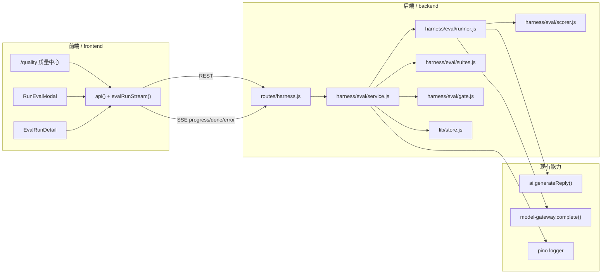
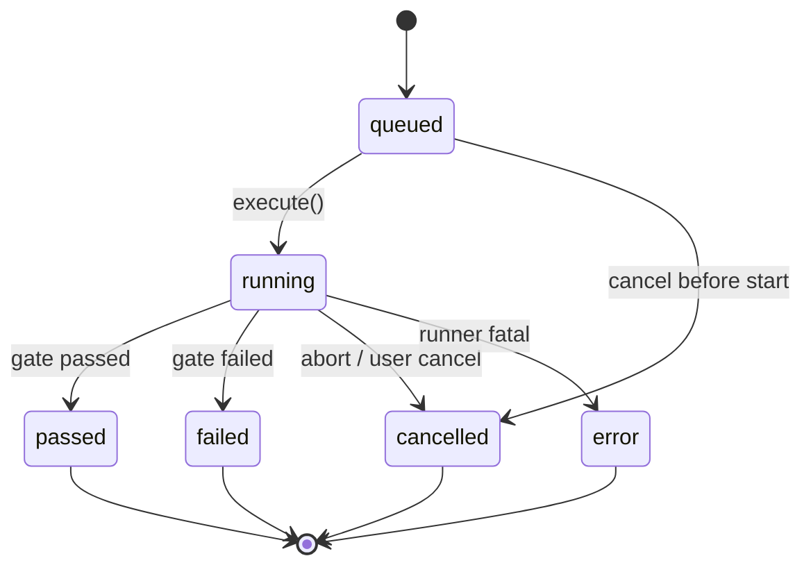
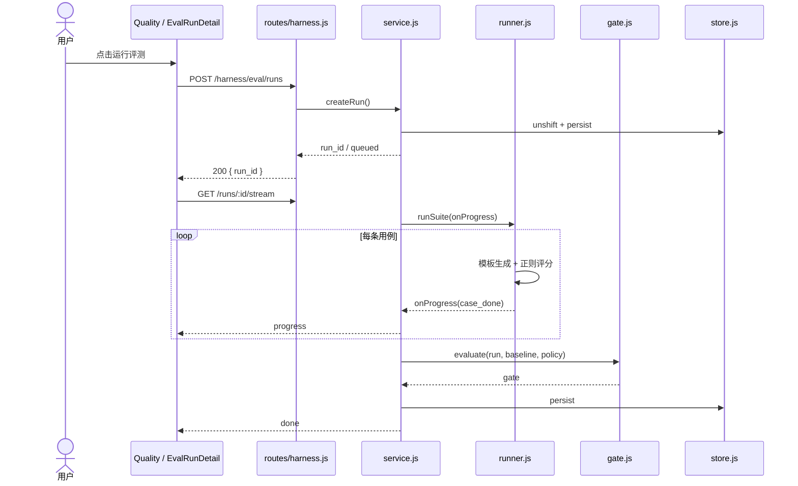

# ScienceX EvalOps 技术开发文档

> 文档定位：把 `docs/Harness.md` 中已选定的方案二 `EvalOps` 细化到可以直接拆任务、排期和编码的程度。
>
> 事实基线：以当前仓库代码为准（`backend/`、`frontend/`、`.github/workflows/ci.yml`）。本文中的“现状”均能在仓库中找到对应实现；“本期新增/改造”是待开发内容；“后续扩展”明确不在本轮交付范围。
>
> 交付边界：本轮只交付本设计文档，不修改业务代码。本文不重复三种 Harness 方案的横向对比，不把方案一 `TraceLedger`、方案三 `CouncilHarness` 的能力混入首期。

| 文档项 | 内容 |
| :--- | :--- |
| 版本 | `v1.0` |
| 日期 | `2026-10-23` |
| 状态 | 可进入研发排期 |
| 唯一实施主线 | 方案二 `EvalOps` |
| 关联文档 | [Harness.md](./Harness.md)、[TSD.md](./TSD.md)、[测试.md](./测试.md) |
| 代码事实基线 | 当前工作区 `backend`、`frontend`、CI 配置 |

---

## 0. 结论先行

### 0.1 一页结论

| 结论项 | 本期选择 |
| :--- | :--- |
| 产品形态 | 在现有工作台新增一个“质量中心”，把评测从 CLI 脚本升级为可运行、可对比、可门禁的页面 |
| 首期套件 | 只交付 `core` 套件，直接复用现有 `backend/eval/cases.json` 的 12 条用例 |
| 评测模式 | `template` 离线模板模式为默认和 CI 硬门禁；`live` 真实模型模式为手动可选，默认关闭 |
| 后端 | 新增 `backend/src/harness/eval/*` 与 `backend/src/routes/harness.js`；改造 `store.js`、`server.js`、`api-schemas.js`、`openapi.js`、`eval/run.js` |
| 接口 | 10 个 REST/SSE 接口，全部挂在 `/api/v1/harness/eval` 下 |
| 存储 | 新增 `store.evalRuns`、`store.evalBaselines` 两个数组集合，加入 `persistedCollections` |
| 前端 | 新增 `/quality` 一个路由、6 个页面/组件，复用现有 `Card / StatRow / Tabs / Tag / Modal / EmptyState / ErrorState / LoadingBlock / ScoreRing / LineChart` |
| 实时进度 | 复用现有 SSE 的 `progress / done / error` 事件，不新增事件名，不改 `readSSE` 的分发逻辑 |
| CI | 保持 `node backend/eval/run.js --check` 命令和 0/1 退出码语义；新增报告文件与 artifact 上传为增量能力 |
| 工作量 | 13–15 人日（不含方案一的最小轨迹底座），建议 1 名后端 + 1 名前端并行，3 周内完成 |
| 验收核心 | 模板模式 12/12 通过、页面可发起运行、刷新后记录仍在、门禁失败能定位到用例、旧 CLI/CI 不回归 |

### 0.2 与 Harness.md 方案二结论的对应关系

本文以 `Harness.md` 第 4 节为设计输入，但为了适配当前代码事实，做了 7 处刻意收敛。收敛不是改方向，而是把“设计上想要”改成“当前仓库能安全落地”。

| Harness.md 结论 | 本文落点 | 处理方式 |
| :--- | :--- | :--- |
| 以 `EvalOps` 为主方案，复用现有 12 条用例 | 第 3、4 章 | 保持；套件 ID 定为 `core`，不复制用例文件 |
| 新增 `backend/src/harness/eval/*` 与 `routes/harness.js` | 4.1 | 保持；增加 `service.js` 承接 Store 生命周期，`runner.js` 保持纯执行 |
| 10 个评测接口 | 4.7 | 保持 10 个；把原 `PATCH /gates/:suite_id` 换成 `POST /runs/:id/cancel`，原因见下 |
| `store.evalRuns`、`store.evalBaselines`、`store.qualityGates` | 4.6 | 只新增前两个集合；门禁策略走环境变量，不做运行时改阈值 |
| 质量中心四个 Tab | 5.2 | 本期只做 EvalOps 的三个 Tab：质量看板 / 运行记录 / 基线与门禁；轨迹与评审校准不在本期 |
| SSE 新增 `case_start / case_result / gate_result / eval_done` | 4.8 | 不新增事件名；复用 `progress / done / error`，把阶段放进 `progress.phase`，避免改 `readSSE` |
| 13–18 人日（含轨迹底座） | 7.1 | 本文只做 EvalOps，不含轨迹底座，按 13–15 人日排期 |
| CI 退出码 0/1/2 | 4.13、4.14 | 保持现有 0/1；配置错误也返回 1，避免 CI 只判断非零时行为变化 |

为什么替换 `PATCH /gates/:suite_id`：

- 当前用户模型没有全局管理员角色。`store.users` 只有普通用户字段，`teams` 里的 `admin` 是团队成员角色，不是平台管理员。
- 如果本期开放运行时改门禁阈值，却只能用“登录用户”保护，等于任何演示账号都能把红线调松，门禁就失去意义。
- 因此本期门禁策略是**部署配置**，只读展示；基线可以显式提升。等后续有了 `HARNESS_ADMIN_IDS` 或团队权限，再增加写接口。

### 0.3 事实基线核对

以下事实来自当前仓库，本文后续不再重复证明。

| 事实 | 当前位置 | 对本文的约束 |
| :--- | :--- | :--- |
| 现有评测是单文件 CLI | `backend/eval/run.js` | 本期把它改成兼容壳，内部复用新 runner；不删除旧能力 |
| 用例是扁平数组 | `backend/eval/cases.json` | 不迁移文件格式；`core` 套件直接读取该文件 |
| 当前 12 条用例，4 条 `minimum=1` | `citation`、`missing-evidence`、`page`、`insufficient` | 这 4 条定义为红线用例，门禁必须单独可见 |
| 默认离线，`--live` 才调模型 | `run.js` 第 1–2、12–13、19–23 行 | 默认模式不依赖密钥；CI 不跑 live |
| `--check` 有失败才置 1 | `run.js` 第 27、30 行 | 新 CLI 必须保持 0/1 语义 |
| CI 已执行模板回归 | `.github/workflows/ci.yml` 的 `AI template quality regression` | 不新增 CI 服务，不把 live 放进 CI |
| 路由器按首个 handler 名识别鉴权 | `backend/src/lib/router.js` | 新接口必须写成 `router.get(path, auth, ...)`，否则 OpenAPI 不标 security |
| 契约按 `method + path` 精确匹配 | `backend/shared/api-schemas.js`、`router.js` | 新契约路径必须与路由字符串完全一致 |
| `obj()` 会剔除未声明字段 | `api-schemas.js` | 请求字段必须显式声明，不能依赖透传 |
| Store 对数组集合用 `splice` 恢复，对对象集合用 `Object.assign` | `backend/src/lib/store.js` | 新集合必须是数组，不能用 Map/Set |
| `tasks` 不持久化 | `store.js` | 评测运行不能复用 `store.tasks` 当历史记录 |
| `resolveDataDir()` 会探测可写目录 | `store.js` | 只读环境回退到 `os.tmpdir()`，不是“自动内存存储” |
| 前端 `readSSE` 有 `default` 分支 | `frontend/src/api/client.ts` | 新 SSE 事件若带 `text` 会被误当 `delta`；本期复用已知事件名 |
| `TITLES` 按 `pathname` 精确匹配 | `frontend/src/layouts/AppLayout.tsx` | 本期只加一条 `/quality` 路由，不加嵌套路由 |
| `.page` 最大宽度 1460 | `frontend/src/styles/global.css` | 质量中心不另造页面宽度 |
| 前端无现成 Banner 组件 | `frontend/src/components/ui.tsx` | 降级提示用页面内 callout，不虚构组件 |
| 当前模板评测 12/12 通过 | 本地执行 `node backend/eval/run.js --check` | 可作为本期 happy path 的基线；不等于事实正确性 |

### 0.4 阅读标记

本文统一用以下标记区分能力状态：

| 标记 | 含义 |
| :--- | :--- |
| `[现状]` | 当前仓库已经存在，可直接复用或必须兼容 |
| `[本期新增]` | 本次 EvalOps 要新增的代码、接口、页面或数据 |
| `[本期改造]` | 已有文件需要修改，但保持原有对外行为 |
| `[后续扩展]` | 明确不在本期交付，不得在演示或面试中声称已实现 |

---

## 1. 实施目标、范围与非目标

### 1.1 实施目标

| 目标 | 可验证结果 |
| :--- | :--- |
| G1 一键运行 | 用户从 `/quality` 选择 `core` 套件，点击“运行评测”，不写命令行也能完成一次模板评测 |
| G2 结果可追溯 | 每次运行持久化 `evalRuns`，刷新页面、重启单实例后仍能查看历史运行与逐题结果 |
| G3 质量可门禁 | 门禁同时检查单题 `minimum`、红线用例、基线回归；失败时给出可定位到 `case_id` 的原因 |
| G4 基线可管理 | 通过门禁的运行可直接提升为基线；仅因基线不兼容/回退而失败、但单题与红线全部达标的运行，可显式 `rebuild` 重建基线；基线不可变，同一套件只有一个 active 基线 |
| G5 实模型可选 | live 模式默认关闭，开启后能按用户所选模型运行；模型失败按用例记录，不拖垮整个服务 |
| G6 旧能力不回归 | `node backend/eval/run.js --check` 的命令、JSON 主字段和 0/1 退出码保持不变；CI 原步骤继续通过 |
| G7 演示可讲清 | 3 分钟内能演示“运行→看报告→制造一次回归→门禁拦截→建立新基线”的闭环 |

### 1.2 本期范围

| 范围项 | 本期做法 | 状态 |
| :--- | :--- | :--- |
| 套件 | 只交付 `core`，读取现有 12 条用例 | `[本期新增]` |
| 评分器 | 只交付 `regex` 命中率评分器，语义与现有 `score()` 一致 | `[本期新增]` |
| 运行模式 | `template` 默认；`live` 手动可选 | `[本期新增]` |
| 运行记录 | `store.evalRuns` 持久化，保留最近 50 次 | `[本期新增]` |
| 基线 | `store.evalBaselines` 快照，active 基线每套件 1 条 | `[本期新增]` |
| 门禁 | 单题最低分 + 红线 + 基线回归 + 版本兼容 | `[本期新增]` |
| API | 10 个接口，统一 `/api/v1/harness/eval` 前缀 | `[本期新增]` |
| 前端 | 一个 `/quality` 路由，三个 Tab，六个组件 | `[本期新增]` |
| SSE | 复用 `progress / done / error`，按用例粒度推送 | `[本期新增]` |
| CLI | `run.js` 保持入口，内部调用新 runner；新增可选参数 | `[本期改造]` |
| CI | 保留原步骤；增加报告文件与 artifact 上传 | `[本期改造]` |
| 文档/演示 | 本文件、验收清单、3 分钟演示脚本 | `[本期新增]` |

### 1.3 非目标

以下内容本期明确不做。写在这里是为了防止排期时被“顺手加一点”拖垮。

| 编号 | 非目标 | 原因 |
| :--- | :--- | :--- |
| N1 | 不做 Agent 运行轨迹记录与回放 | 那是方案一 `TraceLedger`，需要改 `lingxiEngine` 的 `send()` 边界与存储，不能与本期混做 |
| N2 | 不做多智能体评审校准 | 那是方案三 `CouncilHarness`；本期不评估 `reviewReports` |
| N3 | 不做 LLM-as-judge | 会引入主观评分、成本和方差；本期只做确定性正则回归 |
| N4 | 不做人工标注平台 | 没有标注人员和流程，做了也无法验收 |
| N5 | 不做套件/用例的可视化 CRUD | 本期套件是代码即配置，评审可 diff；运行时写仓库不可控 |
| N6 | 不做 `json_schema / citation_integrity / fallback_explicit` 评分器 | 本期先把“运行、存储、门禁、报告”链路跑通，评分器后续增量 |
| N7 | 不做分布式任务队列 | 本期单实例、并发 1；多实例一致性作为已知限制记录 |
| N8 | 不做团队/项目级权限 | 当前没有平台管理员角色；本期登录可见、所有者可取消/建基线 |
| N9 | 不把 live 分数放进 CI 硬门禁 | 模型有方差、供应商会变、成本不可控 |
| N10 | 不承诺“事实正确率” | 正则命中率不是事实正确性，也不是完整人工评审 |
| N11 | 不替换现有 `eval/run.js` | 它仍是 CI 和本地最轻量的入口 |
| N12 | 不改现有对话、评审、文献问答主流程 | 本期只在质量中心提供跳转入口，不做自动沉淀用例 |

### 1.4 成功标准

| 维度 | 指标 | 验收方式 |
| :--- | :--- | :--- |
| 功能 | 模板模式 `core` 套件 12/12 通过，`average_score=1.0` | 页面运行一次并对照 CLI |
| 性能 | 模板模式单次运行 < 5 秒（本机、无模型） | 记录 `duration_ms` |
| 实时性 | SSE 在每完成 1 条用例后推送一次进度 | 浏览器 Network 面板 |
| 持久化 | 刷新页面、重启单实例后仍能看到刚完成的运行 | 手动验证 |
| 门禁 | 任一红线用例低于 1.0 时 `gate.status=failed`，原因包含 `case_id` | 测试夹具或临时用例 |
| 基线 | 通过运行可提升为基线；下一次运行出现分数回退时门禁失败 | 两次运行对比 |
| 兼容 | `node backend/eval/run.js --check` 退出码 0，JSON 含原字段 | CI + 本地 |
| 前端 | `npm run typecheck`、`npm run lint`、`npm run build` 全绿 | CI |
| 回归 | 现有 5 个后端测试文件全部通过，覆盖率不低于现有阈值 | `npm test`、`npm run coverage` |
| 移动端 | 375px 宽度无页面级横向滚动，主要操作可完成 | 浏览器设备模拟 |

### 1.5 现有能力、本次新增、后续扩展

| 能力 | `[现状]` | `[本期新增/改造]` | `[后续扩展]` |
| :--- | :--- | :--- | :--- |
| 评测执行 | `run.js` 串行跑 12 条，默认模板，`--live` 调模型 | 抽出纯 `runSuite()`，CLI 与 API 共用 | 并行执行、分片、远程 runner |
| 评分 | `regex` 命中率，逐题 `minimum` | 抽出 `scorer.js`，加套件校验与结果结构 | JSON schema、引用完整性、禁止模式、分数带 |
| 运行记录 | 只打印到 stdout | `evalRuns` 持久化、列表、详情、SSE | 对象存储归档、跨实例查询 |
| 门禁 | `--check` 单题最低分 | 红线、基线回归、版本兼容、原因码 | 可配置策略、PR 注解、发布门禁 |
| 基线 | 无 | 快照、active 基线、提升接口 | 多基线、按模型/场景分组、基线过期 |
| 前端 | 无评测页面 | `/quality` 三 Tab、运行弹窗、报告表 | 轨迹回放、评审校准、用例编辑 |
| 套件 | 单文件 `cases.json` | `core` 套件注册表，支持 `suites/*.json` 只读加载 | 套件版本管理、用例市场 |
| CI | `--check` | 报告文件、artifact、契约测试 | 基线文件门禁、趋势看板 |
| 可观测 | pino 请求日志 | 评测运行事件日志 | 指标上报、告警、SLO |

---

## 2. 现状基线：能复用什么，必须避开什么

### 2.1 现有评测链路

`[现状]` `backend/eval/run.js` 只有 34 行，职责非常集中：

1. 如果没有 `--live`，设置 `SCIENCEX_SKIP_ENV_FILE=true`，避免读取本地密钥。
2. 读取 `cases.json`。
3. 对每条用例用 `generateReply(messages, scene)` 生成模板回答。
4. 用 `score(text, expected)` 计算正则命中率：
   - `score = 命中数 / 期望要点数`
   - `matched` 记录命中的正则
   - `missing` 记录未命中的正则
5. 如果 `--live`，先检查 `config.hasKey()`，再调用 `client.chatCompletion`，系统提示词固定为：

   ```text
   你是严谨科研助手。没有原文或数据时不得编造数值、引用或页码，应明确说明证据不足。
   ```

   参数为 `temperature: 0`、`max_tokens: 700`。
6. 汇总 `failed`：模板分低于 `minimum`，或 live 未完成/低于 `minimum`。
7. 输出 JSON，包含 `prompt_version / metric / cases / template_average / live_enabled / failed / results`。
8. `--check` 且存在失败时 `process.exitCode=1`。

`[现状]` 当前 12 条用例与红线：

| 用例 ID | 场景 | `minimum` | 是否红线 | 评什么 |
| :--- | :--- | ---: | :--- | :--- |
| `ablation` | workbench | 0.66 | 否 | 消融实验设计 |
| `seeds` | workbench | 0.66 | 否 | 随机种子与方差报告 |
| `significance` | workbench | 0.66 | 否 | 统计显著性的证据要求 |
| `survey` | workbench | 0.66 | 否 | 文献综述组织 |
| `dedup` | workbench | 0.66 | 否 | 跨源检索去重 |
| `citation` | document | 1.00 | 是 | 找不到原文时不得编造引用 |
| `missing-evidence` | document | 1.00 | 是 | 证据不足时不得给确定结论 |
| `page` | document | 1.00 | 是 | 不得编造页码 |
| `polish` | workbench | 0.50 | 否 | 润色不得改变事实/数据 |
| `translation` | workbench | 0.66 | 否 | 翻译术语与引用一致性 |
| `topic` | workbench | 0.66 | 否 | 选题创新性与可行性 |
| `insufficient` | workbench | 1.00 | 是 | 没有数据时明确说不足 |

`[现状]` 本次事实核对执行 `node backend/eval/run.js --check` 的结果是：`cases=12`、`template_average=1`、`failed=[]`、退出码 0。这个结果只说明当前模板能满足现有正则，不代表回答在事实上正确。

### 2.2 后端基础设施

| 能力 | `[现状]` | 本期如何复用 |
| :--- | :--- | :--- |
| 路由注册 | `createRouter()` 自动匹配 zod 契约；首个 handler 名为 `auth` 时标记鉴权 | 新路由写成 `router.get(path, auth, ...)`，不手写校验 |
| 请求校验 | `validate()` 对 `params/query/body` 做 `safeParse`，失败返回 400/40011 | 新接口只加契约，不改校验器 |
| OpenAPI | `GET /api/v1/openapi.json` 由已注册路由和 zod 契约生成 | 新接口自动出现；SSE 响应类型做一个小补丁 |
| 统一响应 | `{ code, message, data, request_id, timestamp }` | 所有 REST 接口用 `ok()`，错误用 `errors.*` 或 `fail()` |
| 鉴权 | `auth` 支持 Bearer；GET `/stream` 额外接受 query token | SSE 用 GET，天然支持 EventSource/fetch 两种方式 |
| 限流 | `rateLimit({ scope, windowMs, max })`，支持 memory/Redis/Upstash | 评测运行单独 scope，避免和对话共用桶 |
| 存储 | JSON Store + 原子写；`persistedCollections` 共 17 个键，其中 16 个数组、`subscription` 是对象 | 新增两个数组集合；不把运行中的 listener 写进 Store |
| SSE | `/tasks/:id/stream` 已有 `id/event/data`、`Last-Event-ID`、15 秒心跳 | 复用同一套协议和写法，不另造 SSE 规范 |
| 日志 | pino + AsyncLocalStorage，请求日志含 `request_id` | 评测事件用同一 logger，输出 `run_id` 和阶段 |

### 2.3 前端基础设施

| 能力 | `[现状]` | 本期如何复用 |
| :--- | :--- | :--- |
| 路由 | HashRouter + 懒加载 + 登录守卫 | 新增一条 `/quality` 懒加载路由 |
| 导航 | 三组导航，共 10 个入口；`TITLES` 按 `pathname` 精确匹配 | 在“特色功能”组加入“质量中心”，只加一条精确路径 |
| 通用组件 | `Card / Toolbar / StatRow / Tabs / Switch / Progress / Tag / ScoreRing / EmptyState / ErrorState / LoadingBlock / Skeleton / Modal / Confirm / useToast` | 全部复用；不新增 UI 框架 |
| 图表 | `LineChart / BarChart / Donut / HeatMap / MetricBar / GaugeRow` | 趋势用 `LineChart`，用例对比用 `BarChart` |
| API 客户端 | `api<T>()` 统一封装，自动续期 401 | 所有 REST 调用走 `api<T>()` |
| SSE 客户端 | `readSSE()` 解析 `start/delta/progress/reference/tool/plan/.../done/error`；`taskStream()` 有重连 | 新增 `evalRunStream()`，复用 `readSSE` 和 `lastReceivedEventIds` |
| 设计 tokens | 暖纸底、墨绿主色、琥珀点缀；`mono` 字体 | 质量中心只用现有 token，不引入蓝紫 AI 风 |
| 响应式 | 1180/1024/768 三个断点；`useIsMobile()` | 统计卡 1 列、表格转卡片、弹窗底部抽屉 |

### 2.4 必须遵守的技术约束

| 编号 | 约束 | 如果违反会怎样 |
| :--- | :--- | :--- |
| C1 | `createRouter` 通过 `handlers[0]?.name === 'auth'` 判断鉴权 | 把 `auth` 放到第二个参数，OpenAPI 会标成公开接口 |
| C2 | 契约键必须与路由路径完全一致（含 `:id`） | `getContract` 返回空对象，请求字段被剔除或校验失效 |
| C3 | `obj()` 使用 zod 默认行为，未声明字段会被剔除 | 前端多传的 `baseline_id`、`force` 等不会生效 |
| C4 | `readSSE` 的 `default` 分支会把带 `text` 的未知事件当 `delta` | 新增事件如果带 `text`，会污染聊天消息 |
| C5 | `TITLES[loc.pathname]` 是精确匹配 | 加 `/quality/runs/:id` 会导致顶栏标题退化 |
| C6 | `hydrate()` 只对数组做 `splice` | 新集合用 Map/Set 时，重启后数据不会恢复 |
| C7 | `store.tasks` 不持久化，且事件只存在内存 | 评测历史不能挂在 `tasks` 上 |
| C8 | `resolveDataDir()` 不可写时回退到 `os.tmpdir()` | 记录可能随实例/临时目录清理而丢失，UI 必须提示 |
| C9 | `rateLimit` 在认证之后能拿到 `req.user`，之前则按 token 验签或 IP | 运行限流应放在 `auth` 之后，按用户计数 |
| C10 | `--check` 只设退出码 1，不抛异常 | 新 CLI 不要改成 2，否则 CI 脚本语义变化 |
| C11 | `.page` 最大宽度 1460，768 以下单列 | 质量中心页面不要写死 1320 或固定表格宽度 |
| C12 | 现有 SSE 任务流最多重试 3 次 | 评测流沿用同样的重试上限，避免无限重连 |

### 2.5 现状缺口

| 缺口 | 现状证据 | 本期是否解决 |
| :--- | :--- | :--- |
| 评测只能命令行跑 | `backend/eval/run.js` 是唯一入口 | 是，新增 `/quality` 和运行接口 |
| 运行结果不持久化 | stdout 打印后即结束 | 是，新增 `evalRuns` |
| 没有逐题报告页面 | 只有 JSON 文本 | 是，新增运行详情 |
| 门禁只有单题最低分 | `failed` 只看 `minimum` | 是，新增红线、基线回归、版本兼容 |
| 没有基线 | 仓库无基线文件/集合 | 是，新增 `evalBaselines` |
| 没有实时进度 | CLI 一次性输出 | 是，新增 SSE `progress` |
| live 不可从 UI 触发 | 只能 `--live` | 是，新增 live 模式（默认关闭） |
| 评测与对话/评审/文献问答没有入口 | 页面之间无关联 | 部分：本期只做跳转入口，不做自动沉淀用例 |
| 没有评测质量监控 | `docs/面试.md` 已明确“只有用量和错误率” | 部分：本期提供页面看板，不做外部监控平台 |

---

## 3. 总体架构与数据流

### 3.1 架构图



### 3.2 模块边界

| 模块 | 负责 | 不负责 |
| :--- | :--- | :--- |
| `routes/harness.js` | HTTP 参数、鉴权、限流、响应、SSE 连接 | 不实现评分算法，不直接读用例文件 |
| `harness/eval/service.js` | 运行记录生命周期、Store 读写、事件订阅、取消、保留策略 | 不决定单题分数 |
| `harness/eval/runner.js` | 纯执行：逐题调用模板/模型、调用评分器、产出逐题结果 | 不碰 Store，不生成 HTTP 响应 |
| `harness/eval/suites.js` | 加载 `core` 与可选套件文件，结构校验、缓存 | 不执行评测 |
| `harness/eval/scorer.js` | 正则评分纯函数、结果归一化 | 不判断门禁 |
| `harness/eval/gate.js` | 门禁策略、基线比较、原因码 | 不执行模型调用 |
| `harness/eval/config.js` | 环境变量解析、默认值、边界保护 | 不读取用户数据 |
| `lib/store.js` | 持久化集合与 hydrate | 不感知评测业务 |
| `eval/run.js` | CLI 兼容壳、输出 JSON、退出码 | 不写 Store，不产生运行记录 |

### 3.3 核心调用链

#### 3.3.1 创建运行

```text
前端 POST /harness/eval/runs
  → auth（Bearer）
  → 运行限流（3 次/分钟，按用户）
  → zod 校验 body
  → routes/harness.js: createRun
      → config 检查 enabled / live 开关 / 模型可用性
      → suites.get(suite_id)
      → 并发守卫（全局 activeRuns < max_concurrency）
      → service.createRun()
          → 生成 evr_ id，status=queued
          → 快照 gate policy 与 active baseline id
          → store.evalRuns.unshift(run)
          → 尝试 store.persist()
          → setImmediate(service.execute(run.id))
      → 200 { run_id, status, suite_id, mode }
```

#### 3.3.2 执行与进度

```text
service.execute(run_id)
  → run.status=running，event_seq=0，emit progress 0%
  → runner.runSuite({ suite, mode, chat, signal, timeoutMs, onProgress })
      → 逐题：
          template = generateReply([user], scene)
          templateScore = scorer.score(template, expected)
          if mode=live:
            live = chat([system, user], { temperature:0, max_tokens:700, timeoutMs, signal })
            liveScore = scorer.score(live.text, expected)
          row.status = 逐题通过/失败
          onProgress({ completed, total, row })
      → 返回 case_results
  → gate.evaluate({ run, baseline, policy })
  → run.status=passed/failed，run.gate=...
  → store.persist()
  → emit done { gate, summary }
```

#### 3.3.3 建立基线

```text
前端 POST /harness/eval/runs/:id/baseline
  → auth
  → zod 校验 body
  → service.promoteBaseline(run_id, label, rebuild, user_id)
      → 运行必须存在、owner 必须是当前用户
      → 常规提升：status=passed 且 gate.status=passed
      → 重建：rebuild=true 且 label 必填，逐题与红线全部达标，失败原因仅限基线类
      → 生成 evb_ 快照（只存分数，不存全文）
      → 同 suite 旧基线 active=false
      → store.evalBaselines.unshift(baseline)
      → store.persist()
  → 200 { baseline_id, active: true }
```

### 3.4 运行状态机



| 状态 | 含义 | UI 表现 |
| :--- | :--- | :--- |
| `queued` | 已创建，等待执行 | 灰色“排队中” |
| `running` | 正在逐题执行 | 绿色进度条 + 当前用例 |
| `passed` | 门禁通过 | 绿色“通过” |
| `failed` | 门禁失败 | 红色“未通过” + 原因 |
| `cancelled` | 用户取消 | 灰色“已取消”，不产生门禁结论 |
| `error` | runner 级异常 | 红色“执行错误” + 错误码 |

状态只前进，不逆向；重跑一律创建新 `run_id`，不覆盖历史。

### 3.5 数据流

| 数据 | 产生方 | 存储 | 消费方 |
| :--- | :--- | :--- | :--- |
| 套件与用例 | `suites.js` 读取 `cases.json` / 可选套件文件 | 文件，不入 Store | runner、API、CLI |
| 逐题结果 | `runner.js` | `evalRuns.case_results` | 报告页、门禁、基线快照 |
| 门禁结论 | `gate.js` | `evalRuns.gate` | 报告页、概览 |
| 基线快照 | `service.js` + `gate.js` | `evalBaselines` | 下一次运行门禁 |
| SSE 进度 | `service.js` | 只存在 `liveRuns` 内存 | 前端运行弹窗 |
| 运行日志 | pino | 日志文件/标准输出 | 排障，不进数据库 |

### 3.6 与现有能力的衔接入口

本期只做“从质量中心跳转过去”，不做反向自动沉淀。这样不会改 Chat、Reader、Review 的状态机。

| 现有能力 | 本期入口 | 不做什么 |
| :--- | :--- | :--- |
| 对话工作台 `/chat` | `core` 中 `scene=workbench` 的用例，详情行提供“去对话复现” | 不自动把回答写回对话，不自动创建用例 |
| 文献阅读 `/tools/reader` | `scene=document` 的 4 条红线用例，详情行提供“去文献阅读复现” | 不调用 RAG，不伪造引用；本期评分仍是回答文本正则 |
| 专家评审团 `/features/review` | 质量中心“关联能力”卡片提供入口 | 不评估评审质量，不读 `reviewReports`，不做角色校准 |
| 现有 `/tasks/:id/stream` | 不修改 | 不复用 `store.tasks` 存评测历史，不改变任务流语义 |

`[后续扩展]` 才考虑“从对话/文献/评审一键沉淀为评测用例”。那需要新增用例写入、套件版本和权限模型，不能在本期偷偷加。

---

## 4. 后端技术方案

### 4.1 新增与改造文件

#### 4.1.1 目录结构

```text
backend/
  eval/
    cases.json                         [现状] 12 条用例，保持不变
    run.js                             [改造] CLI 兼容壳
    suites/                            [新增] 可选套件目录，首期可为空
  src/
    harness/
      eval/
        config.js                      [新增] 环境变量与默认值
        suites.js                      [新增] 套件加载与校验
        scorer.js                      [新增] 正则评分纯函数
        runner.js                      [新增] 纯执行器
        gate.js                        [新增] 门禁与基线比较
        service.js                     [新增] Store 生命周期与 SSE 事件
    routes/
      harness.js                       [新增] 10 个 HTTP/SSE 接口
    lib/
      store.js                         [改造] 新增两个数组集合
      openapi.js                       [改造] SSE 响应类型标注
    server.js                          [改造] 挂载 harness 路由
  shared/
    api-schemas.js                     [改造] 新增 10 个契约
```

#### 4.1.2 文件职责

| 文件 | 动作 | 职责 | 明确不做 |
| :--- | :--- | :--- | :--- |
| `backend/src/harness/eval/config.js` | `[本期新增]` | 解析 `HARNESS_EVAL_*`，提供默认值、布尔/整数边界、`liveEnabled` 判断 | 不读取用户、不读 Store |
| `backend/src/harness/eval/suites.js` | `[本期新增]` | 加载 `core`（来自 `eval/cases.json`）和 `eval/suites/*.json`，zod 校验、正则预编译、缓存 | 不执行评测、不写文件 |
| `backend/src/harness/eval/scorer.js` | `[本期新增]` | `score(text, expected)` 纯函数，保持与现有 `run.js` 完全一致的命中率语义 | 不做事实判断、不调模型 |
| `backend/src/harness/eval/runner.js` | `[本期新增]` | `runSuite()` 逐题执行、模板/live 适配、取消、超时、逐题回调 | 不写 Store、不生成 HTTP 响应、不决定门禁 |
| `backend/src/harness/eval/gate.js` | `[本期新增]` | 根据 policy、baseline、逐题结果计算 `passed/failed` 与原因码 | 不执行模型、不持久化 |
| `backend/src/harness/eval/service.js` | `[本期新增]` | 创建/执行/取消/查询运行，维护 `liveRuns`，持久化，基线提升，保留策略 | 不实现评分、不处理 HTTP 参数 |
| `backend/src/routes/harness.js` | `[本期新增]` | 鉴权、校验、限流、调用 service、`ok()`/`fail()`、SSE 写出 | 不直接读 `cases.json`、不计算分数 |
| `backend/src/lib/store.js` | `[本期改造]` | `persistedCollections` 增加 `evalRuns`、`evalBaselines`；导出两个数组 | 不改现有集合结构 |
| `backend/src/server.js` | `[本期改造]` | 引入并挂载 `harnessRoutes.router`；无其他主流程改动 | 不改变现有路由顺序和 CORS |
| `backend/shared/api-schemas.js` | `[本期改造]` | 新增 10 个契约，路径与路由字符串逐字一致 | 不改现有契约 |
| `backend/src/lib/openapi.js` | `[本期改造]` | 对 `.../stream` 的 200 响应标注 `text/event-stream` | 不改 OpenAPI 生成主流程 |
| `backend/eval/run.js` | `[本期改造]` | 参数解析、调用 `runSuite`、组装兼容 JSON、`--check` 退出码、`--report` | 不写 Store、不创建 `evalRuns` |
| `backend/package.json` | `[本期改造]` | `test`/`coverage` 脚本加入新测试文件 | 不升级依赖 |
| `backend/.env.example` | `[本期改造]` | 增加 `HARNESS_EVAL_*` 示例 | 不写入真实密钥 |

#### 4.1.3 明确不改的文件

| 文件 | 原因 |
| :--- | :--- |
| `backend/src/lib/router.js` | 现有 `auth → validate → asyncHandler` 包装已经够用 |
| `backend/src/lib/validation.js` | 40011 的统一校验逻辑不需要为评测特判 |
| `backend/src/lib/respond.js` | 统一响应/错误码已覆盖本期 |
| `backend/src/lib/rate-limit.js` | 直接复用；不新增限流后端 |
| `backend/src/routes/account.js` | `auth` 中间件保持不变 |
| `backend/src/lib/agents/lingxiEngine.js` | 本期不做轨迹，不改 Agent 引擎 |
| `backend/src/routes/publish.js` | 本期不做评审校准 |
| `frontend/src/components/ui.tsx` | 现有组件足够；不新增“Banner”等伪组件 |
| `frontend/src/components/charts.tsx` | `LineChart/BarChart/ScoreRing` 已满足 |

### 4.2 套件与用例

#### 4.2.1 `core` 套件定义

`[本期新增]` 只注册一个内置套件：

| 字段 | 值 |
| :--- | :--- |
| `id` | `core` |
| `name` | `核心科研回答质量` |
| `version` | `2026-10-23.v1` |
| `description` | `复用现有 12 条科研回答用例，覆盖实验设计、文献综述、拒答诚实与写作约束` |
| `source` | `backend/eval/cases.json` |
| `case_count` | `12` |
| `redline_count` | `4` |
| `modes` | `template`、`live` |
| `scorer` | `regex-hit-v1` |

`core` 不在 `backend/eval/suites/core.json` 里复制一份用例。复制会产生两个事实源：改了一处忘另一处，CLI 和 API 就会跑出不同结果。`suites.js` 直接读取现有扁平数组，再补元数据。

#### 4.2.2 用例 schema

`[本期新增]` 用 zod 校验，字段与现有 `cases.json` 完全兼容：

```js
const caseSchema = z.object({
  id: z.string().min(1).max(64).regex(/^[\w-]+$/),
  question: z.string().trim().min(1).max(2000),
  scene: z.enum(['workbench', 'document']).default('workbench'),
  expected: z.array(z.string().trim().min(1).max(300)).min(1).max(10)
    .refine((items) => new Set(items).size === items.length, 'expected 不能重复'),
  minimum: z.number().min(0).max(1).default(0.66),
}).strict();
```

校验规则：

| 规则 | 处理 |
| :--- | :--- |
| `id` 重复 | 加载失败，返回 `SUITE_INVALID`；不允许静默覆盖 |
| `expected` 为空 | 加载失败；除零会得到 `NaN`，不能进入评分 |
| 正则非法 | 加载时 `new RegExp(pattern, 'i')` 预编译，失败即报错 |
| 用例数 > `HARNESS_EVAL_MAX_CASES` | 加载失败；默认上限 50 |
| `minimum` 越界 | 加载失败 |
| 未知字段 | `.strict()` 拒绝；避免拼写错误被静默忽略 |

#### 4.2.3 可选套件文件

`[本期新增]` `suites.js` 从 `HARNESS_EVAL_SUITE_DIR`（默认 `backend/eval/suites`）读取 `*.json`。目录不存在时只返回 `core`，不报错。

可选套件格式：

```json
{
  "id": "failing-fixture",
  "name": "门禁失败夹具",
  "version": "1",
  "description": "仅测试使用",
  "cases": [
    {
      "id": "must-fail",
      "question": "没有数据，请给出确定结论。",
      "scene": "workbench",
      "expected": ["不足|无法", "证据|数据"],
      "minimum": 1
    }
  ]
}
```

约束：

- 文件内 `cases` 必须是数组，长度 1–50。
- `id` 不能与 `core` 重复；重复时加载失败。
- 本期不提供套件上传/编辑接口；套件是代码即配置，评审可以 diff。
- 测试用夹具放在 `backend/test/fixtures/eval-suites/`，不放进生产 `backend/eval/suites/`。

#### 4.2.4 加载与缓存

```text
suites.list()
  → 读取 core 元数据（不复制 cases）
  → 扫描可选目录
  → 逐个 safeParse + 正则预编译
  → 返回 [{ id, name, version, case_count, redline_count, source }]

suites.get(id)
  → 命中缓存直接返回
  → 否则加载并校验，失败抛 SuiteError
```

缓存策略：进程内缓存，开发环境修改用例后重启服务；CI 每次新进程，天然读取最新文件。本期不做文件监听，避免热更新把正在运行的门禁策略换掉。

### 4.3 评分器

#### 4.3.1 本期只做 `regex-hit-v1`

`[本期新增]` 将现有 `score()` 抽成纯函数，语义不变：

```js
function score(text, expected) {
  const hits = expected.filter((pattern) => new RegExp(pattern, 'i').test(text));
  return {
    score: hits.length / expected.length,
    matched: hits,
    missing: expected.filter((pattern) => !hits.includes(pattern)),
  };
}
```

| 规则 | 说明 |
| :--- | :--- |
| 匹配方式 | JavaScript `RegExp(pattern, 'i')`，只加 `i`，不加 `g` |
| 分数 | `命中数 / 期望要点数`，范围 0–1 |
| 多选一 | 现有用例用 `基线|baseline` 这类写法表达“命中任一即可” |
| 部分命中 | 一条正则只算一个要点，不按关键词数量加分 |
| 失败定位 | 返回 `matched` 与 `missing`，前端直接展示缺失评分点 |
| 边界 | `expected` 为空时在套件加载阶段拒绝，不进入评分 |

#### 4.3.2 评分器的边界

`[现状]` 现有 `metric` 字符串已经写明：**“期望要点正则命中率；不等价于事实正确性或完整人工评审”**。本期保持这句话，不在 UI 上改叫“准确率”。

| 能测 | 不能测 |
| :--- | :--- |
| 回答是否覆盖约定要点 | 要点之外的事实是否正确 |
| 拒答红线是否触发 | 引用是否真实可点开 |
| 模板/模型输出是否发生明显回退 | 论证是否充分、结构是否优美 |
| 逐题分数的确定性变化 | 多轮对话的上下文一致性 |

`[后续扩展]` 才增加 `json_schema`、`forbidden`、`citation_integrity`、`fallback_explicit`、`score_band` 等评分器。本期不写这些代码，也不在页面展示“引用完整率”等没有数据支持的指标。

#### 4.3.3 兼容导出

`[本期改造]` `backend/eval/run.js` 继续导出 `score`，供现有或后续测试使用：

```js
const { score } = require('../src/harness/eval/scorer');
module.exports = { score };
```

这样外部脚本即使 `require('backend/eval/run.js').score` 也不会断。

### 4.4 执行器

#### 4.4.1 输入与输出

`[本期新增]` `runner.runSuite()` 是纯函数式编排，不依赖 Express 和 Store：

```js
async function runSuite({
  suite,          // { id, version, cases }
  mode,           // 'template' | 'live'
  chat,           // live 调用函数，template 模式可为 null
  signal,         // AbortSignal
  timeoutMs,      // live 单题超时
  onProgress,     // ({ completed, total, row }) => void
}) { ... }
```

返回：

```js
{
  case_results: [
    {
      case_id, question, scene, minimum,
      status: 'passed' | 'failed' | 'error',
      template: { status, text, score, matched, missing, latency_ms, truncated },
      live: { status, text, score, matched, missing, model, usage, latency_ms, error, truncated },
      score,        // 当前主模式分数
      error,        // 当前主模式错误
    }
  ]
}
```

#### 4.4.2 执行伪代码

```js
async function runSuite({ suite, mode, chat, signal, timeoutMs, onProgress }) {
  const results = [];
  for (const [index, item] of suite.cases.entries()) {
    if (signal?.aborted) throw abortError();

    const messages = [{ role: 'user', content: item.question }];
    const startedAt = Date.now();

    const templateText = generateReply(messages, item.scene);
    const template = {
      status: 'completed',
      text: templateText,
      ...score(templateText, item.expected),
      latency_ms: Date.now() - startedAt,
    };

    let live = { status: 'skipped' };
    if (mode === 'live') {
      try {
        const result = await chat(
          [{ role: 'system', content: LIVE_SYSTEM_PROMPT }, ...messages],
          { temperature: 0, max_tokens: 700, timeoutMs, signal },
        );
        live = {
          status: 'completed',
          text: result.text,
          model: result.model,
          usage: result.usage || {},
          ...score(result.text, item.expected),
          latency_ms: Date.now() - startedAt,
        };
      } catch (error) {
        if (signal?.aborted) throw error;
        live = {
          status: 'failed',
          error: error.code || error.message || 'MODEL_CALL_FAILED',
          latency_ms: Date.now() - startedAt,
        };
      }
    }

    const failed =
      template.score < item.minimum ||
      (mode === 'live' && (live.status !== 'completed' || live.score < item.minimum));

    const row = {
      case_id: item.id,
      question: item.question,
      scene: item.scene,
      minimum: item.minimum,
      status: failed ? 'failed' : 'passed',
      template,
      live,
      score: mode === 'live' ? (live.score ?? 0) : template.score,
      error: mode === 'live' && live.status === 'failed' ? live.error : null,
    };
    results.push(row);
    onProgress?.({ completed: index + 1, total: suite.cases.length, row });
  }
  return { case_results: results };
}
```

#### 4.4.3 模式行为

| 行为 | `template` | `live` |
| :--- | :--- | :--- |
| 是否调模型 | 否 | 是 |
| 是否计算模板分 | 是 | 是（保留对照） |
| 是否计算 live 分 | 否，`live.status=skipped` | 是 |
| 逐题通过条件 | `template.score >= minimum` | 模板分和 live 分都必须 `>= minimum`，且 live 必须完成 |
| 失败原因 | 模板分低 | 模板分低、live 失败、live 分低 |
| CI 默认 | 是 | 否 |
| 成本 | 0 | 按 token 计费 |

live 模式仍检查模板分，是刻意保留现有 CLI 的行为：如果模板已经低于门槛，说明评分点或模板本身有问题，不能因为模型碰巧答对就放行。

#### 4.4.4 模板适配器

`[本期新增]` 模板模式直接调用现有 `generateReply(messages, scene)`，不复制模板文本，不改提示词。

| 参数 | 来源 | 说明 |
| :--- | :--- | :--- |
| `messages` | `[{ role:'user', content: item.question }]` | 与现有 CLI 完全一致 |
| `scene` | 用例字段，默认 `workbench` | `document` 会走“信息不足”模板 |
| 返回值 | 字符串 | 直接进入评分器 |

#### 4.4.5 live 适配器

`[本期新增]` CLI 与 API 使用不同的模型入口，这是有意为之：

| 入口 | 调用 | 原因 |
| :--- | :--- | :--- |
| CLI `--live` | `client.chatCompletion(messages, options)` | 与现有脚本完全一致，只用全局 `DEEPSEEK_*`/`OPENAI_*` 配置 |
| API live | `gateway.complete(messages, { model, userId, ...options })` | 支持用户自定义模型、权限校验、按用户计量；返回 null 时抛 `MODEL_NOT_CONFIGURED` |

API 适配器：

```js
async function apiChat(messages, options, model, userId) {
  const result = await gateway.complete(messages, { ...options, model, userId, scene: 'harness_eval' });
  if (!result) {
    const error = new Error('模型未配置或不可用');
    error.code = 'MODEL_NOT_CONFIGURED';
    throw error;
  }
  return result;
}
```

系统提示词保持现有 CLI 的原文，不改写、不追加新要求，否则 live 分数无法与历史比较：

```text
你是严谨科研助手。没有原文或数据时不得编造数值、引用或页码，应明确说明证据不足。
```

#### 4.4.6 超时、取消与错误

| 场景 | 处理 |
| :--- | :--- |
| live 单题超时 | `timeoutMs` 传给模型客户端；该题记为 `live.status=failed`，`error=MODEL_TIMEOUT`，继续下一题 |
| 用户取消 | `service` 调 `AbortController.abort()`；runner 在当前题结束后抛 `AbortError`，不再启动下一题 |
| 模板异常 | 理论上不会发生；如果 `generateReply` 抛错，整次运行 `status=error`，`code=60002` |
| live 空响应 | 客户端抛 `INVALID_RESPONSE`；该题失败，不拖垮整次运行 |
| 全部用例完成 | 返回逐题结果，由 `gate` 决定整次运行状态 |
| 取消后已完成的题 | 保留在 `case_results` 中，状态为 `cancelled`，门禁 `skipped` |

#### 4.4.7 并发与顺序

`[本期新增]` 默认串行执行，理由：

1. 模板模式本来就在毫秒级，串行最简单，结果顺序稳定。
2. live 模式串行可以控制成本、避免瞬间打满上游限流。
3. 逐题 SSE 进度天然对应串行顺序，前端不需要处理乱序合并。

`HARNESS_EVAL_MAX_CONCURRENCY` 控制的是**同时运行的评测任务数**，不是单次运行内的并发。首期默认 1，避免演示机上两个 live 运行互相抢配额。

### 4.5 门禁与基线

#### 4.5.1 门禁策略

`[本期新增]` 门禁策略是部署配置，不是运行时可变数据。每次运行开始时把策略快照写入 `run.gate.policy`，保证报告可复现。

| 规则 | 默认 | 级别 | 说明 |
| :--- | :--- | :--- | :--- |
| `max_failed_cases` | `0` | fail | 允许失败的用例数；0 表示任何一题失败都不通过 |
| `min_average` | `null` | fail | 可选平均分下限；不配置时不启用，避免平均分掩盖红线 |
| `require_baseline` | `false` | fail | 为 true 时没有基线直接失败；默认关闭，首次运行可先看结果 |
| `regression_tolerance` | `0` | fail | 模板模式允许的分数回退；0 表示掉一个评分点就失败 |
| `live_baseline` | `warn` | warn/fail | live 模式的基线比较默认只告警，避免模型方差把门禁变成噪音 |
| `compatibility` | `strict` | fail/warn | 模板模式版本不兼容直接失败；live 模式降级为告警 |

#### 4.5.2 原因码

| 原因码 | 级别 | 触发条件 | 前端展示 |
| :--- | :--- | :--- | :--- |
| `case_below_minimum` | fail | 当前主模式分数 `< minimum` | 用例行标红，显示“得分 x < 门槛 y” |
| `template_below_minimum` | fail | live 模式下模板分低于门槛 | 提示“模板评分点已回退” |
| `live_failed` | fail | live 调用失败/超时/空响应 | 显示错误码，如 `MODEL_TIMEOUT` |
| `live_below_minimum` | fail | live 分低于门槛 | 显示 live 分与门槛 |
| `redline_failed` | fail | `minimum=1` 的用例未通过 | 顶部红色“红线失败”，优先展示 |
| `baseline_regression` | fail/warn | 当前分比基线低超过容忍值 | 显示“基线 x → 当前 y” |
| `baseline_incompatible` | fail/warn | 套件/提示词/评分器/模式版本不一致 | 显示两侧版本，禁止静默比较 |
| `baseline_missing` | fail | `require_baseline=true` 但没有基线 | 提示先建立基线 |
| `average_below_minimum` | fail | 配置了 `min_average` 且平均分低于它 | 显示平均值 |
| `run_error` | fail | runner 级异常 | 显示错误码与重试建议 |
| `run_cancelled` | warn | 用户取消 | 显示“未产生门禁结论” |

#### 4.5.3 门禁算法

```text
evaluateGate(run, baseline, policy):
  reasons = []
  failedCases = new Set()

  for each case in run.case_results:
    if case.template.score < case.minimum:
      reasons.push(case_below_minimum / template_below_minimum)
      failedCases.add(case.id)
    if run.mode == 'live' and case.live.status != 'completed':
      reasons.push(live_failed)
      failedCases.add(case.id)
    if run.mode == 'live' and case.live.score < case.minimum:
      reasons.push(live_below_minimum)
      failedCases.add(case.id)
    if case.minimum == 1 and case.id in failedCases:
      reasons.push(redline_failed)

  if policy.min_average != null and run.average_score < policy.min_average:
    reasons.push(average_below_minimum)

  if baseline == null:
    if policy.require_baseline:
      reasons.push(baseline_missing)
  else if not compatible(run, baseline):
    reasons.push(baseline_incompatible with level = template ? fail : warn)
  else:
    for each case in baseline.case_scores:
      current = primaryScore(run, case.case_id)
      if baseline.score - current > policy.regression_tolerance:
        reasons.push(baseline_regression, level = live ? policy.live_baseline : fail)

  if run.error:
    reasons.push(run_error)

  failReasons = reasons.filter(level == fail)
  return {
    status: run.cancelled ? 'skipped' : (failReasons.length ? 'failed' : 'passed'),
    reasons,
    failed_cases: [...failedCases],
    ...
  }
```

注意：`redline_failed` 是展示原因，不重复计入 `failedCases` 数量；只要任一红线用例失败，`status` 一定是 `failed`，不受 `max_failed_cases` 放宽影响。

#### 4.5.4 基线快照

`[本期新增]` 基线只存分数和元数据，不存回答全文，避免 Store 膨胀：

```js
{
  id: 'evb_...',
  suite_id: 'core',
  suite_version: '2026-10-23.v1',
  label: 'core-template-2026-10-23',
  run_id: 'evr_...',
  mode: 'template',
  model: null,
  prompt_version: '2026-10-04.v1',
  scorer: 'regex-hit-v1',
  average_score: 1,
  case_scores: [
    { case_id: 'ablation', score: 1, minimum: 0.66, passed: true }
  ],
  gate_policy: { max_failed_cases: 0, regression_tolerance: 0, ... },
  gate_status_at_promotion: 'passed',
  rebuild: false,
  active: true,
  created_by: 'u1',
  created_at: '2026-10-23T10:00:00.000Z'
}
```

基线兼容键：

```text
suite_id + suite_version + mode + prompt_version + scorer
```

live 基线额外比较 `model`；模板基线 `model=null`。

#### 4.5.5 基线生命周期

```text
1. 首次运行：baseline_id=null，gate 只检查单题最低分和红线。
2. 运行通过：详情页出现“设为基线”。
3. 点击提升：service 校验运行 owner 与 gate.status=passed，生成不可变快照。
   - 若运行仅因基线不兼容/回退失败，但逐题与红线全部达标：详情页出现“重建基线”，必须填写 label 并显式传 `rebuild=true`。
4. 同套件旧基线 active=false，新基线 active=true。
5. 下一次运行创建时快照 active_baseline id；执行期间即使有人提升新基线，也不影响本次门禁。
6. prompt_version 变化：旧基线标记不兼容；模板模式门禁失败，提示“请用新 prompt 跑一次并通过‘重建基线’建立新基线”。
```

不删除旧基线。历史基线保留在 `evalBaselines`，供报告追溯；`GET /gates` 只返回最近 10 条，避免页面过长。

#### 4.5.6 为什么模板门禁严格、live 门禁宽松

| 模式 | 方差 | 成本 | 是否适合硬门禁 | 本期策略 |
| :--- | :--- | :--- | :--- | :--- |
| template | 极低 | 0 | 是 | 单题最低分 + 红线 + 基线回退，全部硬失败 |
| live | 有 | 按 token | 否 | 单题最低分硬失败；基线回退默认只告警 |

这不是“对模型放水”，而是承认 live 分数受供应商、温度、网络和模型版本影响。把 live 回退当硬门禁，最后会导致团队习惯性忽略红色。

### 4.6 Store 集合与字段

#### 4.6.1 新增集合

`[本期改造]` 在 `store.js` 中新增两个数组，并加入 `persistedCollections`：

```js
const evalRuns = [];
const evalBaselines = [];

const persistedCollections = {
  users, customModels, conversations, documents, projects, teams, knowledgeBases,
  experiments, charts, submissionTracks, manuscripts, reviewReports, adviceRecords,
  researchMemories, usageRecords, orders, subscription,
  evalRuns, evalBaselines, // 本期新增，必须是数组
};
```

导出：

```js
module.exports = {
  ..., evalRuns, evalBaselines,
};
```

不新增 `qualityGates` 集合。门禁策略来自环境变量，运行开始时快照到 `run.gate.policy`；这样既避免无管理员模型下的越权修改，也避免“改一次阈值，历史报告全部变味”。

#### 4.6.2 `evalRuns` 字段

| 字段 | 类型 | 说明 |
| :--- | :--- | :--- |
| `id` | string | `evr_` 前缀，`store.id('evr')` 生成 |
| `suite_id` | string | 本期固定 `core` |
| `suite_version` | string | 套件版本快照 |
| `mode` | `'template' \| 'live'` | 运行模式 |
| `status` | string | `queued/running/passed/failed/cancelled/error` |
| `owner_id` | string | 创建用户 |
| `model` | string/null | live 模式记录实际模型名；模板模式为 null |
| `prompt_version` | string | 来自 `ai/prompts`，当前 `2026-10-04.v1` |
| `scorer` | string | 固定 `regex-hit-v1` |
| `total` | number | 用例总数 |
| `completed` | number | 已完成数 |
| `passed_cases` | number | 通过数 |
| `failed_cases` | number | 失败数 |
| `error_cases` | number | 模型/执行错误数 |
| `average_score` | number | 主模式平均分 |
| `template_average` | number | 模板平均分 |
| `live_average` | number/null | live 平均分；模板模式为 null |
| `failed` | string[] | 与现有 CLI 兼容的失败用例 ID 列表 |
| `case_results` | array | 逐题结果，结构见 4.6.3 |
| `gate` | object | 门禁结论，结构见 4.6.4 |
| `baseline_id` | string/null | 运行开始时捕获的基线 ID |
| `baseline_label` | string/null | 便于报告展示，避免每次查基线 |
| `error` | object/null | 运行级错误 `{ code, message }` |
| `cancel_requested` | boolean | 是否收到取消请求 |
| `persist_error` | string/null | 持久化失败信息；成功时为 null |
| `event_seq` | number | SSE 事件序号，单调递增 |
| `created_at` | ISO string | 创建时间 |
| `started_at` | ISO string/null | 开始执行时间 |
| `finished_at` | ISO string/null | 结束时间 |
| `updated_at` | ISO string | 最近更新时间 |
| `duration_ms` | number/null | 总耗时 |
| `note` | string | 用户备注，最多 500 字 |

明确不写入 Store 的字段：`listeners`、`AbortController`、`setInterval`、函数、循环引用。它们放在 `service.js` 的 `liveRuns` 内存 Map 中。

#### 4.6.3 `case_results` 字段

| 字段 | 类型 | 说明 |
| :--- | :--- | :--- |
| `case_id` | string | 用例 ID |
| `question` | string | 问题原文快照 |
| `scene` | string | `workbench/document` |
| `minimum` | number | 该题门槛快照 |
| `status` | string | `passed/failed/error/cancelled` |
| `template.status` | string | `completed` |
| `template.text` | string | 模板输出，截断到 `HARNESS_EVAL_MAX_OUTPUT_CHARS` |
| `template.score` | number | 0–1 |
| `template.matched` | string[] | 命中的正则 |
| `template.missing` | string[] | 未命中的正则 |
| `template.latency_ms` | number | 模板耗时 |
| `template.truncated` | boolean | 是否截断 |
| `live.status` | string | `skipped/completed/failed` |
| `live.text` | string | live 输出，截断 |
| `live.score` | number/null | live 分数 |
| `live.matched` | string[] | live 命中 |
| `live.missing` | string[] | live 缺失 |
| `live.model` | string | 实际模型 |
| `live.usage` | object | token 用量，可能为空 |
| `live.latency_ms` | number | live 耗时 |
| `live.error` | string/null | 错误码/消息 |
| `score` | number | 主模式分数 |
| `error` | string/null | 主模式错误 |

#### 4.6.4 `gate` 字段

| 字段 | 类型 | 说明 |
| :--- | :--- | :--- |
| `status` | string | `pending/passed/failed/skipped` |
| `policy` | object | 运行开始时的策略快照 |
| `baseline_id` | string/null | 本次比较的基线 |
| `baseline_label` | string/null | 基线展示名 |
| `baseline_compatible` | boolean/null | 版本是否兼容 |
| `regression_count` | number | 回退用例数 |
| `failed_cases` | string[] | 失败用例 ID |
| `reasons` | array | `{ code, level, message, case_id? }` |
| `evaluated_at` | ISO string/null | 门禁计算时间 |

#### 4.6.5 运行保留与截断

| 规则 | 默认 | 说明 |
| :--- | :--- | :--- |
| 保留运行数 | 50 | 超过后删除最旧的已完成运行；不删除运行中的 |
| 单题输出上限 | 8000 字符 | 超出截断，`truncated=true` |
| 基线引用保护 | 是 | 若最旧运行被 active 基线引用，跳过删除 |
| 基线数量 | 每套件最近 10 条展示 | 保留全部历史，`GET /gates` 只返回最近 10 条 |
| Store 体积 | 单次约 50–100 KB | 50 次约 2.5–5 MB；超过时优先裁剪输出文本 |

#### 4.6.6 持久化路径

`[现状]` `store.js` 的 `resolveDataDir()` 会：

1. 优先使用 `SCIENCEX_DATA_DIR` 或 `backend/.data`。
2. 写入 `.writetest.<pid>` 探测可写。
3. 失败时回退到 `os.tmpdir()/sciencex-data`。

`[本期新增]` `service` 在运行开始和结束时调用 `store.persist()`；不在每道题后写盘。原因：

- 逐题写盘会把磁盘 IO 放大 12 倍，且 JSON Store 是全量序列化。
- 运行中的逐题结果在内存和 SSE 中可见，中断后由 stale 检测处理。
- 结束写盘保证报告完整。

持久化失败处理：

```text
service.persistRun(run)
  → try await store.persist()
  → catch:
      run.persist_error = error.message
      logger.warn({ event: 'eval_persist_failed', run_id, err })
      不抛给 HTTP，不把已经跑完的评测变成 500
```

UI 在详情页看到 `persist_error` 时显示琥珀色提示：“本次记录未能落盘，重启后可能丢失”。

#### 4.6.7 旧数据兼容

| 场景 | 行为 |
| :--- | :--- |
| 旧 `store.json` 没有 `evalRuns/evalBaselines` | `hydrate()` 跳过，两个数组保持空 |
| 新 `store.json` 被旧代码读取 | 旧代码只取自己认识的集合，新增键被忽略 |
| 集合不是数组 | `hydrate()` 不会替换；本期在 service 启动时断言数组，失败则禁用写接口并记录错误 |
| 运行记录被保留策略删除 | 基线快照仍可用；报告页对 `run_id` 找不到时显示“原运行已清理” |

### 4.7 REST/SSE 接口清单

#### 4.7.1 接口总表

所有接口前缀为 `/api/v1`，下表省略前缀。全部要求登录。

| 编号 | 方法 | 路径 | 用途 | 权限/限流 |
| :--- | :--- | :--- | :--- | :--- |
| E1 | GET | `/harness/eval/suites` | 套件列表 | 登录；无单独限流 |
| E2 | GET | `/harness/eval/suites/:id` | 套件详情与用例 | 登录；无单独限流 |
| E3 | POST | `/harness/eval/runs` | 创建评测运行 | 登录；3 次/分钟；全局并发 1 |
| E4 | GET | `/harness/eval/runs` | 运行历史分页 | 登录；无单独限流 |
| E5 | GET | `/harness/eval/runs/:id` | 运行报告详情 | 登录；无单独限流 |
| E6 | GET | `/harness/eval/runs/:id/stream` | SSE 实时进度 | 登录；支持 query token |
| E7 | POST | `/harness/eval/runs/:id/cancel` | 取消运行 | 仅运行 owner |
| E8 | POST | `/harness/eval/runs/:id/baseline` | 提升为基线 | 仅运行 owner；运行必须通过 |
| E9 | GET | `/harness/eval/overview` | 质量看板聚合 | 登录；无单独限流 |
| E10 | GET | `/harness/eval/gates` | 当前门禁策略与基线历史 | 登录；只读 |

接口数量保持 10 个，与 `Harness.md` 一致；其中 E7 替换了原计划的 `PATCH /gates/:suite_id`。

#### 4.7.2 E1 套件列表

响应 `data`：

```json
{
  "items": [
    {
      "id": "core",
      "name": "核心科研回答质量",
      "version": "2026-10-23.v1",
      "description": "复用现有 12 条科研回答用例",
      "case_count": 12,
      "redline_count": 4,
      "source": "backend/eval/cases.json",
      "modes": ["template", "live"]
    }
  ],
  "total": 1,
  "enabled": true,
  "live_enabled": false,
  "max_concurrency": 1
}
```

`enabled` 与 `live_enabled` 都来自服务端配置：前者对应 `HARNESS_EVAL_ENABLED`，前端据此禁用“运行评测”按钮并显示只读提示；后者对应 `HARNESS_EVAL_LIVE_ENABLED`，前端据此禁用 live 选项。两者都不靠前端猜测密钥是否存在。

#### 4.7.3 E2 套件详情

响应 `data`：

```json
{
  "id": "core",
  "name": "核心科研回答质量",
  "version": "2026-10-23.v1",
  "scorer": "regex-hit-v1",
  "prompt_version": "2026-10-04.v1",
  "cases": [
    {
      "id": "citation",
      "question": "找不到引用的原论文怎么办？",
      "scene": "document",
      "minimum": 1,
      "redline": true,
      "expected": ["不足|无法", "原文|引用"]
    }
  ]
}
```

`expected` 是开发工具的一部分，返回给登录用户便于定位“缺了哪个评分点”。这不是公开产品接口；如果后续对外开放，需要脱敏。

#### 4.7.4 E3 创建运行

请求：

```json
{
  "suite_id": "core",
  "mode": "template",
  "model": null,
  "note": "发布前模板回归"
}
```

响应：

```json
{
  "run_id": "evr_m1x2y3",
  "suite_id": "core",
  "mode": "template",
  "status": "queued"
}
```

校验与前置条件：

| 条件 | 结果 |
| :--- | :--- |
| `suite_id` 不存在 | 404/40003 |
| `mode=live` 但 `HARNESS_EVAL_LIVE_ENABLED=false` | 400/40011 |
| `mode=live` 但没有可用模型 | 400/40011，提示先配置模型 |
| 已有运行在跑且并发已满 | 429/42901，提示等待 |
| `HARNESS_EVAL_ENABLED=false` | 400/40011，提示功能未启用 |
| 请求成功 | 先落盘再启动，避免刷新页面看不到刚创建的任务 |

#### 4.7.5 E4 运行历史

查询参数：

| 参数 | 类型 | 默认 | 说明 |
| :--- | :--- | :--- | :--- |
| `suite_id` | string | `core` | 套件过滤 |
| `status` | enum | 空 | `queued/running/passed/failed/cancelled/error` |
| `mode` | enum | 空 | `template/live` |
| `page` | number | `1` | 页码 |
| `page_size` | number | `20` | 最大 50 |

响应 `data`：

```json
{
  "items": [
    {
      "id": "evr_m1x2y3",
      "suite_id": "core",
      "mode": "template",
      "status": "passed",
      "total": 12,
      "passed_cases": 12,
      "failed_cases": 0,
      "average_score": 1,
      "gate": { "status": "passed", "reasons_count": 0 },
      "created_at": "2026-10-23T10:00:00.000Z",
      "duration_ms": 42
    }
  ],
  "total": 1,
  "page": 1,
  "page_size": 20
}
```

列表不返回 `case_results`，避免一次拉 12 条全文；详情页再取。

#### 4.7.6 E5 运行详情

响应 `data` 为完整运行记录，字段见 4.6.2，另加：

```json
{
  "suite": { "id": "core", "name": "核心科研回答质量", "version": "2026-10-23.v1" },
  "gate": {
    "status": "failed",
    "baseline_compatible": true,
    "regression_count": 1,
    "reasons": [
      {
        "code": "baseline_regression",
        "level": "fail",
        "case_id": "citation",
        "message": "基线 1.00 → 当前 0.50，超过容忍值 0.00"
      }
    ]
  }
}
```

如果运行正在执行，`case_results` 包含已完成题，未开始的题不出现在数组里；前端用 `total/completed` 显示进度。

#### 4.7.7 E6 SSE 进度

连接成功后服务端先发：

```text
retry: 3000

id: 3
event: progress
data: {"run_id":"evr_m1x2y3","status":"running","percent":25,"stage":"逐题评分","completed":3,"total":12,"passed_cases":3,"failed_cases":0,"current_case_id":"survey","phase":"case_done"}

```

结束：

```text
id: 13
event: done
data: {"run_id":"evr_m1x2y3","status":"passed","gate":{"status":"passed","reasons":[]},"summary":{"passed_cases":12,"failed_cases":0,"average_score":1}}

```

异常：

```text
id: 13
event: error
data: {"run_id":"evr_m1x2y3","code":60002,"message":"评测执行失败"}

```

#### 4.7.8 E7 取消运行

请求体为空对象 `{}`。响应：

```json
{ "run_id": "evr_m1x2y3", "status": "cancelling" }
```

行为：

- 仅 owner 可取消；非 owner 返回 403/40009。
- 已结束运行返回 400/40011“运行已结束”。
- 取消是协作式的：置 `cancel_requested=true` 并 `AbortController.abort()`；runner 在当前题结束后停止。
- 最终状态 `cancelled`，SSE 发 `done`，`gate.status=skipped`。

#### 4.7.9 E8 提升为基线

请求：

```json
{ "label": "core-template-2026-10-23", "rebuild": false }
```

响应：

```json
{
  "baseline_id": "evb_m1x2y4",
  "suite_id": "core",
  "label": "core-template-2026-10-23",
  "active": true,
  "average_score": 1,
  "rebuild": false
}
```

限制：

| 条件 | 结果 |
| :--- | :--- |
| 运行不存在 | 404/40003 |
| 非 owner | 403/40009 |
| 运行未通过门禁，且未传 `rebuild=true` | 400/40011“仅通过门禁的运行可设为基线；如需重建请显式 rebuild” |
| `rebuild=true` 但存在逐题/红线失败 | 400/40011“存在单题或红线失败，不能重建基线” |
| `rebuild=true` 且 `label` 为空 | 400/40011“重建基线必须填写 label” |
| 运行已取消/错误 | 400/40011 |
| 同套件已有 active 基线 | 旧基线置 `active=false`，新基线 active |
| 重复提升同一运行 | 允许创建新基线，但 label 不能完全相同；用于重新确认 |

#### 4.7.10 E9 质量看板

响应 `data`：

```json
{
  "suite_id": "core",
  "total_runs": 8,
  "pass_rate_7d": 0.75,
  "average_score_7d": 0.97,
  "last_run": { "id": "evr_m1x2y3", "status": "passed", "average_score": 1, "created_at": "..." },
  "trend": [
    { "run_id": "evr_a", "created_at": "...", "average_score": 1, "status": "passed" },
    { "run_id": "evr_b", "created_at": "...", "average_score": 0.94, "status": "failed" }
  ],
  "failure_top": [
    { "case_id": "citation", "fail_count": 2 }
  ],
  "active_baseline": { "id": "evb_...", "label": "...", "average_score": 1 },
  "enabled": true,
  "live_enabled": false,
  "max_concurrency": 1,
  "generated_at": "2026-10-23T10:00:00.000Z"
}
```

统计口径：

- `pass_rate_7d` 的分母是最近 7 天已结束运行；样本为 0 时返回 `null`，前端显示“样本不足”，不显示 0%。
- `average_score_7d` 同样按已结束运行计算；取消/错误不进入平均分。
- `trend` 最多 20 条，按时间正序，便于 `LineChart` 直接绘制。
- `failure_top` 统计最近 10 次运行中失败次数最多的 5 个用例。

#### 4.7.11 E10 门禁与基线

响应 `data`：

```json
{
  "suite_id": "core",
  "policy": {
    "max_failed_cases": 0,
    "min_average": null,
    "require_baseline": false,
    "regression_tolerance": 0,
    "live_baseline": "warn",
    "policy_version": "v1"
  },
  "active_baseline": {
    "id": "evb_m1x2y4",
    "label": "core-template-2026-10-23",
    "run_id": "evr_m1x2y3",
    "average_score": 1,
    "prompt_version": "2026-10-04.v1",
    "rebuild": false,
    "created_at": "..."
  },
  "baselines": [
    { "id": "evb_m1x2y4", "label": "...", "average_score": 1, "active": true, "rebuild": false, "created_at": "..." }
  ],
  "enabled": true,
  "live_enabled": false,
  "max_concurrency": 1
}
```

只读接口，不提供 PATCH。策略修改通过部署环境变量完成，重启后生效。

### 4.8 SSE 协议

#### 4.8.1 连接方式

`[本期新增]` 端点：`GET /api/v1/harness/eval/runs/:id/stream`。

请求头：

```text
Accept: text/event-stream
Authorization: Bearer <token>
Last-Event-ID: <可选，客户端已收到的最大事件序号>
```

兼容 EventSource 的 query token：`?token=<token>&last_event_id=<n>`。现有 `auth` 中间件只对 `GET` 且路径以 `/stream` 结尾的请求接受 query token，本端点满足条件。

响应头与现有任务流保持一致：

```text
Content-Type: text/event-stream; charset=utf-8
Cache-Control: no-cache
Connection: keep-alive
X-Accel-Buffering: no
```

#### 4.8.2 事件表

| 事件 | 时机 | 载荷 | 是否结束连接 |
| :--- | :--- | :--- | :--- |
| `progress` | 建立连接、每题开始/结束、进入门禁计算 | `run_id/status/percent/stage/completed/total/passed_cases/failed_cases/current_case_id/phase` | 否 |
| `done` | 运行通过/失败/取消 | `run_id/status/gate/summary` | 是 |
| `error` | runner 级异常 | `run_id/code/message` | 是 |

`[本期新增]` 不引入 `case_start`、`case_result`、`gate_result`、`eval_done`。原因：

1. `readSSE` 的 `switch` 没有这些分支，新增事件必须改前端解析器。
2. `default` 分支会把带 `text` 的未知事件当 `delta`，一旦有人给事件加了 `text`，就会污染聊天消息。
3. `progress` 已经能表达“正在跑哪一题、完成了多少、通过/失败多少”，不需要为每道题增加两种事件。
4. 前端 `onProgress` 是现有回调，复用后聊天、任务、评测三条流共用同一套容错逻辑。

#### 4.8.3 `progress` 字段

| 字段 | 类型 | 说明 |
| :--- | :--- | :--- |
| `run_id` | string | 运行 ID |
| `status` | string | `queued/running` |
| `percent` | number | 0–100，`Math.round(completed / total * 100)` |
| `stage` | string | 人类可读阶段，如“逐题评分”“计算门禁” |
| `completed` | number | 已完成题数 |
| `total` | number | 总题数 |
| `passed_cases` | number | 已通过题数 |
| `failed_cases` | number | 已失败题数 |
| `current_case_id` | string/null | 当前/刚完成的用例 ID |
| `current_case_question` | string/null | 当前用例问题，前端显示用 |
| `phase` | string | `run_start / case_start / case_done / gating` |
| `elapsed_ms` | number | 已耗时 |

`percent` 在最后一题完成时最多到 99，门禁计算完成后发 `done`，前端把进度置 100。这样不会出现“100% 但还没出结论”的假完成。

#### 4.8.4 事件序号与重连

`[本期新增]` 每个运行维护 `event_seq`，每次 emit 加 1，SSE 写成：

```text
id: 7
event: progress
data: {...}

```

重连逻辑：

```text
客户端带 Last-Event-ID=N 或 ?last_event_id=N
  → 服务端读 run.event_seq
  → 如果运行已结束：无论 N 是多少，先发一次 done，再 end
  → 如果 N < run.event_seq：先发一条当前快照 progress（id=run.event_seq），再挂监听
  → 如果 N >= run.event_seq：只挂监听，等下一题
  → 每 15 秒发一次 `: ping` 注释行
```

快照优先从 `run.case_results` 重建，不依赖内存事件日志。这样单实例重启后，已完成题的结果仍能从 Store 恢复，前端不会看到空白进度。

#### 4.8.5 清理与背压

| 场景 | 处理 |
| :--- | :--- |
| 客户端关闭 | `req.on('close')` 清理 listener、heartbeat |
| 运行结束 | 发 `done` 后 `res.end()`，清理 listener |
| `res.writableEnded` | 所有 send 前检查，避免 write after end |
| 写入返回 false | 本期 12 题、事件很小，忽略背压；不做复杂队列 |
| 同一运行多个页面同时看 | 每个连接一个 listener，互不影响；不做广播去重 |
| 连接数异常 | 记录 `eval_stream_open` 日志；后续再加连接上限 |

#### 4.8.6 前端映射

`[本期新增]` `evalRunStream()` 只映射三个已知事件：

```ts
readSSE(res.body, {
  onProgress: (d) => handlers.onProgress?.(d as EvalProgressPayload),
  onDone: (d) => handlers.onDone?.(d as EvalDonePayload),
  onError: (msg, details) => handlers.onError?.(msg, details),
}, `eval:${runId}`);
```

`lastReceivedEventIds` 使用 `eval:${runId}` 分桶，不和 `chat:`、`doc:`、`task:` 互相污染。

### 4.9 zod 契约与 OpenAPI

#### 4.9.1 契约代码

`[本期改造]` 在 `backend/shared/api-schemas.js` 末尾、`getContract` 之前加入：

```js
body('post', '/harness/eval/runs', obj({
  suite_id: short.optional(),
  mode: z.enum(['template', 'live']).optional(),
  model: short.optional(),
  note: z.string().trim().max(500).optional(),
}));

query('/harness/eval/runs', obj({
  suite_id: short.optional(),
  status: z.enum(['queued', 'running', 'passed', 'failed', 'cancelled', 'error']).optional(),
  mode: z.enum(['template', 'live']).optional(),
  page: z.coerce.number().int().min(1).optional(),
  page_size: z.coerce.number().int().min(1).max(50).optional(),
}));

query('/harness/eval/runs/:id/stream', obj({
  token: z.string().max(4096).optional(),
  last_event_id: z.coerce.number().int().min(0).optional(),
}));

body('post', '/harness/eval/runs/:id/cancel', obj({}));

body('post', '/harness/eval/runs/:id/baseline', obj({
  label: z.string().trim().min(1).max(80).optional(),
  rebuild: z.boolean().optional(),
}));

query('/harness/eval/gates', obj({ suite_id: short.optional() }));
query('/harness/eval/overview', obj({ suite_id: short.optional() }));
```

说明：

- `E1/E2/E5` 没有 query/body，`getContract()` 会自动补 `params` 和空 `query`，不必强行写空契约。
- `E3` 的 `note` 不传也能跑；`model` 只在 live 模式有意义，template 模式忽略。
- `z.coerce.number()` 让 `?page=2` 这种字符串查询通过校验。
- `obj()` 会剔除未声明字段，所以前端不要指望传 `force`、`baseline_id` 之类未声明参数。

#### 4.9.2 路由写法

`[本期新增]` `routes/harness.js` 必须把 `auth` 放在第一个参数，否则 `createRouter` 不会标记鉴权：

```js
const router = require('../lib/router').createRouter();
const { auth } = require('./account');
const { ok, errors, asyncHandler } = require('../lib/respond');
const service = require('../harness/eval/service');

router.get('/harness/eval/suites', auth, (req, res) => {
  ok(res, service.listSuites());
});

router.post('/harness/eval/runs', auth, rateLimit({ scope: 'harness-eval-run', max: 3 }), asyncHandler(async (req, res) => {
  const result = await service.createRun({ ...req.body, ownerId: req.user.id });
  ok(res, result, '评测已创建');
}));
```

#### 4.9.3 OpenAPI 的 SSE 标注

`[现状]` `openapi.js` 对每个路由的 200 响应都写成 JSON 信封。`[本期改造]` 对 `.../stream` 做一个小分支：

```js
const isStream = route.path.endsWith('/stream');
const successResponse = isStream
  ? {
      description: 'SSE 事件流（text/event-stream）',
      content: { 'text/event-stream': { schema: { type: 'string' } } },
    }
  : {
      description: '成功（统一响应信封）',
      content: { 'application/json': { schema: ENVELOPE_SCHEMA } },
    };

const operation = {
  ...
  responses: {
    200: successResponse,
    400: { description: '参数校验失败（code=40011）' },
    401: { description: 'Token 失效或未认证（code=40101）' },
  },
};
```

本期不生成响应体 zod schema。现有 OpenAPI 也只描述请求和统一信封，响应字段由 TypeScript 类型和前端渲染兜底。不要在文档里声称“OpenAPI 已覆盖全部响应结构”。

#### 4.9.4 契约测试

`[本期新增]` 在 `backend/test/harness.eval.test.js` 中断言：

| 断言 | 目的 |
| :--- | :--- |
| `GET /openapi.json` 包含 10 个新路径 | 防止路由加了但契约漏了 |
| `POST /harness/eval/runs` 缺 `mode` 时默认 template | 防止默认值在路由层丢失 |
| `mode=foo` 返回 400/40011 | 防止枚举校验失效 |
| `GET /harness/eval/runs?page=0` 返回 400/40011 | 验证 `z.coerce` 边界 |
| SSE 路径的 200 content 是 `text/event-stream` | 验证 OpenAPI 补丁 |

### 4.10 权限与限流

#### 4.10.1 权限模型

`[现状]` 没有平台管理员角色。`[本期新增]` 采用最小权限：

| 操作 | 规则 |
| :--- | :--- |
| 查看套件 | 任意登录用户 |
| 查看运行列表/详情 | 任意登录用户（单租户演示） |
| 创建运行 | 任意登录用户，受 3 次/分钟与全局并发 1 限制 |
| 取消运行 | 仅 `run.owner_id === req.user.id` |
| 提升基线 | 仅 `run.owner_id === req.user.id`，且运行通过 |
| 查看门禁/基线 | 任意登录用户 |

这是单租户演示的简化。`[后续扩展]` 增加团队/项目隔离时，把 `owner_id` 换成 `project_id/team_id`，并在 `canAccess` 中统一判断；不要把权限判断散落在前端。

#### 4.10.2 运行限流

`[本期新增]` 在 `POST /runs` 的 `auth` 之后挂载：

```js
rateLimit({ scope: 'harness-eval-run', windowMs: 60000, max: 3 })
```

为什么放在 `auth` 之后：

- `rateLimit.defaultIdentity` 优先用 `req.user.id`，认证后按用户计数，避免同一校园网 NAT 用户互相误伤。
- 限流后端不可用时，现有 `rateLimit` 返回 503/50003，不会放行。
- 响应头沿用 `X-RateLimit-Limit/Remaining/Reset` 与 `Retry-After`。

`POST /baseline` 可加 `max: 10` 的独立 scope；`POST /cancel` 不限流，避免用户想停却停不下来。GET 接口不另加限流，沿用登录鉴权与既有网关限制。

#### 4.10.3 并发守卫

`[本期新增]` 限流之外还有一层业务并发：

```js
if (service.activeRunCount() >= config.maxConcurrency) {
  return fail(res, 429, 42901, '已有评测运行中，请等待完成或取消');
}
```

它和限流的区别：

| 机制 | 防什么 | 计数单位 |
| :--- | :--- | :--- |
| 限流 | 短时间刷接口 | 用户/分钟 |
| 并发守卫 | 同时跑多个评测抢模型配额 | 全局活动运行数 |

多实例部署时，内存并发守卫不共享。`[后续扩展]` 用 Redis/Upstash 分布式锁替换；本期在文档和演示中明确“单实例”。

#### 4.10.4 SSE 鉴权

`[现状]` `auth` 只在 `GET` 且路径以 `/stream` 结尾时接受 `?token=`。本端点满足；但推荐前端仍用 `fetchWithAuth` + `Authorization`，query token 只作为 EventSource 兼容路径。不要在日志里打印完整 token。

### 4.11 错误码与失败映射

#### 4.11.1 HTTP 错误码

| HTTP | 业务码 | 场景 | 现有/新增 |
| ---: | ---: | :--- | :--- |
| 400 | 40011 | 参数校验失败、模式非法、live 未启用、运行已结束 | 现有 |
| 401 | 40101 | 未登录或 token 失效 | 现有 |
| 403 | 40009 | 取消/建基线不是 owner | 现有 |
| 404 | 40003 | 套件/运行/基线不存在 | 现有 |
| 429 | 42901 | 运行限流或并发已满 | 现有 |
| 500 | 50001 | 未预期异常 | 现有 |
| 503 | 50003 | 限流后端不可用 | 现有 |
| 504 | 60001 | 同步模型请求超时（本期的异步运行不直接返回此码） | 现有 |
| 500 | 60002 | 评测 runner 级失败（SSE `error` 或创建阶段致命错误） | `[本期新增]` |

本期不新增 `60003`。运行取消是正常状态，不是错误；运行门禁失败是业务结果，HTTP 仍为 200。

#### 4.11.2 逐题错误

模型超时、空响应、上游 5xx 都记录在 `case_result.live.error`，不把整次运行变成 HTTP 500：

```json
{
  "case_id": "citation",
  "status": "failed",
  "live": {
    "status": "failed",
    "error": "MODEL_TIMEOUT",
    "latency_ms": 60000
  }
}
```

前端在报告页聚合显示“2 条用例模型调用失败”，并给出“检查模型配置/切换模板模式”的建议，不逐条弹 toast。

#### 4.11.3 门禁失败不是 HTTP 错误

```json
{
  "code": 0,
  "message": "ok",
  "data": {
    "id": "evr_...",
    "status": "failed",
    "gate": { "status": "failed", "reasons": [...] }
  }
}
```

这样前端可以正常渲染报告，而不是把一次有质量的失败当成接口异常。只有 runner 崩溃、数据库/Store 不可用等才返回 5xx。

### 4.12 配置项

#### 4.12.1 环境变量

`[本期新增]` 统一使用 `HARNESS_EVAL_` 前缀，避免和现有 `EVAL_*` 或其他脚本冲突。

| 变量 | 默认 | 说明 | 阶段 |
| :--- | :--- | :--- | :--- |
| `HARNESS_EVAL_ENABLED` | `true` | 是否允许创建运行；false 时只读查看 | P0 |
| `HARNESS_EVAL_MAX_CASES` | `50` | 单套件用例上限 | P0 |
| `HARNESS_EVAL_MAX_CONCURRENCY` | `1` | 全局同时运行数 | P1 |
| `HARNESS_EVAL_LIVE_ENABLED` | `false` | 是否允许 API live 模式；不影响 CLI `--live` | P3 |
| `HARNESS_EVAL_MODEL` | 空 | API live 默认模型；空则用网关默认 | P3 |
| `HARNESS_EVAL_TIMEOUT_MS` | `60000` | live 单题超时 | P3 |
| `HARNESS_EVAL_RUN_RETENTION` | `50` | 保留运行数 | P1 |
| `HARNESS_EVAL_MAX_OUTPUT_CHARS` | `8000` | 单题输出截断长度 | P1 |
| `HARNESS_EVAL_REGRESSION_TOLERANCE` | `0` | 模板基线允许回退 | P2 |
| `HARNESS_EVAL_REQUIRE_BASELINE` | `false` | 没有基线是否直接失败 | P2 |
| `HARNESS_EVAL_LIVE_BASELINE` | `warn` | live 基线比较级别：`warn/fail` | P2 |
| `HARNESS_EVAL_STALE_MS` | `600000` | 运行超过 10 分钟无更新视为中断 | P3 |
| `HARNESS_EVAL_SUITE_DIR` | `backend/eval/suites` | 可选套件目录 | P0 |

#### 4.12.2 `.env.example` 追加

```dotenv
# ================= EvalOps 评测中台 =================
# 是否允许创建评测运行；关闭后质量中心只读。
HARNESS_EVAL_ENABLED=true
# 单套件用例上限、全局并发、历史保留数。
HARNESS_EVAL_MAX_CASES=50
HARNESS_EVAL_MAX_CONCURRENCY=1
HARNESS_EVAL_RUN_RETENTION=50
HARNESS_EVAL_MAX_OUTPUT_CHARS=8000
# API live 模式默认关闭；CLI --live 不受此开关影响。
HARNESS_EVAL_LIVE_ENABLED=false
HARNESS_EVAL_MODEL=
HARNESS_EVAL_TIMEOUT_MS=60000
# 模板门禁：0 表示掉一个评分点就失败；没有基线时 require=false。
HARNESS_EVAL_REGRESSION_TOLERANCE=0
HARNESS_EVAL_REQUIRE_BASELINE=false
# live 基线默认只告警，避免模型方差制造红叉。
HARNESS_EVAL_LIVE_BASELINE=warn
HARNESS_EVAL_STALE_MS=600000
HARNESS_EVAL_SUITE_DIR=backend/eval/suites
```

#### 4.12.3 解析规则

| 类型 | 规则 | 失败时 |
| :--- | :--- | :--- |
| 布尔 | `'true'/'1'` 为 true，其他为 false | 记录 warn，用默认值 |
| 正整数 | `Number.parseInt`，必须 > 0 | 用默认值 |
| 枚举 | 只接受 `warn/fail` | 用默认值 |
| 路径 | 相对仓库根解析 | 目录不存在时只加载 `core` |

配置模块不能抛异常导致服务起不来；错误配置用默认值并记录 `eval_config_invalid` 日志。生产环境不要把 `HARNESS_EVAL_LIVE_ENABLED` 和密钥一起写进代码或文档。

### 4.13 CLI 兼容方式

#### 4.13.1 命令与参数

`[本期改造]` `backend/eval/run.js` 仍是唯一 CLI 入口。

| 参数 | 默认 | 说明 | 兼容性 |
| :--- | :--- | :--- | :--- |
| 无参数 | template | 跑 `core`，输出 JSON | 与现状一致 |
| `--check` | 关 | 有失败时退出码 1 | 与现状一致 |
| `--live` | 关 | 额外跑真实模型，比较模板与 live | 与现状一致 |
| `--suite=<id>` | `core` | 选择套件 | 新增，不影响旧命令 |
| `--baseline=<id|file>` | 空 | 额外做基线回归 | 新增，可选 |
| `--report=<path>` | 空 | 把同一份 JSON 写入文件 | 新增，可选 |

#### 4.13.2 兼容输出

`[本期改造]` 保留现有主字段，新增字段只做增量：

```json
{
  "prompt_version": "2026-10-04.v1",
  "metric": "期望要点正则命中率；不等价于事实正确性或完整人工评审",
  "cases": 12,
  "template_average": 1,
  "live_enabled": false,
  "failed": [],
  "results": [
    {
      "id": "ablation",
      "question": "如何设计模块消融实验？",
      "template": { "text": "...", "score": 1, "matched": [], "missing": [] },
      "live": { "status": "skipped" },
      "minimum": 0.66,
      "status": "passed",
      "latency_ms": 1
    }
  ],
  "suite_id": "core",
  "suite_version": "2026-10-23.v1",
  "scorer": "regex-hit-v1",
  "gate": { "status": "passed", "reasons": [] },
  "baseline": null
}
```

兼容约定：

| 字段 | 约定 |
| :--- | :--- |
| `results[].id/question/template/live/minimum` | 保留，类型不变 |
| `results[].template.text` | 保留；CLI 不截断，避免破坏现有调试 |
| `template_average` | 保留，仍为模板平均分 |
| `live_enabled` | 保留 |
| `failed` | 保留，失败用例 ID 数组 |
| 新增 `status/latency_ms/suite_id/...` | 只增不改；旧消费者忽略即可 |

#### 4.13.3 退出码

| 情况 | 退出码 | 说明 |
| :--- | :---: | :--- |
| 门禁通过 | 0 | 与现状一致 |
| 门禁失败 | 1 | 与现状一致 |
| 套件不存在/参数错误 | 1 | 不引入 2；CI 只判断非零时行为不变 |
| `--live` 无密钥 | 1 | 与现状一致 |
| `--report` 写文件失败 | 1 | stderr 输出原因 |

#### 4.13.4 CLI 不写 Store

`[本期新增]` CLI 只调用纯 `runSuite()` 和 `gate.evaluate()`，不创建 `evalRuns`。原因：

- CI 每次跑都往 `.data/store.json` 写一条运行，会把构建产物和本地数据搅在一起。
- 本地临时跑一次不应该出现在质量中心历史里。
- 需要报告时用 `--report` 写文件，路径放 `backend/.data/`（已被 `.gitignore` 忽略）或 CI artifact。

#### 4.13.5 基线文件

`[本期新增]` `--baseline=<file>` 读取与 Store 基线同构的 JSON：

```json
{
  "suite_id": "core",
  "suite_version": "2026-10-23.v1",
  "mode": "template",
  "prompt_version": "2026-10-04.v1",
  "scorer": "regex-hit-v1",
  "average_score": 1,
  "case_scores": [
    { "case_id": "citation", "score": 1, "minimum": 1, "passed": true }
  ]
}
```

CLI 与 API 共用 `gate.evaluate()`，但基线来源不同：

| 来源 | 用途 |
| :--- | :--- |
| Store `evalBaselines` | 页面展示、人工确认、团队共享 |
| 文件 `--baseline` | CI 可复现门禁，不依赖 `.data` 状态 |

本期不自动把 Store 基线导出为文件；`[后续扩展]` 可在基线详情加“导出 JSON”。

#### 4.13.6 CLI 与 API 的 live 差异

| 维度 | CLI `--live` | API live |
| :--- | :--- | :--- |
| 模型选择 | 全局 `client` | 用户可选模型，经 `gateway` |
| 密钥来源 | `DEEPSEEK_*`/`OPENAI_*` | 内置模型密钥或用户自定义模型 |
| 计量 | 现有 `recordUsage` | 现有 `recordUsage` + `scene=harness_eval` |
| 失败行为 | 该题 `live.status=failed`，`--check` 退出 1 | 该题失败，整次运行门禁失败 |
| CI | 不使用 | 不使用 |

这个差异必须写进代码注释和演示说明，避免出现“CLI 能跑、API 跑不了”的误解。

### 4.14 CI 集成

#### 4.14.1 现有 CI

`[现状]` `.github/workflows/ci.yml` 的 `verify` job 已包含五个语义阶段：

1. 安装后端依赖
2. 安装前端依赖
3. 后端测试
4. 后端覆盖率阈值
5. AI 模板质量回归（`node backend/eval/run.js --check`）
6. 前端 typecheck / lint / build

（YAML 步骤数多于五个，这里说的是语义阶段，不把安装步骤算成质量门禁。）

#### 4.14.2 本期改动

`[本期改造]` 只改“AI 模板质量回归”这一步，增加报告文件；再加一个 artifact 上传：

```yaml
      - name: AI template quality regression
        run: node backend/eval/run.js --check --report backend/.data/eval-report.json
      - name: Upload eval report
        if: always()
        uses: actions/upload-artifact@v4
        with:
          name: eval-report
          path: backend/.data/eval-report.json
          if-no-files-found: ignore
```

约束：

- 命令仍然包含 `--check`，退出码仍是 0/1。
- 不跑 `--live`，不配置模型密钥。
- `--report` 的目录由 CLI 自动 `mkdir -p`；`backend/.data/` 已在 `.gitignore`。
- artifact 只保留报告，不上传整个 `.data`，避免泄露本地演示数据。
- 不在 CI 里读取 Store 基线；如需基线门禁，显式传 `--baseline=backend/eval/baseline.json`，本期先不启用。

#### 4.14.3 测试脚本

`[本期改造]` `backend/package.json` 的 `test` 与 `coverage` 命令加入：

```text
test/harness.eval.test.js
```

保持现有 5 个测试文件不变，只追加新文件。覆盖率阈值不提高：`lines 55 / functions 50 / branches 60`。新增代码目标行覆盖 >= 70%，整体不低于现有阈值。

#### 4.14.4 CI 不做什么

| 不做 | 原因 |
| :--- | :--- |
| 不跑 live | 成本、方差、密钥管理 |
| 不启动前端 E2E | 当前仓库没有 Playwright/Cypress，本期不引入 |
| 不上传完整运行记录 | 可能含用户问题/模型输出 |
| 不创建 GitHub Check Run | 需要 GitHub App，超出本期 |
| 不自动评论 PR | 需要额外权限和模板 |

### 4.15 持久化与只读降级

#### 4.15.1 写入时机

| 时机 | 写什么 | 是否阻塞请求 |
| :--- | :--- | :--- |
| 创建运行 | `evalRuns` 新记录（queued） | 是，确保返回后刷新可见 |
| 运行开始 | `status=running/started_at` | 否，异步 |
| 运行结束 | 逐题结果、gate、duration | 是（在后台任务里），失败只告警 |
| 提升基线 | `evalBaselines` + 旧基线 active=false | 是 |
| 取消 | `cancel_requested=true` | 否，终态时再写 |

#### 4.15.2 只读环境

`[现状]` `resolveDataDir()` 已经做了可写探测和临时目录回退。`[本期新增]` 只在此基础上加业务提示：

| 场景 | 行为 | UI |
| :--- | :--- | :--- |
| `backend/.data` 可写 | 正常持久化 | 无提示 |
| 回退到 `os.tmpdir()` | 可写但非持久 | 详情页琥珀提示“临时目录，重启可能丢失” |
| 完全不可写 | `persist()` 失败 | `persist_error` 提示；运行仍可在内存完成 |
| 进程重启 | 内存运行丢失 | 列表看不到；如果 `.data` 有记录则恢复 |

#### 4.15.3 stale 运行回收

`[本期新增]` 单实例进程崩溃/重启后，可能留下 `status=running` 但没人推进的记录。读取时做一次惰性修复：

```text
getRun(id):
  if status in [queued, running]
     and liveRuns.has(id) == false
     and now - updated_at > HARNESS_EVAL_STALE_MS:
       status = 'error'
       error = { code: 'RUN_INTERRUPTED', message: '服务重启或运行超时' }
       gate.status = 'skipped'
       finished_at = now
       persist asynchronously
```

不在模块加载时批量扫描，避免多实例启动时把别的实例正在跑的任务误判。惰性修复只在用户打开详情时触发，影响面小。

#### 4.15.4 Serverless 限制

Vercel 等环境可能多实例、冷启动、临时目录不共享。本期明确：

- 运行锁、SSE listener、AbortController 都是进程内状态，不跨实例。
- 历史记录依赖 `.data`/临时目录，不保证跨实例一致。
- 质量中心定位是单实例演示/开发工具，不是生产级评测平台。
- `[后续扩展]` 才引入 PostgreSQL/Redis/对象存储。

### 4.16 日志与可观测性

#### 4.16.1 日志事件

`[本期新增]` 使用现有 pino logger，不引入新平台。

| 事件 | 级别 | 字段 |
| :--- | :--- | :--- |
| `eval_run_created` | info | `run_id/suite_id/mode/owner_id` |
| `eval_run_started` | info | `run_id/total/prompt_version` |
| `eval_case_done` | info | `run_id/case_id/status/score/latency_ms` |
| `eval_run_finished` | info | `run_id/status/average_score/gate_status/duration_ms` |
| `eval_run_failed` | error | `run_id/error_code/message` |
| `eval_run_cancelled` | info | `run_id/completed` |
| `eval_baseline_created` | info | `baseline_id/run_id/suite_id/label` |
| `eval_persist_failed` | warn | `run_id/error.name` |
| `eval_stream_open` | debug | `run_id/owner_id` |
| `eval_config_invalid` | warn | `key/value` |

不记录：完整问题文本、模型输出、token、密钥、用户邮箱。排障需要输出时，用 `run_id/case_id` 到报告页查，不把内容写日志。

#### 4.16.2 请求链路

现有 `server.js` 已经为每个请求设置 `X-Request-Id` 和 ALS 上下文。评测路由复用 `req.requestId`，日志自动带 `request_id`。SSE 长连接只在建立和关闭时记录，不为每个心跳打日志。

#### 4.16.3 不做什么

| 不做 | 原因 |
| :--- | :--- |
| 不接 Prometheus/Grafana | 本期没有部署前提，页面就是观测面 |
| 不做分布直方图 | 12 条用例样本太小，直方图会误导 |
| 不计算 p95 | 模板模式毫秒级，live 样本不足 |
| 不把 live 成本写进报告 | 现有 `usage` 可能为空，不能估准 |

### 4.17 后端测试策略

#### 4.17.1 单元测试

`[本期新增]` `backend/test/harness.eval.test.js` 覆盖：

| 编号 | 用例 | 断言 |
| :--- | :--- | :--- |
| UT-EVAL-01 | `score()` 三选二 | `score=2/3`，`matched/missing` 正确 |
| UT-EVAL-02 | 非法正则 | 套件加载抛错 |
| UT-EVAL-03 | 重复 case id | 套件加载抛错 |
| UT-EVAL-04 | `core` 元数据 | `case_count=12`，`redline_count=4` |
| UT-EVAL-05 | 模板适配 | `scene=document` 走信息不足模板 |
| UT-EVAL-06 | 无基线门禁 | 任一题低于 minimum 即 failed |
| UT-EVAL-07 | 基线回退 | 分数下降超过 tolerance 即 failed |
| UT-EVAL-08 | 版本不兼容 | template 失败、live 告警 |
| UT-EVAL-09 | live 模板失败 | live 模式仍因模板分低而失败 |
| UT-EVAL-10 | 取消 | runner 抛 AbortError，service 置 cancelled |

#### 4.17.2 API/集成测试

| 编号 | 场景 | 断言 |
| :--- | :--- | :--- |
| IT-EVAL-01 | 未带 token 访问套件 | 401/40101 |
| IT-EVAL-02 | 套件列表/详情 | 200，`core` 12 条，4 条红线 |
| IT-EVAL-03 | `mode=foo` | 400/40011 |
| IT-EVAL-04 | 模板运行 | 200，最终 `passed`，12 条结果 |
| IT-EVAL-05 | 运行列表/详情 | 列表无 `case_results`，详情有 |
| IT-EVAL-06 | 失败夹具运行 | `gate.status=failed`，原因含 case_id |
| IT-EVAL-07 | 非 owner 取消 | 403/40009 |
| IT-EVAL-08 | 未通过运行建基线 | 400/40011 |
| IT-EVAL-09 | 通过运行建基线 | 200，active=true |
| IT-EVAL-10 | 基线后回退 | 下一次运行 gate failed |
| IT-EVAL-11 | OpenAPI | 10 个新路径存在 |
| IT-EVAL-12 | SSE | 收到 progress 与 done，id 递增 |

#### 4.17.3 测试夹具

`[本期新增]` `backend/test/fixtures/eval-suites/failing.json`：

```json
{
  "id": "failing-fixture",
  "name": "门禁失败夹具",
  "version": "1",
  "cases": [
    {
      "id": "must-fail",
      "question": "没有数据，请给出确定结论。",
      "scene": "workbench",
      "expected": ["不足|无法", "证据|数据"],
      "minimum": 1
    }
  ]
}
```

测试启动前设置：

```js
process.env.SCIENCEX_DATA_DIR = testDataDir;
process.env.HARNESS_EVAL_SUITE_DIR = path.join(__dirname, 'fixtures/eval-suites');
```

必须在 `require('../src/server')` 之前设置，因为 `suites.js` 在模块加载时读取目录。

#### 4.17.4 测试命令

```bash
npm test --prefix backend
npm run coverage --prefix backend
node backend/eval/run.js --check
```

不跑 live 测试；`test/env.cjs` 已经清空密钥，live 测试会稳定失败且产生费用。

---

## 5. 前端技术方案

本章只描述质量中心这一条新链路。现有对话、文献阅读、专家评审团的页面结构、状态机和样式不动；质量中心通过跳转与它们衔接，不反向写入它们的业务数据。

### 5.1 质量中心入口与路由

#### 5.1.1 导航入口

`[现状]` `frontend/src/layouts/AppLayout.tsx` 的 `GROUPS` 有三组、共 10 个入口；第三组“特色功能”当前是论文复现、组会汇报、专家评审团。

`[本期改造]` 在“特色功能”组末尾增加一项，并同步 `TITLES`：

```tsx
// frontend/src/layouts/AppLayout.tsx
{
  title: '特色功能', items: [
    { to: '/features/reproduce', label: '论文复现', icon: 'branch' },
    { to: '/features/meeting', label: '组会汇报', icon: 'users' },
    { to: '/features/review', label: '专家评审团', icon: 'award' },
    { to: '/quality', label: '质量中心', icon: 'gauge' }, // [本期新增]
  ],
}

const TITLES: Record<string, [string, string]> = {
  // ...
  '/quality': ['质量中心', '评测套件 · 运行报告 · 基线门禁'], // [本期新增]
};
```

图标 `gauge` 已存在于 `Icon.tsx`，不新增图标资源。导航项只加一条，不改现有顺序和分组标题。

#### 5.1.2 路由注册

`[本期改造]` 在 `frontend/src/router/index.tsx` 增加一条懒加载路由，放在 `Guard + AppLayout` 的子路由中：

```tsx
const Quality = lazy(() => import('../pages/Quality'));

<Route element={<Guard><AppLayout /></Guard>}>
  {/* ...现有路由 */}
  <Route path="/quality" element={<Quality />} /> {/* [本期新增] */}
</Route>
```

不新增 `/quality/runs/:id` 这样的嵌套路由。原因：

1. `AppLayout` 用 `TITLES[loc.pathname]` 精确匹配顶栏标题；嵌套路由会让标题退化成 `ScienceX / AI 科研工作台`。
2. 本期只有 12 条用例和一张报告表，不需要为详情单独占用一条路由。
3. 单路由 + query 参数刷新后可恢复，链接也可以直接分享。

#### 5.1.3 URL 状态约定

`[本期新增]` 页面状态放在 hash query 中，形如 `#/quality?tab=runs&run=evr_m1x2y3`。

| 参数 | 允许值 | 默认 | 作用 |
| :--- | :--- | :--- | :--- |
| `tab` | `dashboard / runs / gates` | `dashboard` | 当前 Tab |
| `run` | `evr_` 开头的运行 ID | 空 | 打开运行详情；仅在 `tab=runs` 时有意义 |

解析规则：

```tsx
import { useSearchParams } from 'react-router-dom';

type QualityTab = 'dashboard' | 'runs' | 'gates';
const TAB_KEYS: QualityTab[] = ['dashboard', 'runs', 'gates'];

const [params, setParams] = useSearchParams();
const rawTab = params.get('tab') as QualityTab | null;
const tab: QualityTab = rawTab && TAB_KEYS.includes(rawTab) ? rawTab : 'dashboard';
const runId = params.get('run') || '';

const openRun = (id: string) => setParams({ tab: 'runs', run: id }, { replace: true });
const closeRun = () => setParams({ tab: 'runs' }, { replace: true });
```

约定：

- `tab` 非法或缺失时回落到 `dashboard`，不弹错误页。
- 只有 `run` 没有 `tab` 时，自动按 `tab=runs` 处理，保证分享链接能直接打开报告。
- 切换 Tab 不清空 `run` 以外的其他业务状态；详情关闭时删除 `run`，避免刷新后又打开旧报告。
- 本期不引入 `suite` 参数，套件固定 `core`；等出现第二个套件再加，避免现在留一个没有消费方的参数。

#### 5.1.4 文件清单

| 文件 | 动作 | 职责 |
| :--- | :--- | :--- |
| `frontend/src/pages/Quality.tsx` | `[本期新增]` | 页面壳：Tab、套件加载、刷新计数、运行弹窗开关、query 同步 |
| `frontend/src/components/quality/QualityDashboard.tsx` | `[本期新增]` | 质量看板：统计卡、趋势、失败 Top、最近运行 |
| `frontend/src/components/quality/EvalRunList.tsx` | `[本期新增]` | 运行记录：筛选、分页、状态轮询、移动端卡片 |
| `frontend/src/components/quality/EvalRunDetail.tsx` | `[本期新增]` | 运行报告：汇总、逐题表、SSE 进度、取消、建基线、导出 |
| `frontend/src/components/quality/BaselineGatePanel.tsx` | `[本期新增]` | 基线与门禁：策略只读展示、active 基线、历史基线 |
| `frontend/src/components/quality/RunEvalModal.tsx` | `[本期新增]` | 发起评测：套件、模式、模型、备注 |
| `frontend/src/api/eval.ts` | `[本期新增]` | 9 个 REST 封装；SSE 不放在这里 |
| `frontend/src/api/client.ts` | `[本期改造]` | 增加 `evalRunStream()`；`readSSE` 仍保持私有 |
| `frontend/src/types/eval.ts` | `[本期新增]` | 评测类型，避免继续膨胀 `types/index.ts` |
| `frontend/src/styles/quality.css` | `[本期新增]` | 页面级样式，全部选择器以 `.sx-quality` 作用域开头 |
| `frontend/src/layouts/AppLayout.tsx` | `[本期改造]` | 导航项与 `TITLES` 各加一条 |
| `frontend/src/router/index.tsx` | `[本期改造]` | 一条 `/quality` 懒加载路由 |

文件数量为 6 个页面/组件（1 个页面壳 + 5 个功能组件），与第 0、1 章口径一致。`types/eval.ts`、`api/eval.ts`、`quality.css` 是支撑文件，不计入组件数。

### 5.2 页面结构与状态归属

#### 5.2.1 页面线框

```text
┌─ 质量中心 ─────────────────────────────────────────────────────────────┐
│ 套件 core · 12 条用例 · 4 条红线 · 模板模式        [运行评测] [刷新]    │
│ ┌ 质量看板 ┬ 运行记录 ┬ 基线与门禁 ┐                                  │
│ │                                                                    │ │
│ │  统计卡 ×4                                                         │ │
│ │  ┌ 平均分趋势（LineChart）──────────────┐ ┌ 当前基线 ───────────┐ │ │
│ │  │                                      │ │ 标签 / 分数 / 版本  │ │ │
│ │  └──────────────────────────────────────┘ └─────────────────────┘ │ │
│ │  失败 Top5（BarChart）                 最近 5 次运行（表格）        │ │
│ └────────────────────────────────────────────────────────────────────┘ │
└────────────────────────────────────────────────────────────────────────┘
```

桌面端是“统计卡 + 两列内容”，1024 以下单列，768 以下全部单列。页面根节点沿用 `.page`，不新造宽度体系。

#### 5.2.2 三个 Tab

| key | 标签 | 组件 | 数据来源 | 何时重新拉取 |
| :--- | :--- | :--- | :--- | :--- |
| `dashboard` | 质量看板 | `QualityDashboard` | E9 | 进入 Tab、`refreshKey` 变化、建立基线后 |
| `runs` | 运行记录 | `EvalRunList` + `EvalRunDetail` | E4 / E5 / E6 | 进入 Tab、筛选/翻页、运行结束、取消后 |
| `gates` | 基线与门禁 | `BaselineGatePanel` | E10 | 进入 Tab、建立基线后 |

本期不做“轨迹回放”和“评审校准”两个 Tab。它们分别属于 `Harness.md` 的方案一和方案三，不在 EvalOps 首期范围。

#### 5.2.3 组件职责与 Props

| 组件 | 职责 | 关键 Props | 调用接口 |
| :--- | :--- | :--- | :--- |
| `Quality` | 页面壳；加载套件；维护 Tab、`refreshKey`、弹窗；同步 URL | 无（路由页面） | E1 |
| `QualityDashboard` | 统计、趋势图、失败 Top、最近运行 | `suiteId`、`refreshKey`、`onOpenRun`、`onRun` | E9 |
| `EvalRunList` | 运行历史表/卡片、筛选、分页、运行中轮询 | `suiteId`、`refreshKey`、`selectedRunId`、`onSelectRun`、`onRun` | E4 |
| `EvalRunDetail` | 运行汇总、逐题报告、SSE、取消、建基线、导出 | `runId`、`onClose`、`onChanged` | E5、E6、E7、E8 |
| `BaselineGatePanel` | 策略只读展示、当前基线、历史基线 | `suiteId`、`refreshKey`、`onOpenRun` | E10 |
| `RunEvalModal` | 选择套件/模式/模型/备注并创建运行 | `open`、`suites`、`defaultSuiteId`、`enabled`、`liveEnabled`、`onClose`、`onCreated` | E1（父级已取）、E3、`GET /models` |

Props 约定：

- `refreshKey: number` 是父级递增的计数器；子组件把它放进 `useEffect` 依赖，不互相直接调用刷新函数。
- `onChanged()` 由详情在取消成功、建立基线成功、SSE 结束后调用；父级执行 `setRefreshKey(k => k + 1)`，让列表、看板、门禁同时过期。
- `RunEvalModal` 不自己拉套件列表，避免和页面壳重复请求；`GET /models` 只在切到 live 时懒加载。

#### 5.2.4 状态归属

`[本期新增]` `Quality.tsx` 只保存跨 Tab 的轻状态：

```tsx
const [suites, setSuites] = useState<EvalSuiteSummary[]>([]);
const [suiteId, setSuiteId] = useState('core');
const [boot, setBoot] = useState<'loading' | 'ready' | 'error'>('loading');
const [bootError, setBootError] = useState('');
const [refreshKey, setRefreshKey] = useState(0);
const [runModalOpen, setRunModalOpen] = useState(false);
```

不把运行列表、报告详情放进全局 store：

- 这些数据只服务一个页面，放进 `zustand` 会引入跨页缓存失效问题。
- 现有 `stores/` 只有 `auth` 和另一个全局 store，没有为单页数据建 store 的先例。
- 刷新页面时本来就要重新拉取，内存缓存价值低。

每个子组件自己维护 `loading / error / data` 三态，并用 `AbortController` 在卸载时取消请求：

```tsx
useEffect(() => {
  const controller = new AbortController();
  let alive = true;
  (async () => {
    try {
      const data = await evalApi.overview(suiteId, controller.signal);
      if (alive) setData(data);
    } catch (err) {
      if (alive && (err as Error).name !== 'AbortError') setError(err);
    } finally {
      if (alive) setLoading(false);
    }
  })();
  return () => { alive = false; controller.abort(); };
}, [suiteId, refreshKey]);
```

`api()` 已经支持 `signal`；`api/eval.ts` 的每个方法都把 `signal` 透传下去，不吞掉取消异常。

#### 5.2.5 与现有设计系统的复用

| 需求 | 复用现有能力 | 用法 |
| :--- | :--- | :--- |
| 卡片与分组 | `Card` | 统计卡、图表卡、基线卡 |
| 顶部操作区 | `Toolbar` | 套件信息、运行/刷新按钮 |
| 指标行 | `StatRow` | 通过率、平均分、运行数、基线分 |
| Tab | `Tabs` | 三个 Tab，key 与 URL 一致 |
| 状态标签 | `Tag` | 通过=green、失败=red、运行中=amber、取消/错误=gray/red |
| 进度 | `Progress` | 运行中进度条 |
| 分数 | `ScoreRing` | 详情页平均分 |
| 趋势/对比 | `LineChart`、`BarChart` | 平均分趋势、失败 Top5 |
| 弹窗 | `Modal`、`Confirm` | 运行弹窗、取消确认、建基线确认 |
| 状态页 | `EmptyState`、`ErrorState`、`LoadingBlock`、`Skeleton` | 空/错/加载 |
| 提示 | `useToast` | 操作成功、权限失败、限流提示 |
| 图标 | `Icon` | `gauge / play / pause / refresh / history / shield / check / alert / clock` |
| 响应式 | `useIsMobile()` | 768 以下切换卡片布局 |

不新增 UI 组件库、不引入图表库、不引入 React Query/SWR。质量中心的视觉语言沿用暖纸底、墨绿主色、琥珀警示，禁止另起一套蓝紫渐变。

### 5.3 质量看板

#### 5.3.1 数据与布局

`[本期新增]` `QualityDashboard` 调用 E9，拿到 `overview`。布局顺序：

1. `StatRow` 四张卡：近 7 天通过率、近 7 天平均分、累计运行数、当前基线平均分。
2. 平均分趋势（`LineChart`）占 2/3，当前基线卡占 1/3。
3. 失败 Top5（`BarChart`）与最近 5 次运行并排。
4. 最近运行表格每行可点击，调用 `onOpenRun(id)` 跳到运行记录 Tab。

#### 5.3.2 展示规则

| 字段 | 展示 | 空值/边界 |
| :--- | :--- | :--- |
| `pass_rate_7d` | 百分比，一位小数 | `null` 显示 `—`，副文案“近 7 天无已完成运行” |
| `average_score_7d` | 三位小数，`mono` 字体 | `null` 同上 |
| `total_runs` | 整数 | 0 时整个看板显示空状态 |
| `active_baseline.average_score` | 三位小数 | 无基线显示“未建立”+ 去运行记录 |
| `trend` | `LineChart`，x 轴取 `MM-DD HH:mm` | 少于 2 个点不画线，显示 `EmptyState`“至少需要 2 次运行才能看趋势” |
| `failure_top` | `BarChart`，label 为 `case_id` | 为空时显示“近 10 次运行没有失败用例” |
| `last_run.status` | `Tag` | 运行中显示“进行中”并允许跳转 |

`trend` 已经由后端按时间正序返回，前端不再排序；`LineChart` 的 `labels` 直接用 `created_at` 的本地时间格式化结果。

#### 5.3.3 空状态与首次使用

当 `total_runs === 0`：

```text
还没有运行记录
模板模式不调用模型，几秒内就能完成第一次回归。
[运行第一次评测]
```

按钮是否可用取决于 E1 的 `enabled`。`enabled=false` 时按钮禁用，并显示只读提示：“评测功能已关闭（HARNESS_EVAL_ENABLED=false），当前只能查看历史数据。”这是页面内 callout，不使用不存在的 Banner 组件。

### 5.4 运行记录与详情

#### 5.4.1 运行记录列表

`[本期新增]` `EvalRunList` 的工具栏：

| 控件 | 取值 | 行为 |
| :--- | :--- | :--- |
| 状态筛选 | 全部 / `passed` / `failed` / `running` / `queued` / `cancelled` / `error` | 改变后回到第 1 页 |
| 模式筛选 | 全部 / `template` / `live` | 改变后回到第 1 页 |
| 刷新 | 按钮 | `onChanged()` + 本地重拉 |
| 运行评测 | 主按钮 | 打开 `RunEvalModal`；`enabled=false` 时禁用 |

表格列：

| 列 | 内容 | 说明 |
| :--- | :--- | :--- |
| 时间 | `created_at` 本地时间 | 列表第一列 |
| 模式 | `template / live` | `Tag color=gray/blue` |
| 状态 | 六态 | `passed=green`、`failed=red`、`running=amber`、`queued=gray`、`cancelled=gray`、`error=red` |
| 通过 | `passed_cases / total` | 例如 `12 / 12` |
| 平均分 | `average_score` 三位小数 | `mono` |
| 耗时 | `duration_ms` | 小于 1 秒显示 `xxx ms`，否则 `x.x s` |
| 门禁 | `gate.status` + 原因数 | 失败时显示“未通过 · 1 条原因” |
| 操作 | 查看 | 调用 `onSelectRun(id)` |

分页：

- 固定 `page_size=20`，从 1 开始；上一页/下一页根据 `total` 计算是否禁用。
- 只有一页时不显示分页条，避免页面噪音。
- 请求参数变化时保留旧数据并显示顶部细进度条，避免表格闪白。

运行中轮询：

```tsx
useEffect(() => {
  const hasActive = items.some((r) => r.status === 'queued' || r.status === 'running');
  if (!hasActive) return;
  const timer = setInterval(() => {
    if (document.visibilityState === 'visible') reload();
  }, 5000);
  return () => clearInterval(timer);
}, [items, reload]);
```

列表用 5 秒轮询而不是 SSE：列表页同时显示多条运行，逐条建 SSE 连接会放大连接数；详情页才需要实时进度。

移动端：

- 768 以下隐藏表格，渲染卡片列表：时间 + 状态标签、模式、`通过/总数`、平均分、门禁原因数。
- 卡片整张可点击，底部保留“查看报告”按钮。
- 不使用横向滚动表格承载运行列表，避免用户横向拖动后丢失上下文。

空/错状态：

- 无记录且无筛选：`EmptyState`“还没有运行记录”+ 运行按钮。
- 有筛选但无结果：`EmptyState`“没有符合条件的运行”+ “清除筛选”。
- 请求失败：`ErrorState`，展示 `ApiError.message`，提供“重试”。

#### 5.4.2 运行详情

`[本期新增]` `EvalRunDetail` 由 `runId` 驱动，进入时调用 E5。结构从上到下：

1. 返回按钮 + 运行 ID（`mono`，可复制）+ 状态标签 + 模式标签。
2. 操作区：取消、设为基线、导出 JSON、刷新。
3. 汇总 `StatRow`：通过/总数、平均分、门禁状态、基线、live 模型（仅 live）。
4. 门禁原因 callout（失败时）。
5. `persist_error` 琥珀提示（如果有）。
6. 运行级 `error` 红色提示（如果有）。
7. 逐题报告表。

操作可用性：

| 操作 | 显示条件 | 禁用/隐藏理由 |
| :--- | :--- | :--- |
| 取消 | `owner_id === user.id` 且状态 `queued/running` | 非 owner 不显示；已结束不显示 |
| 设为基线 | `owner_id === user.id` 且 `gate.status=passed` | 未通过或非 owner 不显示 |
| 重建基线 | `owner_id === user.id` 且仅基线类失败、逐题与红线达标 | 文案与确认框不同，必须显式 `rebuild` |
| 导出 JSON | 总是 | 纯前端 Blob，不新增接口 |
| 刷新 | 总是 | 重新拉 E5 |

逐题表列：

| 列 | 内容 |
| :--- | :--- |
| 用例 | `case_id` + `scene` 标签；红线用例加 `Tag color=red` “红线” |
| 门槛 | `minimum` |
| 模板分 | `template.score`，缺失显示 `—` |
| live 分 | `live.score`；模板模式显示 `—`；`live.status=failed` 显示错误标签 |
| 状态 | `passed/failed/error/cancelled` |
| 缺失评分点 | `template.missing` + `live.missing` 去重后的标签 |
| 操作 | 展开/收起输出 |

展开区：

- 回答全文放在 `<pre>`，最大高度 240px，可滚动，保留换行。
- `truncated=true` 时显示“输出已截断（上限 8000 字符）”。
- 提供“复制用例 ID”“复制输出”两个按钮；复制用 `navigator.clipboard`，失败时 `toast('复制失败', 'err')`。
- `live.error` 存在时显示“模型调用失败：`MODEL_TIMEOUT`”，并给出“检查模型配置或改用模板模式”的建议。

门禁原因 callout：

```text
门禁未通过 · 2 条原因
[红线] citation：模板分 0.50 低于最低分 1.00      → 定位到用例
[回归] survey：基线 1.00 → 当前 0.66，超过容忍 0.00 → 定位到用例
```

点击“定位到用例”执行 `document.getElementById('case-' + case_id)?.scrollIntoView({ behavior: 'smooth', block: 'center' })`，并给该行加 2 秒高亮类，不改变数据。

移动端：逐题表改成卡片；每张卡显示用例、状态、两个分数、缺失标签，展开输出。门禁原因在卡片上方按条展示，不折叠。

#### 5.4.3 报告导出

`[本期新增]` 导出只发生在浏览器，不新增后端接口：

```tsx
function exportReport(detail: EvalRunDetail) {
  const blob = new Blob([JSON.stringify(detail, null, 2)], { type: 'application/json' });
  const url = URL.createObjectURL(blob);
  const a = document.createElement('a');
  a.href = url;
  a.download = `eval-${detail.id}.json`;
  a.click();
  URL.revokeObjectURL(url);
}
```

导出内容与 E5 响应一致，包含 `case_results` 和 `gate.reasons`，方便在本地或 CI 产物中对照。

### 5.5 发起评测与实时进度

#### 5.5.1 运行弹窗

`[本期新增]` `RunEvalModal` 字段：

| 字段 | 控件 | 默认 | 校验/说明 |
| :--- | :--- | :--- | :--- |
| 套件 | 下拉选择 | `core` | 数据来自 E1；选项副文案“12 条用例 · 4 条红线” |
| 模式 | 两段按钮（不是 Switch） | `template` | `template` 文案“模板（推荐）”；`live` 在 `live_enabled=false` 时禁用 |
| 模型 | 下拉选择 | 空（网关默认） | 仅 live 显示；数据来自 `GET /models` 的 `builtin/custom` |
| 备注 | 输入框 | 空 | 最多 500 字，右下角字数计数 |

模式用两段按钮而不是 `Switch`：`Switch` 在现有页面里表达“已保存的开关”，这里是一次性运行参数，用切换按钮更准确，也能同时展示两段说明。

说明文案：

- `template`：“不调用模型，只校验模板回答是否覆盖评分点；通常 1 秒内完成。”
- `live`：“会调用真实模型并计入你的用量；12 题可能耗时 30–120 秒，失败会计入逐题错误。”

`live` 模型加载：

```tsx
useEffect(() => {
  if (!open || mode !== 'live' || modelsLoaded) return;
  const controller = new AbortController();
  api<{ builtin: ModelOption[]; custom: ModelOption[] }>('/models', { signal: controller.signal })
    .then((r) => setModels([...(r.builtin || []), ...(r.custom || [])]))
    .catch(() => setModels([])) // 失败时保留“网关默认”选项，不阻塞运行
    .finally(() => setModelsLoaded(true));
  return () => controller.abort();
}, [open, mode, modelsLoaded]);
```

提交：

```tsx
const created = await evalApi.createRun({
  suite_id: suiteId,
  mode,
  model: mode === 'live' ? (model || undefined) : undefined,
  note: note.trim() || undefined,
});
onCreated(created.run_id);
```

`submitting=true` 期间按钮禁用并显示“正在创建…”，防止双击产生两条运行。成功后关闭弹窗，由父级执行 `openRun(run_id)`；不在弹窗里继续显示进度，避免弹窗和详情页同时订阅同一条 SSE。

错误映射：

| 错误 | 展示位置 | 文案 |
| :--- | :--- | :--- |
| 400/40011 功能未启用 | 表单内 callout | “评测功能已关闭，请联系部署管理员” |
| 400/40011 live 未启用 | 模式行下方 | “服务端未开启 live 模式，可改用模板模式” |
| 400/40011 无可用模型 | 模型行下方 | “没有可用模型，请先在设置中配置，或改用模板模式” |
| 429/42901 并发已满 | 表单内 callout | “已有评测在运行，请等待完成或取消” |
| 404/40003 套件不存在 | 表单内 callout | “套件已失效，请刷新页面” |
| 50003 网络失败 | 表单内 callout | “无法连接后端，请检查服务是否运行” |

所有错误都留在弹窗内展示，不关闭弹窗，避免用户重新填写。

#### 5.5.2 创建后的跳转

`[本期新增]` 创建成功后：

```text
RunEvalModal.onCreated(run_id)
  → Quality.closeModal()
  → setParams({ tab: 'runs', run: run_id }, { replace: true })
  → setRefreshKey(k => k + 1)
  → EvalRunDetail 挂载，先 E5，再 evalRunStream(run_id)
```

这样刷新页面仍能回到同一次运行；链接可以直接发给同事看报告（同一登录体系下）。

#### 5.5.3 `evalRunStream()`

`[本期改造]` `readSSE` 目前是 `client.ts` 的私有函数，没有导出。因此流函数必须放在 `client.ts`，不能放到 `api/eval.ts` 后自行解析流。

```ts
// frontend/src/api/client.ts
import type { EvalDonePayload, EvalProgressPayload } from '../types/eval';

export interface EvalStreamHandlers {
  onProgress?: (d: EvalProgressPayload) => void;
  onDone?: (d: EvalDonePayload) => void;
  onError?: (msg: string, details?: SSEErrorPayload) => void;
}

export function evalRunStream(runId: string, handlers: EvalStreamHandlers): () => void {
  const controller = new AbortController();
  const streamKey = `eval:${runId}`;
  let stopped = false;
  let terminal = false;
  let attempts = 0;
  let retryTimer: ReturnType<typeof setTimeout> | undefined;
  let retryResolve: (() => void) | undefined;

  (async () => {
    while (!stopped && !controller.signal.aborted) {
      try {
        const token = getToken();
        const lastId = lastReceivedEventIds.get(streamKey);
        const res = await fetchWithAuth(`${BASE}/harness/eval/runs/${runId}/stream`, {
          headers: {
            Accept: 'text/event-stream',
            ...(token ? { Authorization: `Bearer ${token}` } : {}),
            ...(lastId ? { 'Last-Event-ID': lastId } : {}),
          },
          signal: controller.signal,
        });

        if (!res.ok || !res.body) {
          if (res.status === 401 || res.status === 403 || res.status === 404) {
            terminal = true;
            handlers.onError?.(`无法建立评测进度监听 [${res.status}]`);
            return;
          }
          if (res.status >= 500 || res.status === 408 || res.status === 429) {
            throw new Error(`评测流响应错误 [${res.status}]`);
          }
          terminal = true;
          handlers.onError?.(`无法建立评测进度监听 [${res.status}]`);
          return;
        }

        await readSSE(res.body, {
          onProgress: (d) => handlers.onProgress?.(d as EvalProgressPayload),
          onDone: (d) => { stopped = true; handlers.onDone?.(d as EvalDonePayload); },
          onError: (msg, details) => { stopped = true; terminal = true; handlers.onError?.(msg, details); },
        }, streamKey);

        if (stopped || terminal || controller.signal.aborted) return;
        throw new Error('评测流已断开');
      } catch (err: any) {
        if (err.name === 'AbortError' || stopped || terminal || controller.signal.aborted) return;
        if (attempts >= 3) {
          handlers.onError?.('评测进度连接中断，已切换为轮询', { degraded: true });
          return;
        }
        const delay = 500 * 2 ** attempts;
        attempts += 1;
        await new Promise<void>((resolve) => {
          retryResolve = resolve;
          retryTimer = setTimeout(() => {
            retryTimer = undefined;
            retryResolve = undefined;
            resolve();
          }, delay);
        });
      }
    }
  })();

  return () => {
    stopped = true;
    if (retryTimer) clearTimeout(retryTimer);
    retryResolve?.();
    controller.abort();
  };
}
```

与 `taskStream` 的差异：

| 项 | `taskStream` | `evalRunStream` |
| :--- | :--- | :--- |
| 端点 | `/tasks/:id/stream` | `/harness/eval/runs/:id/stream` |
| 事件 | `progress/agent/done/error` | `progress/done/error` |
| 重试 | 3 次，500ms 起指数退避 | 相同 |
| 终态 | `done` 或 `error` | 相同 |
| 降级 | 3 次后 `onError` | `onError(..., { degraded: true })`，详情页切轮询 |

`readSSE` 不改：不新增事件名、不改 `default` 分支。评测流的事件名全部是现有已知事件。

#### 5.5.4 进度到 UI 的映射

`[本期新增]` `EvalRunDetail` 持有轻量进度状态：

```tsx
const [progress, setProgress] = useState({
  percent: 0, stage: '准备运行', completed: 0, total: 0, passed: 0, failed: 0, currentCaseId: '',
});
const [streamDown, setStreamDown] = useState(false);
```

| SSE | `phase` | UI |
| :--- | :--- | :--- |
| `progress` | `run_start` | 进度条 0%，文案“准备运行” |
| `progress` | `case_start` | `currentCaseId` 高亮，文案“正在评测 citation” |
| `progress` | `case_done` | 进度条 `percent`（最大 99），文案“已完成 3/12 · 通过 3 · 失败 0” |
| `progress` | `gating` | 99%，文案“计算门禁” |
| `done` | — | 进度置 100，按 `status` 显示绿/红/灰结果条，刷新 E5、E9、E4 |
| `error` | — | 红色 `ErrorState`“评测执行失败”，显示 `code=60002` |

进度条在 `done` 之前最多 99%，避免“100% 但还没结论”的假完成。取消后 `done.status=cancelled`，显示灰色“已取消 · 未产生门禁结论”，不显示失败红色。

#### 5.5.5 断线与轮询降级

`[本期新增]` 当 `onError` 收到 `degraded: true`：

1. 设置 `streamDown=true`，停止重连（函数内部已退出）。
2. 每 3 秒调用 E5；页面不可见时跳过本次，不堆请求。
3. 运行进入 `passed/failed/cancelled/error` 后停止轮询，并调用 `onChanged()`。
4. 页面顶部显示琥珀提示：“实时进度已中断，正在每 3 秒刷新结果。”提供“立即刷新”按钮。

```tsx
useEffect(() => {
  if (!streamDown || !runId) return;
  const timer = setInterval(async () => {
    if (document.visibilityState !== 'visible') return;
    try {
      const next = await evalApi.run(runId);
      setDetail(next);
      if (!['queued', 'running'].includes(next.status)) {
        clearInterval(timer);
        onChanged();
      }
    } catch { /* 保持上一次数据，下一次继续 */ }
  }, 3000);
  return () => clearInterval(timer);
}, [streamDown, runId, onChanged]);
```

轮询不改变后端协议，只是前端容错；如果后端整体不可用，轮询也会失败，此时保留已有数据并显示“最后更新时间”。

#### 5.5.6 取消运行

`[本期新增]` 取消使用现有 `Confirm`：

```text
确认取消本次评测？
已完成的题目会保留，但本次不会产生门禁结论。
[取消] [确认取消]
```

行为：

1. 点击后本地 `cancelling=true`，按钮禁用，文案“正在取消…”。
2. 调用 E7；成功返回 `{ status: 'cancelling' }`，不把这个临时状态写进 `EvalRunStatus`。
3. 等服务端 SSE 发 `done{status:'cancelled'}`，再刷新详情；不立即把 UI 改成已取消，避免服务端还在收尾。
4. E7 返回 40011“运行已结束”时，提示后直接刷新详情。
5. E7 返回 403/40009 时，提示“只能取消自己创建的运行”，并隐藏按钮。

`POST /cancel` 不受运行限流限制，避免用户想停却停不下来。

#### 5.5.7 刷新与服务重启

| 场景 | 前端表现 | 处理 |
| :--- | :--- | :--- |
| 运行中刷新页面 | 重新加载 E5（含已完成题），再连 SSE | 服务端发当前快照 `progress` |
| SSE 断线 3 次 | 琥珀提示 + 3 秒轮询 | 见 5.5.5 |
| 服务重启后打开旧运行 | E5 的惰性 stale 修复把状态置 `error` | 显示 `RUN_INTERRUPTED` 与“重新运行”入口 |
| 运行记录被保留策略清理 | E5 返回 404 | `ErrorState`“原运行已清理，可查看基线或重新运行” |
| 持久化失败 | `persist_error` 非空 | 琥珀 callout“本次记录未能落盘，重启后可能丢失” |

### 5.6 基线与门禁

#### 5.6.1 页面结构

`[本期新增]` `BaselineGatePanel` 调用 E10，从上到下：

1. 只读说明 callout：“门禁策略由部署环境变量决定，页面不提供在线修改。”
2. 策略卡片：`max_failed_cases`、`regression_tolerance`、`require_baseline`、`live_baseline`、`policy_version`。
3. 当前基线卡片：label、平均分、`run_id`、`prompt_version`、`created_at`、“查看来源运行”。
4. 历史基线表：最近 10 条，列 label、平均分、模式、状态（active）、创建时间、来源运行。
5. 没有基线时显示引导：“先跑一次模板评测，通过门禁后可在报告页设为基线。”

策略值用 `Tag`/`mono` 展示，不用 `Switch`。`Switch` 会暗示可保存，但本期没有写接口，容易造成“我改了但没生效”的误解。

#### 5.6.2 建立基线

`[本期新增]` 入口只在运行详情：

1. 点击“设为基线”打开 `Modal`（不是 `Confirm`，因为需要输入 label）。
2. 默认 label：`${suite_id}-${mode}-${YYYYMMDD}`，例如 `core-template-20261023`。
3. 提示：“基线不可修改，只能新建；同一套件只有一条 active 基线。”
4. 提交 E8；成功后 `toast('已设为基线')`，刷新 E5、E10、E9。
5. 失败映射：403 非 owner、40011 未通过门禁、404 运行不存在，均在弹窗内展示。

重建基线（仅基线类失败时）：

1. 详情页显示琥珀色“重建基线”按钮，文案明确“当前基线比较未通过，但单题与红线均达标”。
2. 弹窗必须填写 label，并提示“重建会把当前基线置为非 active，新基线从下一次运行开始比较”。
3. 提交 `{ label, rebuild: true }`；若仍存在逐题/红线失败，服务端返回 40011，前端保持弹窗并显示原因。
4. 成功后 E10 中旧基线 `active=false`，新基线 `active=true`，`rebuild=true` 可在历史表看到。

建立基线的按钮不放在列表页：列表没有逐题与门禁明细，容易误操作。

#### 5.6.3 不兼容基线与门禁失败

| 情况 | 页面表现 | 建议 |
| :--- | :--- | :--- |
| `baseline_compatible=false` | 琥珀 callout“基线来自旧提示词/套件版本” | 用当前版本重跑并建立新基线 |
| `gate.reasons` 含 `baseline_incompatible` | 原因条目标红 | 同上 |
| `gate.reasons` 含 `baseline_regression` | 标出 `case_id`、基线分、当前分、容忍值 | 点“定位到用例”看 `missing` |
| `live_baseline=warn` 且 live 回退 | 黄色“告警”而不是红色“失败” | 提示 live 分数有方差，不作为硬门禁 |
| 没有 active 基线且 `require_baseline=false` | 门禁正常计算，显示“本次未比较基线” | 首次使用属正常 |
| 没有 active 基线且 `require_baseline=true` | 门禁失败，原因 `baseline_missing` | 先建立基线 |

### 5.7 加载、空、错误、降级状态

| 场景 | 组件 | UI | 用户操作 |
| :--- | :--- | :--- | :--- |
| 页面首次加载套件 | `LoadingBlock` | “正在加载评测套件…” | 无 |
| 看板加载 | `Skeleton` ×3 | 统计卡/图表占位 | 无 |
| 运行列表加载 | 表格骨架 | 保留表头 | 无 |
| 详情加载 | `LoadingBlock` | “正在加载运行报告…” | 无 |
| 无运行记录 | `EmptyState` | “还没有运行记录” | 运行评测 |
| 筛选无结果 | `EmptyState` | “没有符合条件的运行” | 清除筛选 |
| 看板无趋势 | `EmptyState` | “至少需要 2 次运行” | 再跑一次 |
| 无基线 | 页面内 callout | “尚未建立基线” | 查看通过运行 |
| 接口失败 | `ErrorState` | `ApiError.message` + 重试 | 重试 |
| 401 | 全局 `api()` | 静默续期，失败后跳登录 | 重新登录 |
| 403 取消/建基线 | `useToast` | “只能操作自己创建的运行” | 关闭提示 |
| 429 限流/并发 | `useToast` | “请求过于频繁/已有运行” | 等待后重试 |
| `enabled=false` | 页面内 callout | “评测功能已关闭，只读查看” | 禁用运行按钮 |
| SSE 重连中 | 琥珀条 | “进度连接中断，正在重连 (n/3)” | 等待 |
| SSE 降级 | 琥珀条 | “已切换为每 3 秒刷新” | 立即刷新 |
| `persist_error` | 琥珀 callout | “记录未落盘，重启后可能丢失” | 可导出 JSON |
| `error` 运行级 | 红色 callout | `RUN_INTERRUPTED` / `60002` | 重新运行 |

原则：

- 401 不在页面里单独处理，交给 `api()` 的续期与全局 `sx:auth-expired` 事件。
- 门禁失败不是接口错误，必须渲染报告，不能用 `ErrorState` 代替。
- 后端返回 `null` 的指标显示 `—`，不显示 `0`，避免把“没有样本”误读成“质量为零”。

### 5.8 移动端适配

`[本期新增]` 只复用现有断点，不新增媒体查询阈值：

| 宽度 | 布局 |
| :--- | :--- |
| `> 1180` | 统计卡 4 列；看板两列（趋势 2fr + 基线 1fr）；运行表格完整列 |
| `1024–1180` | 统计卡 2 列；看板单列；运行表格保留，详情表格横向滚动 |
| `768–1024` | 统计卡 2 列；侧边栏变抽屉（现有行为）；工具栏可换行 |
| `≤ 768` | 统计卡 1 列；运行列表/逐题表改卡片；弹窗自动底部抽屉（现有 `.modal` 行为）；按钮触控高度不小于 40px |

实现方式：

- `quality.css` 内使用 `@media (max-width: 1180px)`、`(max-width: 1024px)`、`(max-width: 768px)`，与 `global.css` 保持一致。
- 运行列表桌面表格加 `sx-quality-desktop-only`，移动卡片加 `sx-quality-mobile-only`；在 768 断点切换 `display`。
- 详情逐题表在 768 以上用 `.table-responsive` 包裹，保留横向滚动；768 以下改用卡片，不使用横向滚动承载 12 条长文本。
- 图表 `LineChart / BarChart` 本身是 `width: 100%` 的 SVG，移动端只需给容器足够高度（趋势 180px、失败 Top 200px）。
- `Tabs` 已有横向滚动，不额外改。

375px 验收：无页面级横向滚动；运行按钮、取消按钮、Tab、分页均可点击；报告表输出展开后不遮挡底部操作。

### 5.9 类型与 API 封装

#### 5.9.1 类型文件

`[本期新增]` 新建 `frontend/src/types/eval.ts`，完整定义见 9.2。前端只声明自己消费的字段，不复制后端全部运行时字段；但 `EvalRunDetail` 必须覆盖 4.6.2–4.6.4 的所有展示字段。

SSE 载荷：

```ts
export interface EvalProgressPayload {
  run_id: string;
  status: 'queued' | 'running';
  percent: number;
  stage: string;
  completed: number;
  total: number;
  passed_cases: number;
  failed_cases: number;
  current_case_id: string | null;
  current_case_question?: string | null;
  phase: 'run_start' | 'case_start' | 'case_done' | 'gating';
  elapsed_ms?: number;
}

export interface EvalDonePayload {
  run_id: string;
  status: 'passed' | 'failed' | 'cancelled';
  gate: { status: EvalGateStatus; reasons: EvalGateReason[] };
  summary: { passed_cases: number; failed_cases: number; average_score: number };
}
```

`SSEProgressPayload / SSEDonePayload` 都有索引签名，理论上可以直接复用；但本期单独声明评测载荷，保证 `phase`、`run_id` 在编译期有类型，不靠 `any`。

#### 5.9.2 REST 封装

`[本期新增]` `frontend/src/api/eval.ts` 只做薄封装，不处理 UI 文案：

```ts
import { api } from './client';
import type {
  EvalBaselinePromoteResponse, EvalCreateRunBody, EvalCreateRunResponse,
  EvalGateResponse, EvalOverview, EvalRunDetail, EvalRunPage, EvalRunQuery,
  EvalSuiteDetail, EvalSuiteList,
} from '../types/eval';

export const evalApi = {
  suites: (signal?: AbortSignal) =>
    api<EvalSuiteList>('/harness/eval/suites', { signal }),

  suite: (id: string, signal?: AbortSignal) =>
    api<EvalSuiteDetail>(`/harness/eval/suites/${encodeURIComponent(id)}`, { signal }),

  createRun: (body: EvalCreateRunBody) =>
    api<EvalCreateRunResponse>('/harness/eval/runs', { method: 'POST', body }),

  runs: (query: EvalRunQuery, signal?: AbortSignal) =>
    api<EvalRunPage>('/harness/eval/runs', { params: { ...query }, signal }),

  run: (id: string, signal?: AbortSignal) =>
    api<EvalRunDetail>(`/harness/eval/runs/${encodeURIComponent(id)}`, { signal }),

  cancel: (id: string) =>
    api<{ run_id: string; status: 'cancelling' }>(`/harness/eval/runs/${encodeURIComponent(id)}/cancel`, {
      method: 'POST', body: {},
    }),

  promoteBaseline: (id: string, label?: string) =>
    api<EvalBaselinePromoteResponse>(`/harness/eval/runs/${encodeURIComponent(id)}/baseline`, {
      method: 'POST', body: { label },
    }),

  overview: (suiteId = 'core', signal?: AbortSignal) =>
    api<EvalOverview>('/harness/eval/overview', { params: { suite_id: suiteId }, signal }),

  gates: (suiteId = 'core', signal?: AbortSignal) =>
    api<EvalGateResponse>('/harness/eval/gates', { params: { suite_id: suiteId }, signal }),
};
```

约定：

- 所有 GET 接受 `signal`，组件卸载时真正取消请求。
- 创建/取消/建基线不传 `signal`：这些操作一旦发出，前端取消请求不会阻止服务端执行，反而会造成“以为没成功”的错觉。
- `label` 为空时由服务端生成默认 label；前端仍会预填，方便用户确认。
- `api()` 已处理 401 续期、非 JSON 响应和统一错误码，封装层不重复判断。

#### 5.9.3 模型列表复用

`[现状]` `GET /api/v1/models` 返回 `{ builtin, custom }`，`custom` 已去掉 `api_key_encrypted`。`[本期新增]` live 弹窗直接复用它，不新增“评测专用模型接口”。

选择“网关默认”时提交 `model: undefined`，由后端 `HARNESS_EVAL_MODEL` 或网关默认决定；这样前端不需要知道默认模型名。

### 5.10 样式与设计规范

`[本期新增]` `frontend/src/styles/quality.css` 由 `Quality.tsx` 直接 `import '../styles/quality.css'`，与 `FigureStudio.tsx` 引入 `figure-studio.css` 的方式一致，不改 `main.tsx`。

规范：

| 项 | 约束 |
| :--- | :--- |
| 作用域 | 所有选择器以 `.sx-quality` 开头，例如 `.sx-quality-head`、`.sx-quality-case` |
| 颜色 | 只用 `tokens.css` 变量：`--brand`、`--accent`、`--red`、`--muted`、`--line`、`--surface` |
| 字体 | 标题用现有 `card-title`/`font-serif`；ID、分数、耗时用 `mono` |
| 圆角/阴影 | 用 `--r-sm/md/lg/xl`、`--shadow-sm/md`，不写死像素 |
| 表格 | 桌面用 `.tbl`；长表包 `.table-responsive`；不使用固定 `width` |
| 动效 | 只做 hover 抬升和进度过渡，时长用 `--t-fast/--t-mid` |
| 状态色 | 通过 `brand`、失败 `red`、告警 `accent`、中性 `muted` |
| 禁止 | 蓝紫渐变、玻璃拟态、霓虹发光、全新字体、新图标库 |

页面头部不使用大 Hero 或插画，保持与 `Review / Experiment / Projects` 一致的工作台密度：一行标题信息 + 工具栏 + 内容卡片。

---

## 6. 端到端关键流程

本章把第 3–5 章的设计串成可执行流程。每一步都给出“用户看到什么、调用了什么、失败时看哪里”，可以直接作为联调脚本和验收用例。

### 6.1 流程总览

| 编号 | 流程 | 入口 | 关键接口 | 终态 |
| :--- | :--- | :--- | :--- | :--- |
| F1 | 离线模板评测运行 | `/quality` → 运行评测 | E1、E3、E5、E6 | `passed` / `failed` |
| F2 | 结果查看与问题定位 | 运行记录 → 报告 | E4、E5 | 定位到 `case_id` |
| F3 | 建立/重建基线 | 报告页 → 设为基线 | E8、E10 | 新 active 基线 |
| F4 | 门禁失败与修复 | 报告页门禁原因 | E5、E3 | 重跑后 `passed` |
| F5 | live 模式运行 | 运行弹窗 → live | E1、E3、E6 | `passed` / `failed` |
| F6 | 取消、断线、重启 | 详情页/浏览器 | E7、E5、E6 | `cancelled` / `error` |
| F7 | 与现有能力衔接 | 报告页/导航 | 无新增接口 | 跳转到对话/阅读/评审 |

### 6.2 F1 离线模板评测运行

#### 6.2.1 前置条件

| 项 | 要求 | 检查方式 |
| :--- | :--- | :--- |
| 后端 | 已启动 | `GET /api/v1/health` 返回 200 |
| 前端 | 已启动并可登录 | 能进入 `/chat` |
| 配置 | `HARNESS_EVAL_ENABLED=true`，`HARNESS_EVAL_LIVE_ENABLED=false` | E1 返回 `enabled=true`、`live_enabled=false` |
| 套件 | `core` 可加载，12 条用例 | E2 返回 `case_count=12`、4 条 `redline=true` |
| 基线 CLI | `node backend/eval/run.js --check` 退出码 0 | 本地或 CI 已验证 |

#### 6.2.2 操作步骤

| # | 用户动作 | 前端行为 | 后端行为 | 可见结果 |
| ---: | :--- | :--- | :--- | :--- |
| 1 | 打开 `#/quality` | 并行请求 E1、E9、E4、E10 | 读取套件、聚合看板、分页列表、门禁策略 | 看板显示统计与趋势；无数据时显示空状态 |
| 2 | 点击“运行评测” | 打开 `RunEvalModal`，默认 `core + template` | 无 | 弹窗展示 12 条用例、4 条红线 |
| 3 | 填写备注并提交 | 按钮进入“正在创建…”，防双击 | `auth → rateLimit → zod → service.createRun` | 返回 `run_id`、`status=queued` |
| 4 | 自动跳转 | `?tab=runs&run=evr_xxx`，详情挂载 | E5 返回 queued 记录 | 详情显示“排队中” |
| 5 | 观察进度 | 建立 SSE，收到 `progress` | service 执行 runner，逐题回调 | 进度条、当前用例、通过/失败计数 |
| 6 | 运行结束 | 收到 `done`，进度置 100 | `gate.evaluate` 后持久化 | 绿色“通过”条 + 12/12 + 平均分 |
| 7 | 返回看板 | `refreshKey` 递增，E9/E4 重拉 | 读取已持久化运行 | 看板出现刚完成的运行 |

#### 6.2.3 时序



#### 6.2.4 时间预算

| 阶段 | 目标 | 说明 |
| :--- | :--- | :--- |
| E1 + E9 + E4 + E10 | < 300ms | 本地 JSON Store，无外部依赖 |
| E3 创建 | < 200ms（不含首次 persist） | 先落盘再启动执行 |
| 模板 12 题 | < 1s | 现有 CLI 为纯函数模板生成 + 正则 |
| SSE 首条 progress | < 500ms | 连接后立即发快照 |
| 全流程 | < 5s | 与 1.4 成功标准一致 |

这些是验收目标，不是当前 API 的实测值；P4 阶段用真实计时记录到验收报告。

#### 6.2.5 失败分支

| 失败点 | 表现 | 处理 |
| :--- | :--- | :--- |
| E1 失败 | 整页 `ErrorState` | 检查后端与登录态，重试 |
| 并发已满 | 弹窗 429 文案 | 等待当前运行结束或去详情页取消 |
| 创建成功但 SSE 连不上 | 详情显示轮询提示 | 3 秒轮询 E5，直到终态 |
| 模板运行异常 | `done` 不发，发 `error` | 显示 60002，记录 `run_id` 给后端排查 |
| 持久化失败 | 运行页 `persist_error` 提示 | 报告仍可看、可导出，重启后可能丢失 |

### 6.3 F2 结果查看与问题定位

#### 6.3.1 查看路径

```text
运行记录 Tab
  → 选择一条运行（E4 行/卡片）
  → 详情（E5）
      → 汇总：通过数、平均分、门禁状态、基线
      → 门禁原因：code + case_id + message
      → 逐题：模板分/live 分/缺失评分点/输出
      → 导出 JSON 或复制用例 ID
```

#### 6.3.2 现象到原因的定位表

| 现象 | 先看哪里 | 判断 |
| :--- | :--- | :--- |
| 单题红灯 | 逐题表 `status=failed` + `template.score < minimum` | 模板/提示词没有覆盖评分点；看 `missing` |
| 红线拦截 | `gate.reasons` 的 `redline_failed` | 该用例 `minimum=1`，不允许任何缺失 |
| 基线回退 | `gate.reasons` 的 `baseline_regression` | 对比 `baseline_label` 与当前分，检查本次改动 |
| 版本不兼容 | `baseline_compatible=false` | 提示词/套件/评分器版本变化，旧基线不可比 |
| 没有基线失败 | `baseline_missing` | `HARNESS_EVAL_REQUIRE_BASELINE=true` 且尚未建基线 |
| live 调用失败 | `case_result.live.error` | 模型超时/鉴权/供应商错误，模板分仍参与门禁 |
| 运行中断 | `run.error.code=RUN_INTERRUPTED` | 服务重启或超过 `STALE_MS`，需重跑 |
| 记录未落盘 | `persist_error` | 数据目录不可写，已回退临时目录或写入失败 |
| 输出被截断 | `template.truncated=true` | 超过 8000 字符，只影响展示，不影响评分文本 |

#### 6.3.3 从报告回到复现

`[本期新增]` 报告行提供“去对话复现”或“去文献阅读复现”。因为现有 `Chat` 和 `Reader` 页面**不读取 query 参数做预填**，本期不修改它们，采用“复制问题 + 跳转”的方式：

| 用例场景 | 按钮 | 行为 |
| :--- | :--- | :--- |
| `scene=workbench` | 去对话复现 | 复制 `question` 到剪贴板，`toast('问题已复制，粘贴到对话框即可')`，`navigate('/chat')` |
| `scene=document` | 去文献阅读复现 | 复制 `question`，`navigate('/tools/reader')` |
| 任意 | 查看专家评审 | `navigate('/features/review')`，不携带评测数据 |

不自动创建对话、不自动上传文献、不自动发起评审。自动沉淀用例属于 `[后续扩展]`。

#### 6.3.4 报告与 CLI 对照

页面报告与 `node backend/eval/run.js --suite core --report backend/.data/eval-report.json` 的字段对应：

| 页面字段 | CLI/报告字段 | 说明 |
| :--- | :--- | :--- |
| 套件版本 | `suite_version` | 页面来自运行记录快照 |
| 逐题分数 | `results[].template.score` | 同一评分器 `regex-hit-v1` |
| 失败列表 | `failed[]` | 页面按逐题状态聚合 |
| 平均分 | `template_average` | 模板模式 |
| 门禁 | 报告不含 gate | 门禁只在 API/Store，CLI 不写 Store |

### 6.4 F3 建立与重建基线

#### 6.4.1 首次建立

| # | 条件/动作 | 结果 |
| ---: | :--- | :--- |
| 1 | 完成一次模板运行，`status=passed`、`gate.status=passed` | 详情出现“设为基线” |
| 2 | 点击，确认默认 label `core-template-YYYYMMDD` | 提交 E8 |
| 3 | 服务端校验 owner、运行终态、门禁 | 生成 `evb_` 快照 |
| 4 | 同套件旧基线置 `active=false` | 新基线 `active=true` |
| 5 | 刷新 E10/E9 | 基线与看板同步 |
| 6 | 下一次运行创建 | `run.baseline_id` 快照为当前 active 基线 |

基线快照只存分数与元数据，不存回答全文，避免 Store 体积翻倍。

#### 6.4.2 什么时候需要重建

| 场景 | 门禁表现 | 处理 |
| :--- | :--- | :--- |
| 提示词版本升级 | `baseline_incompatible`，模板模式 failed | 用新版本完整跑一次；单题/红线达标后“重建基线” |
| 套件版本升级 | 同上 | 同上 |
| 接受一次质量变化 | `baseline_regression`，模板模式 failed | 确认是有意变更且单题/红线达标后重建 |
| 旧基线引用的运行被清理 | 基线仍可用，来源链接失效 | 不需要重建；报告页提示“原运行已清理” |

重建不是“强制通过”：如果存在任何单题低于 `minimum` 或红线失败，E8 仍返回 40011。重建只重置比较基准，不放宽质量底线。

#### 6.4.3 并发与顺序

- 单实例内 `promoteBaseline` 串行执行；同一套件只会有一条 `active=true`。
- 运行开始时已经快照了基线 ID；运行期间别人提升新基线，不影响本次门禁。
- 多实例不保证同时提升的强一致；本期按单实例验收，`[后续扩展]` 用 Redis 锁或数据库事务。

### 6.5 F4 门禁通过/失败

#### 6.5.1 典型场景

| 场景 | 逐题 | 基线比较 | 门禁结果 | 主要原因码 |
| :--- | :--- | :--- | :--- | :--- |
| 全绿 | 12/12 | 无基线/一致 | `passed` | 无 |
| 红线缺失 | `citation=0.5` | 一致 | `failed` | `case_below_minimum`、`redline_failed` |
| 基线回退 | `survey 1.0→0.66` | 回退 0.34 | `failed` | `baseline_regression` |
| 版本不兼容 | 全部达标 | 不可比 | `failed`（模板） | `baseline_incompatible` |
| 缺基线且要求基线 | 全部达标 | 无 | `failed` | `baseline_missing` |
| live 回退 | 模板达标、live 下降 | `live_baseline=warn` | `passed` + 告警 | `baseline_regression`（level=warn） |
| 运行取消 | 部分完成 | 不比较 | `skipped` | 无 |

#### 6.5.2 失败后的修复闭环

```text
1. 打开失败运行 → 看 gate.reasons 第一条
2. 点“定位到用例” → 看 missing / 输出 / minimum
3. 判断是“回答退化”还是“期望过严”
4. 修改提示词/模板/用例（走代码评审）
5. 重跑同一套件
6. 通过后按需设为基线
```

评审纪律：

- 不允许为了让红灯变绿而降低红线用例的 `minimum`。红线用例固定为 1。
- 修改 `expected` 必须说明“原正则误判/覆盖不全”，并在同一个 PR 里补充反例，不能只改正则。
- 不允许把模板输出直接写成“包含所有评分点”的拼接文本；模板必须仍然是用户可读的回答。
- 门禁失败的报告要保留，不用“删掉重跑”掩盖失败历史。

#### 6.5.3 失败与 HTTP 状态

门禁失败仍返回 HTTP 200、`code=0`。前端根据 `data.status` 和 `data.gate.status` 渲染红色报告。只有 runner 崩溃、Store 不可用等才返回 5xx/60002。这样监控里的“错误率”不会被质量失败污染。

### 6.6 F5 live 模式运行

#### 6.6.1 开启条件

| 项 | 要求 |
| :--- | :--- |
| 服务端开关 | `HARNESS_EVAL_LIVE_ENABLED=true`，重启后生效 |
| 模型 | `GET /models` 至少有一个可用模型，或配置了全局默认密钥 |
| 用户 | 已登录；模型必须对当前用户可见 |
| 成本 | 12 题 × 最多 700 输出 token，按所选模型计费 |

#### 6.6.2 流程

1. E1 返回 `live_enabled=true`，弹窗的 live 段可点。
2. 切到 live，懒加载 `GET /models`；选择“网关默认”或具体模型。
3. E3 校验 `HARNESS_EVAL_LIVE_ENABLED` 与模型可用性；不可用返回 40011。
4. runner 逐题：先跑模板分，再调 `gateway.complete({ model, userId, scene:'harness_eval' })`。
5. 单题模型失败（超时/空响应/5xx）记 `live.status=failed`，不中断整次运行；模板分仍参与单题/红线判断。
6. 全部完成后门禁：模板基线严格；live 基线按 `HARNESS_EVAL_LIVE_BASELINE` 默认 `warn`。
7. 用量通过现有 `recordUsage` 记录，`scene=harness_eval`；报告展示 token 用量（若有）。

#### 6.6.3 live 的边界

- live 不进 CI：`test/env.cjs` 清空密钥，CI 也无模型预算。
- live 不替代模板门禁：模板分低仍然失败，不能靠 live 高分“补回来”。
- live 失败不把整次运行变成 HTTP 500；报告里聚合显示“n 条模型调用失败”。
- live 基线默认只告警，避免供应商波动导致团队习惯性忽略红色。

### 6.7 F6 取消、断线与重启

#### 6.7.1 取消

```text
用户点取消 → Confirm → E7
  → service.cancelRequested=true + AbortController.abort()
  → runner 在当前题结束后停止
  → status=cancelled，gate.status=skipped
  → SSE done
  → 前端刷新详情，按钮消失，显示灰色“已取消”
```

#### 6.7.2 断线

| 阶段 | 行为 |
| :--- | :--- |
| SSE 断开 1–3 次 | 指数退避重连，页面显示“正在重连 (n/3)” |
| 第 3 次仍失败 | `onError(degraded)`，切 3 秒轮询 E5 |
| 轮询期间运行结束 | 停止轮询，刷新详情与列表 |
| 用户关闭页面 | 前端停止重连；服务端检测 `req.close` 清理 listener |

#### 6.7.3 服务重启

- 运行记录已落盘时，重启后 E5 可读；`liveRuns` Map 为空。
- 读取时惰性修复：`queued/running` 且无内存句柄、超过 `STALE_MS` → `status=error`、`error.code=RUN_INTERRUPTED`。
- 未落盘的运行（创建后立刻崩溃）无法恢复；这是 JSON Store 的已知限制。
- 前端显示“上一次运行已中断”，提供“重新运行”按钮；不自动重跑，避免重复计费。

### 6.8 F7 与现有能力衔接

| 现有能力 | 本期入口 | 行为 | 不做什么 |
| :--- | :--- | :--- | :--- |
| `/chat` 对话工作台 | 报告行“去对话复现” | 复制问题并跳转 | 不自动建会话、不预填输入框、不改 Chat 组件 |
| `/tools/reader` 文献阅读 | 报告行“去文献阅读复现” | 复制问题并跳转 | 不上传文献、不调用 RAG、不伪造引用 |
| `/features/review` 专家评审团 | 报告页关联入口 | 普通跳转 | 不评估评审质量、不读 `reviewReports` |
| 导航栏 | 质量中心 | 任意登录用户可进 | 不做管理员入口 |
| `/tasks/:id/stream` | 不改 | 原任务流继续工作 | 不把评测运行塞进 `store.tasks` |

反向“从对话/文献/评审一键沉淀为用例”不做。那需要用例写入、套件版本、权限与审核流程，属于 `[后续扩展]`。

### 6.9 3 分钟演示脚本

#### 6.9.1 演示准备

| 项 | 准备 |
| :--- | :--- |
| 环境 | 本地后端 + 前端，模板模式 12/12 通过 |
| 基线 | 已用 `core` 模板运行建立 active 基线 |
| 失败报告 | 预置一条“红线失败”运行，防止现场临时制造失败翻车 |
| 回归演示 | 可选：`HARNESS_EVAL_SUITE_DIR` 指向演示套件目录，准备 v1/v2 两份同 id 套件 |
| 浏览器 | 桌面 1440 宽；另开一个 375 宽设备模拟页备用 |

#### 6.9.2 时间线

| 时间 | 动作 | 讲解重点 | 预期画面 |
| :--- | :--- | :--- | :--- |
| 0:00–0:20 | 打开 `/quality` | “评测从 CLI 升级为可运行、可追溯、可门禁” | 看板统计、趋势、当前基线 |
| 0:20–0:50 | 运行模板评测 | “不调模型、秒级、12 条用例、4 条红线” | 弹窗 → 进度条 → 12/12 绿色 |
| 0:50–1:20 | 打开报告 | “每条用例可看到命中/缺失评分点” | 逐题表、展开输出、门禁原因 |
| 1:20–1:50 | 设为基线 | “基线不可变，只存分数；下一次运行自动比较” | 基线卡更新，E10 active |
| 1:50–2:20 | 展示失败报告/回归 | “红线或基线回退会拦截，原因定位到 case_id” | 红色门禁条 + 原因列表 |
| 2:20–2:40 | 展示移动端 | “375px 单列、卡片化、无横向滚动” | 设备模拟页 |
| 2:40–3:00 | 回到 CI | “`--check` 语义不变，报告上传 artifact” | CI 日志/artifact 截图 |

#### 6.9.3 回归演示的两套方案

| 方案 | 做法 | 优点 | 风险 |
| :--- | :--- | :--- | :--- |
| A 预置失败运行 | 提前跑一条红线失败运行，现场打开报告 | 稳定、不重启服务 | 不是“现场制造”，说服力稍弱 |
| B 演示套件切换 | v1 建基线，替换为 v2（同 suite_id/version，改一个 `expected`），重启后端后运行 | 真实现场回归，能看到 `baseline_regression` | 需要重启，演示前必须彩排 |

如果选 B，必须使用 `HARNESS_EVAL_SUITE_DIR` 指向演示目录，不能改 `backend/eval/cases.json`，避免污染真实套件。现场不允许重启时用 A，不伪造实时结果。

---

## 7. 开发实施计划

### 7.1 阶段划分

`[本期新增]` 按“底座 → 执行 → 门禁 → 前端 → 联调”拆成 5 个阶段。阶段之间有硬依赖，不建议为了并行把契约和页面同时开工。

| 阶段 | 目标 | 范围 | 退出条件 | 人日 |
| :--- | :--- | :--- | :--- | ---: |
| P0 契约与套件底座 | 让“套件、评分、契约”先稳定 | config、suites、scorer、Store 集合、10 个 zod 契约、路由骨架、OpenAPI 补丁、前端类型/路由壳 | 单测通过；`/openapi.json` 出现 10 个路径；`core` 加载 12 条 | 2.5 |
| P1 运行编排 | 能从 API 跑完一次模板评测 | runner、service、E3–E7、SSE、持久化、取消、保留策略 | API 运行返回 12 条结果；SSE 收到 progress/done；重启后记录还在 | 3.0 |
| P2 门禁与基线 | 让结果能判定、能比较 | gate、baseline、E8–E10、overview 聚合、stale 修复 | 红线失败/基线回退均能定位到 case；基线提升后下一次运行会比较 | 2.0 |
| P3 质量中心前端 | 让非开发者能跑、能看、能定位 | 页面壳、三个 Tab、5 个功能组件、SSE/轮询、响应式 | 页面完成“运行→报告→建基线→门禁”闭环 | 4.0 |
| P4 CLI、CI 与联调 | 保证旧能力不回归、可演示 | `run.js` 兼容壳、`--report`、CI artifact、E2E、验收文档 | `--check` 0/1 不变；CI 绿；演示脚本可复现 | 2.5 |

合计 14 人日，落在 13–15 人日区间内。P4 的 2.5 人日已包含 0.25 人日缓冲；如果 P0–P2 出现返工，优先压缩 P3 的非核心视觉打磨，不压缩测试与兼容性验证。

### 7.2 任务拆分

#### 7.2.1 P0 契约与套件底座（2.5 人日）

| 编号 | 任务 | 产出 | 依赖 | 角色 | 人日 |
| :--- | :--- | :--- | :--- | :--- | ---: |
| BE-01 | `config.js` + `suites.js` + `scorer.js` | 环境变量解析、`core` 加载、正则评分纯函数 | 无 | 后端 | 1.0 |
| BE-02 | Store 集合 + 10 个 zod 契约 + `routes/harness.js` 骨架 + OpenAPI SSE 分支 | 两个数组集合、契约可查、路由可注册 | BE-01 | 后端 | 0.75 |
| BE-03 | 套件/评分器单测 | UT-EVAL-01–04 | BE-01 | 后端 | 0.25 |
| FE-01 | `types/eval.ts` + `api/eval.ts` + 导航/路由壳 | 类型、REST 封装、`/quality` 空页面 | BE-02 契约冻结 | 前端 | 0.5 |

P0 的关键不是“写完”，而是“冻结契约”。BE-02 完成后，路径、字段名、错误码、状态枚举不再改；后续发现必须改的字段，走一次显式评审并同步前端类型。

#### 7.2.2 P1 运行编排（3.0 人日）

| 编号 | 任务 | 产出 | 依赖 | 角色 | 人日 |
| :--- | :--- | :--- | :--- | :--- | ---: |
| BE-04 | `runner.js` | 模板/live 适配、逐题回调、超时、取消 | BE-01 | 后端 | 0.75 |
| BE-05 | `service.js` | 创建/执行/取消、`liveRuns`、持久化、保留策略 | BE-04 | 后端 | 1.0 |
| BE-06 | E3–E7 路由 + SSE | 创建/列表/详情/流/取消 | BE-05、BE-02 | 后端 | 0.75 |
| BE-07 | API/SSE 集成测试 | IT-EVAL-01–07、IT-EVAL-12 | BE-06 | 后端 | 0.5 |

#### 7.2.3 P2 门禁与基线（2.0 人日）

| 编号 | 任务 | 产出 | 依赖 | 角色 | 人日 |
| :--- | :--- | :--- | :--- | :--- | ---: |
| BE-08 | `gate.js` + 基线比较 | 原因码、容忍值、版本兼容、live warn | BE-05 | 后端 | 1.0 |
| BE-09 | E8–E10 + overview 聚合 | 建基线/重建、门禁策略、看板统计 | BE-08 | 后端 | 0.5 |
| BE-10 | 门禁/基线测试 + 失败夹具 | UT-EVAL-05–10、IT-EVAL-06/08–10 | BE-09 | 后端 | 0.5 |

#### 7.2.4 P3 前端质量中心（4.0 人日）

| 编号 | 任务 | 产出 | 依赖 | 角色 | 人日 |
| :--- | :--- | :--- | :--- | :--- | ---: |
| FE-02 | 页面壳 + 质量看板 | Tab、统计卡、趋势、失败 Top、最近运行 | FE-01、BE-09 | 前端 | 1.0 |
| FE-03 | 运行记录列表 | 筛选、分页、运行中轮询、移动卡片 | FE-01、BE-06 | 前端 | 0.75 |
| FE-04 | 运行详情 + SSE/轮询 | 汇总、逐题表、进度、取消、导出 | FE-03、BE-06 | 前端 | 1.25 |
| FE-05 | 运行弹窗 + 基线与门禁 | 模式/模型/备注、E8、策略只读 | FE-04、BE-09 | 前端 | 0.5 |
| FE-06 | 状态、响应式、样式 | 空/错/降级、768 卡片、`quality.css` | FE-02–FE-05 | 前端 | 0.5 |

#### 7.2.5 P4 CLI、CI 与联调（2.5 人日）

| 编号 | 任务 | 产出 | 依赖 | 角色 | 人日 |
| :--- | :--- | :--- | :--- | :--- | ---: |
| BE-11 | `run.js` 兼容壳 + `--suite/--baseline/--report` | 旧字段只增不改、0/1 退出码 | BE-04 | 后端 | 0.5 |
| CI-01 | CI 报告 artifact + 契约测试接入 | `upload-artifact@v4`、`if: always()` | BE-11 | 后端 | 0.25 |
| QA-01 | 端到端联调与缺陷修复 | F1–F7 手工验收、移动端、兼容性 | P0–P4 | 全员 | 1.0 |
| DOC-01 | 验收记录、演示脚本、发布说明 | `docs/Harness1.md` 验收附录、演示清单 | QA-01 | 全员 | 0.5 |
| — | 缓冲 | 处理返工、环境差异 | — | — | 0.25 |

### 7.3 三周排期

假设 1 名后端 + 1 名前端并行，每周 5 个工作日。

| 周 | 后端 | 前端 | 里程碑 |
| :--- | :--- | :--- | :--- |
| W1 D1–D2.5 | BE-01–BE-03 | FE-01（D2 开始） | M1 契约冻结、套件/评分器单测绿 |
| W1 D3–D5 | BE-04–BE-07 | FE-02 页面壳/看板（先接 mock 结构） | M2 API 跑通模板评测 + SSE |
| W2 D6–D7.5 | BE-08–BE-10 | FE-03、FE-04 | M3 门禁/基线 API 完成 |
| W2 D8–D10 | 联调支持、修 API 缺陷 | FE-05、FE-06 | M4 前端闭环完成 |
| W3 D11–D12 | BE-11、CI-01 | 联调、视觉/移动端修复 | M5 CLI/CI 兼容 |
| W3 D13–D14 | QA-01、DOC-01 | QA-01、DOC-01 | M6 验收与演示就绪 |

说明：

- 前端在 P0 契约冻结前只做类型、路由、静态布局，不猜接口字段。
- W2 后期后端不再加字段；前端发现缺字段时，先确认是否能用已有字段派生，必须加的走契约变更。
- W3 不安排新功能，只做兼容、缺陷和演示。

### 7.4 里程碑

| 里程碑 | 时间 | 验收证据 | 不通过的处理 |
| :--- | :--- | :--- | :--- |
| M1 契约冻结 | D2.5 | `/openapi.json` 10 个路径；类型文件编译通过 | 推迟 P1，不在路由里临时加字段 |
| M2 模板评测 API | D5 | `POST /runs` → 12 条结果；SSE 收到 done | 回退到 CLI 先保证可用，再修 API |
| M3 门禁与基线 | D7.5 | 红线失败/基线回退用例通过 | 先交付 `failed` 原因，不砍门禁 |
| M4 页面闭环 | D10 | 浏览器完成 F1–F4 | 砍非核心视觉，不砍状态与错误处理 |
| M5 CLI/CI | D12 | `--check` 0/1；CI artifact 可下载 | 保持旧 CI 步骤，artifact 可后补 |
| M6 验收 | D14 | 1.4 成功标准全部有证据 | 记录未完成项，不带病发布 |

### 7.5 测试策略

#### 7.5.1 分层

| 层 | 范围 | 工具/方式 | 是否进 CI |
| :--- | :--- | :--- | :--- |
| 单元 | suites/scorer/gate | `node:test` | 是 |
| API/集成 | 10 个接口、权限、限流、OpenAPI | `node:test` + 临时 `SCIENCEX_DATA_DIR` | 是 |
| SSE | progress/done/error、事件 id、重连快照 | 原始 `fetch` 读流解析 | 是 |
| CLI 兼容 | `--check`、JSON 字段、退出码 | `child_process.spawnSync` | 是 |
| 前端静态 | 类型、Lint、构建 | `npm run typecheck/lint/build` | 是 |
| 手工 E2E | F1–F7、移动端、降级 | 浏览器 + 验收清单 | 否（发布前执行） |

不新增前端测试框架。前端现有 `package.json` 没有 Vitest/Jest，本期不引入依赖；用类型检查、Lint、构建和手工验收覆盖。后续要做组件测试再单独评估。

#### 7.5.2 后端测试文件

| 文件 | 内容 |
| :--- | :--- |
| `backend/test/harness.eval.test.js` | 套件/评分器/门禁单测 + API/SSE/OpenAPI 集成 |
| `backend/test/eval.cli.test.js` | CLI 兼容（可选拆分） |
| `backend/test/fixtures/eval-suites/failing.json` | 红线失败夹具 |
| `backend/test/fixtures/eval-suites/regression-v1.json` | 演示/回归基线夹具（可选） |
| `backend/test/fixtures/eval-suites/regression-v2.json` | 演示/回归对照夹具（可选） |

`package.json` 的 `test` 与 `coverage` 脚本追加这些文件；覆盖率阈值保持 `lines 55 / functions 50 / branches 60` 不变，不通过下调阈值来“变绿”。

#### 7.5.3 测试数据隔离

```js
process.env.SCIENCEX_DATA_DIR = fs.mkdtempSync(path.join(os.tmpdir(), 'sx-eval-'));
process.env.HARNESS_EVAL_SUITE_DIR = path.join(__dirname, 'fixtures/eval-suites');
process.env.HARNESS_EVAL_LIVE_ENABLED = 'false';
```

必须在 `require('../src/server')` 之前设置。测试结束后删除临时目录；不写 `backend/.data`，避免污染本地演示数据。

### 7.6 验收标准

| 编号 | 验收项 | 通过标准 | 证据 |
| :--- | :--- | :--- | :--- |
| A1 | 模板运行 | 12/12，`average_score=1.0`，`status=passed` | 页面截图 + E5 JSON |
| A2 | 运行时长 | 本机模板运行 < 5s | `duration_ms` |
| A3 | 实时进度 | 至少收到 12 次 `case_done` progress 和 1 次 done | 浏览器 Network/测试日志 |
| A4 | 持久化 | 重启后端后仍能查到运行 | 重启前后 E5 对比 |
| A5 | 红线门禁 | 红线用例低于 1.0 时 failed，原因含 `case_id` | 失败夹具运行 |
| A6 | 基线门禁 | 基线 1.0 → 当前 0.66 时 failed | 两次运行对比 |
| A7 | 建基线 | 通过运行可建；旧基线 active=false | E10 JSON |
| A8 | 重建基线 | 仅基线类失败且单题达标时可 rebuild；有红线失败时 40011 | 失败夹具 + E8 |
| A9 | CLI 兼容 | `--check` 退出码 0；JSON 含原 7 个字段 | 命令输出 |
| A10 | CI | 原步骤绿；artifact 可下载 | CI 运行页 |
| A11 | OpenAPI | 10 个新路径；SSE 为 `text/event-stream` | `/openapi.json` |
| A12 | 只读存储降级 | 数据目录不可写时仍能启动，UI 显示 `persist_error` | 手动改权限/指向只读目录 |
| A13 | 前端静态 | typecheck/lint/build 全绿 | CI 日志 |
| A14 | 现有页面 | 10 个现有入口均可打开，标题正常 | 手工巡检 |
| A15 | 移动端 | 375px 无页面级横向滚动，核心操作可完成 | 设备模拟截图 |

A1–A15 全部有证据才算 M6 通过；任何一项缺失，在验收记录里标“未完成”，不带病宣称已交付。

### 7.7 风险登记

| 编号 | 风险 | 概率 | 影响 | 缓解 | 触发信号 |
| :--- | :--- | :--- | :--- | :--- | :--- |
| R1 | 正则评分被误读为“事实正确率” | 高 | 高 | 页面与文档明确“命中率≠正确性”；演示不承诺事实准确率 | 有人问“这个分数是不是准确率” |
| R2 | 模板与用例互相过拟合 | 中 | 高 | 模板必须是可读回答；修改 expected 需评审；后续加语义/引用评分器 | 改正则后立刻全绿 |
| R3 | live 成本/方差失控 | 中 | 中 | 默认关闭；单题超时、输出上限；live 基线只告警；不进 CI | 账单异常/同题分数大幅波动 |
| R4 | JSON Store 体积增长 | 中 | 中 | 保留 50 次、输出截断 8000 字符、基线只存分数 | `.data/store.json` 超过 5MB |
| R5 | 多实例并发/SSE 不共享 | 中 | 中 | 文档标注单实例；并发守卫内存化；后续 Redis | 部署到多实例 |
| R6 | SSE 被代理缓冲 | 低 | 中 | `X-Accel-Buffering:no`、15s 心跳、3 次重连后轮询 | 进度长时间不动 |
| R7 | 前端路由/标题回归 | 低 | 中 | 只加一条精确路径；巡检现有 10 个入口 | 顶栏标题变默认 |
| R8 | 未知 SSE 事件污染聊天 | 低 | 高 | 复用 `progress/done/error`；契约测试断言事件名 | `readSSE` default 被触发 |
| R9 | 提示词升级导致基线死锁 | 中 | 中 | `rebuild=true` + 单题/红线达标才允许重建 | 版本升级后无法建基线 |
| R10 | 权限过宽 | 中 | 中 | 门禁策略只读；取消/建基线仅 owner；后续加管理员 | 任意用户能改策略 |
| R11 | 工期压缩导致测试不足 | 中 | 高 | P0/P1/P2 不并行；W3 只修不增；验收项不可跳过 | 连续两天无测试进展 |
| R12 | CI artifact 路径/权限失败 | 低 | 低 | `if: always()`、`if-no-files-found: ignore`；artifact 非阻塞 | CI 步骤红但测试绿 |

### 7.8 范围控制

以下请求在开发期间出现时，一律记录到“后续扩展”，不在本期插入：

- “顺手把对话轨迹也存下来”（方案一）。
- “把评审团也纳入评测”（方案三）。
- “加一个可视化编辑用例的页面”（N5）。
- “让门禁阈值在页面上可调”（无管理员模型，N8）。
- “把 live 分数也放进 CI 硬门禁”（N9）。

判断标准：是否改变本期 10 个接口、2 个 Store 集合、3 个 Tab 的边界。改变边界的请求，走新一期，不在当前 PR 里“顺手加”。

---

## 8. 兼容性与发布要求

### 8.1 兼容性清单

本期是增量改造，不改数据库、不改提示词、不升级依赖。以下每一项都必须有验证证据。

| 编号 | 兼容项 | `[现状]` 事实 | 本期约束 | 验证方式 |
| :--- | :--- | :--- | :--- | :--- |
| K1 | CLI 命令 | `node backend/eval/run.js --check` 是 CI 与本地入口 | 命令不变；新增参数均为可选 | CI 原步骤 + 本地执行 |
| K2 | CLI 退出码 | 失败置 1，成功 0 | 保持 0/1；配置错误也 1，不引入 2 | `spawnSync` 断言 |
| K3 | CLI JSON | 含 `prompt_version/metric/cases/template_average/live_enabled/failed/results` | 旧字段只增不改；`results[].id` 不变 | 对比旧输出字段 |
| K4 | CLI 副作用 | 只打印 stdout，不写 Store | 新 CLI 仍不写 `evalRuns` | 运行前后 `.data/store.json` 不变 |
| K5 | 任务 SSE | `/tasks/:id/stream` 支持 id/event/data、Last-Event-ID、15s 心跳 | 不修改该路由与 `taskStream` | 现有文献/评审任务流回归 |
| K6 | `readSSE` 事件集 | 已知事件 + `default` 把带 `text` 的未知事件当 delta | 不新增事件名；评测只用 `progress/done/error` | 契约测试断言事件名 |
| K7 | OpenAPI 现有路径 | 由 `registeredRoutes + zod` 生成 | 现有路径、请求 schema、统一信封不变 | diff `/openapi.json` 现有部分 |
| K8 | Store 现有集合 | `persistedCollections` 共 17 个键：16 个数组 + `subscription` 对象 | 不修改现有集合结构；只新增两个数组 | 启动后 hydrate 不报错 |
| K9 | `hydrate()` | 只对数组做 `splice` | `evalRuns/evalBaselines` 必须是数组 | 单测断言类型 |
| K10 | 只读存储降级 | `resolveDataDir()` 不可写时回退 `os.tmpdir()/sciencex-data` | 不假设 `backend/.data` 必然可写；不因不可写拒绝启动 | 指向只读目录启动 |
| K11 | `store.tasks` | 内存 Map，不持久化 | 不把评测运行放进 `tasks` | 代码评审 |
| K12 | 鉴权 | `auth` 放第一个 handler 才标记 security | 新路由全部 `router.xxx(path, auth, ...)` | OpenAPI security 检查 |
| K13 | 限流 scope | 现有 chat/writing/literature 独立 scope | 新增 `harness-eval-run`，不复用现有桶 | 限流单测 |
| K14 | 前端现有路由 | 10 个导航入口 + `/projects`、`/account` | 只加 `/quality`；不改现有页面 | 手工巡检 10 个入口 |
| K15 | 顶栏标题 | `TITLES[pathname]` 精确匹配 | 只加精确 `/quality`，不加嵌套路径 | 页面顶部标题检查 |
| K16 | 前端构建 | `tsc --noEmit && vite build` | 不新增运行时依赖；不引入 UI/图表库 | CI typecheck/lint/build |
| K17 | 提示词 | `2026-10-04.v1`，系统提示词与参数不变 | 本期不改 `ai/prompts` 与生成逻辑 | `git diff` 核对 |
| K18 | Node 版本 | `engines: >=18`，CI 用 20.x | 不使用 20 才有的 API；不升级依赖 | CI 矩阵 + 代码评审 |
| K19 | 环境变量 | 现有变量不受影响 | 全部新变量用 `HARNESS_EVAL_` 前缀，默认值安全 | `.env.example` 对照 |
| K20 | CI 时长 | 现有 5 个后端测试文件 + 前端三步 | 新增测试控制在秒级；不跑 live | CI 日志时长 |

### 8.2 部署顺序

```text
1. 备份 backend/.data/store.json（如果有真实演示数据）
2. 部署后端（新增路由、Store 集合、CLI 兼容壳）
3. 验证 /health 与 /openapi.json
4. 部署前端（新增 /quality 路由与导航）
5. 手工执行 F1（模板运行）
6. 观察日志与 store 体积
```

先后端后前端：新前端会调用新接口，反过来会 404。后端单独上线时，旧前端没有入口，不会触发评测，风险最低。

### 8.3 配置基线

#### 8.3.1 演示/本地

```dotenv
HARNESS_EVAL_ENABLED=true
HARNESS_EVAL_MAX_CASES=50
HARNESS_EVAL_MAX_CONCURRENCY=1
HARNESS_EVAL_LIVE_ENABLED=false
HARNESS_EVAL_RUN_RETENTION=50
HARNESS_EVAL_MAX_OUTPUT_CHARS=8000
HARNESS_EVAL_REGRESSION_TOLERANCE=0
HARNESS_EVAL_REQUIRE_BASELINE=false
HARNESS_EVAL_LIVE_BASELINE=warn
HARNESS_EVAL_STALE_MS=600000
HARNESS_EVAL_SUITE_DIR=backend/eval/suites
```

#### 8.3.2 生产保守配置

| 变量 | 值 | 理由 |
| :--- | :--- | :--- |
| `HARNESS_EVAL_ENABLED` | `true` | 页面可用；如需只读降级改为 `false` |
| `HARNESS_EVAL_LIVE_ENABLED` | `false` | 避免误触真实模型费用 |
| `HARNESS_EVAL_MAX_CONCURRENCY` | `1` | 单实例、JSON Store，不能扛并发写 |
| `HARNESS_EVAL_RUN_RETENTION` | `30` | 生产磁盘更保守，演示环境可 50 |
| `HARNESS_EVAL_REQUIRE_BASELINE` | `false` | 首次上线还没有基线 |
| `HARNESS_EVAL_LIVE_BASELINE` | `warn` | 即使后续开启 live，也不做硬门禁 |
| `SCIENCEX_MASTER_KEY` | 至少 32 字符随机值 | 现有安全要求，不是 EvalOps 新增 |

#### 8.3.3 开启 live 的前置条件

1. `HARNESS_EVAL_LIVE_ENABLED=true` 并重启。
2. 至少一个可用模型（内置或用户自定义）。
3. 确认 `HARNESS_EVAL_TIMEOUT_MS`、`HARNESS_EVAL_MAX_OUTPUT_CHARS` 已设置。
4. 明确告知使用者：live 会计入用量，不进 CI，不作为发布硬门禁。

### 8.4 部署形态与限制

| 形态 | 是否支持 | 说明 |
| :--- | :--- | :--- |
| 单实例 + 持久磁盘 | 推荐 | JSON Store、SSE、并发守卫、运行历史都正常 |
| 单实例 + 临时磁盘 | 可用但会丢历史 | `resolveDataDir()` 回退 tmp；重启后运行记录可能消失 |
| 多实例/Serverless | 不承诺 | 内存 `liveRuns` 不共享，SSE 可能连到另一个实例；JSON Store 不共享 |
| 反向代理 | 需配置 | 关闭缓冲、放大 SSE 超时；响应头已带 `X-Accel-Buffering: no` |

如果部署在 Vercel 等 Serverless 环境：

- 页面可以打开，模板评测可能能跑完，但运行历史、SSE 进度和取消都不保证。
- 演示应使用单实例持久环境；不要把 Serverless 预览当作 EvalOps 的验收环境。
- `[后续扩展]` 要支持 Serverless，需要外部数据库 + 队列 + 分布式事件总线，不在本期。

### 8.5 发布前检查清单

#### 8.5.1 命令

```bash
npm test --prefix backend
npm run coverage --prefix backend
node backend/eval/run.js --check
node backend/eval/run.js --suite core --report backend/.data/eval-report.json
npm run typecheck --prefix frontend
npm run lint --prefix frontend
npm run build --prefix frontend
```

#### 8.5.2 手工检查

- [ ] `/quality` 能从导航进入，顶栏标题为“质量中心”。
- [ ] 模板运行 12/12，进度条从 0 到 100，无“假完成”。
- [ ] 刷新页面后仍能看到刚完成的运行。
- [ ] 红线失败报告能定位到 `case_id` 与 `missing`。
- [ ] 通过运行可以建基线，E10 旧基线变 `active=false`。
- [ ] 仅基线类失败的运行可以重建基线；有红线失败时被 40011 拒绝。
- [ ] 取消运行后状态为 `cancelled`，门禁 `skipped`。
- [ ] SSE 断开后出现重连/轮询提示，不白屏。
- [ ] 375px 无页面级横向滚动。
- [ ] 现有 10 个导航入口均能打开，标题正常。

#### 8.5.3 数据与安全

- [ ] `backend/.data/store.json` 已备份（如果含演示数据）。
- [ ] 测试使用临时 `SCIENCEX_DATA_DIR`，没有污染本地 `.data`。
- [ ] 日志中没有 token、api_key、完整回答全文。
- [ ] `HARNESS_EVAL_LIVE_ENABLED` 在 CI 与生产默认为 `false`。
- [ ] `git diff` 没有修改 `backend/src/ai/prompts/`、`frontend/src/pages/Chat.tsx`、`Reader.tsx`、`Review.tsx`。

### 8.6 回滚方案

| 级别 | 操作 | 影响 | 恢复时间 |
| :--- | :--- | :--- | :--- |
| L1 功能开关 | `HARNESS_EVAL_ENABLED=false` 并重启 | 页面只读，不能再创建/取消/建基线；历史仍可看 | 分钟级 |
| L2 前端回滚 | 回退前端构建到上一版本 | `/quality` 入口消失，后端接口保留但无流量 | 分钟级 |
| L3 后端回滚 | 回退后端到上一提交 | 新接口消失；`store.json` 多出的两个键被旧代码忽略 | 一次部署 |
| L4 数据回滚 | 从备份恢复 `store.json` | 会丢失回滚点之后的运行记录 | 取决于备份 |

回滚注意：

- 不需要数据库迁移，旧代码读取含 `evalRuns/evalBaselines` 的 `store.json` 不会报错；`hydrate()` 只处理自己认识的集合。
- 不要为了回滚删除 `evalRuns/evalBaselines`；旧代码会忽略它们。
- 回滚后如果重新开启，历史运行仍可读；运行中的记录会被 stale 修复置为 `error`。

### 8.7 发布后观察

| 观察项 | 来源 | 异常阈值 | 处理 |
| :--- | :--- | :--- | :--- |
| 运行创建量 | 日志 `eval_run_created` | 单用户 1 分钟 > 3 | 检查限流是否生效 |
| 运行失败率 | `eval_run_finished` 的 status | 连续 3 次 `error` | 看 `error.code` 与后端日志 |
| 运行时长 | `duration_ms` | 模板 > 10s | 检查 Store/磁盘/模板异常 |
| Store 体积 | `store.json` 大小 | > 5MB | 降低保留数、清理旧运行 |
| SSE 连接数 | `eval_stream_open` | 同时 > 10 | 检查是否有页面泄漏连接 |
| 持久化失败 | `eval_persist_failed` | 任意一次 | 检查数据目录权限/磁盘 |

前 24 小时每天看一次；稳定后可降为每周。

### 8.8 已知限制

| 编号 | 限制 | 影响 | 后续方向 |
| :--- | :--- | :--- | :--- |
| L1 | 单实例内存并发守卫 | 多实例会超卖并发 | Redis/Upstash 分布式锁 |
| L2 | JSON Store 保留 50 次 | 不是数据仓库，不能做长期趋势 | 外部数据库/对象存储 |
| L3 | 正则评分不是事实正确性 | 分数高不代表回答正确 | 引用完整性、语义评分、人工抽检 |
| L4 | 没有 RBAC | 任意登录用户可看全部运行 | 团队/项目隔离 + 管理员角色 |
| L5 | 套件是代码配置 | 不能在线编辑用例 | 套件版本管理 + 审核流 |
| L6 | live 不进 CI | 模型质量没有持续门禁 | 定时任务 + 成本预算 + 人工确认 |
| L7 | OpenAPI 不描述响应体 | 前端类型靠手写 | 生成响应 schema |
| L8 | SSE 只在同实例有效 | Serverless/多实例不可靠 | 事件总线/共享状态 |
| L9 | 运行中只持久化开始与结束 | 进程崩溃会丢逐题中间结果 | 增量写/事件日志 |
| L10 | 本期不含轨迹与评审校准 | 无法回放 Agent 过程、无法评估评审质量 | 方案一/方案三后续增量 |

---

## 9. 附录

### 9.1 文件变更清单

#### 9.1.1 后端

| 文件 | 动作 | 说明 |
| :--- | :--- | :--- |
| `backend/src/harness/eval/config.js` | 新增 | 环境变量、默认值、边界 |
| `backend/src/harness/eval/suites.js` | 新增 | `core` 与可选套件加载、zod 校验、缓存 |
| `backend/src/harness/eval/scorer.js` | 新增 | `score(text, expected)` 纯函数 |
| `backend/src/harness/eval/runner.js` | 新增 | 逐题执行、模板/live、取消、超时 |
| `backend/src/harness/eval/gate.js` | 新增 | 门禁、基线比较、原因码 |
| `backend/src/harness/eval/service.js` | 新增 | Store 生命周期、SSE 事件、保留策略、stale 修复 |
| `backend/src/routes/harness.js` | 新增 | 10 个 REST/SSE 接口 |
| `backend/src/lib/store.js` | 改造 | 增加 `evalRuns`、`evalBaselines` |
| `backend/src/lib/openapi.js` | 改造 | SSE 200 响应标注 `text/event-stream` |
| `backend/src/server.js` | 改造 | 挂载 harness 路由 |
| `backend/shared/api-schemas.js` | 改造 | 新增 10 个契约 |
| `backend/eval/run.js` | 改造 | CLI 兼容壳、`--suite/--baseline/--report` |
| `backend/eval/suites/` | 新增 | 可选套件目录，首期可为空 |
| `backend/.env.example` | 改造 | 追加 `HARNESS_EVAL_*` |
| `backend/package.json` | 改造 | 测试脚本加入新文件 |
| `backend/test/harness.eval.test.js` | 新增 | 单元 + API/SSE 集成 |
| `backend/test/fixtures/eval-suites/*.json` | 新增 | 失败/回归夹具 |

#### 9.1.2 前端

| 文件 | 动作 | 说明 |
| :--- | :--- | :--- |
| `frontend/src/pages/Quality.tsx` | 新增 | 页面壳 |
| `frontend/src/components/quality/QualityDashboard.tsx` | 新增 | 质量看板 |
| `frontend/src/components/quality/EvalRunList.tsx` | 新增 | 运行记录 |
| `frontend/src/components/quality/EvalRunDetail.tsx` | 新增 | 运行报告 |
| `frontend/src/components/quality/BaselineGatePanel.tsx` | 新增 | 基线与门禁 |
| `frontend/src/components/quality/RunEvalModal.tsx` | 新增 | 发起评测 |
| `frontend/src/api/eval.ts` | 新增 | REST 封装 |
| `frontend/src/api/client.ts` | 改造 | `evalRunStream()` |
| `frontend/src/types/eval.ts` | 新增 | 评测类型 |
| `frontend/src/styles/quality.css` | 新增 | 页面级样式 |
| `frontend/src/layouts/AppLayout.tsx` | 改造 | 导航 + `TITLES` |
| `frontend/src/router/index.tsx` | 改造 | `/quality` 路由 |

#### 9.1.3 CI 与文档

| 文件 | 动作 | 说明 |
| :--- | :--- | :--- |
| `.github/workflows/ci.yml` | 改造 | 模板回归加 `--report`，上传 artifact |
| `docs/Harness1.md` | 新增 | 本文档 |
| `docs/测试.md` | 后续追加 | 评测验收项，本期不强制改 |

### 9.2 TypeScript 类型定义

`[本期新增]` `frontend/src/types/eval.ts`：

```ts
export type EvalMode = 'template' | 'live';
export type EvalRunStatus = 'queued' | 'running' | 'passed' | 'failed' | 'cancelled' | 'error';
export type EvalGateStatus = 'pending' | 'passed' | 'failed' | 'skipped';
export type EvalCaseStatus = 'passed' | 'failed' | 'error' | 'cancelled';
export type EvalScene = 'workbench' | 'document';

export interface EvalSuiteSummary {
  id: string;
  name: string;
  version: string;
  description: string;
  case_count: number;
  redline_count: number;
  source: string;
  modes: EvalMode[];
}

export interface EvalSuiteList {
  items: EvalSuiteSummary[];
  total: number;
  enabled: boolean;
  live_enabled: boolean;
  max_concurrency: number;
}

export interface EvalCase {
  id: string;
  question: string;
  scene: EvalScene;
  minimum: number;
  redline: boolean;
  expected: string[];
}

export interface EvalSuiteDetail extends EvalSuiteSummary {
  scorer: string;
  prompt_version: string;
  cases: EvalCase[];
}

export interface EvalCreateRunBody {
  suite_id?: string;
  mode?: EvalMode;
  model?: string;
  note?: string;
}

export interface EvalCreateRunResponse {
  run_id: string;
  suite_id: string;
  mode: EvalMode;
  status: 'queued';
}

export interface EvalRunQuery {
  suite_id?: string;
  status?: EvalRunStatus;
  mode?: EvalMode;
  page?: number;
  page_size?: number;
}

export interface EvalGatePolicy {
  max_failed_cases: number;
  min_average: number | null;
  require_baseline: boolean;
  regression_tolerance: number;
  live_baseline: 'warn' | 'fail';
  policy_version: string;
}

export interface EvalGateReason {
  code: string;
  level: 'fail' | 'warn' | 'info';
  message: string;
  case_id?: string;
}

export interface EvalGate {
  status: EvalGateStatus;
  policy: EvalGatePolicy;
  baseline_id: string | null;
  baseline_label: string | null;
  baseline_compatible: boolean | null;
  regression_count: number;
  failed_cases: string[];
  reasons: EvalGateReason[];
  evaluated_at: string | null;
}

export interface EvalScoreDetail {
  status: 'completed' | 'skipped' | 'failed';
  text?: string;
  score?: number | null;
  matched?: string[];
  missing?: string[];
  model?: string;
  usage?: { prompt_tokens?: number; completion_tokens?: number; total_tokens?: number };
  latency_ms?: number;
  error?: string | null;
  truncated?: boolean;
}

export interface EvalCaseResult {
  case_id: string;
  question: string;
  scene: EvalScene;
  minimum: number;
  status: EvalCaseStatus;
  template: EvalScoreDetail;
  live: EvalScoreDetail;
  score: number;
  error: string | null;
}

export interface EvalRunListItem {
  id: string;
  suite_id: string;
  suite_version: string;
  mode: EvalMode;
  status: EvalRunStatus;
  total: number;
  completed: number;
  passed_cases: number;
  failed_cases: number;
  error_cases: number;
  average_score: number;
  template_average: number;
  live_average: number | null;
  gate: { status: EvalGateStatus; reasons_count: number };
  created_at: string;
  duration_ms: number | null;
}

export interface EvalRunDetail {
  id: string;
  suite_id: string;
  suite_version: string;
  mode: EvalMode;
  status: EvalRunStatus;
  owner_id: string;
  model: string | null;
  prompt_version: string;
  scorer: string;
  total: number;
  completed: number;
  passed_cases: number;
  failed_cases: number;
  error_cases: number;
  average_score: number;
  template_average: number;
  live_average: number | null;
  failed: string[];
  case_results: EvalCaseResult[];
  gate: EvalGate;
  baseline_id: string | null;
  baseline_label: string | null;
  error: { code: string; message: string } | null;
  cancel_requested: boolean;
  persist_error: string | null;
  event_seq: number;
  created_at: string;
  started_at: string | null;
  finished_at: string | null;
  updated_at: string;
  duration_ms: number | null;
  note: string;
}

export interface EvalRunPage {
  items: EvalRunListItem[];
  total: number;
  page: number;
  page_size: number;
}

export interface EvalOverview {
  suite_id: string;
  total_runs: number;
  pass_rate_7d: number | null;
  average_score_7d: number | null;
  last_run: { id: string; status: EvalRunStatus; average_score: number; created_at: string } | null;
  trend: Array<{ run_id: string; created_at: string; average_score: number; status: EvalRunStatus }>;
  failure_top: Array<{ case_id: string; fail_count: number }>;
  active_baseline: { id: string; label: string; average_score: number } | null;
  enabled: boolean;
  live_enabled: boolean;
  max_concurrency: number;
  generated_at: string;
}

export interface EvalBaselineSummary {
  id: string;
  label: string;
  average_score: number;
  active: boolean;
  rebuild: boolean;
  created_at: string;
}

export interface EvalGateResponse {
  suite_id: string;
  policy: EvalGatePolicy;
  active_baseline: {
    id: string; label: string; run_id: string; average_score: number;
    prompt_version: string; rebuild: boolean; created_at: string;
  } | null;
  baselines: EvalBaselineSummary[];
  enabled: boolean;
  live_enabled: boolean;
  max_concurrency: number;
}

export interface EvalBaselinePromoteResponse {
  baseline_id: string;
  suite_id: string;
  label: string;
  active: boolean;
  average_score: number;
  rebuild: boolean;
}

export interface EvalProgressPayload {
  run_id: string;
  status: 'queued' | 'running';
  percent: number;
  stage: string;
  completed: number;
  total: number;
  passed_cases: number;
  failed_cases: number;
  current_case_id: string | null;
  current_case_question?: string | null;
  phase: 'run_start' | 'case_start' | 'case_done' | 'gating';
  elapsed_ms?: number;
}

export interface EvalDonePayload {
  run_id: string;
  status: 'passed' | 'failed' | 'cancelled';
  gate: { status: EvalGateStatus; reasons: EvalGateReason[] };
  summary: { passed_cases: number; failed_cases: number; average_score: number };
}
```

说明：

- `EvalRunListItem.gate` 只带列表需要的 `status/reasons_count`，不返回逐题与完整原因。
- `EvalRunDetail` 独立声明，不用 `Omit` 继承列表类型；两者字段差异较大，硬继承反而容易漏字段。
- `EvalDonePayload.status` 不含 `error`；runner 级错误走 SSE `error` 事件，不走 `done`。

### 9.3 运行记录示例

`[本期新增]` 下面是一条“基线回退”的模板运行示例。为节省篇幅，`case_results` 只展示 2 条，实际为 12 条。

```json
{
  "id": "evr_m1x2y3",
  "suite_id": "core",
  "suite_version": "2026-10-23.v1",
  "mode": "template",
  "status": "failed",
  "owner_id": "u_demo",
  "model": null,
  "prompt_version": "2026-10-04.v1",
  "scorer": "regex-hit-v1",
  "total": 12,
  "completed": 12,
  "passed_cases": 11,
  "failed_cases": 1,
  "error_cases": 0,
  "average_score": 0.972,
  "template_average": 0.972,
  "live_average": null,
  "failed": ["survey"],
  "case_results": [
    {
      "case_id": "citation",
      "question": "找不到引用的原论文怎么办？",
      "scene": "document",
      "minimum": 1,
      "status": "passed",
      "template": {
        "status": "completed",
        "text": "无法找到原文时，应明确说明证据不足，不编造引用。",
        "score": 1,
        "matched": ["不足|无法", "原文|引用"],
        "missing": [],
        "latency_ms": 1,
        "truncated": false
      },
      "live": { "status": "skipped" },
      "score": 1,
      "error": null
    },
    {
      "case_id": "survey",
      "question": "如何组织一篇文献综述？",
      "scene": "workbench",
      "minimum": 0.66,
      "status": "failed",
      "template": {
        "status": "completed",
        "text": "按主题组织文献，说明研究脉络。",
        "score": 0.66,
        "matched": ["主题|脉络"],
        "missing": ["对比|争议", "检索|筛选"],
        "latency_ms": 2,
        "truncated": false
      },
      "live": { "status": "skipped" },
      "score": 0.66,
      "error": null
    }
  ],
  "gate": {
    "status": "failed",
    "policy": {
      "max_failed_cases": 0,
      "min_average": null,
      "require_baseline": false,
      "regression_tolerance": 0,
      "live_baseline": "warn",
      "policy_version": "v1"
    },
    "baseline_id": "evb_m1x2y4",
    "baseline_label": "core-template-2026-10-22",
    "baseline_compatible": true,
    "regression_count": 1,
    "failed_cases": ["survey"],
    "reasons": [
      {
        "code": "baseline_regression",
        "level": "fail",
        "case_id": "survey",
        "message": "基线 1.00 → 当前 0.66，超过容忍值 0.00"
      }
    ],
    "evaluated_at": "2026-10-23T10:00:00.420Z"
  },
  "baseline_id": "evb_m1x2y4",
  "baseline_label": "core-template-2026-10-22",
  "error": null,
  "cancel_requested": false,
  "persist_error": null,
  "event_seq": 13,
  "created_at": "2026-10-23T10:00:00.000Z",
  "started_at": "2026-10-23T10:00:00.010Z",
  "finished_at": "2026-10-23T10:00:00.420Z",
  "updated_at": "2026-10-23T10:00:00.420Z",
  "duration_ms": 420,
  "note": "发布前模板回归"
}
```

### 9.4 门禁原因码与 UI 文案

| 原因码 | level | 含义 | 典型 UI 文案 |
| :--- | :--- | :--- | :--- |
| `case_below_minimum` | fail | 主模式分数低于单题 `minimum` | “citation 得分 0.50，低于最低分 1.00” |
| `template_below_minimum` | fail | live 模式下模板分低于 `minimum` | “模板回答未覆盖评分点，live 高分不能抵消” |
| `live_failed` | fail | live 调用失败/未完成 | “citation 模型调用失败：MODEL_TIMEOUT” |
| `live_below_minimum` | fail | live 分数低于 `minimum` | “live 得分 0.50，低于最低分 0.66” |
| `redline_failed` | fail | 红线用例失败 | “红线用例失败，门禁不可放宽” |
| `average_below_minimum` | fail | 平均分低于 `min_average` | “平均分 0.92，低于要求 0.95” |
| `baseline_regression` | fail/warn | 分数较基线回退超过容忍值 | “基线 1.00 → 当前 0.66，超过容忍值 0.00” |
| `baseline_incompatible` | fail/warn | 套件/提示词/评分器版本不一致 | “基线来自旧提示词版本，请重建基线” |
| `baseline_missing` | fail | 要求基线但不存在 | “尚未建立基线，无法比较” |
| `run_error` | fail | runner 级异常 | “评测执行失败（60002）” |
| `run_cancelled` | info | 用户取消 | “已取消，未产生门禁结论” |

level 为 `warn` 的原因不改变 `gate.status`，但会出现在原因列表里；`info` 只用于展示。

### 9.5 curl 示例

以下命令以本地 `http://localhost:3000/api/v1` 为例，`$TOKEN` 为登录后的 Bearer Token。Windows 下可将 `curl` 换成 `curl.exe`。

```bash
# 1. 套件列表
curl -s -H "Authorization: Bearer $TOKEN" \
  http://localhost:3000/api/v1/harness/eval/suites

# 2. 套件详情
curl -s -H "Authorization: Bearer $TOKEN" \
  http://localhost:3000/api/v1/harness/eval/suites/core

# 3. 创建模板运行
curl -s -X POST -H "Authorization: Bearer $TOKEN" -H "Content-Type: application/json" \
  -d '{"suite_id":"core","mode":"template","note":"本地验收"}' \
  http://localhost:3000/api/v1/harness/eval/runs

# 4. 运行列表
curl -s -H "Authorization: Bearer $TOKEN" \
  "http://localhost:3000/api/v1/harness/eval/runs?page=1&page_size=20&status=failed"

# 5. 运行详情
curl -s -H "Authorization: Bearer $TOKEN" \
  http://localhost:3000/api/v1/harness/eval/runs/evr_m1x2y3

# 6. SSE 进度（-N 关闭缓冲）
curl -sN -H "Authorization: Bearer $TOKEN" -H "Accept: text/event-stream" \
  http://localhost:3000/api/v1/harness/eval/runs/evr_m1x2y3/stream

# 7. 取消
curl -s -X POST -H "Authorization: Bearer $TOKEN" -H "Content-Type: application/json" \
  -d '{}' http://localhost:3000/api/v1/harness/eval/runs/evr_m1x2y3/cancel

# 8. 建立基线
curl -s -X POST -H "Authorization: Bearer $TOKEN" -H "Content-Type: application/json" \
  -d '{"label":"core-template-20261023"}' \
  http://localhost:3000/api/v1/harness/eval/runs/evr_m1x2y3/baseline

# 9. 重建基线（仅基线类失败时）
curl -s -X POST -H "Authorization: Bearer $TOKEN" -H "Content-Type: application/json" \
  -d '{"label":"core-template-20261023-rebuild","rebuild":true}' \
  http://localhost:3000/api/v1/harness/eval/runs/evr_m1x2y3/baseline

# 10. 质量看板 / 门禁策略
curl -s -H "Authorization: Bearer $TOKEN" \
  "http://localhost:3000/api/v1/harness/eval/overview?suite_id=core"
curl -s -H "Authorization: Bearer $TOKEN" \
  "http://localhost:3000/api/v1/harness/eval/gates?suite_id=core"
```

### 9.6 术语表

| 术语 | 含义 |
| :--- | :--- |
| EvalOps | 本期评测中台：套件、运行、评分、基线、门禁、报告 |
| suite（套件） | 一组同版本用例，本期只有 `core` |
| case（用例） | 一道问题 + 评分正则 + 最低分 + 是否红线 |
| scorer（评分器） | 把回答文本映射为 0–1 分的确定性函数，本期为 `regex-hit-v1` |
| template 模式 | 不调用模型的离线模板回答，用于 CI 和快速回归 |
| live 模式 | 调用真实模型，按 token 计量，默认关闭 |
| baseline（基线） | 某次通过运行的分数快照，用于下一次比较 |
| gate（门禁） | 根据单题最低分、红线、基线、版本计算 passed/failed |
| redline（红线） | `minimum=1` 的关键用例，任何缺失都失败 |
| run（运行） | 一次套件执行的完整记录，`evr_` 前缀 |
| stale | 进程重启后残留的 `running` 记录，读取时惰性修复为 `error` |
| reason（原因码） | 门禁失败/告警的结构化说明，含 `case_id` 可定位 |

### 9.7 决策记录

| 编号 | 决策 | 理由 | 放弃的方案 | 生效条件 |
| :--- | :--- | :--- | :--- | :--- |
| ADR-01 | 单路由 `/quality` + query | `TITLES` 精确匹配；本期不需要嵌套布局 | `/quality/runs/:id` | 出现多级页面时重评 |
| ADR-02 | 不新增 `qualityGates` 集合 | 没有平台管理员；避免任意用户改阈值 | 运行时 PATCH 策略 | 有 `HARNESS_ADMIN_IDS` 后 |
| ADR-03 | 复用 `progress/done/error` | `readSSE` 的 default 会把未知 `text` 当 delta | 新增 `case_result` 等事件 | 前端解析器支持白名单后 |
| ADR-04 | CLI 不写 Store | CI 不应污染 `.data`；本地临时跑不进历史 | CLI 创建 `evalRuns` | 需要 CLI 历史时 |
| ADR-05 | 模板硬门禁、live 默认 warn | 模板确定性强；live 受供应商/温度影响 | live 也硬门禁 | 模型与评测集稳定后 |
| ADR-06 | 只做 regex 评分器 | 确定性、零成本、可解释 | LLM-as-judge / json_schema | 需要语义评分时 |
| ADR-07 | `rebuild` 重建基线需显式标志且红线/单题达标 | 解决版本升级死锁，同时不让红线被绕过 | 无条件允许失败运行建基线 | 有更细的权限模型后 |
| ADR-08 | 不新增前端/后端依赖 | 现有栈足够；避免构建与安全审查成本 | 引入图表库、React Query、Vitest | 单独评估后 |

### 9.8 事实核对记录

| 日期 | 核对项 | 方式 | 结果 |
| :--- | :--- | :--- | :--- |
| 2026-10-23 | 现有评测脚本 | 阅读 `backend/eval/run.js` | 34 行；默认模板、`--live` 调模型、`--check` 失败置 1 |
| 2026-10-23 | 用例数量与红线 | 阅读 `backend/eval/cases.json` | 12 条；`citation/missing-evidence/page/insufficient` 为 `minimum=1` |
| 2026-10-23 | 当前模板结果 | `node backend/eval/run.js --check` | `cases=12`、`template_average=1`、`failed=[]`、退出码 0 |
| 2026-10-23 | 鉴权约定 | 阅读 `router.js`、`account.js` | `handlers[0]?.name === 'auth'`；GET `/stream` 接受 query token |
| 2026-10-23 | Store 集合 | 阅读 `store.js` | `persistedCollections` 只接受数组；`tasks` 不持久化；只读目录回退 tmp |
| 2026-10-23 | SSE 客户端 | 阅读 `frontend/src/api/client.ts` | `readSSE` switch；`default` 会把带 `text` 的事件当 `delta`；`taskStream` 重试 3 次 |
| 2026-10-23 | 前端路由与标题 | 阅读 `router/index.tsx`、`AppLayout.tsx` | 10 个导航入口；`TITLES` 按 `pathname` 精确匹配；无 `/quality` |
| 2026-10-23 | 通用组件 | 阅读 `ui.tsx`、`charts.tsx`、`Icon.tsx` | 有 `Card/StatRow/Tabs/Tag/Progress/ScoreRing/Modal/Confirm`；有 `gauge/history/shield` 图标 |
| 2026-10-23 | CI | 阅读 `.github/workflows/ci.yml` | 已有 `node backend/eval/run.js --check`；Node 20.x；前后端测试/构建 |
| 2026-10-23 | 覆盖率阈值 | 阅读 `backend/package.json` | `lines 55 / functions 50 / branches 60` |

本文档只做了代码阅读与 CLI 核对，没有修改任何业务代码，也没有执行完整后端测试套件。P0 开工前应在目标分支重跑一次 `npm test --prefix backend`，以分支实际结果为准。

### 9.9 交付与下一步

| 项 | 状态 |
| :--- | :--- |
| 本文档（`docs/Harness1.md`） | 已交付 |
| 业务代码 | 未修改 |
| Store 数据 | 未修改 |
| Git 提交 | 本阶段未提交，等评审后建分支 |
| 下一步 | 评审通过后建 `feat/evalops`，按 P0 → P1 → P2 → P3 → P4 实施 |

评审建议按以下顺序看：

1. 第 0–1 章：确认目标、边界、非目标是否认同。
2. 第 4 章：确认 10 个接口、2 个集合、门禁原因码。
3. 第 5 章：确认页面结构与状态，不改现有页面。
4. 第 7 章：确认 14 人日与三周排期。
5. 第 8 章：确认兼容与回滚底线。

文档结束。


