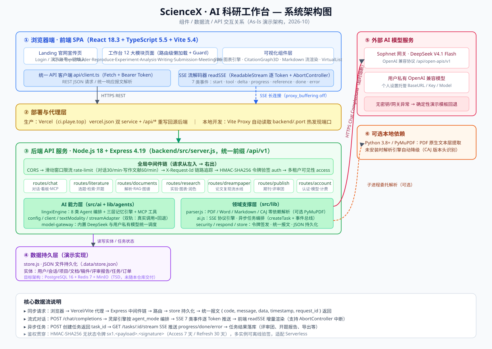
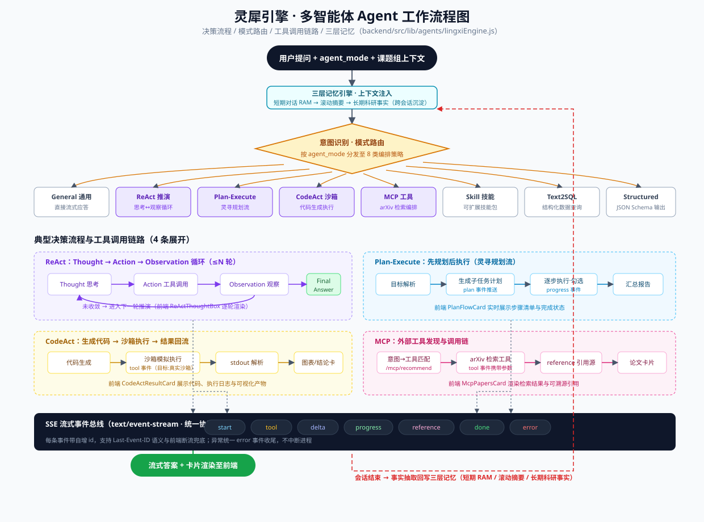

# ScienceX 参赛提交物汇总（系统架构图 · Agent 工作流程图 · 测试用例与结果）

> **文档说明**：本文档将三项核心提交物汇总为一页，便于评审快速查阅。详细版分别见：
> 系统架构图 [`architecture.svg`](./architecture.svg) ｜ Agent 工作流程图 [`agent-flow.svg`](./agent-flow.svg) ｜ 测试明细 [`测试用例与结果.md`](./测试用例与结果.md)
> 汇总日期：2026-10-04（与仓库代码实际状态同步）

---

## 一、系统架构图

### 1.1 六层架构总览

| 层级 | 组成 | 关键实现 |
| :---: | :--- | :--- |
| ① 浏览器端 | React 18.3 + TypeScript 5.5 + Vite 5.4 前端 SPA | Landing / Login / 12 大工作台模块（路由级懒加载 + Guard）；SVG 图表引擎、CitationGraph3D、Markdown 流渲染、VirtualList；统一 API 客户端 `api/client.ts`（REST + SSE 逐 Token 解码 `readSSE`，7 类事件） |
| ② 部署与代理层 | 生产 Vercel（ci.playe.top）／本地 Vite Proxy | `vercel.json` 双 service + `/api/*` 重写回源；Vite 自动读取 `backend/.port` 热发现端口 |
| ③ 后端 API 服务 | Node.js 18 + Express 4.19（统一前缀 `/api/v1`） | 中间件链：CORS → 滑动窗口限流 → X-Request-Id 链路追踪 → HMAC-SHA256 令牌验签 → 多租户可见性；7 个路由模块（chat / literature / documents / research / dreampaper / publish / account） |
| — AI 能力层 | `src/ai` + `lib/agents` | 灵犀引擎 lingxiEngine（8 类 Agent 编排 + 三层记忆 + MCP 工具）；model-gateway 统一调度内置 DeepSeek 与用户私有模型；config / client / textModality / streamAdapter 双轨设计（真实调用 + 确定性回退） |
| — 领域支撑层 | `src/lib` | parser.js 零依赖解析 PDF/Word/Markdown/CAJ（可选 PyMuPDF 加速）；ai.js SSE 协议引擎 + 异步任务编排；security / respond / store |
| ④ 数据持久层 | 演示实现：store.js JSON 文件持久化 | 实体：用户/会话/项目/文档/稿件/评审报告/任务/订单；目标架构（TSD）：PostgreSQL 16 + Redis 7 + MinIO |
| ⑤ 外部 AI 模型服务 | Sophnet 网关 · DeepSeek V4.1 Flash（OpenAI 兼容协议）+ 用户私有模型 | 个人设置托管 BaseURL / Key / Model；无密钥或网关异常时确定性演示模板回退 |
| ⑥ 可选本地依赖 | Python 3.8+ / PyMuPDF | PDF 原生文本层提取子进程委托；未安装时解析引擎自动降级 |

### 1.2 三类核心数据流

- **同步请求**：浏览器 → Vercel/Vite 代理 → Express 中间件链 → 路由 → store 持久化 → 统一报文 `{ code, message, data, timestamp, request_id }` 返回
- **流式对话**：`POST /chat/completions` → 灵犀引擎按 agent_mode 编排 → SSE 7 类事件逐 Token 推送 → 前端 `readSSE` 增量渲染（支持 AbortController 中断）
- **异步任务**：POST 创建任务返回 task_id → `GET /tasks/:id/stream` SSE 推送 progress/done/error → 任务结果落库（评审团、开题报告、导出等）
- **鉴权贯穿**：HMAC-SHA256 无状态令牌 `sx1.<payload>.<signature>`（Access 7 天 / Refresh 30 天），多实例可离线验签，适配 Serverless

---

## 二、Agent 工作流程图

### 2.1 决策主链路

用户提问（+ agent_mode + 课题组上下文）→ **三层记忆引擎上下文注入**（短期对话 RAM → 滚动摘要 → 长期科研事实跨会话沉淀）→ **意图识别与模式路由** → 8 类编排策略执行 → **SSE 事件总线**（plan / step / thought / tool / delta / progress / done）→ 前端专属卡片实时渲染（PlanFlowCard / ReActThoughtBox / CodeActResultCard / McpPapersCard）→ **记忆回写**形成闭环。

### 2.2 8 类编排模式

| 模式 | 策略 | 前端呈现 |
| :--- | :--- | :--- |
| General 通用 | 直接流式应答 | Markdown 流渲染 |
| ReAct 推演 | Thought → Action → Observation 循环（≤N 轮） | ReActThoughtBox 逐轮渲染 |
| Plan-Execute | 先规划后执行（灵寻规划流）：目标解析 → 子任务计划 → 逐步执行 → 汇总 | PlanFlowCard 步骤清单 |
| CodeAct 沙箱 | 代码生成 → 沙箱执行 → stdout 解析 → 图表/结论卡 | CodeActResultCard |
| MCP 工具 | 意图→工具匹配（`/mcp/recommend`）→ arXiv 检索等外部工具 | McpPapersCard |
| Skill 技能 | 可扩展技能包编排 | 技能调用通知 |
| Text2SQL | 结构化数据查询与 SOTA 聚合 | 数据表/图表 |
| Structured | JSON Schema 约束输出（三线表/审稿矩阵） | 结构化卡片 |

### 2.3 4 条典型工具调用链路

1. **ReAct**：Thought 思考 → Action 工具调用 → Observation 观察 → Final Answer（未收敛进入下一轮）
2. **Plan-Execute**：目标解析 → 生成子任务计划（plan 事件）→ 逐步执行勾选（progress 事件）→ 汇总报告
3. **CodeAct**：代码生成 → 沙箱模拟执行（tool 事件）→ stdout 解析 → 图表/结论卡
4. **MCP**：意图→工具匹配 → MCP 服务握手 → 工具调用 → 结果保留真实来源标识

---

## 三、测试用例与结果汇总

> 明细（55 条自动化用例逐条场景/输入/预期/实际）见 [`测试用例与结果.md`](./测试用例与结果.md)；以下为汇总。

### 3.1 结果总览

| 测试套件 | 用例数 | 结果 |
| :--- | :---: | :---: |
| api.test.js（API 接口与安全） | 16 | ✅ 全部通过 |
| routes.contract.test.js（路由契约与限流） | 15 | ✅ 全部通过 |
| ai-services.test.js（AI 服务层韧性/去重/溯源） | 14 | ✅ 全部通过 |
| ai.test.js（AI 模块接入） | 5 | ✅ 通过（3 条真实大模型用例 CI 无密钥自动跳过，属预期） |
| persistence.test.js（持久化并发安全） | 5 | ✅ 全部通过 |
| **自动化合计** | **55** | **✅ 55/55（CI 全量回归通过）** |
| AI 学术质量评测（eval/cases.json） | 12 | 需配置 DeepSeek 密钥运行（含 4 条"禁止编造"强制项） |
| 人工功能验收（docs/测试.md） | 21 | ✅ 全部通过 |

### 3.2 覆盖亮点

- **安全防护**：未授权 401、多租户资源隔离、SSRF 内网地址拦截、批量赋值白名单剔除、伪装扩展名内容嗅探、SSE 查询参数令牌仅限读
- **AI 服务韧性**：429/5xx 自动重试、连续失败熔断、流式 UTF-8 跨块解析、截断流不伪造 done、超时 deadline 全覆盖
- **学术可信**：跨源 DOI/arXiv 去重、引用页码溯源、无证据不伪造指标/数据、"不知道要说不知道"强制拒答评测
- **工程可靠性**：并发写按序串行落盘、单次失败不阻塞队列、真实磁盘无半写损坏、X-Request-Id 全链路透传、限流按 userId 分桶不误伤共享 IP

### 3.3 执行与复现方式

| 方式 | 命令 / 入口 | 说明 |
| :--- | :--- | :--- |
| CI 自动回归 | GitHub Actions（每次 push/PR） | Node.js 原生 test runner，零外部依赖；Actions 记录即通过凭证 |
| 本地复现 | `cd backend && npm test` | 自动创建临时数据目录，测试后销毁 |
| AI 质量评测 | `node backend/eval/run.js` | 需 `DEEPSEEK_API_KEY`，输出逐题得分报告 |

---

## 四、结论

1. **架构完整可讲**：六层架构 + 三类数据流 + HMAC 无状态鉴权适配 Serverless，图示与代码一一对应（As-Is 口径）。
2. **Agent 叙事清晰**：三层记忆 → 模式路由 → 8 类编排 → SSE 总线 → 记忆回写全闭环，4 条工具链路均有前端专属可视化卡片。
3. **质量证据充分**：55 条自动化用例 CI 全量通过 + 12 条学术评测门禁 + 21 项人工验收，全部随仓库交付、可克隆复现。
