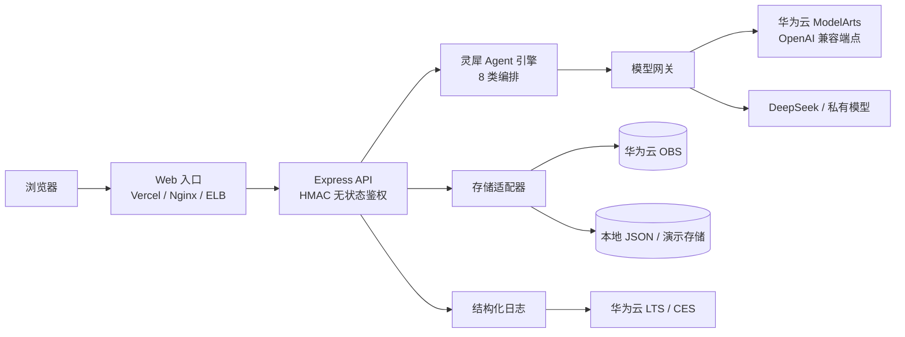

# ScienceX 华为云服务集成方案

> **文档定位**：说明 ScienceX 如何结合华为云服务提升能力，区分「已完成的协议层适配」与「待租户验证的集成规划」，避免把规划写成已交付。
> **对应评分项**：技术架构与工程质量（15 分）第 3 条——是否结合华为云其他服务提升能力。

---

## 一、现状与差距

| 项 | 现状 | 差距 |
| :--- | :--- | :--- |
| 模型调用 | 默认 Sophnet 网关 DeepSeek V4.1 Flash；支持任意 OpenAI 兼容私有端点 + 6 类协议适配 | 未接入华为云侧推理端点 |
| 对象存储 | 文档与解析产物落本地/演示存储 | 未接 OBS |
| 可观测 | `X-Request-Id` 全链路 + pino 结构化日志 | 未接 CES/LTS |
| 部署 | Vercel 双服务 + Docker（node:20-alpine） | 未在 CCE/CAE 实跑 |

本项目**不绑定任何单一模型厂商**，模型网关是可插拔的：这为接入华为云提供了低改造成本的前提。

---

## 二、已完成：华为云 ModelArts 协议适配（代码级）

### 2.1 改动清单

| 层 | 文件 | 改动 |
| :--- | :--- | :--- |
| 协议适配 | `backend/src/ai/providers.js` | `PROVIDERS` 新增 `huaweicloud`，复用 OpenAI 兼容 `/chat/completions` 分支（Bearer 鉴权、`stream_options.include_usage`、`max_tokens`、`response_format`） |
| 请求契约 | `backend/shared/api-schemas.js` | `POST /models` 的 `provider` 枚举同步新增 `huaweicloud`，OpenAPI 同源输出 |
| 前端入口 | `frontend/src/pages/chat/AddModelModal.tsx` | "接口协议"新增「华为云 · ModelArts 兼容」选项，与 OpenAI/Anthropic/Gemini/Ollama 并列 |
| 回归用例 | `backend/test/ai-services.test.js` | 断言 `huaweicloud` 请求 URL、鉴权头与响应解析；当前 14/14 通过 |

### 2.2 设计原则

1. **不预设域名**：Base URL 完全由用户在设置页填写，代码中不硬编码任何厂商地址，避免"假集成"。
2. **不新增依赖**：复用现有 `fetch` 网关、重试、熔断、用量统计与限流能力。
3. **不改动既有协议**：`openai/deepseek/custom/anthropic/gemini/ollama` 行为不变，新增类型不影响历史模型配置。

### 2.3 接入步骤（用户侧）

1. 在华为云控制台开通模型推理服务，取得 **OpenAI 兼容端点 Base URL**、**API Key**、**模型名称**；
2. 打开 ScienceX → 个人设置 / AI 工作台 → 添加模型；
3. 接口协议选择「华为云」，填写 Base URL（形如 `https://<你的推理端点>/v1`）、模型名、API Key；
4. 点击保存，系统会发起**真实连通测试**，通过后才入库并标记「已连接」；
5. 在工作台切换到该模型，即可复用流式输出、重试熔断、用量统计与 RAG。

> 说明：若华为云侧端点为非 OpenAI 兼容协议（如需要 IAM Token 换取的私有签名协议），则需在 `providers.js` 增加独立适配分支；当前已完成的是 OpenAI 兼容路径。

### 2.4 真实性边界

- 已完成：协议枚举、请求构造、前端入口、契约与用例。
- **未完成**：使用真实华为云租户密钥的端到端连通验证与延迟/费用实测。
- 因此文档口径为"**协议层已就绪，可直接配置接入**"，而非"已完成华为云生产集成"。

---

## 三、规划：对象存储 OBS

**价值**：文献原文件、解析产物（sections/figures）、评测报告与导出文件集中存储，支持多实例共享与生命周期管理。

**改造点**（接口已隔离，改造成本可控）：

| 步骤 | 位置 | 说明 |
| :---: | :--- | :--- |
| 1 | `backend/src/routes/documents.js` | 将本地写入改为存储适配器调用 |
| 2 | 新增 `backend/src/lib/object-storage.js` | 抽象 `put/get/delete/signUrl`，本地实现与 OBS 实现可切换 |
| 3 | `backend/.env.example` | 新增 `STORAGE_DRIVER`、`OBS_ENDPOINT`、`OBS_BUCKET`、`OBS_ACCESS_KEY`、`OBS_SECRET_KEY` |
| 4 | 权限 | 私有桶 + 临时签名 URL，禁止公开读；密钥只走环境变量 |

**验收**：上传文档 → 结构化产物写入 OBS → 删除文档时同步清理对象；断网/密钥缺失时回退本地存储并告警。

---

## 四、规划：可观测（CES / LTS）

现有基础已具备对接条件：

- 每条请求带 `X-Request-Id`，pino 输出 JSON 日志（含 `request_id / method / path / status / duration_ms`）；
- AI 调用记录 token 用量与耗时，可映射为自定义指标。

对接方式：

1. 容器标准输出由日志采集侧（LTS）收集，按 `level`、`event`、`status` 建索引；
2. 关键指标上报 CES：请求成功率、P95 延迟、AI 调用失败率、限流触发数、Harness 门禁失败数；
3. 告警规则：5xx 比例、SSE 中断率、模型熔断触发。

---

## 五、规划：部署（CCE / CAE）

- 现有 `backend/Dockerfile`（node:20-alpine）可直接构建镜像；
- 多实例部署必须统一 `SCIENCEX_MASTER_KEY`，否则令牌无法跨实例验签；
- 无状态设计已就绪（HMAC 令牌 + 外部限流可选），但 **JSON Store 不支持多副本并发写**，上 CCE 前需先完成数据层迁移（PostgreSQL + Redis），或限定单副本 + 持久卷；
- SSE 需在负载均衡层关闭缓冲、延长读超时（与 Nginx 配置一致）。

---

## 六、目标架构

---

## 七、任务清单与优先级

| 优先级 | 任务 | 产出 | 状态 |
| :---: | :--- | :--- | :---: |
| P0 | 华为云 ModelArts 协议适配 + 用例 | 代码 + 测试 | ✅ 已完成 |
| P0 | 集成方案与边界声明 | 本文档 | ✅ 已完成 |
| P1 | 真实租户端到端连通与耗时/费用记录 | 验证记录 | ⏳ 待条件 |
| P1 | OBS 存储适配器 + 回退策略 | 代码 + 用例 | ⏳ 规划 |
| P2 | CES 指标与告警规则 | 配置 | ⏳ 规划 |
| P2 | 数据层迁移后再上 CCE 多副本 | 架构升级 | ⏳ 规划 |

---

*相关文档：`README.md` 技术栈与部署章节 ｜ `backend/.env.example` ｜ `docs/TSD.md` ｜ `区域赛评分.md`*