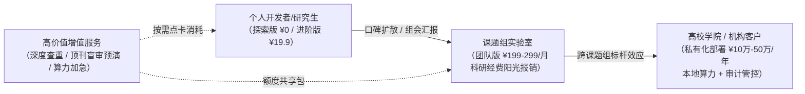
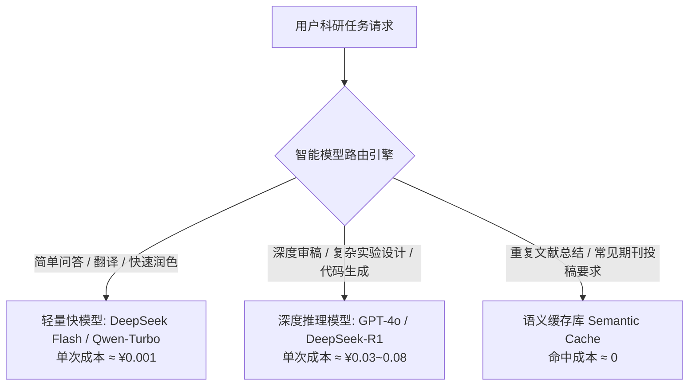
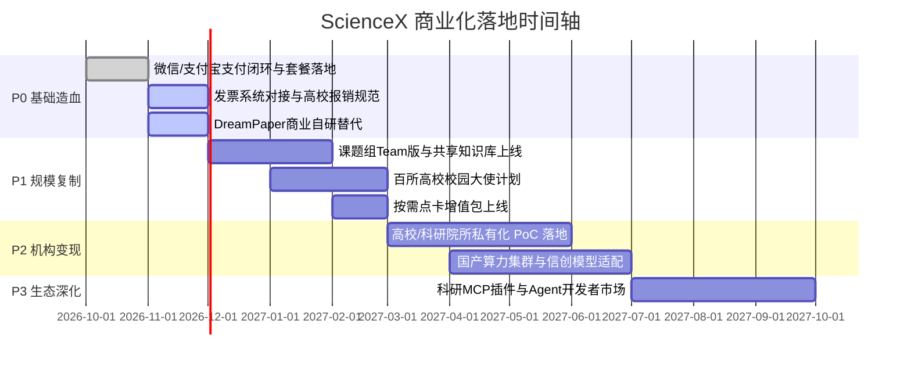

# 🧪 ScienceX · AI 科研工作台 —— 商业化落地与商业模式全景方案

> **文档版本**：v1.0 ｜ **撰写角色**：商业化与战略规划团队 ｜ **最后更新**：2026-10-19  
> **关联依据**：`docs/PRD.md`（产品功能与四档定价）、`docs/运营.md`（增长漏斗与WATC指标）、`docs/路演.md`（投资亮点与成本核算）、`docs/DREAMPAPER_INTEGRATION.md`（许可风险与替代路径）

---

## Executive Summary 核心执行摘要

ScienceX 作为覆盖「选题 → 文献 → 实验 → 图表 → 写作 → 投稿 → 协作」全生命周期的科研 AI 工作台，区别于传统单点型学术工具（如仅做润色或仅做引用图谱），具备**高粘性、长生命周期、强组织协同**的产品属性。

当前产品已具备扎实的工程基线与模型网关能力，商业化的关键在于**破除"学生白嫖/高算力成本吞噬利润"的常见AI产品陷阱**，构建起：
1. **底层引擎**：通过「动态模型路由 + BYOK + 任务级语义缓存」筑牢 60%+ 的毛利率护城河；
2. **增长飞轮**：以「个人版高性价比学生价」做大用户漏斗与学术口碑，顺势引导进入「课题组版（Team）」实现科研经费阳光化买单；
3. **终局变现**：依托「私有化机构版（Enterprise）」切入高校信息中心与产业研发院，撬动高客单价年度大单。

---

## 一、目标客群、支付能力与买单痛点分析

科研工具的商业化必须明确**“使用者（User）”与“买单者（Buyer）”的分离关系**：

| 用户群体 | 典型角色 | 付费能力 | 买单痛点与强需求 | 预算来源与决策周期 |
| :--- | :--- | :--- | :--- | :--- |
| **P1 硕博研究生 / 毕业冲刺生** | 硕士、博士、高年级本科生 | 偏弱（个人月均预算 ¥20~¥50） | 毕业硬指标迫近、组会被导师训斥、英文写作生硬被拒、查重降重焦虑。迫切需要降门槛、出成品。 | 个人生活费自付；决策极快（10分钟内看效果即决定冲月卡）。 |
| **P2 青年学者 / 博士后 / 讲师** | 28-38 岁高校青年教师、博后 | 中等偏强（年均学术工具支出 ¥500~¥2000） | 评职称晋升倒计时、基金申报评审苛刻、国际顶刊投稿周期长、审稿人意见刁钻难以应对。 | 个人科研启动金/自付；关注数据安全与专家盲审专业度。 |
| **P3 课题组导师 / 实验室 PI** | 教授、副教授、学科带头人 | 强（年团队软件经费 ¥5,000~¥30,000） | 团队知识散落、前人代码文档无法传承、新人入门导师指导耗尽精力、组会汇报低效。 | **项目纵向/横向科研经费报销**；需合规发票，决策周期 1-3 周。 |
| **P4 高校院系 / 图书馆 / 研究所** | 图书馆馆长、网信办主任、院长 | 极强（项目制 ¥10万~¥80万/年） | 统一科研数据主权、AI 学术诚信与监管审计、多模型统一纳管、对标头部高校数字科研底座。 | 政府采购预算/双一流专项经费；招投标流程，周期 2-6 个月。 |
| **P5 工业界研发人员 / 药企与科技公司** | 算法工程师、芯片材料研发员、调研员 | 强（部门采购 ¥2,000~¥8,000/席位/年） | 技术前沿调研（SOTA跟踪）、论文算法复现落地慢、竞品专利与论文交叉验证。 | 企业研发预算；关注知识产权合规、数据不出域。 |

---

## 二、六大商业模式推荐与体系设计

针对上述五类客群，ScienceX 规划了相互咬合的六大商业模式：

### 模式 1：PLG 免费增值 + 个人阶梯 SaaS 订阅（主打漏斗走量）
- **商业逻辑**：Product-Led Growth（产品驱动增长），通过免费版体验基础全链路，利用高频科研冲刺痛点转化为低门槛订阅。
- **阶梯设计**：
  - **🌱 探索版（FREE）**：¥0。每日 30 次基础对话、文献精读 5 篇/月、基础润色与翻译。目标：占领心智、采集真实评测样本。
  - **⭐ 科研进阶版（PRO）**：**¥19.9/月**（连续包月 ¥15.9/月，年付优惠 ¥168/年）。无限对话、三栏精读与引用溯源、完整消融实验矩阵、专家盲审 10 次/月、双通道查重降重、组会 PPT 生成。
- **毛利保障**：默认调用高性价比模型（DeepSeek V4.1 Flash/Qwen-Turbo），高价值任务（盲审、代码执行）调用强模型但扣除额度。

### 模式 2：课题组实验室席位制订阅（主打经费阳光化变现，LTV 核心）
- **商业逻辑**：以 PI（导师）为中心，解决多人协作与知识资产沉淀，解决个人版续费率随毕业断崖下跌的顽疾。
- **定价机制**：
  - **👥 课题组标准版（TEAM-Standard）**：**¥199 / 月**（或 ¥1,999 / 年），含 10 个席位；
  - **👥 课题组进阶版（TEAM-Pro）**：**¥399 / 月**（或 ¥3,888 / 年），含 25 个席位。
- **核心卖点**：
  - 课题组私有 RAG 知识库（历届学长代码、组内开题/中报/结题报告、组会沉淀）；
  - 导师批注与修改意见一键归档分发；
  - 团队统一结算，开具正规「**软件技术服务费**」或「**科技信息检索服务**」增值税发票，支持高校财务对公转账报销。

### 模式 3：机构私有化部署与年度授权许可（主打高客单价现金流）
- **商业逻辑**：针对 985/211 高校、中科院所、大型央国企研究院及药企，提供本地部署版（Enterprise）。
- **交付与收费模式**：
  - **单校/单院私有化授权费**：**¥150,000 ~ ¥500,000 首年交付**（含系统部署、UI定制、统一身份认证SSO集成、知识库初始化迁移）；
  - **年度软件维保与升级费（MA）**：按合同额 15%~20%/年（约 ¥30,000 ~ ¥80,000/年）；
  - **算力适配**：支持客户自建算力池（昇腾、海光、英伟达 GPU 集群）接入私有化部署的大模型（Qwen2.5/DeepSeek/ChatGLM）。

### 模式 4：按量计费与高价值增值点卡包（混合变现补充）
- **商业逻辑**：针对低频但极重度的阶段性需求（如毕业季送审前 3 天、重大期刊截稿前），用户不愿长期订阅但愿意单次大额付费。
- **增值产品池（Token / 点卡定价）**：
  - **学术双通道深度查重包**：¥15 / 篇（比对知网/万方/CrossRef库，出具重复率走势与保义降重建议）；
  - **顶刊专家评审团盲审全案（5角色深评）**：¥29 / 次（调用大参数推理模型，提供 15 页结构化评审报告）；
  - **组会/路演 PPT 深度重构**：¥9.9 / 套（高清排版、图表代码重绘）；
  - **算力加速包**：¥10 购买 50 万高阶推理 Token（保障截稿高峰期免排队）。

### 模式 5：极客 BYOK（自带 Key）轻量服务费模式
- **商业逻辑**：允许科研极客与实验室填入自己的 OpenAI / Anthropic / DeepSeek 官方 API Key。
- **盈利方式**：平台不再承担模型调用成本，收取极低的**平台工具层服务费**（¥6.9/月 或 年费 ¥59），提供工作台全套 8 种 Agent 编排、向量存储、公式图表解析及课题管理能力，几乎零边际成本获客。

### 模式 6：学术 MCP 工具与科研 Agent 插件市场分成（长期生态）
- **商业逻辑**：开放平台开发者接口，高校师生或第三方机构可上架专属领域 Agent（如：生信基因分析 Agent、化学分子式生成 Agent、LaTeX 期刊模板转写工具）。
- **分成机制**：平台按 7:3 分成，促进科研生态由封闭走向网络效应。

---

## 三、商业模式全方位对比分析矩阵

为清晰评估各商业模式的投入产出比与可行性，以下从 11 个关键商业维度进行横向对比：

| 评估维度 | 模式 1：个人 SaaS 订阅 (PRO) | 模式 2：课题组席位制 (TEAM) | 模式 3：机构私有化 (ENTERPRISE) | 模式 4：按需点卡增值包 | 模式 5：极客 BYOK 模式 | 模式 6：学术插件生态市场 |
| :--- | :--- | :--- | :--- | :--- | :--- | :--- |
| **目标客户** | 硕博生、高年级本科生 | 导师、课题组 PI、实验室 | 高校院所、企业研究院 | 临近截稿/答辩冲刺人员 | 极客学者、已有 Key 的团队 | 第三方开发者、学术科研博主 |
| **收费模式** | 按月/按年订阅（¥19.9/月） | 按年/按月席位包（¥1999/年） | 项目实施费 + 年费许可 | 单次按件/按点卡购买 | 低价工具使用年费/月费 | 收益流水 30% 分成 |
| **典型客单价 (ARPU)** | ¥150 ~ ¥240 / 年 | ¥2,000 ~ ¥4,500 / 年 | **¥150,000 ~ ¥500,000 / 单** | ¥10 ~ ¥80 / 次 | ¥59 ~ ¥99 / 年 | 平台分成，长尾弹性 |
| **获客成本 (CAC)** | **低**（口碑、B站/小红书裂变） | **中**（学术会议、校内内推） | **极高**（B2B直销、招投标） | 极低（平台内场景式触发） | 低（技术博客、GitHub开源） | 低（开发者社区沉淀） |
| **毛利率** | 50% ~ 65%（受Token波动） | **75% ~ 85%**（多人平摊算力） | 65% ~ 75%（含交付实施人力） | **70% ~ 80%**（高溢价定价） | **90%+**（无大模型成本） | **85%+**（纯平台分成） |
| **用户生命周期价值 (LTV)**| 中偏低（随毕业流失，约1-2年）| **极高**（届届传承，3-5年以上）| **极高**（年年续费，强绑定） | 阶段性，随节点爆发 | 中等，高技术用户忠诚度高 | 平台型 LTV |
| **现金流与回款周期** | T+0 实时到账（微信/支付宝） | T+7（需配合开票报销对公转账）| T+90~180（财政审批/招投标） | T+0 实时到账 | T+0 实时到账 | T+30 结算分成 |
| **研发与运维成本** | 低（现有架构完全支持） | 中（需完善多租户权限与共享库）| 高（需支持本地 Docker/K8s 打包）| 低（按量计费与积分表改造） | 极低（仅需鉴权与调度） | 高（需开放平台 SDK 与沙箱）|
| **合规与风控门槛** | 低（个人学术诚信自负） | 中（课题组数据隔离） | **高**（需通过公安等保、涉密排查）| 低 | 极低（客户承担模型风险） | 中（需审核第三方代码安全）|
| **业务护城河** | 弱（竞品降价易被迁移） | **强**（组内沉淀了大量历史课题）| **极强**（招投标替换成本极高）| 弱（功能性即买即走） | 中（极客认同感与开放生态） | 极强（双边网络效应） |
| **综合推荐指数** | ⭐⭐⭐⭐ (必须落地) | ⭐⭐⭐⭐⭐ (最核心造血支柱) | ⭐⭐⭐⭐ (规模化利润爆发点) | ⭐⭐⭐⭐ (立竿见影的利润补充) | ⭐⭐⭐ (技术形象与极客壁垒) | ⭐⭐ (中远期战略布局) |

---

## 四、商业化关键策略推荐（GTM 与落地支撑）

### 4.1 获客与渠道策略（Acquisition Strategy）
1. **“课题组种子合伙人”校园渗透计划**：
   - 招募 100 位头部高校（清北华五及重点工科院校）的硕博研究生为校园大使，赠送其所在课题组为期 3 个月的 Team 版；
   - 只要课题组在组会中使用 ScienceX 生成汇报 PPT 或在论文致谢中提及 ScienceX，直接免除下一年团队软件费用。
2. **论文复现与学术痛点内容营销**：
   - 将现有真实交付的 Agent 架构与论文复现引擎在知乎、B站、小红书打造专栏《研究生如何用 AI 3小时跑通 SOTA 论文》、《告别深夜被拒：5位AI审稿人预审实测》；
   - 紧扣“开题季（每年10-12月）”、“毕业投稿季（每年3-6月）”进行爆发式节奏投放。
3. **开源生态反哺商业化**：
   - 保持部分基础工具（如引用图谱可视化、CCF 目录速查器）开源，在 GitHub 沉淀技术星标（Star），向官网商业版导流。

### 4.2 转化与付费“钩子”策略（Conversion & Hook Strategy）
1. **最短价值转化链路（Aha Moment 缩短至 5 分钟）**：
   - 新注册用户引导直接上传 1 篇目标 PDF 论文，系统在 60 秒内输出「中英对照七段式总结 + 3D 引用图谱」；
   - 提供 1 次免费的「专家盲审精简版（2个角色）」，当用户看到极具学术深度的审稿意见时，立刻弹出：*“升级 Pro 档解锁 5 位专家深度盲审并获得消融方案建议，仅需 ¥19.9”*。
2. **“学术焦虑截点”精准转化**：
   - 在论文写作页面设置“截稿倒计时助手”，当检测到临近 CCF 会议 Deadline（< 7天）时，主动推送“论文冲刺加速包（降重+格式排版+评审预演）”。

### 4.3 留存与防流失策略（Retention Strategy）
1. **组织资产“锁死”效应**：
   - 课题空间不仅存文件，还关联实验参数矩阵、多轮对话记忆、导师评语历史。更换工具意味着整个课题组丢失可追溯资产，迁移成本极高。
2. **科研周报与进展追踪（Weekly Scientific Digest）**：
   - 每周日晚自动汇总生成“本周文献精读量、实验消融进度、论文撰写字数”，自动推送到用户邮箱/微信通知，持续唤醒用户。

### 4.4 单位经济模型（UE）与成本精细化管控策略
要维持商业模式的长期健康，**毛利率必须控制在 65% 以上**。核心举措包括：

1. **动态模型路由分级调用**：
   - 80% 的日常检索、翻译、初级润色、图表渲染请求走低成本模型网关；
   - 仅对 20% 的高阶多智能体评审团、代码沙箱执行调用大参数强模型。
2. **科研特定数据语义缓存**：
   - 对 arXiv/PubMed 上热门论文的七段式总结建立全平台公有缓存，相同文献二次阅读直接返回缓存，Token 成本趋近于 0。
3. **用户用量分桶与风控**：
   - 基于后端已落地的限流体系（按用户分桶），防范爬虫脚本刷取 Token，单用户异常消耗自动降级到本地备用模型。

### 4.5 财务报销与学术合规风控策略
1. **科研经费合规化闭环**：
   - 联合国内第三方正规财税服务商，支持电子增值税普通发票与专用发票全自动化开具；
   - 发票开具内容规范化为高校财务处标准认可类目：`*信息技术服务*软件使用许可费`、`*信息技术服务*数据处理与分析服务`。
2. **DreamPaper 知识产权隔离**：
   - 当前项目引用的 DreamPaper 遵循 *PolyForm Noncommercial 1.0.0* 许可（禁止商业使用）；
   - **合规动作**：商业化版本必须立即完成代码隔离，组会汇报 PPT 导出采用平台自研交互引擎（基于 pptxgenjs / 模板化重构），仅借鉴其产品交互逻辑，彻底消除潜在商用侵权隐患。
3. **学术诚信免责与溯源防伪**：
   - 生成内容均默认附带《AI 学术辅助使用透明声明》，严守“无证据不编造”底线，提供真实 DOI/arXiv 页码溯源，保护使用者的学术信誉。

---

## 五、商业化实施阶段与优先级路线图（Roadmap）

我们按照**“技术代价、变现速度、合规风险、现金流价值”**四个维度对各项商业动作进行优先级（P0/P1/P2/P3）划分：

### 优先级详表与落地指标

| 优先级 | 建设周期 | 核心商业动作 | 技术/业务交付物 | 关键考核指标 (KPI) |
| :--- | :--- | :--- | :--- | :--- |
| **P0 紧急核心 (第1-2月)** | **M1-M2** | 1. 跑通线上真实支付通道（微信支付/支付宝/企业转账）； 2. 个人版 PRO（¥19.9/月）商业闭环上线； 3. 对接电子发票系统（支持高校报销）； 4. **DreamPaper 代码剥离，完成商业化自研 PPT 模块上线**（消除侵权风险）。 | 1. 支付回调 webhook 与账单记录表； 2. 个人中心一键开票功能； 3. 自研 PPTX 生成引擎。 | 1. 支付成功率 ≥ 99.5%； 2. 首月付费转化率 ≥ 2%； 3. 0 侵权隐患。 |
| **P1 重点发力 (第3-5月)** | **M3-M5** | 1. 推出课题组标准版（TEAM ¥199/月），支持对公打款开票； 2. 落地多租户共享 RAG 知识库与导师意见看板； 3. 上线高价值按需增值包（深度查重、5角色评审盲审）； 4. 启动“百所高校校园大使计划”。 | 1. 课题组席位管理与角色权限控制； 2. 增值点卡计费流水线； 3. 校园大使裂变追踪邀请码系统。 | 1. 签约课题组 ≥ 30 个； 2. 月经常性收入（MRR）≥ ¥30,000； 3. 校园注册用户达 10,000+。 |
| **P2 规模变现 (第6-9月)** | **M6-M9** | 1. 推出高校/院所私有化部署版本（Enterprise）； 2. 支持本地 Docker / Helm / 昇腾信创算力一键部署； 3. 对接学校统一身份认证（CAS/OAuth/SAML）； 4. 参与高校图书馆/数字科研平台招投标。 | 1. 企业版本地化私有化镜像包； 2. SSO 与安全审计日志系统； 3. 招投标标书与资质认证材料。 | 1. 签约高校/院所标杆客户 ≥ 3 家； 2. 单项目合同额 ≥ ¥150,000； 3. 实现季度盈亏平衡。 |
| **P3 生态深耕 (第10-12月)**| **M10-M12**| 1. 开放学术 MCP 插件与领域 Agent 开发者平台； 2. 上线开发者收益分成结算系统； 3. 与学术期刊/学术出版集团展开投稿助手联运合作。 | 1. Open API 平台与沙箱环境； 2. 插件上架审核与分成结算中心； 3. 期刊直投绿色通道接口。 | 1. 第三方科研 Agent 插件 ≥ 50 个； 2. 平台分成佣金月流水破万； 3. 形成多边网络壁垒。 |

---

## 六、商业化风控与退出备选方案

1. **大模型成本价格战风险**：
   - 应对：持续优化提示词长度（Prompt 剪枝），推行 BYOK 模式，绝不将平台溢价绑定在单一模型上，而是绑定在“科研工作流编排与课题资产积累”上。
2. **高校经费报销审计收紧风险**：
   - 应对：与具备正规科研服务外包资质的高校校属企业、国家技术转移中心建立联合运营，合规出具课题外协或文献查新服务合同。
3. **学生毕业流失风险**：
   - 应对：毕业生账号保留终身“校友学术空间”（轻量免费存储），促成其在进入新工作单位或新博后流动站时，将 ScienceX 作为首选生产力工具引流至新团队。

---

> **结论与行动指南**：  
> 立即按照 **P0 阶段规划**，先上线个人版低门槛付费订阅与高校发票系统，完成自研 PPT 模块对 PolyForm 许可的合规替换；同步启动 **P1 课题组团队版** 的研发与校园大使招募，让 ScienceX 从竞赛获奖作品正式迈入可持续盈利的高增长学术商业化轨道。
