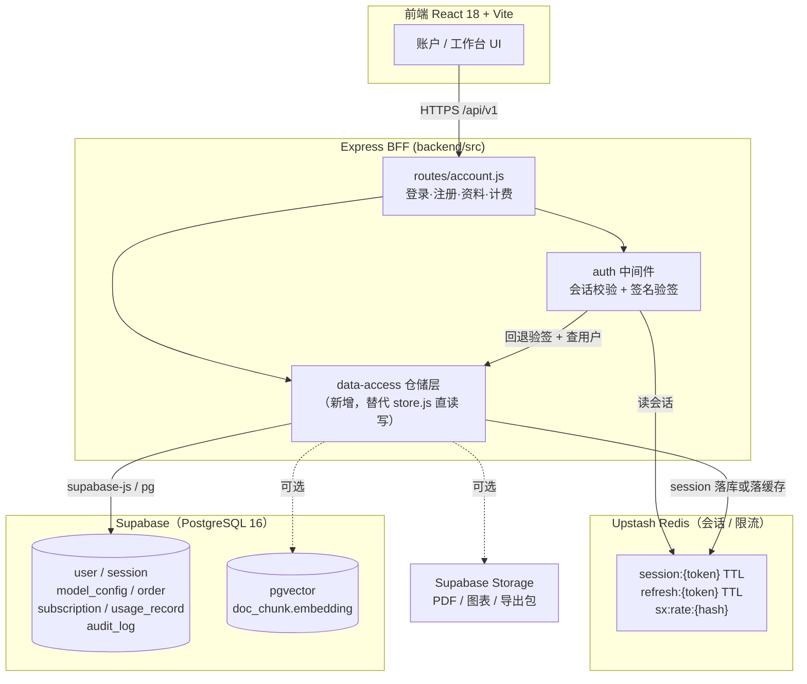

# ScienceX 数据库对接方案与账户数据持久化实施指南

> 本文档基于对 ScienceX 代码库（`backend/src/lib/store.js`、`backend/src/lib/persistence.js`、`backend/src/lib/security.js`、`backend/src/lib/rate-limit.js`、`backend/src/routes/account.js`、`backend/src/server.js`、`vercel.json`）与设计文档（`docs/TSD.md` §4.4 核心表结构、`docs/PRD.md`）的全面分析生成。
>
> **核心结论（先读这段）**：当前账户数据是「**进程内存数组 + 单文件 JSON 全量快照**」的演示级持久化，在 Vercel Serverless 多实例环境下**无法保证账户数据一致性与不丢失**。本文档在对比 6 类主流方案后，**首选推荐 Supabase 全家桶**（托管 PostgreSQL + Auth + Storage），并给出从环境变量配置到代码改造、数据迁移、部署验证的**完整分步操作教程**。

---

## 目录 (Table of Contents)

- [一、现状分析](#一现状分析)
  - [1.1 当前数据存储全景（代码事实）](#11-当前数据存储全景代码事实)
  - [1.2 账户相关数据现状清单](#12-账户相关数据现状清单)
  - [1.3 现有持久化机制的七大局限](#13-现有持久化机制的七大局限)
  - [1.4 账户持久化的目标要求](#14-账户持久化的目标要求)
- [二、数据库对接方案对比](#二数据库对接方案对比)
  - [2.1 候选方案总览对比表](#21-候选方案总览对比表)
  - [2.2 逐方案深度分析](#22-逐方案深度分析)
  - [2.3 选型结论与推荐架构](#23-选型结论与推荐架构)
- [三、账户数据模型与安全设计（Supabase / PostgreSQL）](#三账户数据模型与安全设计supabase--postgresql)
  - [3.1 表结构设计](#31-表结构设计)
  - [3.2 存量集合 → 数据表映射](#32-存量集合--数据表映射)
  - [3.3 完整建表 SQL（DDL）](#33-完整建表-sqlddl)
  - [3.4 安全设计（RLS / 加密 / 会话）](#34-安全设计rls--加密--会话)
  - [3.5 鉴权迁移的两条路线](#35-鉴权迁移的两条路线)
- [四、具体操作教程（Step by Step）](#四具体操作教程step-by-step)
- [五、数据迁移与验证清单](#五数据迁移与验证清单)
- [六、风险、成本与合规](#六风险成本与合规)
- [七、附录](#七附录)

---

## 一、现状分析

### 1.1 当前数据存储全景（代码事实）

ScienceX 后端是一个 **Node.js + Express BFF**（`backend/src/server.js`），演示环境**没有接入任何真实数据库**，全部数据由 `backend/src/lib/store.js` 以**模块级内存变量**承载，并通过 `backend/src/lib/persistence.js` 将若干集合**整体快照**写成一个 JSON 文件。

```
┌──────────────────────────────────────────────────────────────────────┐
│  Express BFF (backend/src)                                           │
│                                                                      │
│   routes/account.js  routes/chat.js  routes/documents.js  ...        │
│         │                │               │                           │
│         └────────────────┴───────────────┘                          │
│                          ▼                                           │
│   lib/store.js  ── 内存数组/对象（users / sessions / orders / ...）  │
│         │                                                            │
│         │  store.persist()  （每次写请求 finish 触发，见 server.js L40）│
│         ▼                                                            │
│   lib/persistence.js ── 写队列 + 临时文件 + fsync + rename（原子写）  │
│         ▼                                                            │
│   .data/store.json （单文件全量 JSON 快照，当前约 112 KB）           │
└──────────────────────────────────────────────────────────────────────┘
```

**关键代码位置**：

| 关注点 | 文件与位置 | 说明 |
| :--- | :--- | :--- |
| 内存数据源 | [store.js](file:///e:/Code/AI/Start/Web/Science/backend/src/lib/store.js#L13-L30) | `users`、`sessions`、`customModels`、`orders`、`subscription` 等全部为内存变量 |
| 用户主表 | [store.js](file:///e:/Code/AI/Start/Web/Science/backend/src/lib/store.js#L13-L27) | 演示账号 `demo@sciencex.cn`，密码 `scrypt$...` |
| 内存会话表 | [store.js](file:///e:/Code/AI/Start/Web/Science/backend/src/lib/store.js#L29) | `const sessions = new Map()` —— **进程内存，非持久化** |
| 落盘集合白名单 | [store.js](file:///e:/Code/AI/Start/Web/Science/backend/src/lib/store.js#L898-L902) | 仅 17 个集合参与持久化 |
| 原子写实现 | [persistence.js](file:///e:/Code/AI/Start/Web/Science/backend/src/lib/persistence.js#L6-L31) | 串行队列 + `wx` 独占创建 + `fsync` + `rename` |
| 可写目录回退 | [store.js](file:///e:/Code/AI/Start/Web/Science/backend/src/lib/store.js#L882-L896) | 主目录不可写时回退到 `os.tmpdir()` |
| 写触发点 | [server.js](file:///e:/Code/AI/Start/Web/Science/backend/src/server.js#L39-L46) | 仅在 POST/PUT/PATCH/DELETE 的 `res.finish` 时异步 `store.persist()` |
| 令牌方案 | [security.js](file:///e:/Code/AI/Start/Web/Science/backend/src/lib/security.js#L42-L73) | HMAC-SHA256 无状态签名令牌（`sx1.<body>.<sig>`）+ 内存会话镜像 |
| 双校验鉴权 | [account.js](file:///e:/Code/AI/Start/Web/Science/backend/src/routes/account.js#L33-L61) | 先查内存 `sessions`（支持即时吊销），再回退签名验签 |
| 共享限流 | [rate-limit.js](file:///e:/Code/AI/Start/Web/Science/backend/src/lib/rate-limit.js#L45-L72) | 已内置 memory / Redis / Upstash 三种后端（**数据库化的最佳切入样板**） |

### 1.2 账户相关数据现状清单

账户域（`routes/account.js`）涉及的数据及其当前形态：

| 数据对象 | 当前存储位置 | 是否落盘 | 关键字段 |
| :--- | :--- | :---: | :--- |
| 用户主档 | `store.users` 数组 | ✅（store.json） | `id, email, password(scrypt), name, title, avatar, research_tags[], lang, plan, created_at` |
| 登录会话 | `store.sessions` Map | ❌（纯内存） | `token → { user_id, refresh_token, expires_at, refresh_expires_at }` |
| 自定义模型 | `store.customModels` 数组 | ✅ | `owner_id, provider, base_url, model_name, api_key_masked, api_key_encrypted, priority, status` |
| 订阅 | `store.subscription` 单对象 | ✅ | `plan, price, period, expire_at, auto_renew, quota{}, used{}` |
| 订单 | `store.orders` 数组 | ✅ | `owner_id, order_no, plan, amount, pay_status, invoice{}` |
| 用量记录 | `store.usageRecords` 数组 | ✅ | `user_id, date, scene, model, prompt_tokens, completion_tokens, cost, source` |
| 审计日志 | `store.auditLogs` 数组 | ❌（未纳入白名单） | `user_id, action, resource, ip, result, ts` |

> **注意**：`sessions`（会话）与 `auditLogs`（审计日志）**均未纳入持久化白名单**，前者是设计使然（内存镜像），后者是遗漏。二者恰是账户安全最关键的两块数据。

### 1.3 现有持久化机制的七大局限

| 序号 | 局限 | 证据 / 原理 | 生产影响 |
| :---: | :--- | :--- | :--- |
| 1 | **Serverless 多实例内存不共享** | Vercel 每个函数实例独立进程；`store.sessions` 为进程内存 Map | 实例 A 登录、实例 B 校验 → 只走签名验签可通，但**登出无法即时吊销**；改密/踢线等能力失效 |
| 2 | **实例本地文件系统隔离** | Vercel `/var/task` 只读 → [store.js](file:///e:/Code/AI/Start/Web/Science/backend/src/lib/store.js#L882-L896) 回退 `os.tmpdir()` | 各实例各写各的 `/tmp`，**数据不共享**；实例回收后**写入全部丢失** |
| 3 | **单文件全量快照写放大** | 每次写请求把 17 个集合整体 `JSON.stringify` 落盘 | 数据增长后**每次写 O(全量)**，并发写放大 IO，是性能瓶颈 |
| 4 | **无并发保护 / 无事务** | 仅靠单进程内写队列串行；跨实例无锁 | 多实例并发下 **last-write-wins**，注册/订单等写操作可能互相覆盖 |
| 5 | **无查询与索引能力** | `find` / `filter` 全表遍历，如 [account.js](file:///e:/Code/AI/Start/Web/Science/backend/src/routes/account.js#L75) 登录遍历 | 用户量上升后登录、用量统计变慢，无法分页/排序下推 |
| 6 | **演示数据与真实数据混存** | `store.js` 顶部硬编码 `u1`/`c2`/`d1` 等演示数据，与注册用户同数组 | 无法区分，清理困难，存在**数据污染**风险 |
| 7 | **无库级访问控制** | 数据隔离仅靠应用层 `canAccess(record, userId)`（[access.js](file:///e:/Code/AI/Start/Web/Science/backend/src/lib/access.js)） | 一旦某查询漏加过滤即**越权读全部用户数据**；无 RLS 兜底 |

### 1.4 账户持久化的目标要求

| 维度 | 目标 |
| :--- | :--- |
| 一致性 | 多实例共享同一数据源，写入原子、支持事务（注册唯一性、订单幂等） |
| 可靠性 | 实例重启/回收不丢数据；具备备份与恢复能力（对齐 TSD RPO ≤ 15min / RTO ≤ 1h） |
| 安全性 | 密码单向哈希、密钥字段密文存储、**库级行级访问控制**、审计可追溯 |
| 可扩展 | 支持索引/分页/聚合查询，能承载用量统计与文献量级增长 |
| 可演进 | 能平滑扩展至 pgvector 向量检索（对齐 TSD §4.4 的 `doc_chunk.embedding`） |
| 可迁移 | 具备从现有 `store.json` 导入历史数据的路径 |

---

## 二、数据库对接方案对比

### 2.1 候选方案总览对比表

| 维度 | **Supabase 全家桶** ⭐首选 | PostgreSQL(Neon)+Prisma | MongoDB Atlas | SQLite / Turso | Redis / Upstash | Vercel Postgres |
| :--- | :--- | :--- | :--- | :--- | :--- | :--- |
| 数据模型 | 关系型(Postgres) | 关系型(Postgres) | 文档型 | 关系型(SQLite) | KV / 数据结构 | 关系型(Postgres) |
| 托管方式 | 全托管 SaaS | 全托管 Serverless | 全托管 | 边缘托管/本地 | 全托管 Serverless | 全托管 |
| Serverless 适配 | 极佳（REST/HTTP + 连接池） | 极佳（HTTP 驱动/连接池） | 极佳 | 极佳（HTTP） | 极佳（HTTP REST） | 极佳 |
| 事务能力 | ✅ 完整 | ✅ 完整 | ⚠️ 单文档 | ✅ 完整 | ⚠️ 有限(MULTI) | ✅ 完整 |
| 内置 Auth | ✅ GoTrue（JWT/RLS） | ❌ 需自研 | ❌ 需自研 | ❌ 需自研 | ❌ | ❌ |
| 文件存储 | ✅ Storage | ❌ 需 S3 | ❌ 需 S3 | ❌ | ❌ | ❌ |
| 向量检索 | ✅ pgvector 内建 | ✅ pgvector | ✅ Atlas Search | ❌ | ❌ | ✅ pgvector |
| 实时订阅 | ✅ Realtime | ❌ | ⚠️ Change Streams | ❌ | ✅ Pub/Sub | ❌ |
| 与现有代码改动量 | 中（引入 SDK，替换 store 读写） | 中（引入 ORM + 迁移） | 中低（文档模型最贴近 JSON） | 低 | 低（已接入限流） | 中 |
| 免费额度 | 2 项目 / 500MB DB | 0.5GB 存储 | 512MB | 免费额度大 | 10K 命令/天 | 256MB |
| 运维成本 | 极低 | 低 | 低 | 极低 | 极低 | 极低 |
| 厂商绑定风险 | 中（可用原生 `pg` 解耦） | 低 | 中 | 低 | 低 | 中 |
| **综合适配度** | **★★★★★** | ★★★★★ | ★★★☆ | ★★★ | ★★★（补位） | ★★★★ |

### 2.2 逐方案深度分析

#### 2.2.1 Supabase 全家桶（首选 ⭐）

- **是什么**：托管 PostgreSQL 16 + 内置 **GoTrue Auth**（JWT/RLS）、**Storage**（对象存储）、**Realtime**（变更订阅）、**pgvector**。
- **优点**：
  - **一站式**：账户、鉴权、文件、向量四件事一个平台解决，直击本项目「账户持久化 + 文件 + RAG 向量」三类需求。
  - **Serverless 友好**：既可用 `@supabase/supabase-js` 走 **PostgREST（纯 HTTP，无连接池耗尽问题）**，也可用 **Supavisor 连接池**（事务模式 6543 端口）供 `pg` / Prisma 使用。
  - **安全兜底**：原生 **行级安全（RLS）** 可把「只能读写自己的数据」下沉到数据库层，弥补现状仅靠应用层 `canAccess` 的越权风险。
  - **可视化 + SQL 双形态**：Table Editor 可直接看表，SQL Editor 可执行迁移脚本，对演示/答辩友好。
  - **与 TSD 一致**：TSD §4.4 已声明 PostgreSQL + pgvector，Supabase 即是该架构的托管实现。
- **缺点 / 注意**：
  - 引入供应商（可通过只用 Postgres + 原生 `pg` 驱动降低绑定）。
  - 免费项目**闲置 7 天会暂停**（演示期需注意）。
  - RLS 配置需谨慎，`service_role` 密钥**绝不能下发前端**。
- **适用**：本项目当前阶段——既要快速落地账户持久化，又要兼顾后续文件与向量。

#### 2.2.2 PostgreSQL (Neon) + Prisma

- **优点**：纯数据库、无厂商绑定；Prisma 提供类型安全的 schema 与迁移（migrate），工程规范度高；Neon 分支（branch）便于预发/回滚；同样支持 pgvector。
- **缺点**：Auth、Storage 需自己搭建（本项目已有自研鉴权，适配成本可控）；多一层 ORM 学习与维护成本；Serverless 下需用 Neon 的 `@neondatabase/serverless` 或连接池。
- **适用**：希望**架构纯净、避免供应商锁定**，且团队熟悉 ORM 的场景。
- **与 Supabase 的关系**：二者底层都是 Postgres。若未来要从 Supabase 解绑，只需换连接串并改用原生 `pg`/Prisma，**数据模型无须重构**。

#### 2.2.3 MongoDB Atlas

- **优点**：文档模型与现有 `store.js` 的 JSON 结构**最贴近**，`users`/`conversations` 等数组可直接灌入集合；schema 灵活，改动量最小。
- **缺点**：与 TSD 声明的**关系型**架构不一致；跨集合事务较弱；向量/全文检索生态不如 pgvector 原生；关系（user↔order↔project）需应用层维护。
- **适用**：追求**最低代码改动**、数据结构高度非固定的场景。

#### 2.2.4 SQLite / Turso (libSQL)

- **优点**：零运维、冷启动极快、成本最低；Turso 提供 HTTP 接口与边缘副本，天然适配 Serverless；SQL 完整。
- **缺点**：无内置 Auth/Storage；写并发与多实例一致性弱于 Postgres（Turso 通过主副本 + HTTP 缓解）；向量能力缺失；**多实例写冲突**需谨慎设计。
- **适用**：**纯 Demo / 单机演示**、预算极紧的场景。

#### 2.2.5 Redis / Upstash（补位，不替代主库）

- **现状**：项目**已接入**——[rate-limit.js](file:///e:/Code/AI/Start/Web/Science/backend/src/lib/rate-limit.js#L31-L72) 已支持 Upstash REST 与 Redis 协议两种共享限流后端，`package.json` 已含 `redis@^4.7.1`。
- **定位**：**不作为账户主库**（无关系/无持久事务语义不适合账户主档），而作为：
  1. **会话与刷新令牌 TTL 存储**（替代内存 `sessions` Map，天然支持过期与即时吊销）；
  2. **限流计数**（已在用）；
  3. **热点缓存**（如登录用户档案、用量聚合）。
- **结论**：与主库**互补**，推荐「Supabase(主库) + Upstash(会话/限流)」组合。

#### 2.2.6 Vercel Postgres / PlanetScale

- **Vercel Postgres**：与部署同平台、集成度高；但底层也是 Postgres 且容量偏小，功能性子集于 Supabase，生态与免费额度不占优。
- **PlanetScale (MySQL)**：分支工作流优秀，但为 MySQL 协议、无 pgvector、与 TSD 的 Postgres 声明不符。

### 2.3 选型结论与推荐架构

> **首选：Supabase 全家桶**（托管 PostgreSQL 承担账户与业务主数据，Auth/Storage/pgvector 作为可渐进启用的能力），**补充：Upstash Redis** 承担会话与限流，二者通过环境变量切换、互不耦合。

**推荐目标架构**：



**分层职责**：
- **Supabase Postgres**：账户主档、模型配置、订阅订单、用量、审计等**需强一致**的数据。
- **Upstash Redis**：高频、带 TTL 的会话/刷新令牌与限流计数（**已有代码基础，改动最小**）。
- **pgvector（可选）**：对齐 TSD §4.4 的 RAG 检索，后续启用。

**为什么不选其他**：MongoDB 与 TSD 关系型声明不符且事务弱；SQLite/Turso 多实例写一致性不足；Redis 不是关系型主库；Vercel Postgres 功能子集、免费额度小。**Supabase 在「账户持久化」这一当前目标上，一次性覆盖了持久化、鉴权、文件、向量四类需求，落地最快。**

---

## 三、账户数据模型与安全设计（Supabase / PostgreSQL）

### 3.1 表结构设计

围绕**账户域**设计 8 张核心表，字段与现有 `store.js` 集合一一对应，并补齐现状缺失的会话与审计持久化：

| 表 | 作用 | 关键字段 | 对应需求 |
| :--- | :--- | :--- | :--- |
| `app_user` | 用户主档 | `id, email, password_hash, name, title, avatar, research_tags[], lang, plan, status, created_at` | REQ-USER-01 |
| `user_session` | 登录/刷新会话 | `token_hash, user_id, refresh_token_hash, expires_at, refresh_expires_at, revoked_at, ip, ua` | REQ-USER-05 |
| `model_config` | 自定义模型 | `id, user_id, provider, base_url, model_name, api_key_cipher, api_key_masked, enabled, priority, status` | REQ-USER-02 |
| `subscription` | 订阅 | `user_id, plan, price, period, expire_at, auto_renew, quota_json, used_json` | REQ-USER-04 |
| `order` | 订单 | `id, user_id, order_no, plan, amount, pay_status, period, invoice_json, created_at` | REQ-USER-04 |
| `usage_record` | 用量 | `id, user_id, date, scene, model, prompt_tokens, completion_tokens, calls, cost, source, usage_status` | REQ-USER-03 |
| `audit_log` | 审计日志 | `id, user_id, action, resource, ip, result, created_at` | REQ-USER-05 |
| `schema_migration` | 迁移记录 | `version, name, applied_at` | 运维 |

> 命名约定：`user` 是 Postgres 保留字，故主表命名为 **`app_user`**。

### 3.2 存量集合 → 数据表映射

| `store.js` 集合 | 目标表 | 迁移说明 |
| :--- | :--- | :--- |
| `users[]` | `app_user` | `password` → `password_hash`（scrypt 串原样迁移，无需重算） |
| `sessions` (Map) | `user_session` | **原内存 Map 无持久数据**，仅迁移结构；建议 `token` 存哈希 |
| `customModels[]` | `model_config` | `api_key_encrypted` → `api_key_cipher`（密文原样迁移，依赖 `SCIENCEX_MASTER_KEY`） |
| `subscription` | `subscription` | 单对象 → 按 `user_id` 建行 |
| `orders[]` | `order` | 补 `owner_id` → `user_id` |
| `usageRecords[]` | `usage_record` | `source='demo'` 的演示数据可跳过 |
| `auditLogs[]` | `audit_log` | **新纳入持久化**（现状未落盘） |
| `projects/teams/documents/...` | （后续阶段） | 非本次账户持久化的核心，按 TSD §4.4 分批迁移 |

### 3.3 完整建表 SQL（DDL）

在 Supabase **SQL Editor** 或迁移脚本中执行：

```sql
-- 0) 扩展：UUID 与向量（向量为可选，后续 RAG 启用）
create extension if not exists "pgcrypto";
-- create extension if not exists "vector";   -- 启用 pgvector 时打开

-- 1) 用户主档
create table if not exists app_user (
  id             text primary key default ('u_' || encode(gen_random_bytes(8), 'hex')),
  email          text not null unique,
  password_hash  text not null,                     -- scrypt$salt$hash
  name           text not null,
  title          text default '研究者',
  avatar         text default '',
  research_tags  text[] default '{}',
  lang           text default 'zh',
  plan           text default 'free',
  status         text default 'active',             -- active / disabled / pending_close
  created_at     timestamptz default now(),
  updated_at     timestamptz default now()
);
create index if not exists idx_app_user_email on app_user (lower(email));

-- 2) 会话（落库，替代内存 Map；仅存哈希）
create table if not exists user_session (
  id                  bigserial primary key,
  token_hash          text not null unique,         -- sha256(token)
  user_id             text not null references app_user(id) on delete cascade,
  refresh_token_hash  text unique,
  expires_at          timestamptz not null,
  refresh_expires_at  timestamptz,
  revoked_at          timestamptz,
  ip                  text,
  user_agent          text,
  created_at          timestamptz default now()
);
create index if not exists idx_user_session_user on user_session (user_id);
create index if not exists idx_user_session_exp  on user_session (expires_at);

-- 3) 自定义模型（密钥密文）
create table if not exists model_config (
  id               text primary key default ('m_' || encode(gen_random_bytes(8), 'hex')),
  user_id          text not null references app_user(id) on delete cascade,
  name             text,
  provider         text not null default 'openai',
  base_url         text not null,
  model_name       text not null,
  api_key_cipher   text,                            -- AES-256-GCM 密文
  api_key_masked   text,
  enabled          boolean default true,
  priority         int default 1,
  status           text default 'untested',
  created_at       timestamptz default now()
);
create index if not exists idx_model_config_user on model_config (user_id);

-- 4) 订阅
create table if not exists subscription (
  user_id      text primary key references app_user(id) on delete cascade,
  plan         text not null default 'free',
  plan_name    text,
  price        numeric(10,2) default 0,
  period       text,
  expire_at    timestamptz,
  auto_renew   boolean default false,
  quota_json   jsonb default '{}'::jsonb,
  used_json    jsonb default '{}'::jsonb
);

-- 5) 订单
create table if not exists "order" (
  id           text primary key default ('o_' || encode(gen_random_bytes(8), 'hex')),
  user_id      text not null references app_user(id) on delete cascade,
  order_no     text not null unique,
  plan         text,
  amount       numeric(10,2) default 0,
  pay_status   text default 'pending',              -- pending / paid / refunded
  period       text,
  invoice_json jsonb default '{}'::jsonb,
  created_at   timestamptz default now()
);
create index if not exists idx_order_user on "order" (user_id, created_at desc);

-- 6) 用量记录
create table if not exists usage_record (
  id                 bigserial primary key,
  user_id            text not null references app_user(id) on delete cascade,
  date               date not null,
  scene              text,
  model              text,
  prompt_tokens      int default 0,
  completion_tokens  int default 0,
  calls              int default 1,
  cost               numeric(12,6) default 0,
  source             text default 'live',
  usage_status       text,
  created_at         timestamptz default now()
);
create index if not exists idx_usage_user_date on usage_record (user_id, date desc);

-- 7) 审计日志
create table if not exists audit_log (
  id          bigserial primary key,
  user_id     text references app_user(id) on delete set null,
  action      text not null,
  resource    text,
  ip          text,
  result      text,                                 -- success / failed
  created_at  timestamptz default now()
);
create index if not exists idx_audit_user_time on audit_log (user_id, created_at desc);

-- 8) 迁移记录
create table if not exists schema_migration (
  version    text primary key,
  name       text,
  applied_at timestamptz default now()
);
```

> 时间字段一律使用 `timestamptz` 存 UTC，与 TSD §5.1「统一 UTC ISO8601」一致；前端按本地时区展示。

### 3.4 安全设计（RLS / 加密 / 会话）

**① 行级安全（RLS）——把隔离下沉到数据库**

后端使用 `service_role` 会绕过 RLS，因此 RLS 主要用于**前端直连（anon 角色）或未来启用 Supabase Auth 时**的兜底。启用后：

```sql
alter table app_user      enable row level security;
alter table model_config  enable row level security;
alter table "order"       enable row level security;
alter table usage_record  enable row level security;
alter table audit_log     enable row level security;

-- 用户只能读取/更新自己的行（auth.uid() 由 Supabase Auth JWT 提供）
create policy "self_read"  on app_user     for select using (id = auth.uid()::text);
create policy "self_update" on app_user    for update using (id = auth.uid()::text);

create policy "own_models" on model_config for all
  using (user_id = auth.uid()::text) with check (user_id = auth.uid()::text);

create policy "own_orders" on "order" for select using (user_id = auth.uid()::text);
create policy "own_usage"  on usage_record for select using (user_id = auth.uid()::text);
create policy "own_audit"  on audit_log for select using (user_id = auth.uid()::text);
```

> 若采用「路线 A（保留自研鉴权）」，后端全程走 `service_role`，RLS 对后端**不生效**（属预期），此时数据库层隔离由仓储层强制 `where user_id = :uid` 保证；RLS 仍作为**前端直连时代的兜底**与**路线 B 的准备**。

**② 敏感字段加密**
- `password_hash`：沿用现有 **scrypt**（[security.js](file:///e:/Code/AI/Start/Web/Science/backend/src/lib/security.js#L21-L35)），迁移时原样搬运，登录逻辑无须改动。
- `api_key_cipher`：沿用现有 **AES-256-GCM**（[security.js](file:///e:/Code/AI/Start/Web/Science/backend/src/lib/security.js#L75-L93)），密钥 `SCIENCEX_MASTER_KEY` 存于环境变量，**不落库**。
- 会话令牌：**只存 `sha256(token)`**，即使库被读取也无法直接冒用令牌。

**③ 会话表替代内存 Map**
- 签发时：`insert into user_session (token_hash, user_id, expires_at, ...)`；
- 校验时：`select ... where token_hash = sha256(token) and revoked_at is null and expires_at > now()`；
- 登出/改密/踢线：`update user_session set revoked_at = now() where token_hash = ...` → **即时吊销在多实例下真正生效**；
- 过期清理：定时任务 `delete from user_session where expires_at < now() - interval '7 days'`。

**④ 密钥与角色**
- 后端仅使用 **`service_role`**（服务端环境变量，绝不进前端）；
- 前端如需直连（可选），仅用 **`anon`** 且必须依赖 RLS；
- `SUPABASE_SERVICE_ROLE_KEY` 一旦泄露须立即轮换。

### 3.5 鉴权迁移的两条路线

| | **路线 A：保留自研鉴权（推荐，平滑）** | **路线 B：迁移 Supabase Auth（久期）** |
| :--- | :--- | :--- |
| 登录逻辑 | 复用现有 scrypt 校验 + HMAC 签名令牌 | 交给 GoTrue（邮箱/OTP/OAuth） |
| 会话 | `user_session` 表 + Upstash TTL | GoTrue 管理的 JWT + Refresh |
| 令牌 | 现有 `sx1.*` 签名令牌不变 | 换成 Supabase JWT |
| 前端改动 | 几乎为零 | 需改登录/登出/取用户 |
| RLS 生效 | 仅前端直连场景 | 全面生效（`auth.uid()`） |
| 落地成本 | **低**（只改存储层与会话） | 中高（鉴权链路重构） |
| 适用 | **本次账户持久化目标** | 后续需要 OAuth/邮箱验证时 |

> **本文档操作教程按路线 A 展开**，路线 B 作为后续演进在 §7 FAQ 给出要点。

---

## 四、具体操作教程（Step by Step）

> 目标：把「内存 + JSON 文件」的账户数据，切换为「Supabase PostgreSQL 主库 + 会话落库/缓存」，并保持现有 API 契约（`/api/v1/auth/*`、`/api/v1/user/profile`）**对外不变**。

### 步骤 1：创建 Supabase 项目

1. 访问 <https://supabase.com>，注册并进入控制台。
2. **New project**：填写项目名 `sciencex`，设置**数据库密码**（务必保存），选择区域（建议 `Southeast Asia (Singapore)`，靠近国内访问）。
3. 等待初始化完成（约 1–2 分钟）。

### 步骤 2：获取连接串与密钥

进入 **Project Settings → API / Database**，记录四项：

| 变量 | 位置 | 用途 |
| :--- | :--- | :--- |
| `SUPABASE_URL` | API → Project URL | `https://<ref>.supabase.co` |
| `SUPABASE_ANON_KEY` | API → anon public | 前端直连（可选） |
| `SUPABASE_SERVICE_ROLE_KEY` | API → service_role | **后端专用** |
| `DATABASE_URL` | Database → Connection string → **Transaction pooler** | 后端 `pg`/迁移用 |

> **Serverless 关键**：连接串请用 **Transaction pooler**（主机 `aws-0-<region>.pooler.supabase.com`，端口 **`6543`**，附 `?pgbouncer=true`），它专为 Serverless 短连接设计，避免连接数耗尽。若使用 `@supabase/supabase-js`（PostgREST/HTTP）则无此顾虑。

### 步骤 3：配置环境变量

**本地** `backend/.env`（在现有内容后追加）：

```dotenv
# ===== Supabase =====
SUPABASE_URL=https://<ref>.supabase.co
SUPABASE_ANON_KEY=<anon-key>
SUPABASE_SERVICE_ROLE_KEY=<service-role-key>
# Serverless 用事务连接池；本地迁移也可用直连串
DATABASE_URL=postgresql://postgres.<ref>:<db-password>@aws-0-<region>.pooler.supabase.com:6543/postgres?pgbouncer=true
# 数据源开关：db 启用数据库；json 保持现状（便于回滚）
SCIENCEX_STORAGE=db
```

同时把上述变量写入 **Vercel → Project → Settings → Environment Variables**（Production/Preview/Development 全勾选）。**`service_role` 与 `DATABASE_URL` 仅限服务端，切勿加 `VITE_` 前缀。**

### 步骤 4：建表（执行 DDL）

1. 打开 Supabase **SQL Editor** → New query；
2. 粘贴 §3.3 的完整 DDL，**Run**；
3. 在 **Table Editor** 确认 8 张表已生成。

> 更工程化的做法：将 DDL 落为 `backend/migrations/0001_init.sql`，配合 `schema_migration` 表版本化管理；本教程先在 SQL Editor 执行，后续再脚本化。

### 步骤 5：安装后端依赖

```powershell
# 在 backend 目录执行
npm i @supabase/supabase-js pg
# 若需要类型化与迁移管理（可选）
npm i -D prisma && npx prisma init
```

- `@supabase/supabase-js`：走 HTTP，Serverless 最省事，**首选**；
- `pg`：需要**多语句事务**（如注册 + 建订阅 + 记审计）时使用。

### 步骤 6：新增数据访问层（仓储层）

新增 `backend/src/lib/db.js` —— **统一数据库客户端与开关**，让现有 `store.js` 平滑切库：

```js
/** Supabase / PostgreSQL 数据访问层（新增） */
const { createClient } = require('@supabase/supabase-js');

const enabled = process.env.SCIENCEX_STORAGE === 'db' && process.env.SUPABASE_URL && process.env.SUPABASE_SERVICE_ROLE_KEY;

let client = null;
if (enabled) {
  client = createClient(process.env.SUPABASE_URL, process.env.SUPABASE_SERVICE_ROLE_KEY, {
    auth: { persistSession: false, autoRefreshToken: false },
  });
}

module.exports = { enabled, client };
```

新增 `backend/src/lib/repositories/userRepo.js`（示例：用户查询与创建）：

```js
const { enabled, client } = require('../db');

async function findByEmail(email) {
  const { data, error } = await client
    .from('app_user').select('*').eq('email', String(email).trim().toLowerCase()).maybeSingle();
  if (error) throw error;
  return data;
}

async function createUser({ email, passwordHash, name }) {
  const { data, error } = await client.from('app_user')
    .insert({ email: String(email).trim().toLowerCase(), password_hash: passwordHash, name })
    .select().single();
  if (error) throw error;
  return data;
}

async function findById(id) {
  const { data, error } = await client.from('app_user').select('*').eq('id', id).maybeSingle();
  if (error) throw error;
  return data;
}

module.exports = { findByEmail, createUser, findById };
```

### 步骤 7：改造登录 / 注册 / 会话（保持 API 契约不变）

以 [account.js](file:///e:/Code/AI/Start/Web/Science/backend/src/routes/account.js#L70-L95) 为例，将「读写 `store.users`」替换为「读写仓储层」，`store.sessions` 替换为 `user_session` 表：

```js
// 登录：替换 store.users.find(...) 遍历
const row = await userRepo.findByEmail(mail);
const user = row && verifyPassword(password, row.password_hash) ? row : null;
if (!user) return errors.param(res, '邮箱或密码错误（演示账号 demo@sciencex.cn / 123456）');

// 签发：内存 Map 改为落库（仅存 token 哈希）
const { token, refreshToken } = issueSession(user);
await sessionRepo.create({
  tokenHash: sha256(token),
  userId: user.id,
  refreshTokenHash: sha256(refreshToken),
  expiresAt: new Date(Date.now() + ACCESS_TTL_MS),
  refreshExpiresAt: new Date(Date.now() + REFRESH_TTL_MS),
  ip: req.ip,
});
```

会话仓储 `sessionRepo.js` 关键方法：

```js
const { client } = require('../db');
const sha256 = (s) => require('node:crypto').createHash('sha256').update(String(s)).digest('hex');

async function create(s) { /* insert into user_session ... */ }
async function findActive(token) {
  const { data, error } = await client.from('user_session')
    .select('user_id, expires_at').eq('token_hash', sha256(token))
    .is('revoked_at', null).gt('expires_at', new Date().toISOString()).maybeSingle();
  if (error) throw error;
  return data;
}
async function revoke(token) {
  await client.from('user_session').update({ revoked_at: new Date().toISOString() })
    .eq('token_hash', sha256(token));
}
module.exports = { create, findActive, revoke };
```

鉴权中间件 [account.js](file:///e:/Code/AI/Start/Web/Science/backend/src/routes/account.js#L36-L61) 的 `auth` 调整为：**先查 `user_session` 表（支持即时吊销）→ 未命中再回退 HMAC 验签 → 再查 `app_user`**。这样既保留 Serverless 多实例可用性，又补上即时吊销能力。

> **事务示例（注册）**：注册需「写 `app_user` + 写 `subscription` + 写 `audit_log`」三写原子，建议用 `pg`：

```js
const { Pool } = require('pg');
const pool = new Pool({ connectionString: process.env.DATABASE_URL, max: 1 });

async function registerTx({ email, passwordHash, name }) {
  const c = await pool.connect();
  try {
    await c.query('begin');
    const { rows: [u] } = await c.query(
      `insert into app_user(email, password_hash, name) values ($1,$2,$3) returning *`,
      [email, passwordHash, name]);
    await c.query(`insert into subscription(user_id, plan) values ($1,'free')`, [u.id]);
    await c.query(`insert into audit_log(user_id, action, result) values ($1,'注册成功','success')`, [u.id]);
    await c.query('commit');
    return u;
  } catch (e) { await c.query('rollback'); throw e; }
  finally { c.release(); }
}
```

### 步骤 8：迁移历史数据（从 store.json 导入）

编写一次性脚本 `backend/scripts/migrate-to-supabase.js`：

```js
/** 将 .data/store.json 的历史数据导入 Supabase */
const fs = require('node:fs');
const path = require('node:path');
require('dotenv').config?.();
const { createClient } = require('@supabase/supabase-js');

const sb = createClient(process.env.SUPABASE_URL, process.env.SUPABASE_SERVICE_ROLE_KEY);
const raw = JSON.parse(fs.readFileSync(path.join(__dirname, '../.data/store.json'), 'utf8'));

(async () => {
  // 1) 用户（password -> password_hash 原样搬运）
  if (raw.users?.length) {
    await sb.from('app_user').upsert(raw.users.map((u) => ({
      id: u.id, email: String(u.email).toLowerCase(), password_hash: u.password,
      name: u.name, title: u.title, avatar: u.avatar || '',
      research_tags: u.research_tags || [], lang: u.lang || 'zh',
      plan: u.plan || 'free', created_at: u.created_at,
    })), { onConflict: 'id' });
  }
  // 2) 订单
  if (raw.orders?.length) {
    await sb.from('order').upsert(raw.orders.map((o) => ({
      id: o.id, user_id: o.owner_id || 'u1', order_no: o.order_no, plan: o.plan,
      amount: o.amount, pay_status: o.pay_status, period: o.period,
      invoice_json: o.invoice || {}, created_at: o.created_at,
    })), { onConflict: 'id' });
  }
  // 3) 自定义模型（api_key_encrypted -> api_key_cipher）
  if (raw.customModels?.length) {
    await sb.from('model_config').upsert(raw.customModels.map((m) => ({
      id: m.id, user_id: m.owner_id || 'u1', name: m.name, provider: m.provider,
      base_url: m.base_url, model_name: m.model_name,
      api_key_cipher: m.api_key_encrypted || null, api_key_masked: m.api_key_masked,
      enabled: m.enabled, priority: m.priority, status: m.status, created_at: m.created_at,
    })), { onConflict: 'id' });
  }
  console.log('迁移完成：用户/订单/模型已导入 Supabase');
})();
```

执行：

```powershell
cd backend
node scripts/migrate-to-supabase.js
```

> **安全的做法**：先 `pg_dump` 备份现有 `store.json` 对应产物；迁移脚本设计为**幂等 upsert**，可重复执行；如 `raw.users` 中的演示账号也一并导入，可用 `where plan<>'pro'` 类条件选择性排除。

### 步骤 9：本地验证

启动后端并用 curl 走通账户全链路：

```powershell
cd backend
$env:SCIENCEX_STORAGE='db'
node src/server.js
```

```powershell
# 注册
curl -X POST http://localhost:8787/api/v1/auth/register `
  -H "Content-Type: application/json" `
  -d '{"email":"t1@lab.edu.cn","password":"12345678","name":"测试用户"}'

# 登录（保存返回的 token）
curl -X POST http://localhost:8787/api/v1/auth/login `
  -H "Content-Type: application/json" `
  -d '{"email":"t1@lab.edu.cn","password":"12345678"}'

# 用 token 取资料
curl http://localhost:8787/api/v1/user/profile -H "Authorization: Bearer <token>"

# 登出后再次取资料应返回 401（验证即时吊销真正生效）
curl -X POST http://localhost:8787/api/v1/auth/logout -H "Authorization: Bearer <token>"
```

在 Supabase **Table Editor** 中确认 `app_user`、`user_session`、`audit_log` 出现对应记录。

### 步骤 10：Vercel 部署

1. 在 Vercel 项目环境变量中补齐 `SUPABASE_URL`、`SUPABASE_SERVICE_ROLE_KEY`、`DATABASE_URL`、`SCIENCEX_STORAGE=db`、`SCIENCEX_MASTER_KEY`（≥32 字符）、`UPSTASH_REDIS_REST_URL` / `UPSTASH_REDIS_REST_TOKEN`（会话/限流）。
2. 提交代码触发部署（本仓库 `vercel.json` 已配置 `backend`(express) + `frontend`(vite) 两个 service）。
3. 部署后访问 `GET /api/v1/health` 确认服务在线，再跑一遍步骤 9 的登录/登出验证。
4. **注意**：不要配置 `RATE_LIMIT_BACKEND=memory`（生产多实例下计数各自独立），至少启用 Upstash。

### 步骤 11：回滚方案

- **开关回滚**：把 `SCIENCEX_STORAGE=json` 即刻切回 JSON 文件模式（`store.js` 保留原路径），无需回滚代码。
- **数据回滚**：Supabase 支持 **Point-in-Time Recovery / 备份**；执行中的写操作可用事务包裹，失败整体 rollback。
- **代码回滚**：`git revert` 对应提交即可，因**未删除** `store.js` 与 `persistence.js`，回滚后系统仍可运行。
- **表回滚**：DDL 均使用 `if not exists`，回滚脚本 `drop table ...` 需谨慎执行（先备份）。

---

## 五、数据迁移与验证清单

### 5.1 迁移 Checklist

- [ ] Supabase 项目创建完成，数据库密码已安全保存
- [ ] `DATABASE_URL` 使用 **Transaction pooler（6543）**
- [ ] §3.3 DDL 已在 SQL Editor 执行，8 张表就绪，索引已建
- [ ] 环境变量已在**本地 + Vercel** 双端配置，`service_role` 未下发前端
- [ ] `backend/src/lib/db.js`、`repositories/*.js` 已新增
- [ ] `account.js` 登录/注册/资料/登出已切换仓储层，API 契约未变
- [ ] 历史数据迁移脚本已执行且幂等
- [ ] 本地步骤 9 全链路通过（含**登出后 401**）
- [ ] Vercel 部署后复验通过

### 5.2 验收测试用例

| 编号 | 场景 | 预期 |
| :--- | :--- | :--- |
| T1 | 新邮箱注册 | 201，`app_user`/`subscription`/`audit_log` 三表各增一行（事务） |
| T2 | 重复邮箱注册 | 400「该邮箱已注册」，`app_user` 无新增 |
| T3 | 正确凭证登录 | 200，`user_session` 新增哈希行 |
| T4 | 错误密码 | 400，`audit_log` 记 `failed` |
| T5 | 携 token 取资料 | 200，返回本人资料（**不含 password_hash**） |
| T6 | 登出后取资料 | 401（多实例下同样成立） |
| T7 | 用户 A 用 token 访问用户 B 的订单 | 404/空（`where user_id = A`） |
| T8 | 并发注册同一邮箱 | 仅 1 条成功（唯一索引兜底） |
| T9 | 实例重启后登录态 | token 仍有效（会话已落库/缓存，非内存） |
| T10 | 用量统计 | `/usage` 聚合与 `usage_record` 一致 |

### 5.3 数据一致性校验 SQL

```sql
-- 1) 是否存在重复邮箱（预期 0 行）
select lower(email), count(*) from app_user group by 1 having count(*) > 1;

-- 2) 孤儿会话（预期 0 行）
select s.id from user_session s
  left join app_user u on u.id = s.user_id where u.id is null;

-- 3) 是否残留明文密钥字段（预期 0 行）
select id from model_config where api_key_cipher is null and api_key_masked is not null;

-- 4) 迁移行数核对（与 store.json 各数组长度比对）
select (select count(*) from app_user) as users,
       (select count(*) from "order") as orders,
       (select count(*) from model_config) as models;
```

---

## 六、风险、成本与合规

### 6.1 成本估算（Supabase）

| 档位 | 价格 | 数据库 | 说明 |
| :--- | :--- | :--- | :--- |
| Free | ¥0 | 500MB | 2 个项目；**闲置 7 天暂停**（演示期注意） |
| Pro | $25/月 | 8GB | 不暂停、每日备份、可 PITR |
| Team | $599/月 | — | 团队协作、更强支持 |

> 补充：Upstash Redis 免费额度 10K 命令/天，限流+会话绰绰有余。**演示/答辩阶段用 Free 即可，正式运营再升 Pro。**

### 6.2 风险与缓解

| 风险 | 影响 | 缓解措施 |
| :--- | :--- | :--- |
| `service_role` 泄露 | 全库可读写 | 仅服务端环境变量；泄露即轮换；开启 RLS 兜底 |
| 免费项目闲置暂停 | 演示当天不可用 | 演示前预热/访问；或升 Pro |
| Serverless 连接数耗尽 | 请求报错 | 必须用 **Transaction pooler(6543)** 或 Supabase JS(HTTP) |
| RLS 误配导致前端越权/无权 | 数据泄露或不可用 | 前端直连前用不同账号回归测试策略 |
| 迁移数据覆盖 | 历史数据丢失 | 迁移前备份 `store.json`；脚本幂等 upsert |
| 事务缺位（多写不原子） | 注册半成功 | 关键多写用 `pg` 显式事务 |

### 6.3 数据合规

- **PII**：邮箱、姓名属个人数据，库内加密传输（Supabase 默认 TLS）、访问最小化；
- **密码**：仅存 scrypt 单向哈希，不可逆；
- **删除权**：`app_user` 删除时用 `on delete cascade` 级联清理会话/模型/订单（或按需软删 `status='pending_close'`）；
- **审计**：登录/改密/导出等敏感操作写 `audit_log`，保留期建议 ≥6 个月；
- **数据出境**：若面向国内用户且合规要求高，须评估 Supabase 区域选择（可选新加坡）或改用国内云 Postgres（`docs/TSD.md` 的私有化路径）。

---

## 七、附录

### A. 环境变量清单

```dotenv
# ===== Supabase 主库（账户持久化核心）=====
SUPABASE_URL=
SUPABASE_ANON_KEY=             # 前端直连才需要
SUPABASE_SERVICE_ROLE_KEY=     # 仅后端，严禁下发前端
DATABASE_URL=                  # Transaction pooler 6543，含 ?pgbouncer=true
SCIENCEX_STORAGE=db            # db | json（回滚开关）

# ===== 既有：密钥与会话签名 =====
SCIENCEX_MASTER_KEY=           # ≥32 字符随机值，用于令牌签名 & 密钥加密

# ===== 既有：共享限流/会话缓存 =====
UPSTASH_REDIS_REST_URL=
UPSTASH_REDIS_REST_TOKEN=
# 或 REDIS_URL=redis://...
```

### B. FAQ

**Q1：`@supabase/supabase-js` 和 `pg` 该用哪个？**
A：默认用 `@supabase/supabase-js`（HTTP，Serverless 无连接池问题）；**只需多语句事务**时用 `pg`（务必走事务连接池）。

**Q2：为什么用户表叫 `app_user` 而不是 `user`？**
A：`user` 是 PostgreSQL 保留字，直接用会引发语法歧义，故加 `app_` 前缀。

**Q3：路线的选择——要不要迁 Supabase Auth？**
A：本次**不迁**。保留自研 scrypt + HMAC 令牌能保证前端零改动、平滑上线；当需要 OAuth/邮箱验证/密码重置时再迁 GoTrue（路线 B，届时启用 §3.4 的 RLS）。

**Q4：会话到底放 Postgres 还是 Upstash？**
A：两者皆可。**Upstash** 天然 TTL、读快，适合高频校验；**Postgres** 便于审计与关联查询。推荐：校验走 Upstash，落库留 Postgres 作持久/审计，双写并做「先缓存后库」读取。

**Q5：现有 `.data/store.json` 要不要删？**
A：**保留**。作为 JSON 模式的回滚数据源与迁移输入，待数据库模式稳定运行一段时间后再归档。

**Q6：Vercel 上 `store.persist()` 还会执行吗？**
A：会（[server.js](file:///e:/Code/AI/Start/Web/Science/backend/src/server.js#L39-L46) 写请求 finish 时触发）。切到 `SCIENCEX_STORAGE=db` 后建议**移除该调用**或改为 no-op，避免无意义写临时目录。

### C. 参考链接

- Supabase 官方文档：<https://supabase.com/docs>
- Supabase 连接方式（含 Serverless/连接池）：<https://supabase.com/docs/guides/database/connecting-to-postgres>
- Supabase RLS：<https://supabase.com/docs/guides/auth/row-level-security>
- Supabase + Vercel 集成：<https://vercel.com/integrations/supabase>
- pgvector：<https://github.com/pgvector/pgvector>
- Neon（备选 Postgres）：<https://neon.tech/docs>
- Upstash Redis：<https://upstash.com/docs/redis>

---

> **文档落点回顾**：现状 = 内存 + 单文件 JSON（§1）；方案 = 6 类对比，**首选 Supabase 全家桶**（§2）；设计 = 8 张账户表 + RLS + 会话落库（§3）；落地 = 11 步操作教程（§4）；保障 = 迁移清单 / 测试用例 / 成本合规（§5–6）。按 §4 执行即可在不破坏现有 API 契约的前提下完成账户数据持久化。