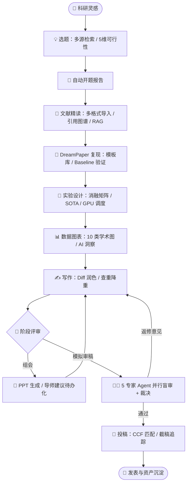
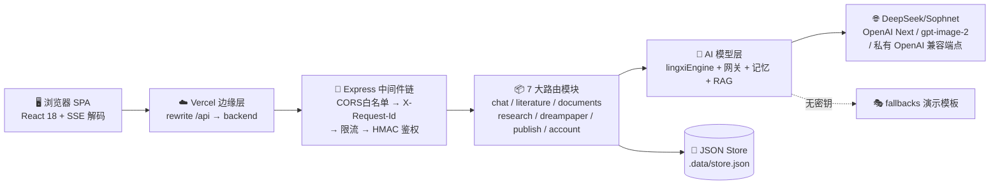

# 🧪 ScienceX · AI 科研工作台 —— 项目介绍文档

> **文档版本**：v1.0 ｜ **最后更新**：2026-10-04
> **文档定位**：本文档由 [`README.md`](README.md)（工程全景与部署）、[`ai.md`](ai.md)（AI 能力全景与真实对接状态）、[`docs/PRD.md`](docs/PRD.md)（产品需求与商业模式）三份文档合并分析生成，作为项目整体介绍的一站式参考。
> **一句话介绍**：ScienceX 是一站式覆盖「选题 → 文献 → 复现 → 实验 → 分析 → 写作 → 投稿 → 协作」科研全生命周期的 Agent 工作台，以智能体对话中枢为骨架，把科研中重复、琐碎、耗时的环节交给 AI，让研究者专注于创新本身。

---

## 一、产品概述

### 1.1 基本信息与核心主张

| 项目 | 内容 |
| :--- | :--- |
| **产品名称** | ScienceX · AI 科研工作台 |
| **产品形态** | Web 前后端分离（React 18 + Node.js）+ 移动端自适应网页，桌面优先、移动可用 |
| **核心主张** | **让科研更简单**：对话即工作台，工具即智能体 |
| **目标愿景** | 成为科研人员的「第二大脑」与「AI 科研助理团」，把论文产出周期平均缩短 50% 以上 |
| **在线 Demo** | https://ci.playe.top/ （演示账号 `demo@sciencex.cn` / `123456`） |

**核心差异化**：市面产品多为「单点工具」（检索、润色、画图各自为战）。ScienceX 以 **AI 对话工作台为中枢**，将 7 大科研工具与 2 大特色机制（组会汇报、多智能体专家评审团）串联为**可追溯、可协作、可复用**的闭环，各环节数据自动沉淀到「我的项目」，杜绝重复粘贴与信息孤岛。

**竞品格局结论**：通用大模型（ChatGPT/Claude/Kimi）有「脑」无「手」（缺专业科研工具），垂直工具（SciSpace/Elicit/Zotero）有「手」无「脑」（缺智能体编排与流程闭环）。ScienceX 的机会在于：**以专业 Agent 对话为中枢，把科研专用工具全部智能体化、流程化。**

### 1.2 目标用户与使用场景

| 用户角色 | 画像与诉求 | 典型场景 |
| :--- | :--- | :--- |
| 🎓 研究生 / 博士生 | 论文是毕业硬指标；快速选题、读懂英文文献、写出第一篇论文 | 开题前调研、组会前精读 5 篇论文、深夜改稿润色 |
| 🧑‍🏫 高校教师 / 科研人员 | 提高产出效率、管理课题组、追踪前沿 | 审稿、写基金、指导学生组会汇报 |
| 🏢 企业研究院研发人员 | 快速技术调研、复现 SOTA、写技术报告 | 技术选型、复现开源代码、产出白皮书 |
| 🧪 课题组 / 实验室团队 | 多人协作、知识沉淀困难 | 课题组 RAG 知识库、多人协同阅读讨论 |
| 🧑‍🎨 跨学科研究者 | 快速建立陌生领域认知 | 思维导图 + 专家评审快速摸清新方向 |

### 1.3 痛点与量化价值（目标）

| 科研阶段 | 真实痛点 | ScienceX 价值点 | 量化收益（目标） |
| :--- | :--- | :--- | :--- |
| 选题 | 不知从哪找方向、判断不了可行性 | 多源检索 + 选题推荐 + 可行性评估 + 一键开题 | 调研耗时 ↓ 60% |
| 读文献 | 英文阅读慢、读不懂、读了忘 | 翻译 + 思维导图 + 七段总结 + 引用图谱 | 单篇精读 ↓ 50% |
| 实验 | 参数乱记、GPU 抢不到、方案拍脑袋 | 参数看板 + GPU 可视化 + 消融方案生成 + SOTA 对标 | 方案效率 ↑ 40% |
| 数据分析 | 不会画图、看不懂结果 | 图表生成 + AI 图表解读与建议 | 出图+解读 ↓ 70% |
| 写作 | 表达不地道、怕查重、降重难 | 中英互译 + 学术润色 + AI 查重 + 保义降重 | 改稿轮次 ↓ 50% |
| 投稿 | 不了解期刊、错过 deadline | CCF 期刊大全 + 投稿倒计时 + 匹配推荐 | 投稿准备 ↓ 40% |
| 协作 | 组会汇报累、导师意见散乱 | PPT 一键生成 + 导师建议待办化 + 多智能体评审 | 组会准备 ↓ 70% |
| 知识 | 资料散落各处、无法复用 | 课题组空间 + RAG 知识库 | 知识复用率 ↑ 显著 |

---

## 二、核心功能全景（12 大模块）

```
🧪 ScienceX 科研工作台
├── 💬 AI 对话工作台 ─────── 8 类智能体模式切换 / ReAct 推演盒 / Plan 规划卡 / 三层记忆抽屉
├── 💡 选题灵感 ──────────── 多源文献检索 / 选题推荐 / 5维可行性雷达 / 一键开题报告
├── 📖 文献阅读 ──────────── PDF/Word/MD/CAJ 导入 / 三栏沉浸精读 / 划词翻译 / 3D引用图谱 / RAG问答
├── 🔁 论文复现 ──────────── DreamPaper 流水线 / 复现模板库 / 任务编排与质量评分
├── 🧫 实验设计 ──────────── 实验参数看板 / GPU 集群监控 / 消融矩阵自动生成 / SOTA 对标
├── 📊 数据图表 ──────────── FigureStudio 科研图工作台 / 10 类学术图表模板 / AI 趋势洞察
├── ✍️ 论文写作 ──────────── 双栏 Diff 润色 / 中英互译 / AI 查重 / 保义降重
├── 📮 投稿助手 ──────────── CCF 期刊大全 / 截稿倒计时 / 摘要契合度匹配 / 投稿追踪
├── 🎤 组会汇报 ──────────── PPTX 大纲生成 / 导师意见结构化提取为待办
├── 🧑‍⚖️ 专家评审团 ───────── 理论/方法/实验/写作/伦理 5 Agent 并行盲审 + 主审裁决报告
├── 📁 项目空间 ──────────── 课题组多租户协作 / 资产关联 / 私有 RAG 知识库沉淀
└── ⚙️ 账户中心 ─────────── 私有模型网关托管 / Token 用量明细 / 订阅计费 / 安全设置
```

### 2.1 科研全流程端到端工作流



**主流程一句话**：`建项 → 选题 → 读文献 → 复现 → 设计实验 → 分析数据 → 写论文 → 预审 → 投稿`，全流程数据自动回流到「我的项目」。

---

## 三、AI 能力体系（六段式全链路 + 真实网关对接）

### 3.1 AI 能力总览

ScienceX 的 AI 能力归纳为「**理解 → 检索 → 分析 → 生成 → 校验 → 协作**」六段式全链路，AI 不只是"写内容"，而是承担从意图理解到多智能体协作的全流程工作，并通过**可溯源（引用来源）+ 多智能体互检**保证可信度。

| 业务环节 | 核心 AI 能力 | 当前实现状态 |
| :--- | :--- | :--- |
| 对话中枢 | 8 类 Agent 编排、多轮记忆、工具调用、流式输出 | 真实网关（默认 GPT-6.1 Sol）+ 本地回退 |
| 选题灵感 | 多源检索、综述生成、选题推荐、可行性评估 | 演示模拟 |
| 文献阅读 | 版面解析、翻译、思维导图、七段总结、引用图谱、RAG 问答 | 演示 + 网关翻译/问答 |
| 实验设计 | 方案生成、SOTA 对标、参数看板 | 演示模拟 |
| 数据分析 / 科研图 | 两阶段 Design→Implement 配图、图表 spec 渲染 | **生图网关（gpt-image-2 真实位图）+ 矢量回退** |
| 论文写作 | 中英互译、学术润色、AI 查重、AI 降重 | 演示 + 网关 |
| 投稿助手 | 期刊匹配推荐、CCF 查询、倒计时 | 规则 + 演示 |
| 组会汇报 | PPT 大纲生成、导师建议结构化（ASR+LLM） | 演示模拟 |
| 专家评审团 | 多智能体（理论/方法/实验/写作/伦理）并行评审 + 主席汇总 | 演示模拟 |
| 知识管理 | RAG 知识库、语义检索、溯源问答 | 演示模拟 |

### 3.2 已真实对接的 AI 网关

模型路由统一走 `backend/src/lib/model-gateway.js`（OpenAI 兼容协议，模型中立，无密钥时回退演示模板保证永不空转）。

| 能力 | 实现 | 配置 |
| :--- | :--- | :--- |
| **DeepSeek V4.1 Flash 文本网关** | Sophnet 端点（`ai/config.js` / `ai/client.js`），对话/翻译/结构化输出 | `DEEPSEEK_*` |
| **OpenAI Next 统一文本网关** | `https://api.openai-next.com/v1`，同一套 OpenAI SDK 路由多厂商模型 | `OPENAINEXT_*` |
| **gpt-image-2 生图网关** | `backend/src/ai/image.js`，OpenAI 兼容 `/v1/images/generations`，科研图两阶段配图真实位图渲染（实测约 60–70s/图，失败自动降级矢量 SVG 并写入 `render_warning`） | `IMAGE_*` |

### 3.3 内置可选模型清单（`store.builtinModels`）

| 模型 ID | 名称 | 网关 / 厂商 | 定位标签 | 上下文 | 状态 |
| :--- | :--- | :--- | :--- | :--- | :--- |
| m-deepseek-flash | DeepSeek V4.1 Flash | Sophnet | 极速推理 · 默认推荐 | 64K | 已实测连通 |
| m-gpt-sol | GPT-6.1 Sol | OpenAI Next | 通用旗舰 · 深度推理 · **工作台默认选中** | 128K | 已实测连通 |
| m-claude | Claude Sonnet 5 | OpenAI Next | 长文写作 · 学术润色 | 200K | 已实测连通 |
| m-gemini | Gemini 3.8 Flash | OpenAI Next | 高速低价 · 超长上下文 | 1M | 已实测连通 |
| m-deepseek | DeepSeek V4 Pro | OpenAI Next | 代码 / 数学推理 | 128K | 已实测连通 |
| m-kimi | Kimi K2.5 | OpenAI Next | 中文长文档精读 | 256K | 已实测连通 |

> 另支持用户自定义 OpenAI 兼容模型（`store.customModels`），配置 `base_url + model_name + api_key`（密钥加密存储，强制 HTTPS + 内网地址拦截 SSRF 防护）。

### 3.4 关键 AI 运行时机制

1. **模型网关与优雅降级**：优先调用已配置的 OpenAI 兼容网关；无密钥或调用失败回退本地模板，Demo 永不空转；回退结果标注 `design_mode: simulated/fallback` 区分真实产出。
2. **SSE 结构化事件协议**：`start / memory_injected / plan / step_start / step_update / thought / tool_call / tool_result / delta / done / error`，前端分别驱动规划看板、思维链、工具卡片与打字机正文。
3. **8 大 Agent 编排模式（灵犀引擎）**：`general / react / plan_execute / codeact / mcp / skill / text2sql / structured`，每种模式对应独立推理管线与输出形态。
4. **课题组三层记忆**：会话内存 → 滚动摘要 → 长期科研事实库（按 `user_id`/`project_id` 隔离），跨会话注入提示词上下文。
5. **DreamPaper 两阶段配图流水线**：阶段一抽取模板结构/母版风格，阶段二按用户内容填充产出 JSON spec；Implement 阶段优先调用生图网关渲染真实位图，配合 stage-weight 进度映射与 Design Log 流式推送。
6. **提示词工程体系**：角色先行、结构化输出契约（JSON schema 禁 Markdown 围栏）、忠实性红线（用户文本是唯一内容来源，不杜撰数据/指标/引用）、防塌缩规则、JSON 修复与确定性降级、低温度确定性（temperature=0.2）。

---

## 四、技术架构与工程实现

### 4.1 项目规模速览（实测统计）

- **后端源码**：`backend/src` 约 5,200 行 JavaScript，含 7 个路由模块、12 个 AI 子模块、14 个基础库
- **前端源码**：`frontend/src` 约 16,600 行 TypeScript/TSX，含 13+ 业务页面、11 个通用组件
- **接口总量**：约 **70 个 REST/SSE 端点**，统一 `/api/v1` 前缀与响应契约
- **工程化**：5 个后端测试套件 + AI 质量回归评测（eval）+ GitHub Actions CI + Vercel/Docker 双部署路径 + MIT 开源协议

### 4.2 六层系统架构与请求链路



### 4.3 技术栈要点

| 层次 | 技术选型 | 亮点 |
| :--- | :--- | :--- |
| 前端 | React 18.3 + TS 5.5 + Vite 5.4 | Fetch ReadableStream SSE 解码器、自研 SVG 图表引擎 + 3D 力导向引用图谱、VirtualList 虚拟滚动、≤768px 移动适配 |
| 后端 | Node.js ≥18 + Express 4.19 | Zod 契约与 OpenAPI 文档**同源生成**、pino + AsyncLocalStorage 全链路追踪、EADDRINUSE 端口自适应联动前端代理 |
| 鉴权 | HMAC-SHA256 无状态签名令牌 | `sx1.<payload>.<signature>` 格式，任意实例离线验签，适配 Serverless 多实例；access 7 天 / refresh 30 天 |
| 限流 | rate-limiter-flexible | 对话 30 次/分钟、写作与文献 60 次/分钟，userId/IP 双维度 |
| 文档解析 | 零依赖解析引擎 + fast-xml-parser | PDF / Word OOXML / Markdown / **CAJ** 四格式，PDF 可选委托 PyMuPDF，多级降级 |
| AI 服务 | 灵犀引擎 + 模型网关 + 三层记忆 + RAG | 重试/降级容错（`ai/resilience.js`）、Token 用量统计入账、MCP 工具生态（@modelcontextprotocol/sdk） |
| 数据层 | JSON 文件 Store（`.data/store.json`） | 演示级持久化，异步落盘；目标态 PostgreSQL + Redis + pgvector |

### 4.4 三种数据流模式

| 流类型 | 协议 | 典型场景 | 机制 |
| :--- | :--- | :--- | :--- |
| **同步请求** | REST JSON | 登录、看板聚合、期刊检索 | 统一 `{code, message, data, timestamp}` 报文 |
| **流式生成** | SSE `text/event-stream` | 对话应答、文献 RAG 问答、润色 | 七类事件按序推送，前端逐 Token 渲染 |
| **异步任务** | 任务 ID + SSE 进度流 | 论文复现、评审团会诊、开题报告、两阶段配图 | `createTask` 编排，resultBuilder 完成后才置 `status='done'`（防轮询空结果竞态） |

---

## 五、商业模式

### 5.1 付费模式

| 套餐 | 目标用户 | 定价策略（示意） | 核心权益 |
| :--- | :--- | :--- | :--- |
| **免费版 Free** | 体验用户 | ¥0 | 基础对话、有限文献检索/翻译次数、1 个知识库 |
| **专业版 Pro** | 研究生/个人研究者 | ¥19.9–99 / 月 | 全工具解锁、多模型、RAG、图表生成、不限量润色 |
| **科研团队版 Team** | 课题组/实验室 | ¥199–999 / 月 | 多人协作、课题组空间、共享知识库、管理员权限 |
| **机构版 Enterprise** | 高校/企业研究院 | 按席位 / 年费（议价） | 私有化部署、数据隔离、SSO、专属模型、SLA |
| **增值服务** | 所有用户 | 按次 / 打包 | 高级查重、专家评审、深度综述、PPT 高级模板、算力租赁 |

**收入结构**：订阅制（主力）+ API/算力增值 + 企业私有化 + 生态分成（模型/插件）。

### 5.2 投资亮点

- **高景气赛道**：AI for Science 是确定性增长方向
- **全流程闭环**：单点工具易被替代，闭环平台迁移成本高、粘性强
- **开放生态**：多模型 + Skills + MCP，可扩展性强、抗模型迭代风险
- **数据飞轮**：用户越多 → 知识库/反馈越丰富 → 效果越好 → 留存越高
- **行业价值**：科研效率提升、科研公平（小团队获得顶级 AI 助理团）、课题组知识资产化传承、产业转化加速

---

## 六、快速开始与部署

### 6.1 本地开发启动（四条命令）

```bash
# ① 后端
cd backend && npm install && npm run dev
# ② 前端（另开终端）
cd frontend && npm install && npm run dev
# ③ 访问 http://localhost:5173 · 演示账号 demo@sciencex.cn / 123456
```

> 💡 **零配置端口联动**：后端端口冲突时自动递增探测并写入 `backend/.port`；Vite 启动时读取该文件配置代理，多人同机开发互不干扰。

### 6.2 关键环境变量（`backend/.env`，参考 `.env.example`）

| 变量名 | 说明 |
| :--- | :--- |
| `DEEPSEEK_BASE_URL` / `DEEPSEEK_API_KEY` / `DEEPSEEK_MODEL` | DeepSeek 文本网关（未配置则回退演示模板） |
| `OPENAINEXT_*` | OpenAI Next 统一文本网关（GPT-6.1 Sol / Claude / Gemini / Kimi 等） |
| `IMAGE_BASE_URL` / `IMAGE_API_KEY` / `IMAGE_MODEL` | 生图网关（gpt-image-2，科研图位图渲染） |
| `SCIENCEX_MASTER_KEY` | HMAC 签名主密钥，**生产必须 ≥32 字符且多实例一致** |
| `CORS_ORIGINS` | 跨域白名单（默认 `localhost:5173`） |

### 6.3 生产部署

- **路径 A · Vercel（推荐）**：根目录 `vercel.json` 声明双服务（frontend 构建 + backend API），`/api/*` 自动 rewrite；多实例务必统一 `SCIENCEX_MASTER_KEY`。
- **路径 B · Docker + Nginx（自托管）**：`node:20-alpine` 生产镜像；Nginx 反代需开启 `proxy_buffering off` + `proxy_read_timeout 300s` 保证 SSE 逐帧推送。
- **CI/CD**：GitHub Actions 自动执行「后端测试 → AI 质量回归 → 前端类型检查 → Lint → 构建」全链路验证。

### 6.4 API 概览

基础前缀 `/api/v1`，除认证接口外均需 `Authorization: Bearer sx1.<payload>.<signature>`；统一响应协议 `{code, message, data, request_id, timestamp}`，错误码分级 `400xx/401xx/500xx`；机器可读契约见 `GET /api/v1/openapi.json`（Zod 同源生成）。约 70 个端点覆盖：健康与文档、认证账户、模型网关、计费用量、对话中枢（SSE）、选题文献、任务流、文档研读（含 RAG 问答）、知识库、实验设计、数据图表、论文写作、论文复现、投稿协作、评审团。完整清单见 [README.md §六](README.md)。

---

## 七、现状边界与演进路线

### 7.1 能力边界（诚实声明）

项目为「**真实调用 + 演示回退**」双轨架构，能力分三级：

| 级别 | 范围 |
| :--- | :--- |
| ✅ **已真实对接** | 文本网关（DeepSeek-Flash + OpenAI Next 六模型，SSE 流式）、gpt-image-2 生图网关（科研图真实位图 + PNG 导出）、HMAC 鉴权、限流、多格式文档解析 |
| 🎭 **高保真演示** | 选题推荐、实验方案、GPU 监控、评审团打分等业务层 LLM 模拟流程（配置密钥后部分切换真实调用） |
| 🔮 **目标态（未交付）** | 真实 Embedding 向量检索（当前 RAG 为关键词评分）、代码沙箱真执行、PostgreSQL/Redis 数据层、Vision 视觉理解、Whisper ASR |

### 7.2 综合自评

| 评估维度 | 评级 | 依据 |
| :--- | :---: | :--- |
| 功能完备度 | ⭐⭐⭐⭐⭐ | 12 大模块 ~70 端点全链路打通，科研闭环真实可交互 |
| 架构设计 | ⭐⭐⭐⭐⭐ | 六层分层清晰；Zod 契约与 OpenAPI 同源；HMAC 无状态鉴权适配 Serverless |
| 工程规范 | ⭐⭐⭐⭐ | CI 五重卡口 + 覆盖率阈值 + AI 质量回归评测；中文语义化提交持续覆盖 |
| AI 深度 | ⭐⭐⭐⭐ | 8 类 Agent 模式 + 三层记忆 + 真实网关；部分工具执行与向量检索为高保真模拟 |
| 数据层成熟度 | ⭐⭐⭐ | JSON 文件持久化仅适合演示，目标 PostgreSQL+Redis 未交付 |
| 诚实性/文档 | ⭐⭐⭐⭐⭐ | 明确区分「已交付 / 演示实现 / 目标能力」三级边界，无过度宣传 |

### 7.3 未来演进路线

| 方向 | 演进目标 |
| :--- | :--- |
| 🧠 多模态深度解析 | 复杂 PDF 跨页多栏公式、三线表、高清图表的视觉多模态抽取与对齐（Vision） |
| 🔬 真实科研沙箱 | DreamPaper 模拟执行器升级为 Docker/Wasm 隔离沙箱，一键复现 Baseline 指标 |
| 🗄️ 生产数据层 | JSON Store → PostgreSQL 16 + Redis 7 + pgvector，落地真实 Embedding 与 Rerank |
| 🌐 混合云私有化 | 高校一键单机/集群部署，集成国产大模型（Qwen/GLM）与本地 GPU 调度 |
| 🤖 自主科研 Agent | 给定假设自主检索前沿、生成实验代码、调度算力验证、撰写结论报告的自动化科研范式 |

---

## 八、结语

ScienceX 的核心价值在于**闭环**与**咬合**：从开题直切文献、从文献直发复现、实验参数联动图表与写作、评审意见回流改稿——上下文全链路接力，彻底打破单点工具割裂。灵犀多智能体引擎（8 类编排 + 三层记忆 + 5 角色评审团）让 AI 成为可规划、可推理、可沉淀的研究协作者；HMAC 无状态鉴权、滑动窗口限流、Zod↔OpenAPI 契约同源、CI 质量卡口等生产级治理骨架，使演示原型具备了向生产平滑演进的全部接口契约。

> **ScienceX · 用 AI 打通从选题到发表的科研全流程，让每一个研究者都拥有一支随叫随到的「AI 科研助理团」。让科学探索更高效，让科研创新更专注。**
